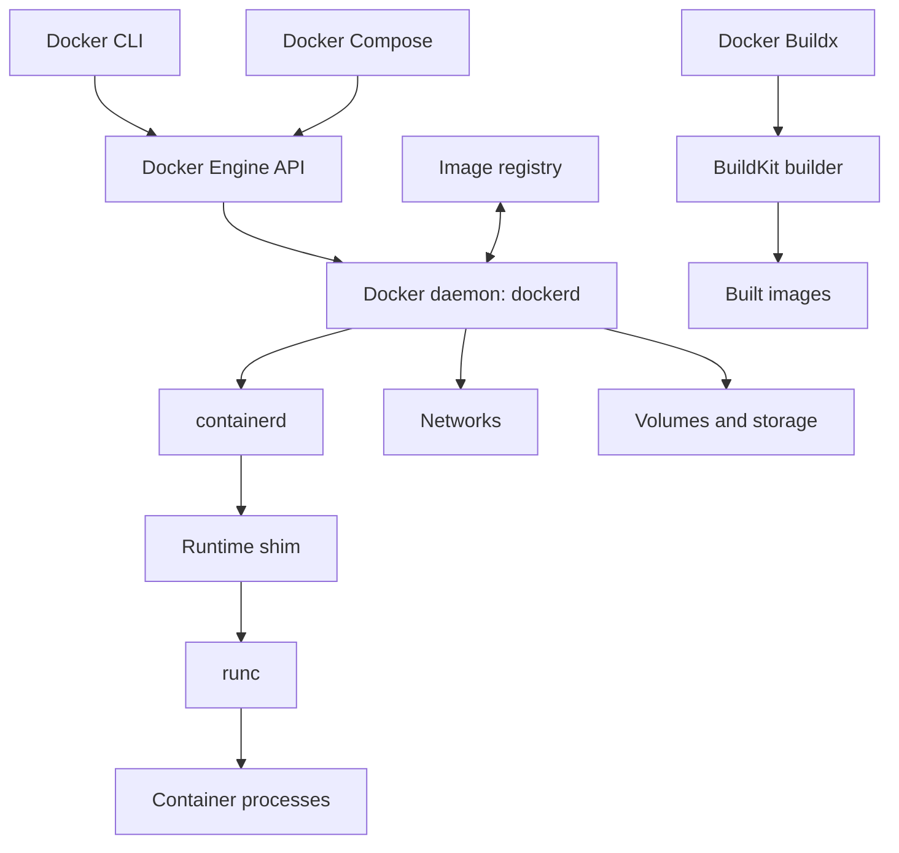

**A container is an isolated environment for running an application as one or more processes.** It packages the application’s files and dependencies while using the kernel of the operating system underneath it.

Docker provides tools to build those packages, distribute them, and run them. This guide covers container fundamentals, virtual machines, Docker architecture, networking, storage, image builds, Compose, practical commands, and troubleshooting.

| Term | What it means |
|---|---|
| **Container** | An isolated application environment |
| **Image** | The packaged files and configuration used to create containers |
| **Dockerfile** | Instructions for building an image |
| **Docker Engine** | The software that manages containers |
| **Docker Desktop** | A desktop application that provides a convenient local Docker environment |
| **Docker Hub** | An online service for storing and distributing images |
| **Volume** | Storage whose lifetime is independent of a container |
| **Network** | Connectivity between containers and other systems |
| **Docker Compose** | A way to define and manage an application made of multiple containers |

Most of this guide concerns **Linux containers**, which are widely used for server applications. Windows containers also exist, with different operating-system requirements.

# 1 What a container actually is

Suppose your application needs:

- Python.

- A specific set of Python libraries.

- Some operating-system libraries.

- Your application code.

- Configuration describing how to start it.

Installing these directly on every developer’s laptop and every server can produce inconsistent environments.

With containers, you build an image containing the application and its required user-space dependencies. You then create containers from that image.

A running container has:

- One or more processes.

- Its own view of the filesystem.

- An isolated view of processes and, normally, networking.

- Runtime configuration, such as environment variables.

- Optional resource limits and mounted storage.

The host operating system still executes those processes. A container does not normally boot a separate operating system with its own kernel. [Docker’s container introduction](https://docs.docker.com/get-started/docker-concepts/the-basics/what-is-a-container/)

Consider three applications:

```text
Container A           Container B           Container C
Python application    Node.js application   PostgreSQL
Python libraries      Node.js libraries     Database files
        \                    |                    /
         └──────── Shared Linux kernel ─────────┘
                             |
                          Hardware
```

The applications can use different language runtimes and libraries without installing those dependencies globally on the host.

However, “self-contained” has limits: a container still depends on a compatible kernel, CPU architecture, available resources, and any external services it uses.

# 2 Why containers are used

Containers solve several related problems.

| Problem | How containers help |
|---|---|
| “It works on my machine” | Developers and deployment systems can use the same image |
| Conflicting dependencies | Different applications get separate filesystems and dependency sets |
| Complicated setup | An application’s environment can be built from a version-controlled definition |
| Slow deployment | Prepared images can be downloaded and started |
| Inconsistent releases | A tested image can be promoted through environments |
| Scaling | Multiple containers can be created from the same image |
| Difficult cleanup | Disposable environments can be removed after use |

For example, a team can build an application image once, test it in continuous integration, and deploy that same image to staging and production.

Containers also help make applications independently deployable. Updating an API does not necessarily require updating its database or frontend.

They do **not** automatically fix application bugs, provide high availability, or guarantee identical behavior under different configuration and infrastructure. They make the application environment more reproducible. [Docker overview](https://docs.docker.com/get-started/docker-overview/)

# 3 Containers versus virtual machines

The fundamental difference is the **kernel boundary**.

A virtual machine gets virtual hardware and runs its own guest operating-system kernel. Conventional Linux containers share the kernel of their container host.

```text
Virtual machines                     Containers

Application A   Application B        Application A   Application B
Libraries       Libraries            Libraries       Libraries
Guest kernel A  Guest kernel B       Container isolation
        Hypervisor                   Shared host kernel
           Hardware                      Hardware
```

| Aspect | Container | Virtual machine |
|---|---|---|
| Isolation mechanism | Operating-system mechanisms | Virtualized hardware and hypervisor |
| Kernel | Shared with the container host | Each VM has its own |
| Package contents | Application and user-space dependencies | Typically a complete guest OS |
| Startup | Usually fast; starts application processes | Usually slower; may boot a guest OS |
| Overhead | Generally lower | Generally higher |
| OS flexibility | Requires a compatible kernel | Can run different guest operating systems |
| Isolation boundary | Shared kernel needs careful consideration | Separate kernel usually provides a stronger boundary |
| Typical purpose | Packaging and running applications | Provisioning independent machines |

These are general tendencies, not fixed performance guarantees.

Containers and VMs are often used together:

```text
Cloud server hardware
    → Virtual machine
        → Linux
            → Container runtime
                → Multiple application containers
```

The VM provides a machine boundary; containers provide application packaging and isolation. [Docker’s container and VM comparison](https://docs.docker.com/get-started/docker-concepts/the-basics/what-is-a-container/)

**An Ubuntu container does not boot an Ubuntu kernel.** It normally supplies Ubuntu user-space files while using the Linux kernel underneath it.

Likewise, Linux containers on a Mac require a Linux environment because macOS does not supply a Linux kernel.

## Why a VM on a Mac does not make each container a VM

In a typical Docker Desktop setup, one Linux VM hosts many containers. The VM has its own kernel; the containers share that kernel.

```text
Mac hardware and virtualization layer
  └── One Linux VM
        └── One Linux kernel shared by
              ├── PostgreSQL processes
              ├── Nginx processes
              ├── Redis processes
              └── Your application processes
```

Running each application in a separate VM would instead require separate guest kernels and guest operating-system environments. Container startup normally starts processes rather than booting a guest OS, although image downloads, application initialization, and starting an idle Desktop VM can still take time.

Think of a VM as a house with its own utilities, and containers as apartments sharing a building’s infrastructure. The apartment boundaries are useful, but the foundation—the kernel—is shared. This analogy explains resource sharing; it is not a precise security model.

## Observe the shared kernel

With Docker targeting the same ordinary Linux Engine, run:

```bash
docker run --rm alpine uname -r
docker run --rm debian:bookworm-slim uname -r
docker run --rm ubuntu:24.04 uname -r
```

These containers normally report the same kernel release. On Docker Desktop for Mac, that is the Linux VM’s kernel, regardless of the image’s distribution.

Run `uname -s` directly in a Mac terminal and it reports Darwin; run it inside a Linux container and it reports Linux. Separate VMs can also report identical release strings if they boot the same kernel version, so matching strings alone do not prove a shared kernel.

# 4 How Linux isolates containers

Several operating-system features work together.

## Namespaces

Namespaces control what a process can see.

| Namespace | What it isolates |
|---|---|
| PID | Process IDs and process visibility |
| Mount | Filesystems and mount points |
| Network | Network interfaces, routes, ports, and related state |
| UTS | Hostname and domain name |
| IPC | Certain interprocess communication resources |
| User | User and group ID mappings |

A process might appear as PID `1` inside a container while having a different PID on the host.

## Control groups

Control groups, or cgroups, control resource usage. They support accounting and constraints for resources such as CPU and memory.

## Security mechanisms

Security mechanisms constrain what processes can do. These include Linux capabilities, seccomp filters, and security systems such as AppArmor or SELinux.

These mechanisms provide useful isolation, but sharing a kernel means containers are not an absolute security boundary. Excessive privileges or dangerous host mounts can substantially weaken isolation. [Docker Engine security](https://docs.docker.com/engine/security/)

# 5 Images and containers are different

An **image** is an immutable package. A **container** is an instance created from it.

```text
Image: my-api:1.0
    ├── Container api-1
    ├── Container api-2
    └── Container api-3
```

The three containers use the same application image but can have different environment variables, networks, and storage.

Images contain filesystem layers and configuration. Layers allow images to share common content.

A container normally adds a writable layer above its image:

```text
Container writable layer
Application files
Application dependencies
Base image files
```

Changes made inside one container do not modify the original image or another container’s writable layer.

Stopping a container normally preserves its writable layer. **Removing the container deletes that layer.** Persistent application data therefore needs storage outside that layer.

## What built images contain

**Built images** are simply images produced by a successful build, not a separate image type. In the website exercise, `my-website:1.0` contains the Nginx base image's files and dependencies, your copied `index.html`, and inherited configuration describing how Nginx starts.

An image is a package, not a running website. `--load` makes a build result available locally; `docker image ls my-website` lists it. After changing a file copied into the image, rebuild and recreate the application container. Existing containers do not automatically adopt a newly built image, even when the image tag is reused.

Image references also matter:

```text
myteam/my-api:1.0
```

Here, `1.0` is a **tag**. Tags can be moved to point to different content.

A **digest**, such as `sha256:...`, identifies specific image content. Digest references are useful when exact reproducibility matters.

The tag `latest` is just a tag; it does not inherently mean “newest,” “stable,” or “best.” [Docker image concepts](https://docs.docker.com/get-started/docker-concepts/the-basics/what-is-an-image/)

## Layered filesystems and copy on write

Linux container storage commonly combines read-only image layers with a writable container layer using OverlayFS or a related snapshotting mechanism. The exact implementation depends on the storage driver or containerd snapshotter.

With copy-on-write storage, changing a file from a lower image layer may first copy it into the writable layer. Containers can share unchanged image content while maintaining separate changes. Layer sharing reduces duplicated storage; it does not mean every Dockerfile instruction adds a filesystem layer, nor that startup is always instantaneous.

Image storage and process isolation are separate responsibilities: a storage driver or snapshotter prepares the root filesystem, while the runtime configures the process environment and mounts. OverlayFS is not itself the mechanism that isolates process IDs or networking. [Docker storage](https://docs.docker.com/engine/storage/)

# 6 What Docker Desktop is

Docker Desktop is an application for developing with containers on macOS, Windows, and Linux. It provides a convenient installation, management interface, and integrations for the Docker toolchain.

Its capabilities include working with containers, images, builds, volumes, and development environments. It integrates tools such as the Docker CLI and Compose. [Docker Desktop documentation](https://docs.docker.com/desktop/)

For Linux containers on macOS, the conceptual arrangement is:

```text
macOS
  └── Docker Desktop
        └── Linux virtual machine
              └── Docker Engine
                    └── Linux containers
```

On Windows, Linux containers use a Linux environment, commonly through WSL 2. Docker Desktop for Linux also uses a VM.

This leads to a useful distinction:

- **Your laptop** is the physical host.

- **The Linux environment managed by Desktop** is the container host.

Docker Desktop handles networking between these environments, including forwarding published ports to your laptop. You generally access a local web container through a published port instead of its internal container IP. [Docker Desktop networking](https://docs.docker.com/desktop/features/networking/)

Docker Desktop is convenient for development. A Linux production server can run Docker Engine directly without Docker Desktop.

## Why macOS needs a Linux environment

macOS uses Apple’s XNU kernel, which combines Mach and BSD components. It is Unix-like, but it does not provide the Linux system-call interface and container mechanisms expected by ordinary Linux container workloads.

There are two separate compatibility issues:

- **Kernel features:** Linux containers rely on Linux isolation and resource-management facilities.

- **Executable compatibility:** Linux programs commonly use ELF executables and Linux system calls; native macOS programs use a different executable format and operating-system interface.

A Linux Nginx binary therefore cannot simply execute as a native macOS process. For local Docker Linux containers, macOS runs the virtualization and integration components; the guest Linux kernel runs the container processes.

Hardware virtualization and CPU instruction translation are different. An ARM Linux VM on Apple silicon can execute ARM instructions using hardware virtualization while still needing its own Linux kernel.

## What Docker Desktop manages on a Mac

Docker Desktop connects the native Mac development environment to its Linux guest.

| Responsibility | What happens |
|---|---|
| VM lifecycle | Desktop starts, stops, and manages a background Linux VM |
| CLI connection | The native Mac Docker client sends API requests to the engine inside the VM |
| Host file access | Shared Mac directories become available to containers through a host-to-VM sharing mechanism |
| Port forwarding | Published ports make container services reachable from the Mac |
| Resources | VM-level limits bound the pool available to the engine and its containers |
| Development tools | Desktop adds a dashboard, credential integration, optional Kubernetes, extensions, and other tooling |

The client’s socket path depends on installation and context; paths such as `~/.docker/run/docker.sock` and a `/var/run/docker.sock` compatibility link may be involved. Use `docker context inspect` to see the selected endpoint rather than assuming a path.

Mac virtualization is backend-dependent. Docker Desktop supports options including Apple’s Virtualization framework and Docker VMM; HyperKit is a legacy Intel option. Do not assume every installation uses Apple’s framework. [Docker virtual machine managers](https://docs.docker.com/desktop/features/vmm/)

VirtioFS is a current file-sharing option; availability of alternatives depends on the backend. Desktop’s CPU and memory settings control the VM-level resource pool, while container limits apply within that pool. Memory reclaim and idle behavior vary by backend and settings. [Docker Desktop settings](https://docs.docker.com/desktop/settings-and-maintenance/settings/)

## Apple silicon and image architecture

On an Apple silicon Mac, the local Linux guest normally uses ARM64. A `linux/arm64` image runs with a matching instruction set. A `linux/amd64` image needs a compatible emulation or translation mechanism unless it runs on a remote AMD64 machine.

Rosetta acceleration is available with supported Apple Virtualization framework configurations; it is not a universal default across backends. Docker VMM currently does not support Rosetta. Emulation performance depends on the workload and backend. [Mac backend compatibility](https://docs.docker.com/desktop/features/vmm/)

To select an AMD64 build target:

```bash
docker buildx build --platform linux/amd64 --load -t my-app:amd64 .
```

To publish both architectures under one tag:

```bash
docker buildx build \
  --platform linux/amd64,linux/arm64 \
  -t YOUR_USERNAME/my-app:1.0 \
  --push .
```

These commands assume a suitable Dockerfile, builder, and—for publishing—registry access. Multi-platform builds can use emulation, native build nodes, or cross-compilation. Emulation can be much slower for compilation and compression.

A multi-platform tag can reference distinct ARM64 and AMD64 image variants. The same tag across laptop and server therefore does not necessarily mean identical executable bytes. [Multi-platform builds](https://docs.docker.com/build/building/multi-platform/)

## Linux with Docker Engine installed directly

```text
Physical machine or cloud VM
  └── Linux kernel
        └── Docker Engine
              └── Linux container processes
```

No additional VM is required by Docker Engine in this arrangement. If Linux itself is running in a cloud VM, that underlying VM still exists.

- The CLI commonly talks to a local Unix socket.

- Bind mounts use paths in the same Linux kernel environment, avoiding Desktop’s host-to-guest file-sharing boundary.

- With bridge networking, virtual interfaces connect containers to bridges on the Linux host.

- Host process tools can see container processes because they are host processes.

- Resource use is subject to host capacity, cgroup configuration, and any container limits.

This removes an extra integration boundary; it does not guarantee that every workload is faster. Docker Desktop for Linux is a separate option and uses a VM.

Production Linux machines may use Docker Engine or other runtimes. Kubernetes nodes commonly use containerd or CRI-O directly; Docker Desktop and Docker Engine are not requirements for every container deployment.

## Windows running Linux containers through WSL 2

```text
Windows and its virtualization infrastructure
  └── WSL 2 utility VM
        └── Real Linux kernel
              └── Docker Desktop engine environment
                    └── Linux containers
```

WSL 2 supplies a real Linux kernel. Docker Desktop runs in its own `docker-desktop` WSL distribution. Other WSL 2 distributions, such as Ubuntu, can share the WSL kernel while remaining separate environments. Enabling WSL integration makes the Docker CLI available from a selected distribution.

WSL uses dynamic memory allocation; configuration and memory-reclaim behavior affect how much RAM returns to Windows. VM-level limits are configured through WSL settings, including `.wslconfig`. [Docker Desktop WSL 2 backend](https://docs.docker.com/desktop/features/wsl/)

For Linux container development, keep frequently accessed project files in the WSL Linux filesystem, such as `/home/you/project`, rather than a Windows-drive mount such as `/mnt/c/Users/you/project`. Crossing the Windows–Linux filesystem boundary can add substantial overhead, particularly for many small files and file watching. [WSL development best practices](https://docs.docker.com/desktop/features/wsl/best-practices/)

WSL 2 is a common Windows backend, not the only one. Docker Desktop also documents Hyper-V and other backend options, with availability depending on version, installation mode, and system requirements. [Windows virtualization backends](https://docs.docker.com/desktop/features/vmm/)

## Windows containers and their isolation modes

Windows containers run Windows applications, including workloads using IIS and .NET Framework. Their kernel requirements differ from Linux containers.

```text
Process isolation
Windows host kernel
  └── Windows container processes sharing that kernel

Hyper-V isolation
Windows host
  └── Isolated utility VM for a container
        └── Windows kernel
              └── Windows container processes
```

Process isolation shares the Windows host kernel. Hyper-V isolation provides an optimized VM and separate kernel, strengthening the isolation boundary and permitting certain supported host/image version combinations.

Windows compatibility rules depend on the host, base-image version, and isolation mode. Hyper-V isolation does not make every arbitrary version combination valid. [Microsoft container isolation modes](https://learn.microsoft.com/en-us/virtualization/windowscontainers/manage-containers/hyperv-container)

On supported Windows installations, Docker Desktop can switch between Linux-container and Windows-container engines. Do not assume one local engine runs both OS families simultaneously.

## Platform comparison

| Setup | Kernel used by ordinary containers | Additional local VM required by this setup |
|---|---|---|
| Linux with native Docker Engine | Linux host kernel | No |
| Docker Desktop for Linux | Desktop guest Linux kernel | Yes |
| Docker Desktop for Mac | Desktop guest Linux kernel | Yes |
| Windows with Docker Desktop WSL 2 | WSL guest Linux kernel | Yes |
| Windows containers with process isolation | Windows host kernel | No container-specific VM |
| Windows containers with Hyper-V isolation | Windows kernel in an isolated utility VM | Yes |

The governing rule is **kernel compatibility**, together with CPU architecture and runtime support. Docker Desktop on macOS runs Linux workloads locally; it does not provide native macOS containers or a local Windows kernel for Windows containers.

## Other Mac container tools

OrbStack, Colima, Rancher Desktop, and Podman Desktop are alternative ways to manage local Linux container environments on a Mac. Their local Linux workloads still need a Linux environment. Features, runtime compatibility, performance, and licensing differ; they are not all interchangeable replacements for every Docker workflow.

Apple’s `container` project uses lightweight Linux VMs and a per-container VM architecture, rather than the conventional shared-VM Docker Desktop model. It runs Linux containers, not macOS application containers. [Apple container project](https://github.com/apple/container)

Docker Desktop is free for qualifying personal, educational, non-commercial open-source, and small-business use; other uses can require a subscription. The applicable license and organization criteria determine eligibility. [Docker Desktop licensing](https://docs.docker.com/subscription-billing/desktop-license/)

# 7 What Docker Hub is

Docker Hub is a hosted image registry service.

It lets people and organizations store and distribute container images through repositories, including public and private repositories.

For example:

```bash
docker pull nginx:alpine
```

This downloads the referenced image. It does not start a container.

A more explicit form is:

```text
docker.io/library/nginx:alpine
```

| Part | Meaning |
|---|---|
| `docker.io` | Registry |
| `library` | Namespace used for Docker Official Images |
| `nginx` | Repository |
| `alpine` | Tag |

Publishing an image commonly looks like this:

```bash
docker login
docker tag my-api:1.0 YOUR_USERNAME/my-api:1.0
docker push YOUR_USERNAME/my-api:1.0
```

Replace `YOUR_USERNAME` with your actual namespace.

Docker Hub stores images; it does not automatically run your application. You still need a machine or platform that pulls and starts the image. Other registries can also store container images. [Docker Hub documentation](https://docs.docker.com/docker-hub/)

# 8 Docker architecture

Docker uses a client-server architecture.



This is a conceptual view of a typical Linux setup. Build backends and image-storage configuration can vary.

## Docker CLI

The `docker` command is a client. It translates your commands into requests to a Docker daemon.

CLI means **Command-Line Interface**: the `docker` program you use in Terminal. Think of it as a remote control for the Docker daemon. The CLI accepts your command, sends an API request, and prints the response. On a Mac using Docker Desktop, the native client connects to the engine in the Linux VM.

A typical command has an action followed by options and a target:

```bash
docker run -d --name web -p 127.0.0.1:8080:80 nginx:alpine
```

| Part | Meaning |
|---|---|
| `docker` | Invoke the Docker CLI |
| `run` | Create and start a new container |
| `-d` | Run in the background |
| `--name web` | Name this container `web` |
| `-p 127.0.0.1:8080:80` | Forward local Mac port 8080 to container port 80 |
| `nginx:alpine` | Select the Nginx image and its `alpine` tag |

Use `docker run --help` to see the options for this command. [Docker CLI reference](https://docs.docker.com/reference/cli/docker/)

## Docker daemon

The daemon, `dockerd`, manages Docker objects such as containers, images, networks, and volumes.

The client and daemon can run on the same machine or on different machines. [Docker architecture](https://docs.docker.com/get-started/docker-overview/)

### How dockerd coordinates Docker operations

The executable is **`dockerd`**, not `dockered`. A daemon is a service that runs in the background. The CLI accepts your command; dockerd exposes the Engine API and coordinates the requested work.

| Resource or operation | Daemon responsibility |
|---|---|
| Images | Coordinate pulls and manage local image references and storage |
| Containers | Coordinate creation, startup, shutdown, inspection, and removal |
| Networks | Manage connectivity and published ports |
| Volumes | Manage persistent storage |
| Logs | Configure logging and provide captured output |
| Lifecycle | Track events and apply configured restart policies |

For `docker run`, the daemon coordinates getting the image, creating the container and writable storage, configuring networking, and starting the application through the runtime stack. It delegates execution work to containerd and lower-level runtime components.

With Docker Desktop on a Mac, the CLI runs on macOS and the Linux daemon runs in Desktop's Linux VM. Open Docker Desktop to make that environment available; the website exercise does not require starting dockerd manually in Mac Terminal.

### Stopping is different from removing

For `docker stop my-linux`, Docker requests graceful shutdown using the configured stop signal, normally `SIGTERM`. If the main process fails to exit within the timeout, Docker forcibly terminates it. Some images choose a different stop signal.

Stopping preserves the container configuration and writable layer. Removing the container with `docker rm my-linux` deletes its writable layer; image content and deliberately managed persistent storage have separate lifetimes.

### Daemon and builder responsibilities

BuildKit constructs images. Dockerd coordinates Docker resources and application containers. The default `docker` build driver integrates BuildKit into the daemon; the `docker-container` driver runs it as a separate service in a container. Building an image does not start the website described by that image.

Useful commands from Mac Terminal:

| Command | What to inspect |
|---|---|
| `docker version` | Client and server versions |
| `docker info` | Engine configuration, counts, storage, logging, and runtimes |
| `docker context ls` | Configured engine connections and the selected context |
| `docker events` | Live container and other lifecycle events |

Press Control+C to stop watching events. If the CLI cannot connect to the daemon, check that Docker Desktop is running and the intended context is selected. [Docker architecture](https://docs.docker.com/get-started/docker-overview/), [Docker stop](https://docs.docker.com/reference/cli/docker/container/stop/)

## Docker Engine API

The API is the programmatic interface to the daemon. The CLI, SDKs, and other tools use it to perform operations.

Requests can travel over a local Unix socket, a Windows named pipe, or a configured remote connection.

Conceptually:

```text
docker ps
    → Request to list containers
        → Docker daemon
            → Response containing container information
```

On a typical local Linux Engine installation, you can query it directly:

```bash
curl --unix-socket /var/run/docker.sock \
  http://localhost/version
```

That socket path is not universal; Desktop and rootless configurations can differ.

API access is powerful because it permits container and host-related operations. It should be protected accordingly. [Docker Engine API](https://docs.docker.com/reference/api/engine/)

### How terminal commands become API requests

API means **Application Programming Interface**: the defined requests a program can make and the responses it can receive. The Engine API lets the CLI, Compose, SDKs, and other clients control Docker without implementing its internals.

These are simplified request paths; actual requests normally include an API version and may include query parameters or a body:

| CLI command | API request | Purpose |
|---|---|---|
| `docker ps` | `GET /containers/json` | List running containers |
| `docker images` | `GET /images/json` | List images |
| `docker stop my-linux` | `POST /containers/my-linux/stop` | Request a stop |
| `docker logs my-linux` | `GET /containers/my-linux/logs` with options | Retrieve captured output |

`GET` generally retrieves data; `POST` requests an action. One CLI command can make several requests: `docker run` can require image retrieval, container creation, and startup.

On a Mac, the local client connects through Docker Desktop to the daemon in its Linux VM. A Unix socket is a local communication endpoint, not a public website. Use `docker context inspect` to inspect the configured endpoint. Usually the CLI handles this communication for you. [Docker Engine API reference](https://docs.docker.com/reference/api/engine/)

# 9 What the container runtime does

“Container runtime” can refer to more than one layer.

## containerd

`containerd` manages core container lifecycle operations, including execution and supervision, and provides facilities for images, storage, and related tasks.

Docker Engine uses containerd as part of its runtime architecture. The exact division of image-storage responsibilities depends on configuration. [containerd project](https://containerd.io/)

Containerd, pronounced “container dee,” is itself a background service. It can manage image content and filesystem snapshots as well as execution; Docker's configured storage backend determines which image responsibilities it uses.

For `docker start my-linux`, dockerd asks containerd to coordinate execution of the existing container. Containerd communicates with the selected runtime shim rather than directly implementing every detail of Linux process isolation. It does not read your Compose file or serve your webpage. Containerd is also used outside Docker. [containerd](https://containerd.io/)

## runc

`runc` is a lower-level runtime that creates and starts containers according to the Open Container Initiative, or OCI, runtime specification.

It applies the configuration needed to launch a process in its isolated environment, using Linux mechanisms such as namespaces and cgroups. [runc project](https://github.com/opencontainers/runc)

For the typical Linux setup, runc takes a prepared root filesystem and OCI runtime configuration. It establishes or joins namespaces, applies configured cgroup and security settings, arranges mounts, and starts the requested process. Network provisioning and image preparation also involve other components.

For Nginx, that leads to the web-server master and worker processes running under the Linux kernel. The startup runc invocation normally exits after its work; later operations can invoke it again. You generally use Docker commands rather than calling runc directly. [Official runc documentation](https://github.com/opencontainers/runc)

## Runtime shim

A shim sits between containerd and container processes. It supports supervision and lifecycle handling without requiring a long-running `runc` process for each container.

The shim decouples container supervision from the short-lived low-level runtime. It does not by itself guarantee that containers survive a Docker daemon shutdown. Docker’s live-restore configuration governs supported cases where containers remain running while the daemon is unavailable. Restarting or shutting down the entire Desktop VM is a different event. [Docker live restore](https://docs.docker.com/engine/daemon/live-restore/)

The usual executable name is `containerd-shim-runc-v2`. The shim receives lifecycle requests from containerd, invokes runc, and supports continuing process supervision, exit reporting, and input/output plumbing after startup.

The shim is outside your application's container environment. It is not Nginx, a replacement kernel, or a web proxy. Depending on runtime configuration, a shim may handle one container or a group. [Runtime shim architecture](https://raw.githubusercontent.com/containerd/containerd/main/docs/runtime-v2.md)

| Component | Main role |
|---|---|
| Docker CLI | Accept your commands |
| Docker API | Define the interface for requests |
| `dockerd` | Coordinate Docker operations |
| `containerd` | Manage runtime lifecycle |
| Shim | Mediate between runtime management and container processes |
| `runc` | Create and start the isolated process environment |
| Linux kernel | Execute processes and enforce isolation |

**OCI** defines standards that help different tools agree on container image and runtime formats. Docker is one toolchain in a broader container ecosystem.

## Runtime lifecycle with Nginx

For a typical Linux Docker container using runc:

```text
Startup coordination
Docker CLI → dockerd → containerd → shim → runc → Nginx

After startup
containerd ↔ shim ↔ running Nginx processes
The startup runc invocation has finished.
```

The Linux kernel executes Nginx and enforces isolation. A running container includes the application's processes, filesystem, networking, and configured resource controls. A stopped container retains its stored configuration and writable layer without a running main application process.

On a Mac, dockerd, containerd, shims, runc, and Linux application processes run inside Docker Desktop's Linux VM. The CLI runs on macOS.

To observe an example, use available names and ports:

```bash
docker run -d --name runtime-demo \
  -p 127.0.0.1:8083:80 nginx:alpine
docker top runtime-demo
```

`docker top` shows application processes, such as Nginx's master and workers; it is not an inventory of the VM's management services.

Open an additional shell in the existing container:

```bash
docker exec -it runtime-demo sh
```

This starts another process, not another container or VM. Enter `exit` to leave the additional shell while Nginx continues. Stop and remove the demonstration from Mac Terminal:

```bash
docker stop runtime-demo
docker rm runtime-demo
```

[Docker top](https://docs.docker.com/reference/cli/docker/container/top/), [Container concepts](https://docs.docker.com/get-started/docker-concepts/the-basics/what-is-a-container/)

## Why separate runtime components exist

One component could perform all this work. The separate design trades more processes and interfaces for reuse, replaceable implementations, and clearer responsibilities.

| Reason | Benefit |
|---|---|
| Reuse | Docker and other systems can use containerd and OCI runtimes |
| Replaceability | A compatible runtime can provide different isolation without containerd implementing its internals |
| Different lifetimes | A short-lived startup tool can finish while the shim continues supervision |
| Maintenance | Each component can focus on and evolve its own responsibilities |

These components form a management path, not the path of every webpage request:

```text
Management: Docker → containerd → shim → runtime operations
Web traffic: Browser → published port → Nginx
```

The shim helps separate management-service lifetimes from workload lifetimes; it does not guarantee survival of any shutdown. See the live-restore qualification above. More components can also mean more troubleshooting points. [Containerd runtime design](https://raw.githubusercontent.com/containerd/containerd/main/docs/runtime-v2.md)

# 10 What happens when you run a container

Consider:

```bash
docker run -d \
  --name web \
  -p 127.0.0.1:8080:80 \
  nginx:alpine
```

Conceptually:

1. The CLI sends a request to Docker Engine.

2. Docker checks for the image locally and pulls it if required by the pull policy.

3. Docker creates a new container with its configuration and writable layer.

4. It configures networking and the published port.

5. The runtime starts the image’s configured process.

6. Docker returns the container ID because detached mode was requested.

| Option | Meaning |
|---|---|
| `run` | Create and start a new container |
| `-d` | Run detached from the terminal |
| `--name web` | Assign the name `web` |
| `-p 127.0.0.1:8080:80` | Forward local host port 8080 to container port 80 |
| `nginx:alpine` | Image reference |

Visit [localhost:8080](http://localhost:8080) after running it.

A container remains running while its main process remains alive. Detached mode does not keep an exited application alive. [Docker run reference](https://docs.docker.com/reference/cli/docker/container/run/)

## Follow a Mac request across the full stack

Suppose `$HOME/site` is an existing folder containing an `index.html` file. In a Mac terminal:

```bash
docker run -d \
  --name mac-site \
  -p 127.0.0.1:8081:80 \
  --mount type=bind,src="$HOME/site",dst=/usr/share/nginx/html,readonly \
  nginx:alpine
```

Port 8081 avoids conflicting with the earlier example on 8080.

1. The native Docker CLI sends a request through the selected Docker API endpoint.

2. Docker Desktop connects that endpoint to the engine in its Linux VM.

3. The engine obtains the image if required, selecting a compatible platform variant when available.

4. Desktop’s file-sharing integration makes the Mac folder accessible in the guest.

5. The storage and runtime components prepare the container filesystem, attach the shared directory, configure isolation, and start Nginx.

6. Docker networking and Desktop’s host-side forwarding make the published port accessible on Mac loopback.

7. A browser request to `http://localhost:8081` reaches Nginx, which reads files originating in the Mac folder.

```text
Mac browser → Desktop port forwarding → Linux guest network → Nginx
Mac folder  → Host-to-guest file sharing → Container mount
```

These are logical paths. The exact forwarding implementation need not be two identical port mappings on the host and guest.

The low-level runtime does not independently perform every step. Image storage, filesystem snapshotting, network setup, file sharing, and process creation are coordinated by different components. Once created, the workload is an ordinary Linux process from the guest kernel’s perspective.

# 11 Container networking

A container normally has its own networking environment: interfaces, addresses, routes, and listening ports.

That is why two separate containers can both listen on port `80`. They have separate network namespaces.

## Container ports and host ports

```text
Browser
    → Host port 8080
        → Container port 80
            → Web server
```

With `-p 127.0.0.1:8080:80`:

- `8080` is the port on your machine.

- `80` is the port inside the container.

- `127.0.0.1` restricts the publication to the host’s loopback address.

By contrast, `-p 8080:80` normally publishes on all host interfaces.

Publishing is generally needed when clients outside the container network must reach a service. Containers on the same suitable network can communicate directly using container ports.

### Container IP addresses and published host endpoints

**A container on a normal bridge network has its own IP address. Publishing a host port adds a forwarding rule; it does not replace that address.**

Example addresses below are illustrative:

```text
Mac endpoint                    Container endpoint
127.0.0.1:8081   → forwarding →  172.20.0.2:80

Docker bridge network
├── website-a: 172.20.0.2, port 80
└── website-b: 172.20.0.3, port 80
```

An IP address identifies a network interface; a port identifies an application endpoint at that address. Docker allocates addresses from the network's subnet. A container attached to multiple networks normally has an address on each. Special modes such as host or shared-container networking behave differently.

In `-p 127.0.0.1:8081:80`, the first address is the **host bind address**. Nginx must separately listen on container port 80, normally on an interface reachable through the container network rather than only container loopback.

Multiple containers can share the host's CPU, memory, and kernel while using different addresses. They can all listen on port 80 internally. Published host endpoints must have available combinations of address, port, and protocol; overlapping bindings produce the “port is already allocated” error.

Containers on the same user-defined network use destination names and container ports, for example `http://website-b:80`. They do not need to go through Mac port 8081. Being on the same host alone does not establish this shared-network connection.

On your Mac, Linux bridge networking lives inside Docker Desktop's Linux VM. Container IPs are normally not directly reachable from macOS; published ports provide Mac access. [Port publishing](https://docs.docker.com/engine/network/port-publishing/), [Desktop networking](https://docs.docker.com/desktop/features/networking/)

## Network drivers

| Driver | Purpose |
|---|---|
| `bridge` | Connect containers on one Docker host |
| `host` | Use the host’s networking environment |
| `none` | Disable ordinary external networking |
| `overlay` | Connect containers across hosts in Docker Swarm |
| `macvlan` | Give containers distinct identities on a physical network |
| `ipvlan` | Integrate container networking with underlying network infrastructure |

Driver availability and behavior depend on the platform. [Docker networking overview](https://docs.docker.com/engine/network/)

## User defined bridge networks

For a local application, create a network:

```bash
docker network create app-net
```

Then run two containers on it:

```bash
docker run -d \
  --name web-internal \
  --network app-net \
  nginx:alpine
```

```bash
docker run --rm \
  --network app-net \
  busybox \
  wget -qO- http://web-internal
```

The second container can resolve `web-internal` by name.

User-defined bridge networks provide automatic name resolution. The default bridge has different DNS behavior, so explicitly created networks are generally easier to use for applications.

Under typical Linux bridge networking, virtual interfaces connect containers to a software bridge. Docker also configures forwarding and address translation where needed. [Bridge networking](https://docs.docker.com/engine/network/drivers/bridge/)

### Two persistent containers on the same bridge

This exercise uses the `app-net` network above and different host ports from the earlier website. Run commands from Mac Terminal with Docker Desktop running. If `app-net` does not yet exist, create it explicitly as a bridge:

```bash
docker network create --driver bridge app-net
```

If it already exists from the preceding exercise, reuse it rather than running the create command again.

Start two Nginx containers, using available names and ports:

```bash
docker run -d \
  --name bridge-web-a \
  --network app-net \
  -p 127.0.0.1:8085:80 \
  nginx:alpine
```

```bash
docker run -d \
  --name bridge-web-b \
  --network app-net \
  -p 127.0.0.1:8086:80 \
  nginx:alpine
```

| Command part | Meaning |
|---|---|
| `docker run` | Create and start a new container |
| `-d` | Run in the background |
| `--name bridge-web-a` | Assign a name for management and network discovery |
| `--network app-net` | Attach to the shared bridge |
| `-p 127.0.0.1:8085:80` | Forward Mac loopback port 8085 to container port 80 |
| `nginx:alpine` | Use the existing Nginx image with the alpine tag |
| Trailing backslash | Continue the same shell command on the next line |

The command uses an existing image, downloading it if required; it does not build your custom website. With line continuation, put the backslash immediately before the newline, without trailing spaces.

```text
                 app-net bridge
Mac :8085 → bridge-web-a:80
                    ↕
Mac :8086 → bridge-web-b:80
```

Open [website A](http://localhost:8085) and [website B](http://localhost:8086). Both have their own IPs and listen on port 80. To test A reaching B directly:

```bash
docker exec bridge-web-a wget -q -O - http://bridge-web-b:80
```

`docker exec` runs wget inside A. `-q` hides progress; **`-O -` uses uppercase letter O** and prints the response to standard output. This is also written `-qO-`. Typing zero as `-q0-` causes `wget: unrecognized option: 0`. Seeing B's HTML confirms the connection, without using B's host port 8086.

Inspect network membership and addresses:

```bash
docker network inspect app-net
docker port bridge-web-a
docker port bridge-web-b
```

To attach an existing container, replace the placeholder with its actual name:

```bash
docker network connect app-net EXISTING_CONTAINER_NAME
```

Repeat for the other container. Names work through Docker's DNS on the user-defined network; prefer names over changing IP addresses. Two containers on the built-in default bridge do not have the same automatic name discovery.

To remove just these demonstration containers:

```bash
docker stop bridge-web-a bridge-web-b
docker rm bridge-web-a bridge-web-b
```

Remove `app-net` with `docker network rm app-net` only when it is no longer needed and no containers remain attached, including containers from the preceding example. [Bridge networks](https://docs.docker.com/engine/network/drivers/bridge/)

### Multiple services with Compose

Compose can create the shared network and containers together:

```yaml
services:
  website-a:
    image: nginx:alpine
    ports:
      - "127.0.0.1:8085:80"

  website-b:
    image: nginx:alpine
    ports:
      - "127.0.0.1:8086:80"
```

Use this as an alternative to the manual exercise; first stop containers that already own these host ports. Save it in a separate exercise folder as `compose.yaml`, then run `docker compose up -d` there.

`compose` reads the service configuration, `up` creates or updates and starts the resources, and `-d` leaves them running in the background. Compose normally creates a project-specific default bridge network; it does not automatically reuse the manually created `app-net`.

| Caller | Destination |
|---|---|
| Mac browser to website A | `http://localhost:8085` |
| Mac browser to website B | `http://localhost:8086` |
| Website A to website B | `http://website-b:80` |
| Website B to website A | `http://website-a:80` |

This supplies connectivity; configuring one application to call or proxy another remains an application setting. Inspect with `docker compose ps`; remove this exercise's resources with `docker compose down`. [Compose networking](https://docs.docker.com/compose/how-tos/networking/)

## The localhost trap

Inside a container, `localhost` normally means **that container itself**.

If your API and database run in different containers, this is usually wrong:

```text
database host = localhost
```

Use the database’s service or container name on their shared network instead.

For a container connecting to a service on your laptop, Docker Desktop provides `host.docker.internal`. Plain Linux Engine may need additional configuration. [Desktop networking](https://docs.docker.com/desktop/features/networking/)

| Request originates in | Meaning of localhost | Address for another destination |
|---|---|---|
| Mac browser or Terminal | Your Mac | Published port, such as `localhost:8081` |
| Website A container | Website A itself | `website-b:80` on a shared user-defined network |
| API container | API container itself | Database service name and its listening port |
| Container reaching a Mac service | Container itself | For Docker Desktop, `host.docker.internal:5000` for a reachable Mac service on port 5000 |

Normal bridge containers can usually initiate outbound internet connections through the host's networking. An internal network can restrict external connectivity. Different networks can separate frontend and backend services, and a container can join more than one.

Host networking is a special mode rather than ordinary bridge networking. On supported Docker Desktop versions it requires enablement and has Desktop-specific limitations. It is unnecessary for the exercises here. [Networking overview](https://docs.docker.com/engine/network/), [Host networking](https://docs.docker.com/engine/network/drivers/host/)

# 12 Container storage and volumes

There are four common places for container data:

| Storage | Who manages it | After container removal | Typical use |
|---|---|---|---|
| Writable container layer | Docker | Deleted with container | Disposable application changes |
| Named volume | Docker | Normally remains | Databases and persistent application data |
| Bind mount | You choose a host path | Host files remain | Source code and configuration |
| `tmpfs` mount | Memory-backed filesystem | Contents are temporary | Temporary runtime files |

A volume or mount appears at a normal path inside the container. The application reads and writes that path without needing to know how Docker attached it. [Docker storage](https://docs.docker.com/engine/storage/)

## Storage lifetime

Image files are read-only. Files created or changed inside a container normally go into its writable layer unless the destination is mounted storage. Stopping preserves that layer; removing the container deletes it. Rebuilding an image does not move an old container's writable files into a replacement.

| Action | Container writable layer | Named volume | Bind-mounted Mac files |
|---|---|---|---|
| Stop and start the same container | Preserved | Preserved | Preserved |
| Recreate a container | Old layer discarded | Preserved when the same volume is reused | Preserved |
| `docker compose down` | Deleted with the containers | Normally preserved | Preserved |
| `docker compose down -v` | Deleted with the containers | Declared nonexternal volumes removed | Preserved |

Anonymous volumes have generated names. They may survive ordinary container removal but are removed with their container when using `docker run --rm`; Compose does not automatically reconnect a later `up` to an old anonymous volume. Named volumes provide a deliberate reusable identity. External volumes are not removed by Compose, even with `down -v`. [Docker storage](https://docs.docker.com/engine/storage/), [Compose down](https://docs.docker.com/reference/cli/docker/compose/down/)

## Named volumes

```bash
docker volume create demo-data
```

Write a file using one container:

```bash
docker run --rm \
  --mount type=volume,src=demo-data,dst=/data \
  busybox \
  sh -c 'echo "This survives container removal" > /data/message.txt'
```

Read it from a new container:

```bash
docker run --rm \
  --mount type=volume,src=demo-data,dst=/data \
  busybox \
  cat /data/message.txt
```

Both temporary containers are removed, but the named volume persists.

A volume is not automatically a backup or replicated storage. Local volumes normally belong to one Docker host. Applications sharing a volume must support concurrent access safely.

On Docker Desktop, volume data usually lives inside its managed Linux environment. [Docker volumes](https://docs.docker.com/engine/storage/volumes/)

### Learning data exercise and terminal results

The following exercise uses `learning-data`, the volume tested in the terminal session. It is separate from the `demo-data` example above.

```bash
docker volume create learning-data
```

Docker can also create a missing named volume automatically when mounting it. The volume name identifies storage on the selected Docker Engine; it is not a folder relative to your Mac Terminal's current directory.

| Mount syntax | Meaning |
|---|---|
| `type=volume` | Use Docker-managed storage |
| `src=learning-data` | Select the volume named learning-data |
| `dst=/data` | Make it available at /data inside this container |
| `-v learning-data:/data` | Short form of the same basic mapping |

Keep all comma-separated mount fields in **one shell argument**, without spaces after commas:

```text
Correct: --mount type=volume,src=learning-data,dst=/data
Incorrect: --mount type=volume, src=learning-data, dst=/data
```

In the incorrect version, the shell splits the value at spaces. Docker receives an incomplete value ending in a comma and reports `invalid field '' must be a key=value pair`. This is a syntax failure before the intended container command runs.

**Inspect the volume through a temporary container.**

```bash
docker run --rm \
  --mount type=volume,src=learning-data,dst=/data \
  alpine ls -l /data
```

Docker starts Alpine, attaches the volume at `/data`, runs `ls -l`, and removes the temporary container after completion. It preserves the named volume.

The observed output `total 0` with no entries means no non-hidden files were listed; it does not prove that mounting failed. To include hidden files:

```bash
docker run --rm \
  --mount type=volume,src=learning-data,dst=/data \
  alpine ls -la /data
```

The subsequent `cat /data/message.txt` reported “No such file or directory” because that file did not exist yet. Check exact spelling: `message.txt` and `messages.txt` are different names.

**Write a file into the volume.**

```bash
docker run --rm \
  --mount type=volume,src=learning-data,dst=/data \
  alpine sh -c 'echo "Hello from a volume" > /data/message.txt'
```

`sh -c` runs the quoted command inside Alpine, including the `>` redirection. The quotes ensure your Mac shell does not perform that redirection itself. A successful write normally prints no output. The temporary container exits and is removed; the file remains in the volume.

Read the file from a new temporary container:

```bash
docker run --rm \
  --mount type=volume,src=learning-data,dst=/data \
  alpine cat /data/message.txt
```

**Attach an interactive container.**

```bash
docker run -it \
  --name volume-demo \
  --mount type=volume,src=learning-data,dst=/data \
  alpine sh
```

`-i` keeps input open, `-t` provides a terminal, and `sh` starts Alpine's shell. This command omits `--rm`, so the container remains after its shell exits. Use an available name; if `volume-demo` already exists, start it instead of creating it again.

At the container's `/ #` prompt:

```sh
cat /data/message.txt
```

The session returned:

```text
Hello from a volume
```

This confirms that **one container wrote the file and another container read the same named volume**. The `/data` directory shown by `ls /` is the mount point, not a separate copy of the volume.

To add another file:

```sh
echo "Written by volume-demo" > /data/another.txt
ls -l /data
exit
```

Exiting this main shell stops the container. From Mac Terminal, reopen it with:

```bash
docker start -ai volume-demo
```

Inspect storage using supported Docker commands:

```bash
docker volume ls
docker volume inspect learning-data
docker inspect volume-demo
```

The container inspection includes its `Mounts`. Removing `volume-demo` after stopping it preserves `learning-data`. Removing the volume itself with `docker volume rm learning-data`, once no container references it, deletes its stored data. [Volumes](https://docs.docker.com/engine/storage/volumes/)

## Bind mounts

A bind mount exposes a specific host path:

```bash
docker run --rm \
  --mount type=bind,src="$(pwd)",dst=/workspace \
  busybox \
  ls /workspace
```

This example uses a macOS/Linux shell. The current directory becomes `/workspace` inside the container.

Bind mounts are useful when editing source code on the host. Changes are visible through the mount.

Add `readonly` when the container only needs to read:

```text
--mount type=bind,src="$(pwd)",dst=/workspace,readonly
```

Mounting over a directory hides the files that were previously visible at that location in the image. Also, bind paths belong to the **daemon’s host**, which matters when using a remote Docker daemon. [Bind mounts](https://docs.docker.com/engine/storage/bind-mounts/)

### Editable website files versus image COPY

A Dockerfile `COPY` packages a snapshot of files into an image at build time. Editing the Mac source afterward requires rebuilding the image and recreating the container. A bind mount supplies files at runtime, so local edits become visible without an image rebuild.

To try a separate bind-mounted website, create `site/index.html` in your current Mac folder:

```bash
mkdir -p site
```

Then run with an available name and port:

```bash
docker run -d \
  --name storage-web \
  -p 127.0.0.1:8087:80 \
  --mount "type=bind,src=$(pwd)/site,dst=/usr/share/nginx/html,readonly" \
  nginx:alpine
```

`$(pwd)` expands to the current directory. Open [localhost:8087](http://localhost:8087), edit the Mac HTML file, and refresh. `readonly` prevents this container from modifying the mounted files; it does not prevent edits on the Mac.

An empty bind-mounted directory hides the image's default webpage. It does not merge with it. By contrast, Docker normally copies existing destination files into an empty volume on its initial mount; a nonempty mounted volume hides the image contents at that location. With `--mount type=bind`, the source normally must already exist. [Bind mounts](https://docs.docker.com/engine/storage/bind-mounts/), [Volume initialization](https://docs.docker.com/engine/storage/volumes/)

### Storage in Compose

This separate example demonstrates editable web files and persistent Redis data:

```yaml
services:
  web:
    image: nginx:alpine
    ports:
      - "127.0.0.1:8087:80"
    volumes:
      - ./site:/usr/share/nginx/html:ro

  cache:
    image: redis:7-alpine
    command: ["redis-server", "--appendonly", "yes"]
    volumes:
      - cache-data:/data

volumes:
  cache-data:
```

Use it as an alternative to the manual `storage-web` example; stop that container first if it owns port 8087. Place `site/index.html` beside this Compose file inside its `site` folder.

The service-level `volumes:` attaches storage. The top-level `volumes:` declares the named volume. `./site` is a bind-mounted project directory; `ro` means read-only. `cache-data` is Docker-managed storage, normally named with a Compose project prefix. The Redis command enables append-only persistence under `/data`.

The stock Nginx service does not use Redis; the services demonstrate storage independently. Start them with `docker compose up -d`. Ordinary `docker compose down` preserves the named volume; `down -v` deletes its stored Redis data. [Compose volumes](https://docs.docker.com/reference/compose-file/volumes/)

### Temporary memory backed storage

A tmpfs mount is for data that need not survive container shutdown:

```bash
docker run --rm -it \
  --mount type=tmpfs,dst=/scratch \
  alpine sh
```

Files under `/scratch` disappear when the container stops or restarts. This uses Linux memory-backed storage, inside the Linux VM on Docker Desktop. Depending on system configuration, tmpfs pages can be swapped to disk, so it is not a guarantee that bytes never reach disk. [Tmpfs mounts](https://docs.docker.com/engine/storage/tmpfs/)

## Where Docker Desktop data lives on a Mac

Docker Desktop uses a purpose-built Linux guest rather than a general-purpose Linux desktop installation. Its Linux VM disk is stored as a disk-image file on the Mac, commonly named `Docker.raw`; its location is configurable.

Local images, writable container layers, and local named volumes usually occupy space inside that disk image. **Bind-mounted Mac folders remain on the Mac filesystem**, and remote storage has its own location.

The disk image’s maximum or apparent size can differ from the physical space currently allocated. Removing Docker objects and reclaiming host disk space are related but not always instantaneous operations.

Inspect usage with:

```bash
docker system df
```

Use Docker’s supported cleanup and disk-management tools. `docker system prune` removes several categories of unused Docker data; it is not a harmless size-reporting command or a substitute for backups. Deleting the VM disk file directly can destroy stored images, containers, and volume data. [Docker Desktop Mac storage FAQ](https://docs.docker.com/desktop/troubleshoot-and-support/faqs/macfaqs/)

For I/O-heavy databases and caches on Desktop, named volumes avoid the Mac-folder sharing path. Bind mounts are useful for source code edited on the host. Performance depends on workload, sharing backend, and filesystem behavior. [Desktop file sharing](https://docs.docker.com/desktop/settings-and-maintenance/settings/)

### Lessons from navigating macOS and the Linux VM

The terminal session moved through three different filesystem contexts:

| Context | What the session demonstrated |
|---|---|
| Mac project folder | `ls` showed compose.yaml, Dockerfile, and index.html |
| Mac root and /var/lib | These were macOS directories, not the Linux daemon's volume directory |
| Linux VM namespaces entered with nsenter | /var/lib/docker/volumes showed learning-data and Docker metadata |
| Alpine container with a volume mount | /data/message.txt exposed the file through a supported mount |

Typing `/var` alone asks the shell to execute that path as a command. The observed `zsh: permission denied: /var` did not establish that the directory could not be entered; the subsequent `cd var` from `/` succeeded. Use `cd /var` to enter and `ls /var` to list.

The Mac's `/var/lib` listing contained `postfix`. That was not a failed Docker volume lookup: Docker's Linux filesystem is separate from macOS. Similarly, macOS `/Volumes` is not Docker's named-volume directory.

### What the nsenter inspection did

The session used this advanced diagnostic command:

```bash
docker run -it --rm --privileged --pid=host alpine \
  nsenter -t 1 -m -u -i -n sh
```

| Part | Effect |
|---|---|
| `docker run -it --rm` | Start a temporary interactive helper container |
| `--privileged` | Grant broad Linux privileges and device access |
| `--pid=host` | Share the daemon host's PID namespace; on this Mac, that host is the Linux VM |
| `alpine` | Supply the helper image; Docker downloaded it because it was not already local |
| `nsenter -t 1` | Select Linux process 1 as the namespace target |
| `-m -u -i -n` | Enter its mount, UTS, IPC, and network namespaces |
| `sh` | Start a shell in that environment |

The `-i` after `nsenter` means **IPC namespace**, whereas Docker's `-i` means interactive input. Namespace entry depends on privileges and Desktop configuration; this records what worked in this session, not a universal Desktop access procedure.

That shell exposed the Linux VM's mount view, where the session listed:

```text
/var/lib/docker/volumes
├── backingFsBlockDev
├── learning-data
└── metadata.db
```

The listing located the volume's internal storage entry; it did not create `message.txt`. Entering the volume directory with `cd` only changed the shell's working directory. The later successful `echo` command created the file.

Local volumes commonly store their content under a volume-specific `_data` directory, but paths and implementations can differ. Use `docker volume inspect learning-data` for the Engine's reported mount point and inspect content by mounting the volume in a container. The internal path is not an ordinary Mac Finder path.

This helper deliberately crosses container isolation boundaries with broad privileges. It is unnecessary for the normal volume exercise; do not edit Docker's internal metadata or manage volume data directly through these internal directories. Exiting the shell removed the temporary helper, not the VM or named volume. [Nsenter manual](https://man7.org/linux/man-pages/man1/nsenter.1.html), [Docker run options](https://docs.docker.com/reference/cli/docker/container/run/), [Supported volume access](https://docs.docker.com/engine/storage/volumes/)

# 13 Building images with a Dockerfile

A Dockerfile describes how to build an image.

Here is a small educational example using Python’s built-in HTTP server:

```dockerfile
FROM python:3.13-slim

WORKDIR /app

COPY index.html .

USER 10001:10001

EXPOSE 8000

CMD ["python", "-m", "http.server", "8000", "--bind", "0.0.0.0"]
```

Place an `index.html` beside the Dockerfile:

```html
<h1>Hello from a container</h1>
```

Then build and run:

```bash
docker build -t hello-web:1.0 .
```

```bash
docker run --rm \
  -p 127.0.0.1:8000:8000 \
  hello-web:1.0
```

The final `.` in the build command identifies the build context.

| Instruction | Purpose |
|---|---|
| `FROM` | Choose a base image |
| `WORKDIR` | Set the working directory |
| `COPY` | Copy files from the build context |
| `RUN` | Execute a command during image construction |
| `ENV` | Set an environment-variable default |
| `ARG` | Define a build-time argument |
| `USER` | Set the user for later execution |
| `EXPOSE` | Document an intended listening port |
| `CMD` | Supply a default startup command or arguments |
| `ENTRYPOINT` | Define the main executable |

`EXPOSE` does not publish a port; use `-p` or Compose `ports`.

`RUN` happens during a build. `CMD` describes what happens when a container starts. [Dockerfile reference](https://docs.docker.com/reference/dockerfile/)

Python’s built-in server is suitable for this demonstration, rather than a complete production web-server setup.

# 14 BuildKit Buildx caching and smaller images

BuildKit is Docker’s modern build backend. Buildx is the CLI interface commonly used to access its capabilities.

BuildKit supports caching, efficient build execution, and features such as secret mounts.

For an application with dependencies, this order is useful:

```dockerfile
COPY requirements.txt .
RUN pip install --no-cache-dir -r requirements.txt
COPY . .
```

Application source can change without necessarily invalidating the cached dependency-installation step.

Use `.dockerignore` to exclude unnecessary files from the build context:

```text
.git
.env
.venv
__pycache__
```

Do not bake credentials into image layers or use ordinary build arguments as a secret-storage mechanism. [BuildKit documentation](https://docs.docker.com/build/buildkit/)

A **multi-stage build** uses one stage to compile or prepare the application, then copies only the required output into a smaller runtime stage.

```text
Build stage
  Compiler + source + build dependencies
             ↓
Runtime stage
  Application binary + required runtime files
```

This can reduce image size and keep build tools out of the deployed image. [Multi-stage builds](https://docs.docker.com/build/building/multi-stage/)

## Docker Buildx and BuildKit

**Buildx is the command-line client for running and managing builds. BuildKit is the backend that executes them.** A Dockerfile describes what to build; the builder carries out those instructions. Docker Desktop includes both tools, and modern `docker build` uses Buildx under the hood. [Docker build overview](https://docs.docker.com/build/concepts/overview/)

| Component | Role |
|---|---|
| Dockerfile | Instructions for constructing the image |
| Buildx | Accept build options, choose a builder, and manage build requests |
| BuildKit | Execute build steps and reuse cached work |
| Docker Engine | Store images and run application containers |
| Compose | Define application services and coordinate their builds and containers |

```text
Dockerfile + application files
            ↓
Buildx sends a build request
            ↓
BuildKit executes the build
            ↓
Container image
            ↓
Docker Engine runs an application container
```

## Build the website directly with Buildx

For the Nginx exercise in section 15, keep these files in the same folder:

```text
container1/
├── Dockerfile
├── index.html
└── compose.yaml
```

The Dockerfile is:

```dockerfile
FROM nginx:alpine
COPY index.html /usr/share/nginx/html/index.html
```

From this folder in your Mac Terminal, run:

```bash
docker buildx build --load -t my-website:1.0 .
```

**This creates an image and loads it into your local Docker image store. It does not start the website or upload the image.**

| Part | Meaning |
|---|---|
| `docker buildx build` | Start a build using BuildKit |
| `--load` | Load the resulting image into the local Docker image store |
| `-t my-website:1.0` | Give the image the name `my-website` and tag `1.0` |
| `.` | Use the current folder as the build context; look for its `Dockerfile` by default |

The build context supplies files that instructions such as `COPY` can use. Here, BuildKit starts from `nginx:alpine` and copies your `index.html` into Nginx's web directory:

```text
Nginx base image + your index.html → my-website:1.0
```

The `1.0` tag is a label you choose. Rebuilding with the same tag updates that tag to the new result.

Check that the image exists:

```bash
docker image ls my-website
```

To run it independently of Compose, use a new container name and an available host port:

```bash
docker run -d --name my-website-demo \
  -p 127.0.0.1:8082:80 my-website:1.0
```

Open [localhost:8082](http://localhost:8082). This demonstration container is managed separately from the Compose service on port 8081. If the name or port is already in use, choose another or stop the relevant existing container. [Buildx build reference](https://docs.docker.com/reference/cli/docker/buildx/build/)

## Builders and drivers

A **builder** is the BuildKit backend used to perform your builds. Docker provides a default builder; Buildx can also manage dedicated builders or connect to remote ones.

```bash
docker buildx version
docker buildx ls
docker buildx inspect --bootstrap
```

These commands show the Buildx version, available builders, and details of the selected builder. The asterisk in `docker buildx ls` marks the selected builder. `--bootstrap` starts it if necessary.

A **driver** determines how BuildKit is provided:

| Driver | Where BuildKit runs |
|---|---|
| `docker` | Integrated into Docker Engine |
| `docker-container` | In a dedicated container |
| `kubernetes` | In pods in a Kubernetes cluster |
| `remote` | In an independently managed BuildKit service |

The default builder is enough for the basic website exercise. To experiment with a separate builder:

```bash
docker buildx create \
  --name learning-builder \
  --driver docker-container \
  --use
docker buildx inspect --bootstrap
```

`--use` selects the new builder for subsequent Buildx commands. The BuildKit container performs builds; it is separate from your running website container.

`docker buildx build` honors the selected Buildx builder. For compatibility, `docker build` defaults to the Engine's default builder unless you override it using `--builder` or `BUILDX_BUILDER`. [Builders and selection](https://docs.docker.com/build/builders/)

## Where the build result goes

| Option | Destination |
|---|---|
| `--load` | Your local Docker image store, ready for local use |
| `--push` | An image registry such as Docker Hub |
| `--output type=local,dest=./output` | The final build filesystem exported as local files |

The `docker` driver automatically loads image results locally. A `docker-container` builder normally needs an explicit output such as `--load` or `--push`; otherwise, a successful result may remain only in its build cache and not appear in `docker image ls`.

Use `--load` for the single-platform local website exercise. Loading multiple platforms locally depends on image-store and exporter support; publishing with `--push` is a straightforward distribution workflow. [Build drivers](https://docs.docker.com/build/builders/drivers/)

## Build for different CPU architectures

Apple silicon Linux environments typically use `linux/arm64`. Intel and AMD Linux machines typically use `linux/amd64`. The target remains Linux even when you enter the build command on macOS.

To build an image for an Intel or AMD Linux target:

```bash
docker buildx build \
  --platform linux/amd64 \
  --load \
  -t my-website:amd64 .
```

To publish both architectures under one tag, replace `YOUR_DOCKERHUB_USERNAME` with your actual account name and ensure you can push to that repository:

```bash
docker login
docker buildx build \
  --platform linux/amd64,linux/arm64 \
  -t YOUR_DOCKERHUB_USERNAME/my-website:1.0 \
  --push .
```

This uploads platform-specific variants and an index pointing to them. Docker selects the appropriate variant when pulling for a target platform. Your base image and application dependencies must support each requested platform.

Docker Desktop supports emulation for foreign architectures, although compute-intensive builds can be slower. Alternatives include native build nodes for each architecture and cross-compilation. Multi-platform builds produce different platform variants; multi-stage builds organize stages within a Dockerfile. [Multi-platform builds](https://docs.docker.com/build/building/multi-platform/)

## Buildx cache controls

BuildKit's caching described earlier also applies to direct Buildx builds. In the Nginx example, changing `index.html` updates the copied content while allowing unchanged base-image content to be reused.

To rebuild without reusing cached build steps:

```bash
docker buildx build --no-cache --load -t my-website:1.0 .
```

To also check for newer base images:

```bash
docker buildx build --pull --no-cache --load -t my-website:1.0 .
```

`--no-cache` controls reuse of build steps; `--pull` checks referenced images for updates. For readable build output, add `--progress=plain`. [Build options](https://docs.docker.com/reference/cli/docker/buildx/build/)

For automated builds across machines, `--cache-to` exports cache and `--cache-from` imports it. An external cache can preserve useful work when the next build uses a fresh environment. [Cache storage backends](https://docs.docker.com/build/cache/backends/)

# 15 Docker Compose

Docker Compose defines and manages an application with one or more services using a YAML configuration file.

Instead of manually remembering many `docker run` options, you save the configuration in a file such as `compose.yaml`.

This example demonstrates networking, a published port, and persistent storage:

```yaml
services:
  web:
    image: nginx:alpine
    ports:
      - "127.0.0.1:8080:80"

  cache:
    image: redis:7-alpine
    command: ["redis-server", "--appendonly", "yes"]
    volumes:
      - cache-data:/data

volumes:
  cache-data:
```

Run it with:

```bash
docker compose up -d
```

Compose creates a project network. Services can use names such as `cache` to find one another. An application added to this network could reach Redis at `cache:6379`.

The stock Nginx service in this example does not use Redis; the two services demonstrate the infrastructure.

```bash
docker compose ps
docker compose logs -f
docker compose down
```

`down` normally removes the project’s containers and networks while preserving named volumes. Adding `-v` removes the declared named volumes too. [Docker Compose](https://docs.docker.com/compose/)

Startup order and readiness are different. A started database may still be initializing. Compose can wait for a dependency’s health check using `depends_on` with `condition: service_healthy`; applications should also handle temporary connection failures. [Compose startup order](https://docs.docker.com/compose/how-tos/startup-order/)

## Compose fields and container names

Compose can manage a single service or several services together. Its name is **Docker Compose**, and the command is `docker compose`.

The earlier example uses ready-made images. A service that builds its own image instead can look like this:

```yaml
services:
  web:
    build: .
    image: my-website:1.0
    ports:
      - "127.0.0.1:8081:80"
```

| Field | Meaning |
|---|---|
| `services:` | Lists the application's components, such as a website, API, or database |
| `web:` | A service name you choose; it could instead be `website` |
| `build: .` | Use this directory as the build context and look for its `Dockerfile`; the path is relative to the Compose file |
| `image: my-website:1.0` | Name and tag the image produced by the build; without `build:`, it identifies an existing image to use |
| `ports:` | A list of mappings between host ports and container ports |

In `127.0.0.1:8081:80`, `127.0.0.1` binds the published port to your Mac's loopback interface, `8081` is the port on your Mac, and `80` is the port inside the container. Open [localhost:8081](http://localhost:8081) to reach Nginx.

Indentation expresses nesting: `web` belongs under `services`, and `build`, `image`, and `ports` belong under `web`. Use ordinary spaces, not tabs. The space after the dash in the port mapping makes it a YAML list item.

By default, a folder named `container1` gives the project its name. A container named `container1-web-1` means project `container1`, service `web`, instance `1`. The network `container1_default` is the project's default network. Project names can be overridden.

An existing container such as `my-linux`, created separately with `docker run`, does not automatically become a Compose service.

## Building images versus starting containers

**An image is the packaged application. A container is an instance created from an image.**

| Command | Effect |
|---|---|
| `docker compose config` | Validate and display the resolved configuration |
| `docker compose build` | Build images for services with a `build:` setting; does not start the application containers |
| `docker compose up -d` | Create or recreate and start service containers in the background; obtain images by pulling or building according to configuration and policy |
| `docker compose up -d --build` | Explicitly build images before starting the service containers |
| `docker compose ps` | Show the project's service containers |
| `docker compose logs -f` | Follow the project's container logs |
| `docker compose stop` | Stop the service containers without removing them |
| `docker compose start` | Start existing stopped service containers |
| `docker compose down` | Remove the project's service containers and networks; named volumes are normally preserved |

With only `image: nginx:alpine`, Compose uses that existing image and downloads it when required by its pull policy. There are no build instructions, so `docker compose build` reports **No services to build**.

With both `build:` and `image:`, Compose can build from your files and tag the result with your chosen image name. Pull and build behavior also depends on `pull_policy`; use the explicit build commands above for this exercise. [Compose build specification](https://docs.docker.com/reference/compose-file/build/), [Compose up](https://docs.docker.com/reference/cli/docker/compose/up/)

## Compose build versus Buildx build

**Both build images. Compose reads service build settings from a YAML file; Buildx takes a build context and explicit command-line options.** Buildx does not read `compose.yaml`.

| Aspect | `docker compose build` | `docker buildx build` |
|---|---|---|
| Configuration | Service settings in `compose.yaml`, plus referenced Dockerfiles | Command-line options and a Dockerfile |
| Scope | All buildable services, or named services | The specified build context and target |
| Image name | Service `image:` setting or a generated name | Explicit `-t` option |
| Common use | Build the components of a Compose application together | Direct control of an individual build, builder, platforms, cache, and output |
| Starts application containers | No | No |

For the website configuration below:

```yaml
services:
  web:
    build: .
    image: my-website:1.0
    ports:
      - "127.0.0.1:8081:80"
```

Build just the `web` service with:

```bash
docker compose build web
```

Compose gets the context from `build: .` and image name from `image: my-website:1.0`. The `ports:` mapping is used when starting the service container, not when constructing the image.

A comparable direct build is:

```bash
docker buildx build --load -t my-website:1.0 .
```

This explicitly supplies the context, name, and local output. It does not apply the Compose service's runtime settings or start its container.

Both are part of the BuildKit build ecosystem. Features such as multiple target platforms and caching can also be configured through Compose; they are not exclusive to direct Buildx commands.

For the website exercise, use `docker compose build` to build the configured service, or `docker compose up -d --build` to build and start it together. Use Buildx directly to control a build independently of the Compose application. [Compose build](https://docs.docker.com/reference/cli/docker/compose/build/), [Buildx build](https://docs.docker.com/reference/cli/docker/buildx/build/)

## Build a custom Nginx website on a Mac

Open Docker Desktop. Create a separate folder for this exercise and use Terminal from that folder. Keep these three files together:

```text
container1/
├── compose.yaml
├── Dockerfile
└── index.html
```

**1. Create `index.html`.**

```html
<!DOCTYPE html>
<html>
  <head>
    <title>My Docker Website</title>
  </head>
  <body>
    <h1>Hello from my custom Docker image!</h1>
  </body>
</html>
```

**2. Create `Dockerfile`, with that exact name and no extension.**

```dockerfile
FROM nginx:alpine
COPY index.html /usr/share/nginx/html/index.html
```

`FROM` selects the Nginx base image. `COPY` adds your webpage to the directory Nginx serves. This exercise uses Nginx; the Python example in section 13 is a separate alternative.

**3. Create `compose.yaml`.**

```yaml
services:
  web:
    build: .
    image: my-website:1.0
    ports:
      - "127.0.0.1:8081:80"
```

Port 8081 avoids the earlier example's port 8080, provided 8081 is free. Copy only the code inside each block, without the surrounding triple backticks.

**4. Validate the configuration and build the image.**

```bash
docker compose config
docker compose build
docker image ls my-website
```

Run these from the folder containing `compose.yaml`. The last command lets you confirm that `my-website:1.0` exists locally.

**5. Start the website.**

```bash
docker compose up -d
docker compose ps
```

Open [localhost:8081](http://localhost:8081). You should see the message from your HTML file.

**6. After editing `index.html` or the Dockerfile, rebuild and update the container.**

```bash
docker compose up -d --build
```

This example copies the webpage into the image, so changing the local HTML file requires rebuilding. Changing only the published host port requires `docker compose up -d`, without rebuilding the image.

```text
Dockerfile + index.html
          ↓ docker compose build
     my-website:1.0 image
          ↓ docker compose up -d
     Running web container
```

[Docker Compose build reference](https://docs.docker.com/reference/cli/docker/compose/build/)

# 16 Common Docker commands

The following are reference examples. Commands referring to `web` assume that container exists.

| Command | Purpose |
|---|---|
| `docker version` | Show client and server versions |
| `docker info` | Show Engine information |
| `docker context ls` | List configured Docker endpoints |
| `docker pull nginx:alpine` | Download an image |
| `docker images` | List local images |
| `docker build -t my-app:1.0 .` | Build an image |
| `docker ps` | List running containers |
| `docker ps -a` | Include stopped containers |
| `docker stop web` | Request container shutdown |
| `docker start web` | Start an existing stopped container |
| `docker restart web` | Restart an existing container |
| `docker logs -f web` | Follow container logs |
| `docker exec -it web sh` | Start a shell inside a running container |
| `docker inspect web` | Show detailed configuration and state |
| `docker stats` | Show resource usage |
| `docker port web` | Show published ports |
| `docker rm web` | Remove a stopped container |
| `docker image rm my-app:1.0` | Remove an image reference |
| `docker network ls` | List networks |
| `docker volume ls` | List volumes |
| `docker system df` | Show Docker disk usage |

Some minimal images do not contain a shell, so `docker exec ... sh` is not universally available. [Docker CLI reference](https://docs.docker.com/reference/cli/docker/)

Frequently used `run` options include:

```bash
docker run -d \
  --name my-app \
  --network app-net \
  -p 127.0.0.1:8080:8080 \
  -e APP_MODE=development \
  --mount type=volume,src=app-data,dst=/data \
  my-app:1.0
```

Here, `-e` supplies an environment variable, `--network` selects a network, and `--mount` attaches storage.

Use `--rm` for disposable containers and `-it` for interactive terminal sessions. [Run options](https://docs.docker.com/reference/cli/docker/container/run/)

## Mac Terminal and container shells

With Docker Desktop running, enter Docker management commands at your **Mac's Terminal prompt**. For example, to start the ready-made Nginx image independently of Compose:

```bash
docker run -d --name web -p 127.0.0.1:8080:80 nginx:alpine
```

Open [localhost:8080](http://localhost:8080). Use the commands in the table above to view, stop, start, or remove this `web` container. If `web` already exists, start it with `docker start web` or choose another name for a new container. If the Mac reports `docker: command not found`, install or check [Docker Desktop for Mac](https://docs.docker.com/desktop/setup/install/mac-install/).

A prompt such as `root@4261e4b42d6b:/#` usually means you are inside a container's Linux shell. An ordinary Ubuntu image does not include the Docker CLI. Entering `docker stop my-linux` there can therefore produce `bash: docker: command not found`.

For an existing container named `my-linux`, run these management commands from the Mac:

```bash
docker stop my-linux
docker ps -a
```

To start that stopped container and attach to its original interactive shell, assuming it was created with an interactive Bash terminal:

```bash
docker start -ai my-linux
```

To open an additional Bash shell in an already-running Ubuntu container:

```bash
docker exec -it my-linux bash
```

Exiting an additional `exec` shell ends that shell. Exiting Bash when it is the container's main process stops the container.

## Why container logs can look like commands running again

`docker logs my-linux` retrieves captured output; it does not enter the container or execute the commands shown. Normally Docker captures the main process's standard output and standard error through its configured logging system. It does not automatically read every log file inside the container.

If the container's main process is an interactive Bash shell with a terminal, captured output can include prompts, echoed commands, and their results. For example:

```text
root@4261e4b42d6b:/# apt update
Get:1 ...
Fetched 26.9 MB ...
2 packages can be upgraded.
root@4261e4b42d6b:/# docker stop my-linux
bash: docker: command not found
```

Seeing this after requesting logs is a transcript of earlier activity. Docker is not running `apt update` again or attempting the stop command again. Repeating `docker logs` retrieves the retained history again. A visible `root@...` prompt inside that output is recorded text.

`apt update` refreshes the package index; “2 packages can be upgraded” is informational and does not mean those packages were upgraded. A trailing `%` may be the Mac's zsh terminal marking output that lacked a final newline.

| Command | Purpose |
|---|---|
| `docker logs my-linux` | Display retained output |
| `docker logs --timestamps --tail 5 my-linux` | Show the last five lines with timestamps |
| `docker logs -f my-linux` | Display retained output and keep following new output |

Press **Control+C** to stop following logs; this does not stop the container. Logs depend on the running program: a shell can produce terminal activity, Nginx produces web-server logs, and an application produces the messages it prints. Commands launched with `docker exec` have a separate output stream and are not generally included in `docker logs`. [Docker logs reference](https://docs.docker.com/reference/cli/docker/container/logs/)

# 17 Resource limits and restart policies

Containers do not automatically receive a small, fixed amount of memory or CPU.

You can set limits:

```bash
docker run -d \
  --name limited-web \
  --memory=256m \
  --cpus=0.5 \
  nginx:alpine
```

The CPU setting limits available CPU time; it does not reserve half a particular physical core.

A memory limit can cause processes to be killed when memory is exhausted. Application sizing and monitoring still matter. [Resource constraints](https://docs.docker.com/engine/containers/resource_constraints/)

Restart policies control what happens after a container exits:

| Policy | Behavior |
|---|---|
| `no` | No automatic restart |
| `on-failure` | Restart after an unsuccessful exit, subject to configuration |
| `always` | Restart according to the policy, including after daemon restart |
| `unless-stopped` | Similar to `always`, while preserving an intentional stopped state |

Example:

```bash
docker run -d \
  --restart unless-stopped \
  --name persistent-web \
  nginx:alpine
```

Restart policies have details around manual stops and daemon restarts. They are not a substitute for application health monitoring. An unhealthy status alone does not make standalone Docker automatically restart a container. [Restart policies](https://docs.docker.com/engine/containers/start-containers-automatically/)

# 18 Troubleshooting common problems

| Symptom | Likely explanation | First check |
|---|---|---|
| Cannot connect to Docker daemon | Engine is stopped or wrong context selected | `docker info`, `docker context ls` |
| Container immediately exits | Main process finished or failed | `docker ps -a`, `docker logs NAME` |
| Website is unreachable | Port not published, wrong port, or app bound to loopback | `docker port NAME`, application listen address |
| API cannot reach database | Wrong hostname or different networks | Use service name and inspect network membership |
| Data disappeared after replacement | Data was stored in the writable layer | Inspect mounted storage |
| Files disappeared after mounting | Mount hides files from the image | Inspect mount source and destination |
| Permission denied on mounted files | User IDs or filesystem permissions differ | Inspect application user and file ownership |
| Old application still runs | Existing container still uses the old image | Recreate it from the intended image |
| Container consumes too much memory | No limit, insufficient sizing, or application issue | `docker stats` |

A particularly useful distinction is:

```text
docker run    → create a new container
docker start  → start an existing container
docker exec   → start another process inside a running container
```

## Compose errors from the website exercise

| Error | Cause and correction |
|---|---|
| `go-yaml load error ... L2.C1` | YAML could not be parsed at line 2, column 1. Check for tabs, nonbreaking spaces, stray backticks, or other invalid characters. Use ordinary spaces and the complete example in section 15. |
| `services.web.ports must be a array` | `ports` must contain a YAML list. Write `- "127.0.0.1:8081:80"`, including the space after the dash and correct indentation. |
| `No services to build` | No service has a build configuration. For a custom image, add `build: .` and place a Dockerfile in that directory. An image-only service needs no build. |
| `pull access denied for ngnix` | In this example, the image name was misspelled. Correct `ngnix:alpine` to `nginx:alpine`. This typo does not require a Docker login. |
| `Bind for 127.0.0.1:8080 failed: port is already allocated` | Another container or process is using that host address and port. Choose an available host port such as 8081, or stop the identified conflicting service. |

Validate the file before trying to start it:

```bash
docker compose config
```

For a port conflict, inspect running containers and their published ports:

```bash
docker ps
```

If the earlier `web` container owns port 8080 and you no longer need it, run `docker stop web` from the Mac. Otherwise, keep it running and change this project's mapping to:

```yaml
    ports:
      - "127.0.0.1:8081:80"
```

Then run `docker compose up -d` and open [localhost:8081](http://localhost:8081). Nginx still listens on port 80 inside the container. The port change does not require an image rebuild. If 8081 is also occupied, select another free host port and use that port in the browser.

An “up” operation can create the project network before container startup fails. Check both the resolved configuration and `docker compose ps -a` after an error; a created network alone does not mean the website is running.

# 19 Practices worth learning early

- Keep persistent data in deliberately managed storage, with backups.

- Run applications as a non-root user where practical.

- Avoid unnecessary privileges and host access.

- Treat access to the Docker daemon as highly privileged.

- Keep secrets out of images and source control.

- Use trusted base images and rebuild to incorporate updates.

- Write application logs to standard output and standard error when appropriate.

- Prefer rebuilding and replacing containers over manually modifying them.

- Pin deployment images deliberately when reproducibility matters.

- Make applications handle shutdown signals and temporary dependency failures.

The first security question is not simply “Is this in a container?” It is “What privileges, mounts, resources, and network access does this container have?” [Docker security guidance](https://docs.docker.com/engine/security/)

## Shared kernel risks and alternative isolation models

Sharing a kernel improves resource efficiency, but it also exposes containers to the same kernel implementation. A kernel vulnerability or unsafe privileges can allow an escape from a container boundary.

A VM adds a guest-kernel boundary and a virtualization boundary. That usually changes and strengthens isolation, but VM escapes and unsafe shared devices or folders remain possible. A container escape inside a Desktop Linux guest is not automatically an escape from that VM onto macOS.

Some systems combine container packaging with stronger isolation:

| Technology | Approach |
|---|---|
| Kata Containers | Runs container workloads in lightweight VMs; a VM boundary may encompass a pod or sandbox |
| Firecracker | A minimal virtual machine monitor for microVM workloads; higher-level platforms determine workload grouping |
| gVisor | Interposes a user-space application kernel to reduce direct application access to the host kernel |
| Apple container | Runs Linux containers using lightweight VMs on Mac, with per-container VM isolation |

Firecracker is used in the infrastructure behind AWS Lambda and Fargate, but it is not a universal “one Docker container equals one VM” runtime. Kata’s sandbox grouping also means a VM need not correspond to exactly one container. [Kata Containers](https://katacontainers.io/), [Firecracker](https://firecracker-microvm.github.io/)

gVisor’s user-space kernel approach differs from a conventional hardware VM. Apple’s architecture differs from ordinary Docker Desktop’s shared Linux guest. These are deliberate variations in isolation, not evidence that every container is a virtual machine. [gVisor architecture](https://gvisor.dev/docs/), [Apple container](https://github.com/apple/container)

# 20 How the pieces fit together

For a typical application, the workflow is:

```text
Application source
      +
Dockerfile
      |
      | BuildKit builds
      v
Container image
      |
      | docker push
      v
Image registry, such as Docker Hub
      |
      | Deployment host pulls image
      v
Docker Engine and container runtime
      |
      v
Running application containers
      |
      ├── Networks connect services
      ├── Volumes preserve data
      └── Configuration controls behavior
```

The distinctions to keep clear are **image versus container**, **container versus VM**, **host port versus container port**, and **container storage versus persistent storage**. Those four distinctions explain a large share of Docker’s everyday behavior.
