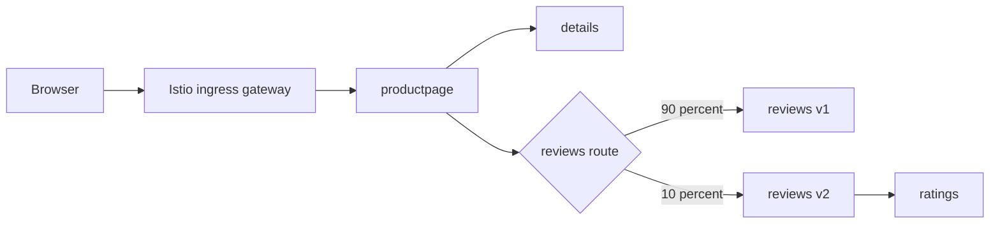
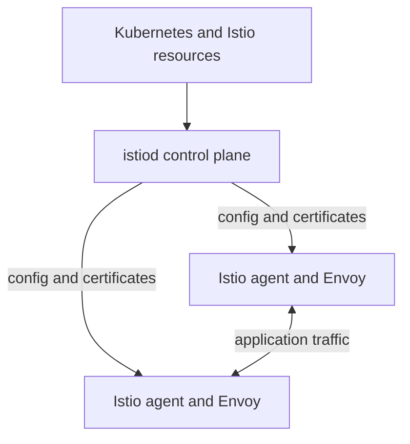

```yaml
# =============================================================================
#  BOOKINFO + ISTIO: COMPLETE, FULLY ANNOTATED MANIFEST
# =============================================================================
#  Apply:   kubectl apply -f bookinfo-istio-complete.yaml
#  Needs:   Istio installed (istiod + istio-ingressgateway in istio-system)
#           e.g.  istioctl install --set profile=demo -y
#
#  TWO LAYERS, TWO OWNERS  (read this first)
#  ------------------------------------------------------------------
#  Not everything the request path uses is in this file. The Istio
#  INSTALLER (istioctl / Helm) creates the infrastructure; this file
#  creates one application plus rules for that infrastructure.
#
#    Created by the Istio installer     Created by THIS file
#    (SYSTEM-DEFINED, not in this file) (USER-DEFINED)
#    -------------------------------    ----------------------------------
#    namespace istio-system             namespace bookinfo
#    Deployment istiod                  4 ServiceAccounts
#    Service istiod                     4 Services (productpage, details,
#    Deployment istio-ingressgateway      reviews, ratings) 9080 -> 9080
#      (the gateway pod, label          5 Deployments
#       istio: ingressgateway)          DestinationRule, 2 VirtualServices,
#    Service istio-ingressgateway         Gateway
#      port 80    -> targetPort 8080    PeerAuthentication,
#      port 443   -> targetPort 8443      AuthorizationPolicy
#      port 15021 -> targetPort 15021
#      nodePorts assigned automatically
#    sidecar-injection webhook
#    ConfigMaps istio-sidecar-injector,
#      istio  (define 15001/15006 and
#      the other 150xx ports)
#    the iptables redirect (15001/15006)
#
#  This file REFERS to the installer's objects (Gateway selector
#  istio: ingressgateway; Gateway port number: 80) but never defines
#  them. Section 8c shows a read-only copy of the installer's Service.
#  Change installer-owned things via IstioOperator / Helm values, not here.
#
#  CONTENTS
#    A. Quick start (tunnel + URLs to open)
#    B. The big picture and the sample app
#    C. What "apiVersion" and "kind" mean
#    D. How the YAMLs connect (the "glue")
#    E. Port map
#    F. Complete flow: browser -> pods -> browser
#    G. Setup time vs request time vs failure time
#    H. The resources (sections 0 to 9, each explained next to its YAML;
#       0b = read-only copy of what injection adds, where 15001/15006 live;
#       8c = how a cloud LoadBalancer's external IP reaches the gateway)
#    I. Troubleshooting and verification commands
#    J. Corrections to common misconceptions
# =============================================================================


# =============================================================================
# A. QUICK START
# =============================================================================
#  1) Wait for all pods to show 2/2 (app + istio-proxy sidecar):
#         kubectl get pods -n bookinfo
#
#  2) Open the tunnel and leave it running in its own terminal:
#         kubectl port-forward -n istio-system svc/istio-ingressgateway 8080:80
#
#     The format is LOCAL_PORT:REMOTE_PORT.
#       8080 = a port kubectl opens on YOUR LAPTOP (you type this in the browser)
#       80   = the ingress gateway's Service port
#     This mapping is NOT stored in any YAML or in the cluster. It exists only
#     while this kubectl command is running; Ctrl+C removes it. 8080 was chosen
#     because ports below 1024 need admin rights on most laptops. To use port 80
#     locally:  sudo kubectl port-forward -n istio-system svc/istio-ingressgateway 80:80
#     and then the URLs need no port at all (http://localhost/productpage).
#
#  3) URLs to open in the browser:
#
#       Product page (the real web page):  http://localhost:8080/productpage
#       Details data (book info, JSON):    http://localhost:8080/api/v1/products/0
#       Reviews data (JSON):               http://localhost:8080/api/v1/products/0/reviews
#       Ratings data (JSON):               http://localhost:8080/api/v1/products/0/ratings
#
#     Only productpage is exposed to the outside. Details, reviews and ratings
#     are internal; their data is reachable through the /api/v1/products path
#     on productpage, which is on the gateway's allow-list (section 8).
#     Any other path (for example http://localhost:8080/) returns 404.
#
#     Other setups:  minikube + `minikube tunnel` -> http://127.0.0.1/...
#                    cloud LoadBalancer           -> http://<EXTERNAL-IP>/...
#                    (EXTERNAL-IP: kubectl get svc istio-ingressgateway -n istio-system)
#                    (section 8c explains how the cloud LoadBalancer reaches the gateway)
#
#  4) Watch the 90/10 split. Refresh /productpage many times: about 9 of 10
#     loads show NO stars (reviews v1), about 1 of 10 shows black stars (v2).
#     Or from a terminal:
#         for i in $(seq 1 100); do
#           curl -s localhost:8080/productpage | grep -q "glyphicon-star" && echo v2 || echo v1
#         done | sort | uniq -c


# =============================================================================
# B. THE BIG PICTURE AND THE SAMPLE APP
# =============================================================================
#  Four microservices, each in a different language (that is the point of a
#  service mesh: retries, encryption and monitoring are NOT re-implemented in
#  Python, Ruby, Java and Node.js; the mesh does them once, outside the code).
#
#    productpage  (Python)   front end; calls details and reviews
#    details      (Ruby)     book information
#    reviews      (Java)     book reviews; two versions run side by side:
#                              v1 does not call ratings (no stars)
#                              v2 calls ratings (black stars)
#                              (v3, red stars, is not in this manifest)
#    ratings      (Node.js)  star ratings, called by reviews v2 only
#
#  Istio has two layers:
#    DATA PLANE    an Envoy proxy (sidecar) next to every app. It handles the
#                  actual traffic and enforces the rules. An Istio Agent in the
#                  same container fetches config and certificates for Envoy.
#    CONTROL PLANE istiod: the brain. It never touches app traffic. It reads
#                  your YAML + the Kubernetes API, compiles Envoy config and
#                  pushes it to every proxy. (Older Istio showed this as three
#                  parts, Citadel = certificates/identity, Pilot = traffic
#                  rules and discovery, Galley = config validation; modern
#                  Istio merges them into the single istiod binary.)
#
#  What the mesh is responsible for:
#    Traffic management  routing, weights, retries, timeouts, circuit breaking
#    Security            mTLS (encryption + identity) and authorization
#    Observability       uniform metrics, logs and traces from every proxy
#    Service discovery   find pods, know which are healthy, load-balance
#
#  WITHOUT Istio you would hand-write all of this in every language: retry
#  libraries per language, manual certificates and rotation, metrics and
#  trace-header forwarding in every service, pod-count tricks for canaries
#  (9 v1 pods + 1 v2 pod = ~10%), and only connection-level (L4) balancing.
#  With Istio it is YAML, changed with `kubectl apply` in seconds.
#  Trade-off: each sidecar costs CPU/memory and a little latency, you run a
#  control plane, and debugging gains a layer. With only a few services in one
#  language, a library plus plain Kubernetes can be simpler.
#
#  Overview:
#
#   Browser
#     |  http://localhost:8080/productpage
#     v
#   kubectl port-forward (your laptop, port 8080)
#     v
#   INGRESS GATEWAY pod (Envoy only)        <- Gateway + VirtualService "bookinfo"
#     |  mTLS
#     v
#   PRODUCTPAGE pod [Envoy -> app :9080]
#     |
#     +--> DETAILS pod  [Envoy -> app]
#     |
#     +--> REVIEWS  <- VirtualService (90/10) + DestinationRule (LEAST_REQUEST)
#            +--> reviews-v1 pod  (9 of 10 requests, no stars)
#            +--> reviews-v2 pod  (1 of 10 requests)
#                    +--> RATINGS pod  (v2 only, for the stars)


# =============================================================================
# C. WHAT "apiVersion" AND "kind" MEAN
# =============================================================================
#  Every Kubernetes YAML starts with two lines saying what the object is:
#
#      apiVersion: networking.istio.io/v1   which API group + version defines it
#      kind: VirtualService                 which type inside that API
#
#  Together they answer "what am I, and who handles me?". The "spec" that
#  follows is different for every kind. Istio's kinds are Custom Resource
#  Definitions (CRDs): installing Istio registers them so `kubectl apply`
#  understands them like built-in types. istiod watches them and turns them
#  into Envoy configuration.
#
#   kind                 apiVersion              Built-in?   Meaning
#   -------------------  ----------------------  ----------  ----------------------------
#   Namespace            v1                      Kubernetes  A logical partition of the cluster
#   ServiceAccount       v1                      Kubernetes  Identity of a pod
#   Service              v1                      Kubernetes  Stable name + address for a group of pods
#   Deployment           apps/v1                 Kubernetes  N identical pods from one template
#   DestinationRule      networking.istio.io/v1  Istio CRD   HOW traffic is handled at the destination
#   VirtualService       networking.istio.io/v1  Istio CRD   WHERE a request goes
#   Gateway              networking.istio.io/v1  Istio CRD   The front door: ports, protocols, hosts
#   PeerAuthentication   security.istio.io/v1    Istio CRD   Is mTLS required?
#   AuthorizationPolicy  security.istio.io/v1    Istio CRD   WHO is allowed to call
#
#  Memory aid:  VirtualService = where,  DestinationRule = how,
#               PeerAuthentication = how encrypted,  AuthorizationPolicy = who.


# =============================================================================
# D. HOW THE YAMLs CONNECT (THE "GLUE")
# =============================================================================
#  The resources never reference each other by file or object name. They are
#  connected by shared LABELS, HOSTNAMES, SUBSET NAMES and SERVICE ACCOUNTS:
#
#   Link                          Defined in                    Used in
#   ----------------------------  ----------------------------  -------------------------------------
#   Pod label  app: reviews       Deployment (pod template)     Service selector, AuthorizationPolicy
#                                                               selector
#   Pod label  version: v1/v2     Deployment (pod template)     DestinationRule subsets[].labels
#   Subset name  v1 / v2          DestinationRule subsets[]     VirtualService destination.subset
#   Host  "reviews"               Service name                  VirtualService hosts + destination.host,
#                                                               DestinationRule host
#   ServiceAccount                Deployment serviceAccountName AuthorizationPolicy principals
#   Namespace  bookinfo           everything                    PeerAuthentication / AuthorizationPolicy scope
#   Gateway name                  Gateway metadata.name         VirtualService gateways: [...]
#
#  The chain of names:
#
#      Pod label  version: v1                 (Deployment)
#            ^
#            |  labels: {version: v1}
#      Subset name "v1"                       (DestinationRule; also holds the
#            ^                                 load-balancing + ejection policy)
#            |  subset: v1
#      Route weight 90 + timeout + retries    (VirtualService)
#            ^
#            |  host: reviews
#      Service "reviews"                      (selects app: reviews)
#
#  Identity chain:
#      ServiceAccount -> certificate -> principal -> authorization decision
#
#  What breaks when a link is cut:
#   Pod labels don't match DestinationRule subset labels  -> empty subset, 503
#   VirtualService names a subset no DestinationRule has   -> 503 on that route
#   host doesn't match the Service name                    -> rules silently never apply
#   No sidecar injected                                    -> no Istio feature works for that pod
#   AuthorizationPolicy principal typo / wrong ServiceAcct -> 403 on legitimate calls
#   AuthorizationPolicy without mTLS                       -> identity can't be verified
#   Namespace mismatch                                     -> policy applies to wrong workloads or none


# =============================================================================
# E. PORT MAP
# =============================================================================
#  THREE kinds of port sit in a request's path:
#
#   nodePort    on every NODE (the machine). Lets traffic from OUTSIDE the
#               cluster in. Range 30000-32767. Only exists for Services of
#               type NodePort / LoadBalancer. NOT used by the app Services here.
#   port        on the Service's virtual ClusterIP. What callers use
#               (reviews:9080). Called the "service port".
#   targetPort  on the POD. Where traffic is forwarded. Must equal the port
#               the app really listens on. Defaults to "port" if omitted.
#   containerPort (Deployment) is documentation only; it opens/blocks nothing.
#               Keep it equal to targetPort.
#
#   Format "80:31380/TCP" in `kubectl get svc` = service port 80, nodePort 31380.
#
#   Service type decides what is opened:
#     ClusterIP (default; used here)  service port only, inside the cluster
#     NodePort                        + a nodePort on every node
#     LoadBalancer                    + a cloud load balancer pointing at the nodePorts
#
#  EXTERNAL PATH
#   browser -> laptop :8080 (port-forward)  [cloud: LoadBalancer address, :80]
#           -> ingress gateway Service  port 80 -> targetPort 8080   (SYSTEM-DEFINED:
#                                        created by the Istio installer, not by this file)
#           -> gateway pod (Envoy)      listens on 8080
#           -> Gateway resource         matches port 80 (section 8)
#           -> VirtualService           routes to productpage port 9080
#           -> productpage Service      port 9080 -> targetPort 9080
#           -> productpage pod          containerPort 9080
#
#  INTERNAL PATH (service to service, e.g. productpage -> reviews)
#     app calls  reviews:9080                      (Service port, USER-DEFINED)
#     -> iptables redirects to Envoy outbound      15001 (inside the caller pod)
#     -> Envoy picks a pod IP, connects to         <pod-ip>:9080 (targetPort)
#     -> iptables redirects to Envoy inbound       15006 (inside the target pod)
#     -> Envoy forwards to the app on              127.0.0.1:9080 (containerPort)
#
#     15001 and 15006 are SYSTEM-DEFINED (Istio installer), not in this file.
#     They are set in two places that must agree, both owned by Istio:
#       (a) the iptables rules: args of the injected istio-init container,
#           taken from ConfigMap istio-sidecar-injector (istio-system)
#       (b) Envoy's listeners: mesh defaults in ConfigMap istio (istio-system),
#           pushed to every sidecar by istiod
#     The only line in THIS file that causes them to exist is the namespace
#     label istio-injection: enabled (section 0). See the read-only copy of
#     the injected containers at the end of section 0.
#
#  Two different "8080"s (unrelated, same number):
#     laptop :8080     your port-forward local port (you choose it)
#     gateway pod :8080  where the gateway Envoy listens (Service maps 80 -> 8080
#                        because the gateway runs non-root and cannot bind <1024)
#
#  Ports reserved by the Istio sidecar (do not use them in your own apps):
#     15000 Envoy admin (localhost)   15001 outbound listener
#     15004 debug                     15006 inbound listener
#     15008 HBONE tunnel              15020 merged Prometheus metrics
#     15021 health check (readiness)  15053 local DNS proxy
#     15090 Envoy Prometheus telemetry


# =============================================================================
# F. COMPLETE FLOW: BROWSER -> PODS -> BROWSER
# =============================================================================
#  FORWARD PATH (request goes in)
#
#   1. Browser -> gateway. Browser sends GET /productpage to localhost:8080.
#      kubectl port-forward carries it into the cluster to the gateway pod
#      (gateway Service port 80 -> pod port 8080).
#
#   2. Gateway accepts and routes. The gateway pod runs only Envoy. Using
#      section 8:
#        Gateway:        port 80, plain HTTP, any hostname? yes, let it in.
#        VirtualService "bookinfo": /productpage is on the allow-list, send to
#                        the productpage Service port 9080. (Unlisted paths: 404.)
#
#   3. Gateway -> productpage pod (encrypted). The gateway opens mTLS to a
#      productpage pod; it lands on that pod's SIDECAR first:
#        PeerAuthentication (STRICT): is it mTLS? yes, accept.
#      then the sidecar hands plain HTTP to the app on 127.0.0.1:9080.
#
#   4. Productpage -> details. The app calls http://details:9080; its sidecar
#      intercepts, opens mTLS to a details pod, whose sidecar passes it to the
#      details app. No special rules, Istio defaults apply.
#
#   5. Productpage -> reviews. The app calls http://reviews:9080; its sidecar
#      applies your rules:
#        a. VirtualService "reviews": 90/10 draw picks v1 or v2; starts the 2s
#           overall timer and 500ms per-try timer.
#        b. DestinationRule: takes the pods of that version (skipping ejected
#           ones), LEAST_REQUEST picks the less busy pod.
#        c. mTLS to that reviews pod. Its sidecar checks PeerAuthentication
#           (mTLS? yes) and AuthorizationPolicy (caller is bookinfo-productpage?
#           yes, allow; anyone else gets 403).
#        d. Sidecar passes plain HTTP to the reviews app.
#      On a 5xx the sidecar retries on another pod (up to 3 retries).
#
#   6. Reviews v2 -> ratings (v2 only). Reviews v2 calls http://ratings:9080;
#      mTLS to a ratings pod returns the stars. Reviews v1 skips this step,
#      which is why v1 shows no stars.
#
#  RETURN PATH (response comes back; nothing new is decided)
#
#   7. ratings app   -> reviews v2 app     star rating (JSON)
#   8. reviews app   -> productpage app    review text (+ ratings if v2)
#   9. details app   -> productpage app    book details (JSON)
#  10. productpage   -> gateway            the finished HTML page
#  11. gateway       -> port-forward       HTML over plain HTTP
#  12. port-forward  -> browser            page renders
#
#  Every pod-to-pod hop is: app -> its sidecar -> mTLS -> next sidecar -> app,
#  in both directions. Step 10 happens only after productpage has both the
#  details and reviews answers. If reviews is slow, the 2s timeout fires and
#  productpage shows the page with a "reviews unavailable" message.
#
#  The browser-to-gateway hop is plain HTTP; the hop from the gateway into the
#  mesh is already mTLS. The gateway is where outside traffic enters the
#  encrypted mesh.
#
#  Which YAML does what:
#   Gateway                      accept at the front door
#   VirtualService "bookinfo"    route /productpage
#   Services + selectors         find pod IPs behind each name
#   PeerAuthentication           require encryption
#   VirtualService "reviews"     choose v1/v2, timeout, retries
#   DestinationRule              choose the pod, eject bad pods
#   AuthorizationPolicy          only productpage may call reviews
#   ServiceAccounts              caller identity inside the certificate
#   Deployments                  the pods and their labels
#   Namespace label              an Envoy next to each app
#
#  On a cloud cluster only step 1 changes: no port-forward; the browser uses
#  http://<EXTERNAL-IP>/productpage and the load balancer reaches the gateway
#  Service on port 80. Steps 2 to 12 are identical.


# =============================================================================
# G. SETUP TIME vs REQUEST TIME vs FAILURE TIME
# =============================================================================
#  PHASE A: BEFORE ANY REQUEST (setup time). Envoy never reads your YAML.
#   A1. Deployments carry the labels (app, version): the only place v1 and v2
#       exist as real facts about running pods.
#   A2. The Service gives the group a name ("reviews") and covers both versions.
#   A3. The DestinationRule maps subset NAMES to pod LABELS and holds the policy.
#   A4. The VirtualService refers to subsets by NAME only.
#   A5. istiod pre-builds the routing table and pushes it to every sidecar:
#         1. discovers all pods behind the "reviews" Service (Kubernetes API)
#         2. groups them using the DestinationRule: pods with version: v1
#            become one Envoy CLUSTER named
#            outbound|9080|v1|reviews.bookinfo.svc.cluster.local ; version: v2
#            pods become another
#         3. attaches the trafficPolicy (LEAST_REQUEST + ejection) to each cluster
#         4. builds the ROUTE from the VirtualService (90/10, timeout, retries)
#       So the "subset lookup" is not done per request: the v1 pod list is
#       already in Envoy's memory when the request arrives.
#       (Envoy config: VirtualService -> route table; DestinationRule -> clusters.)
#
#  PHASE B: ONE REQUEST (all inside the caller's own sidecar)
#   1. Intercept the plain-HTTP call from the app.
#   2. Route match (VirtualService): host "reviews".
#   3. Weighted pick (VirtualService): 90/10 draw, say v2.
#   4. Pod pick (DestinationRule): inside the v2 cluster only, LEAST_REQUEST
#      picks two random healthy pods and sends to the one with fewer active
#      requests. Ejected pods are not candidates.
#   5. Timers start (VirtualService): 2s overall, 500ms per try.
#   6. mTLS to the receiving sidecar, which runs PeerAuthentication then
#      AuthorizationPolicy.
#
#  PHASE C: A POD FAILS (VirtualService and DestinationRule cooperate)
#   Suppose reviews-v2-a returns 503:
#   1. The request lands on v2-a and gets a 503; its error counter goes to 1.
#   2. The 503 matches retryOn: 5xx, so Envoy retries instead of failing the user.
#   3. The retry goes back to the v2 load balancer and (by default) avoids the
#      host that just failed; say v2-b returns 200. The user never sees the error.
#   4. Each further failure on v2-a raises its counter; a success resets it to 0.
#   5. At 5 consecutive 5xx, v2-a is ejected from the v2 pool for 30s.
#   6. After that it is let back in. If it fails again the next ejection lasts
#      60s, then 90s (LINEAR growth: baseEjectionTime x number of ejections).
#   Only v2-a is quarantined; v1 pods and healthy v2 pods are untouched
#   because each subset is its own pool.
#
#   Retries vs outlier detection (similar purpose, different level):
#                   Retries (VirtualService)     Outlier detection (DestinationRule)
#     Protects      this ONE request             ALL future requests
#     Action        try again, on another pod    remove the bad pod from the pool
#     Memory        none                         counts consecutive errors per pod
#     Reaction      immediate                    after 5 consecutive 5xx
#   They reinforce each other: failed attempts (retries included) push a bad
#   pod toward its ejection threshold, and once ejected, retries are spent on
#   healthy pods.
#
#   Timing math: attempts: 3 means 3 retries ON TOP of the original try = up to
#   4 tries. 4 x perTryTimeout 500ms = 2s = the overall timeout. The overall
#   timeout always wins: if everything is slow, Envoy returns 504 at 2s even
#   if tries remain.


# =============================================================================
# H. THE RESOURCES
# =============================================================================

# -----------------------------------------------------------------------------
# 0. NAMESPACE  (sidecar injection ON -> every pod gets an Envoy next to it)
#
#    A Namespace is a logical partition of the cluster. Most objects (Pods,
#    Services, Deployments, Istio policies) live in exactly one namespace,
#    giving separate names, access control and a scope for policies. The name
#    "bookinfo" appears in every other resource and in identities such as
#    cluster.local/ns/bookinfo/sa/bookinfo-productpage.
#
#    The label istio-injection: enabled turns the namespace into part of the
#    mesh. Kubernetes does nothing with it itself; Istio installs a mutating
#    admission webhook that looks for it:
#      1. You apply a Deployment; Kubernetes creates a Pod from it.
#      2. Before the Pod is saved, the API server sends it to the webhook
#         (run by istiod).
#      3. The webhook checks the Pod's namespace for istio-injection: enabled.
#      4. If present, it REWRITES the Pod spec, adding:
#           istio-init   an init container that sets up iptables rules so all
#                        inbound/outbound traffic is redirected through Envoy
#           istio-proxy  the sidecar: Istio Agent + Envoy
#      5. The pod starts with your app container plus these.
#    Hence `kubectl get pods` shows 2/2 (app + istio-proxy) and the app code
#    never changes: it still makes plain HTTP calls.
#
#    EVERY pod gets its OWN istio-init and istio-proxy; nothing is shared.
#    This manifest creates 9 pods = 9 separate Envoy proxies:
#      productpage 1, details 1, reviews-v1 3, reviews-v2 3, ratings 1.
#      istio-init   init container: runs once at startup, then EXITS; needs
#                   NET_ADMIN/NET_RAW to edit iptables; not counted in READY
#      istio-proxy  regular container: runs for the whole pod life; counted
#    A pod with several app containers still gets ONE sidecar (they share one
#    network namespace). Gateway pods have only istio-proxy (the proxy is the
#    whole workload). With the Istio CNI plugin, istio-init is replaced by an
#    istio-validation init container and pods need no extra privileges. With
#    native sidecars (Kubernetes 1.28+, ENABLE_NATIVE_SIDECARS) istio-proxy is
#    declared as an init container with restartPolicy: Always instead.
#
#    Behaviors:
#     - Only pods created AFTER the label get a sidecar. For existing pods:
#         kubectl rollout restart deployment -n bookinfo
#       (This is why the Namespace is first in the file.)
#     - Namespace-wide; opt a single workload out with the pod-template label
#         sidecar.istio.io/inject: "false"
#     - Pods outside injected namespaces are not in the mesh; with STRICT mTLS
#       their plaintext calls are rejected.
#     - WITHOUT sidecars none of the Istio YAMLs below do anything: routing,
#       load balancing, mTLS and authorization are all ENFORCED BY ENVOY.
#
#    Variations:
#      istio-injection: enabled          default revision (used here)
#      istio.io/rev: <revision>          specific istiod revision (canary
#                                        upgrades; don't combine with the above)
#      istio.io/dataplane-mode: ambient  ambient mode: no sidecar, a per-node
#                                        proxy handles traffic
#    Same effect on an existing namespace:
#      kubectl label namespace bookinfo istio-injection=enabled
# -----------------------------------------------------------------------------
apiVersion: v1
kind: Namespace
metadata:
  name: bookinfo
  labels:
    istio-injection: enabled

# -----------------------------------------------------------------------------
# 0b. REFERENCE ONLY, SYSTEM-DEFINED (commented out; do NOT apply):
#     WHAT THE LABEL ABOVE MAKES ISTIO INJECT INTO EVERY POD, AND WHERE
#     15001 (OUTBOUND) AND 15006 (INBOUND) ARE DEFINED
#
#     You write only the Deployment (app container). Istio's mutating
#     admission webhook (created by the installer) rewrites each new pod in
#     this namespace and adds the two containers below. Nothing here is in
#     your Deployments; it is shown so you can see where the port numbers
#     come from. Values are taken from two installer-owned ConfigMaps:
#       istio-sidecar-injector  (istio-system)  -> the template below
#       istio                   (istio-system)  -> mesh defaults (Envoy listeners)
#     To change interception PER POD use annotations on the pod template:
#       traffic.sidecar.istio.io/excludeInboundPorts:  "9999"
#       traffic.sidecar.istio.io/excludeOutboundPorts: "5432"
#       traffic.sidecar.istio.io/includeOutboundIPRanges: "10.0.0.0/8"
#     To change the ports themselves (rare) use IstioOperator meshConfig, not
#     this file. To opt one pod out entirely: label sidecar.istio.io/inject: "false".
#
#     Roughly what the injected pod spec contains:
#
#     spec:
#       initContainers:
#       - name: istio-init                   # SYSTEM-DEFINED: runs once, writes
#         image: docker.io/istio/proxyv2:<version>   # iptables rules, then exits
#         args:
#         - istio-iptables
#         - -p
#         - "15001"                          # OUTBOUND redirect: app -> Envoy :15001
#         - -z
#         - "15006"                          # INBOUND  redirect: pod :9080 -> Envoy :15006
#         - -u
#         - "1337"                           # UID of istio-proxy; its own traffic is
#                                            # NOT redirected (prevents a loop)
#         - -m
#         - REDIRECT
#         - -i
#         - "*"                              # intercept outbound to all IP ranges
#         - -x
#         - ""
#         - -b
#         - "*"                              # intercept inbound on all ports...
#         - -d
#         - 15090,15021,15020                # ...except Istio's own (metrics, health, agent)
#         securityContext:
#           capabilities:
#             add: [NET_ADMIN, NET_RAW]      # needed to edit iptables
#           runAsUser: 0
#       containers:
#       - name: istio-proxy                  # SYSTEM-DEFINED: the sidecar
#         image: docker.io/istio/proxyv2:<version>
#         args: [proxy, sidecar, ...]        # starts pilot-agent, which starts Envoy
#         ports:
#         - containerPort: 15090             # Envoy Prometheus metrics
#           name: http-envoy-prom
#         readinessProbe:
#           httpGet:
#             path: /healthz/ready
#             port: 15021                    # why the pod shows 1/2 until Envoy is ready
#         securityContext:
#           runAsUser: 1337                  # matches -u 1337 above
#           runAsGroup: 1337
#         # Envoy listeners istiod configures inside this container (not in the
#         # pod spec; they come from mesh defaults in ConfigMap "istio"):
#         #   0.0.0.0:15001  virtualOutbound   must equal -p above
#         #   0.0.0.0:15006  virtualInbound    must equal -z above
#         #   0.0.0.0:15021  health             127.0.0.1:15000 admin
#         #   0.0.0.0:15090  metrics            0.0.0.0:15020  agent
#       - name: productpage                  # USER-DEFINED: your container, unchanged
#         image: docker.io/istio/examples-bookinfo-productpage-v1:1.20.2
#         ports:
#         - containerPort: 9080
#
#     Resulting iptables rules (simplified), as printed by istio-init's log:
#       -A PREROUTING -p tcp -j ISTIO_INBOUND
#       -A ISTIO_INBOUND -p tcp --dport 15008 -j RETURN
#       -A ISTIO_INBOUND -p tcp --dport 15090 -j RETURN
#       -A ISTIO_INBOUND -p tcp --dport 15021 -j RETURN
#       -A ISTIO_INBOUND -p tcp --dport 15020 -j RETURN
#       -A ISTIO_INBOUND -p tcp -j ISTIO_IN_REDIRECT
#       -A ISTIO_IN_REDIRECT -p tcp -j REDIRECT --to-ports 15006     # <- inbound
#       -A OUTPUT -p tcp -j ISTIO_OUTPUT
#       -A ISTIO_OUTPUT -m owner --uid-owner 1337 -j RETURN           # Envoy's own
#       -A ISTIO_OUTPUT -d 127.0.0.1/32 -j RETURN                      # localhost
#       -A ISTIO_OUTPUT -j ISTIO_REDIRECT
#       -A ISTIO_REDIRECT -p tcp -j REDIRECT --to-ports 15001         # <- outbound
#
#     Verify on a live pod:
#       PP=$(kubectl get pod -n bookinfo -l app=productpage -o jsonpath='{.items[0].metadata.name}')
#       kubectl get pod $PP -n bookinfo -o jsonpath='{.spec.initContainers[0].args}'
#       kubectl logs -n bookinfo $PP -c istio-init | grep -E "15001|15006"
#       istioctl proxy-config listeners $PP -n bookinfo | grep -E "15001|15006"
#       kubectl get configmap istio-sidecar-injector -n istio-system -o yaml | grep -nE "15001|15006"
#
#     Alternatives: with the Istio CNI plugin the same rules are written by
#     the node and istio-init is replaced by an istio-validation init
#     container (no NET_ADMIN in the pod). In ambient mode there is no
#     per-pod redirect at all.
# -----------------------------------------------------------------------------
---
# -----------------------------------------------------------------------------
# 1. SERVICE ACCOUNTS  (these become the mTLS identities in certificates)
#
#    A ServiceAccount is the identity of a workload (pod), like a user account
#    for a person. Every pod runs as exactly one ServiceAccount, set by
#    serviceAccountName in the pod spec (default: the namespace's "default").
#    In plain Kubernetes it mainly controls what a pod may do against the
#    Kubernetes API (RBAC). In Istio it has a second job: it is the identity
#    other services see and check. These accounts have no Roles bound to them,
#    so they grant NO Kubernetes API permissions; they are used purely as names.
#
#    Fields: name = the identity name (Deployments point to it);
#    namespace = where it lives (part of the identity); labels "account: ..."
#    are a descriptive tag copied from Istio's Bookinfo sample; nothing here
#    selects on it, so it is safe to remove. There is no spec: a ServiceAccount
#    is just a named identity.
#
#    How Istio turns it into an mTLS identity:
#      1. A pod starts; its Istio Agent (in istio-proxy) needs a certificate.
#      2. It sends a request to istiod with a Kubernetes token proving which
#         ServiceAccount the pod runs as.
#      3. istiod's built-in certificate authority validates the token and
#         issues a short-lived certificate.
#      4. The certificate holds a SPIFFE identity:
#            spiffe://cluster.local/ns/bookinfo/sa/bookinfo-productpage
#                     trust domain  namespace   ServiceAccount
#      5. Envoy uses it in every mTLS handshake; the receiving Envoy reads the
#         identity out of the certificate.
#    This is the same string as the AuthorizationPolicy principal (without
#    the spiffe:// prefix):
#         ServiceAccount -> certificate -> principal -> authorization decision
#
#    Why FOUR accounts: one identity per kind of service you want to tell apart.
#      bookinfo-productpage  productpage pods
#      bookinfo-details      details pods
#      bookinfo-reviews      reviews v1 AND v2 pods (identity is per SERVICE,
#                            not per version, and not per pod: all 6 pods get
#                            separate certificates carrying the same name)
#      bookinfo-ratings      ratings pods
#    If every Deployment used "default", all services would present the same
#    identity (.../sa/default): policies couldn't tell productpage from
#    ratings, a compromised pod would look like any other, and logs/metrics
#    would show "default" everywhere. Separate accounts give least privilege:
#    here ratings runs as bookinfo-ratings, so its call to reviews gets 403.
#
#    Gotchas: an account does nothing unless a Deployment sets
#    serviceAccountName (a typo there usually stops the pod from starting);
#    a typo in the AuthorizationPolicy principal does NOT error, the rule
#    just never matches (403s); the namespace is part of the identity; mTLS
#    is required, otherwise there is no certificate to read.
#
#    Check:  kubectl get pods -n bookinfo \
#              -o custom-columns=POD:.metadata.name,SA:.spec.serviceAccountName
# -----------------------------------------------------------------------------
apiVersion: v1
kind: ServiceAccount
metadata:
  name: bookinfo-productpage
  namespace: bookinfo
  labels:
    account: productpage
---
apiVersion: v1
kind: ServiceAccount
metadata:
  name: bookinfo-details
  namespace: bookinfo
  labels:
    account: details
---
apiVersion: v1
kind: ServiceAccount
metadata:
  name: bookinfo-reviews
  namespace: bookinfo
  labels:
    account: reviews
---
apiVersion: v1
kind: ServiceAccount
metadata:
  name: bookinfo-ratings
  namespace: bookinfo
  labels:
    account: ratings
---
# -----------------------------------------------------------------------------
# 2. KUBERNETES SERVICES  (give each group of pods a stable hostname)
#
#    A Service gives a changing group of pods one stable name and address.
#    Pods get replaced and IPs change; the Service name stays.
#
#    metadata.name  becomes the DNS hostname:
#        reviews                                 pods in the same namespace
#        reviews.bookinfo                        pods in any namespace
#        reviews.bookinfo.svc.cluster.local      anywhere (fully qualified)
#      It is ALSO the hostname Istio uses: DestinationRule host and
#      VirtualService hosts must match it, or they silently stop applying.
#      Istio builds cluster names from it:
#        outbound|9080|v1|reviews.bookinfo.svc.cluster.local
#    metadata.namespace  a Service selects pods only in its own namespace.
#    metadata.labels     tags on the SERVICE OBJECT, not on pods, with NO
#      effect on routing. Used by tools (kubectl get svc -l app=reviews, Kiali
#      grouping). "service: <name>" is a Bookinfo-sample convention; safe to
#      delete the whole labels block.
#
#    spec.selector  is the field that actually connects the Service to pods:
#      a filter on POD labels. Any pod in the namespace whose labels contain
#      the selector's labels AND that is Ready becomes a backend:
#
#        Service "reviews", selector app=reviews
#          reviews-v1 pods (3)  app=reviews, version=v1   matched
#          reviews-v2 pods (3)  app=reviews, version=v2   matched
#          ratings pod         app=ratings                not matched
#
#      So "reviews" has 6 backends covering both versions. That is why the
#      Service alone cannot do 90/10: it only knows app=reviews and treats all
#      six as equals; the "version" label is what the DestinationRule uses.
#      Rules: all entries must match (AND); exact key=value equality only
#      (no "in"/"notin" for Services); extra pod labels are fine; only Ready
#      pods get traffic; metadata.labels are NOT used for selection. Adding
#      version: v1 to the reviews selector would drop v2 from the pool.
#      Kubernetes keeps the pod-IP list in EndpointSlices, and istiod reads
#      that list (phase A5). Empty list = nothing for istiod to work with.
#
#    Port fields (see also section E):
#      name         "http" prefix tells Istio to treat traffic as HTTP (L7),
#                   enabling VirtualService routing, retries, header matching
#                   and HTTP metrics. If it were unnamed or "foo", Istio would
#                   treat it as plain TCP and none of those would apply.
#      appProtocol  the modern, explicit way to declare the protocol
#      protocol     transport protocol (TCP is the default; written out here)
#      port         the Service port callers use (reviews:9080)
#      targetPort   the pod port traffic is forwarded to; must equal the port
#                   the app listens on (= containerPort in the Deployment)
#      nodePort     NOT allowed here: type ClusterIP is reachable only inside
#                   the cluster. See optional section 9 for a NodePort.
#    type: ClusterIP (default) = a virtual IP reachable only inside the
#    cluster; the ingress gateway is what exposes productpage externally.
#
#    Service vs Istio:
#                       Kubernetes Service        Istio (VS + DR)
#      Knows about      app label, one flat pool  version labels, named subsets
#      Balances by      connection (L4)           request (L7, Envoy)
#      90/10 split?     only by pod count         yes, by weight
#      Role             supplies the NAME and     supplies the RULES on top
#                       the POD LIST
#    Istio does not replace the Service; the Service must exist first.
#
#    Pods behind each Service:  productpage 1, details 1, reviews 6, ratings 1.
#
#    USER-DEFINED vs SYSTEM-DEFINED Services: the four Services below are
#    yours (9080 -> 9080). The gateway's Service, istio-ingressgateway in
#    istio-system (80 -> 8080, 443 -> 8443, 15021 -> 15021), is the same kind
#    of object but is created by the Istio installer and is NOT in this file.
#
#    Wrong selector effects: matches nothing -> no endpoints, 503 "no healthy
#    upstream"; pods in another namespace -> no match; pod not Ready ->
#    excluded; port name not http-prefixed -> treated as TCP.
#
#    Check:  kubectl describe svc reviews -n bookinfo
#            kubectl get endpointslices -n bookinfo -l kubernetes.io/service-name=reviews
# -----------------------------------------------------------------------------
apiVersion: v1
kind: Service
metadata:
  name: productpage
  namespace: bookinfo
  labels:
    app: productpage
    service: productpage
spec:
  type: ClusterIP
  ports:
  - name: http
    appProtocol: http
    protocol: TCP
    port: 9080
    targetPort: 9080
  selector:
    app: productpage
---
apiVersion: v1
kind: Service
metadata:
  name: details
  namespace: bookinfo
  labels:
    app: details
    service: details
spec:
  type: ClusterIP
  ports:
  - name: http
    appProtocol: http
    protocol: TCP
    port: 9080
    targetPort: 9080
  selector:
    app: details
---
# The "reviews" Service selects app: reviews, so it covers BOTH v1 and v2 pods
# (6 backends). It does not mention version on purpose.
apiVersion: v1
kind: Service
metadata:
  name: reviews
  namespace: bookinfo
  labels:
    app: reviews
    service: reviews
spec:
  type: ClusterIP
  ports:
  - name: http
    appProtocol: http
    protocol: TCP
    port: 9080
    targetPort: 9080
  selector:
    app: reviews
---
apiVersion: v1
kind: Service
metadata:
  name: ratings
  namespace: bookinfo
  labels:
    app: ratings
    service: ratings
spec:
  type: ClusterIP
  ports:
  - name: http
    appProtocol: http
    protocol: TCP
    port: 9080
    targetPort: 9080
  selector:
    app: ratings
---
# -----------------------------------------------------------------------------
# 3. DEPLOYMENTS  (the pods; the labels here are what Istio selects on)
#
#    A Deployment tells Kubernetes "keep N copies of this pod running and
#    replace them if they die". It builds pods from ONE pod template (one
#    image, one set of labels).
#
#    WHY reviews HAS TWO DEPLOYMENTS: v1 and v2 are different code (different
#    images), so they cannot share a template, and running both at once means
#    two Deployments. With a single Deployment you would only get a rolling
#    update (v1 pods replaced by v2 until none are left), which means: v1
#    disappears, you do not control the mix (maxSurge/maxUnavailable, and it is
#    temporary), and rollback is another rollout. Two Deployments give you:
#      - both versions live at once with separate "version" labels (what the
#        DestinationRule splits on; one Deployment would put one version label
#        on every pod, leaving nothing to split)
#      - independent replica counts. Istio splits by WEIGHT, not pod count,
#        so 90/10 holds whatever the replicas are (the pod-count trick of
#        9 v1 + 1 v2 breaks the moment you scale)
#      - independent rollouts/rollbacks (rollback = change the weights, v1 is
#        still running and warm)
#      - independent blast radius (a crashing v2 doesn't affect v1)
#    Shared between the two: label app: reviews (so the Service and the
#    AuthorizationPolicy cover both) and ServiceAccount bookinfo-reviews.
#    Different: image, version label, replica count.
#    Gotcha: each Deployment's selector.matchLabels includes "version". If both
#    were just app: reviews, each Deployment would treat the other's pods as
#    its own and they would fight over replicas and rollouts.
#    Tools like Argo Rollouts / Flagger automate this pattern (create the
#    versioned workloads, step the weights 5% -> 25% -> 50% -> 100%, roll back
#    on rising errors).
#
#    containerPort is documentation only (opens/blocks nothing); keep it equal
#    to the Service targetPort (9080). The container still listens on 9080;
#    Envoy sits in front of that port.
#
#    The "---" line separates multiple objects in one file.
# -----------------------------------------------------------------------------
apiVersion: apps/v1
kind: Deployment
metadata:
  name: productpage-v1
  namespace: bookinfo
  labels:
    app: productpage
    version: v1
spec:
  replicas: 1
  selector:
    matchLabels:
      app: productpage
      version: v1
  template:
    metadata:
      labels:
        app: productpage
        version: v1
    spec:
      serviceAccountName: bookinfo-productpage   # identity used by AuthorizationPolicy
      containers:
      - name: productpage
        image: docker.io/istio/examples-bookinfo-productpage-v1:1.20.2
        imagePullPolicy: IfNotPresent
        ports:
        - name: http
          containerPort: 9080
          protocol: TCP
        volumeMounts:
        - name: tmp
          mountPath: /tmp
      volumes:
      - name: tmp
        emptyDir: {}
---
apiVersion: apps/v1
kind: Deployment
metadata:
  name: details-v1
  namespace: bookinfo
  labels:
    app: details
    version: v1
spec:
  replicas: 1
  selector:
    matchLabels:
      app: details
      version: v1
  template:
    metadata:
      labels:
        app: details
        version: v1
    spec:
      serviceAccountName: bookinfo-details
      containers:
      - name: details
        image: docker.io/istio/examples-bookinfo-details-v1:1.20.2
        imagePullPolicy: IfNotPresent
        ports:
        - name: http
          containerPort: 9080
          protocol: TCP
---
# reviews v1: does NOT call ratings (no stars).
apiVersion: apps/v1
kind: Deployment
metadata:
  name: reviews-v1
  namespace: bookinfo
  labels:
    app: reviews
    version: v1
spec:
  replicas: 3                       # 3 pods so LEAST_REQUEST and ejection are observable
  selector:
    matchLabels:
      app: reviews
      version: v1                   # includes version so it manages only its own pods
  template:
    metadata:
      labels:
        app: reviews                # matches Service selector + AuthorizationPolicy selector
        version: v1                 # matches DestinationRule subset "v1"
    spec:
      serviceAccountName: bookinfo-reviews
      containers:
      - name: reviews
        image: docker.io/istio/examples-bookinfo-reviews-v1:1.20.2
        imagePullPolicy: IfNotPresent
        env:
        - name: LOG_DIR
          value: "/tmp/logs"
        ports:
        - name: http
          containerPort: 9080
          protocol: TCP
        volumeMounts:
        - name: tmp
          mountPath: /tmp
        - name: wlp-output
          mountPath: /opt/ibm/wlp/output
      volumes:
      - name: wlp-output
        emptyDir: {}
      - name: tmp
        emptyDir: {}
---
# reviews v2: calls ratings and shows black stars.
apiVersion: apps/v1
kind: Deployment
metadata:
  name: reviews-v2
  namespace: bookinfo
  labels:
    app: reviews
    version: v2
spec:
  replicas: 3
  selector:
    matchLabels:
      app: reviews
      version: v2
  template:
    metadata:
      labels:
        app: reviews                # matches Service selector + AuthorizationPolicy selector
        version: v2                 # matches DestinationRule subset "v2"
    spec:
      serviceAccountName: bookinfo-reviews
      containers:
      - name: reviews
        image: docker.io/istio/examples-bookinfo-reviews-v2:1.20.2
        imagePullPolicy: IfNotPresent
        env:
        - name: LOG_DIR
          value: "/tmp/logs"
        ports:
        - name: http
          containerPort: 9080
          protocol: TCP
        volumeMounts:
        - name: tmp
          mountPath: /tmp
        - name: wlp-output
          mountPath: /opt/ibm/wlp/output
      volumes:
      - name: wlp-output
        emptyDir: {}
      - name: tmp
        emptyDir: {}
---
apiVersion: apps/v1
kind: Deployment
metadata:
  name: ratings-v1
  namespace: bookinfo
  labels:
    app: ratings
    version: v1
spec:
  replicas: 1
  selector:
    matchLabels:
      app: ratings
      version: v1
  template:
    metadata:
      labels:
        app: ratings
        version: v1
    spec:
      serviceAccountName: bookinfo-ratings
      containers:
      - name: ratings
        image: docker.io/istio/examples-bookinfo-ratings-v1:1.20.2
        imagePullPolicy: IfNotPresent
        ports:
        - name: http
          containerPort: 9080
          protocol: TCP
---
# -----------------------------------------------------------------------------
# 4. DESTINATIONRULE  (HOW traffic is handled once a destination is chosen)
#
#    Two jobs:
#      (1) SUBSETS: map subset NAMES (v1, v2) to pod LABELS. This is the bridge
#          between the physical world (pod labels) and the routing world
#          (names the VirtualService uses). The Service sees one pool of
#          "reviews" pods; this splits it into two named groups.
#      (2) trafficPolicy: load balancing + outlier detection (+ optionally
#          connection pool limits and TLS settings).
#
#    host: reviews   must match the Service name.
#    No port is set, so the policy applies to every port of the Service (only
#    9080 here). To target one port use trafficPolicy.portLevelSettings:
#        portLevelSettings:
#        - port: {number: 9080}
#          loadBalancer: {simple: LEAST_REQUEST}
#
#    --- loadBalancer: simple: LEAST_REQUEST ---
#    Answers: the VirtualService already chose a version, so which POD inside
#    that version gets this request? It only ever chooses among pods of the
#    chosen subset's cluster; it never compares a v1 pod with a v2 pod.
#    Envoy uses "power of two choices":
#      1. take the healthy pods (ejected pods are not candidates)
#      2. pick TWO at random
#      3. compare their ACTIVE request counts (sent, not yet answered)
#      4. send to the one with fewer
#    Example, v2 pods with active requests a=1, b=8 (slow), c=2:
#      a vs b -> a    a vs c -> a    b vs c -> c
#    The slow pod loses every comparison it appears in, so load shifts away
#    from it automatically, with no "slow" detector configured.
#    Why it suits this case: it reacts to SLOWNESS (outlier detection only
#    reacts to 5xx errors); it handles uneven request cost; it works per
#    REQUEST (Kubernetes balances per connection, so long-lived HTTP/2 or
#    keep-alive connections can pile onto one pod); it needs no shared state.
#      ROUND_ROBIN   pods in turn; ignores load
#      RANDOM        uniform random; ignores load
#      LEAST_REQUEST fewer active requests of two random pods
#      PASSTHROUGH   connect to the original destination, no balancing
#    Limits: each Envoy counts only ITS OWN in-flight requests (not a global
#    view); with sequential low traffic every pod shows 0 active requests, so
#    the spread looks random (your curl loop is sequential; use concurrent
#    load such as hey or fortio to see it work); it does not replace health
#    handling, since a pod that fails fast has a low count and looks
#    attractive, which is why it is paired with outlierDetection.
#
#    --- outlierDetection (passive health checking / circuit breaker) ---
#    Envoy watches live traffic errors and ejects misbehaving pods from the
#    pool without waiting for Kubernetes readiness probes (tens of seconds).
#      consecutive5xxErrors: 5   5 consecutive 5xx (500/502/503...) from ONE
#                                pod -> ejected IMMEDIATELY at the 5th error.
#                                A single success resets the counter to 0.
#      interval: 10s             period of the analysis sweep, which also
#                                returns pods whose ejection time is over (so
#                                a pod may return up to ~10s after its time)
#      baseEjectionTime: 30s     ejection lasts baseEjectionTime x number of
#                                times that pod was ejected: 30s, 60s, 90s...
#                                (LINEAR, not exponential)
#      maxEjectionPercent: 50    never eject more than half of a pool (the
#                                default is 10%; at least one host can always
#                                be ejected). Raised here because the demo
#                                pools are only 3 pods; remove to see default.
#    At low request volume a bad pod can take a long time to reach 5
#    consecutive errors, so ejection depends on traffic.
#
#    --- Subsets and scope ---
#    The top-level trafficPolicy applies to every subset. A subset can
#    override parts of it; settings not overridden are still inherited:
#        subsets:
#        - name: v2
#          labels: {version: v2}
#          trafficPolicy:
#            loadBalancer: {simple: ROUND_ROBIN}   # v2 only; ejection inherited
#    Each subset is its own pool: LEAST_REQUEST compares only pods in the same
#    subset, and ejecting a bad v2 pod does not touch v1 pods.
#    Useful for a risky canary (e.g. consecutive5xxErrors: 2, baseEjectionTime:
#    60s for v2 only).
#    GOTCHA: subsets only take effect if a VirtualService routes to them. With
#    no VirtualService, Istio balances across ALL reviews pods using the
#    top-level policy and the subsets sit unused.
#
#    Other DestinationRule settings (not used here): connectionPool (cap
#    connections), tls (usually automatic mTLS).
#    Related timers live in different places: VirtualService timeout /
#    perTryTimeout (request) vs DestinationRule connectionPool.tcp.connectTimeout
#    (opening a connection).
# -----------------------------------------------------------------------------
apiVersion: networking.istio.io/v1
kind: DestinationRule
metadata:
  name: reviews
  namespace: bookinfo
spec:
  host: reviews                      # matches the Service name
  trafficPolicy:                     # inherited by every subset below
    loadBalancer:
      simple: LEAST_REQUEST
    outlierDetection:
      consecutive5xxErrors: 5        # 5 consecutive 5xx -> eject the pod
      interval: 10s                  # sweep interval (also returns pods after ejection)
      baseEjectionTime: 30s          # ejection lasts 30s x number of times ejected
      maxEjectionPercent: 50         # never eject more than half of a pool
  subsets:
  - name: v1                         # name the VirtualService uses
    labels:
      version: v1                    # matches Deployment pod label
  - name: v2
    labels:
      version: v2
---
# -----------------------------------------------------------------------------
# 5. VIRTUALSERVICE "reviews"  (WHERE a request goes)
#
#    A set of rules: "when a request is addressed to this host, route it like
#    this". It never mentions labels or pods, only subset NAMES. It does not
#    set "gateways", so it applies only to in-mesh (sidecar) calls, not to the
#    ingress gateway.
#
#      hosts: [reviews]   which destination hostnames the rules apply to;
#                         must match the Service name. The Envoy sidecar of any
#                         caller (e.g. productpage) applies the rule.
#      http:              list of HTTP rules, checked in order (there are also
#                         tcp and tls sections). A "match" could be added, e.g.
#                         header end-user: tester -> v2.
#      route:             list of destinations
#      destination.host   the target Service
#      destination.subset a named group defined in the DestinationRule; if it
#                         does not exist there, routing fails (503)
#      destination.port   the Service port; optional for a single-port Service,
#                         written out to make it explicit
#      weight 90 / 10     percent of traffic per destination; must total 100
#      timeout: 2s        hard ceiling for the WHOLE request including retries;
#                         at 2s Envoy returns 504 even if retries remain
#      retries.attempts: 3        3 retries on top of the first try = up to 4
#      retries.perTryTimeout      each individual attempt gets at most 500ms
#      retries.retryOn: 5xx       retry only on server errors (others exist:
#                                 connect-failure, reset, ...)
#      Math: 4 tries x 500ms = 2s = the overall timeout.
#
#    Routing happens FIRST (this resource), then the DestinationRule policy
#    applies inside the chosen subset. On a failed try, the VirtualService
#    decides WHETHER to try again and the DestinationRule decides WHICH POD
#    gets the next try.
#
#    What each resource controls (request -> VirtualService; pod/connection
#    -> DestinationRule):
#      Which version gets this request?       VirtualService   weight
#      Should some requests go elsewhere?     VirtualService   match (not used)
#      How long may the request take?         VirtualService   timeout
#      Retry a failure?                       VirtualService   retries
#      Which pods belong to "v2"?             DestinationRule  subsets
#      Which pod in the cluster?              DestinationRule  loadBalancer
#      When is a pod removed from rotation?   DestinationRule  outlierDetection
#      How many connections allowed?          DestinationRule  connectionPool
#
#    What each becomes in Envoy: VirtualService -> route table; DestinationRule
#    -> clusters. A route points at a cluster BY NAME (subset: v2 ->
#    outbound|9080|v2|reviews.bookinfo.svc.cluster.local), and that cluster
#    exists only because the DestinationRule defined subset v2.
#
#    If one is missing:
#      VS names a subset no DR defines       -> route to a nonexistent cluster, 503
#      DR only, no VS                         -> still works; default route to the
#                                                whole Service, DR policy applies,
#                                                subsets unused
#      neither                                -> plain Kubernetes-style behavior
#      host doesn't match the Service name    -> that resource silently doesn't apply
#
#    Worked example (testers always get v2, everyone else 90/10; v2 protected
#    harder in the DestinationRule):
#        http:
#        - match:
#          - headers: {end-user: {exact: tester}}
#          route:
#          - destination: {host: reviews, subset: v2}
#        - route:
#          - destination: {host: reviews, subset: v1}
#            weight: 90
#          - destination: {host: reviews, subset: v2}
#            weight: 10
# -----------------------------------------------------------------------------
apiVersion: networking.istio.io/v1
kind: VirtualService
metadata:
  name: reviews
  namespace: bookinfo
spec:
  hosts:
  - reviews                          # matches the Service name
  http:
  - route:
    - destination:
        host: reviews
        subset: v1                   # defined in the DestinationRule
        port:
          number: 9080               # Service port
      weight: 90
    - destination:
        host: reviews
        subset: v2                   # defined in the DestinationRule
        port:
          number: 9080               # Service port
      weight: 10
    timeout: 2s
    retries:
      attempts: 3                    # 3 retries on top of the first try (up to 4 tries)
      perTryTimeout: 500ms
      retryOn: 5xx
---
# -----------------------------------------------------------------------------
# 6. PEERAUTHENTICATION  (is mTLS required?)
#
#    "Peer authentication" = authenticating the SERVICE on the other end of a
#    connection (the peer), as opposed to an end user.
#      name: default        by convention, "default" with no selector is the
#                           namespace-wide default
#      namespace: bookinfo  the scope: with no selector it covers EVERY
#                           workload in this namespace (in istio-system it
#                           would be mesh-wide); a selector.matchLabels would
#                           target specific workloads
#      mtls.mode:
#        STRICT      only mTLS accepted; plaintext rejected (used here)
#        PERMISSIVE  accept mTLS and plaintext (the default; useful while
#                    migrating pods without sidecars)
#        DISABLE     no mTLS
#    It controls what the RECEIVING sidecar accepts. For the sending side,
#    "auto mTLS" is on by default: sidecars use mTLS automatically when the
#    destination supports it.
#    It applies to every inbound port. One port can be relaxed with
#    portLevelMtls (needs a selector); see optional section 9.
#    It makes identity trustworthy: AuthorizationPolicy principals need mTLS.
# -----------------------------------------------------------------------------
apiVersion: security.istio.io/v1
kind: PeerAuthentication
metadata:
  name: default
  namespace: bookinfo
spec:
  mtls:
    mode: STRICT
---
# -----------------------------------------------------------------------------
# 7. AUTHORIZATIONPOLICY  (WHO is allowed to call)
#
#    Authentication answers "who are you?"; this answers "are you allowed?".
#      selector.matchLabels app: reviews   the workload being PROTECTED (the
#                                          pod label from the Deployments)
#      action: ALLOW                       the default. Once any ALLOW policy
#                                          applies to a workload, everything
#                                          NOT matched by a rule is DENIED.
#      rules                               a request is allowed if it matches
#                                          at least one rule
#      from.source.principals              the CALLER identity, format
#                                          <trust-domain>/ns/<namespace>/sa/<serviceaccount>
#                                          cluster.local = default trust domain
#                                          ns/bookinfo   caller's namespace
#                                          sa/bookinfo-productpage  the caller's
#                                          ServiceAccount
#    That identity is embedded in the certificate Istio issues, so mTLS is
#    required (section 6). Result: only productpage may call reviews; details
#    or ratings calling reviews get 403.
#    Finer rules are possible: action DENY / CUSTOM, "to" (methods, paths,
#    ports) and "when" (conditions). No "to.operation.ports" is set, so the
#    rule covers every port on reviews. To limit it to the app port add:
#        to:
#        - operation:
#            ports: ["9080"]
#    Verify the block works (expect 403):
#      kubectl exec -n bookinfo deploy/ratings-v1 -c ratings -- \
#        curl -s -o /dev/null -w "%{http_code}\n" http://reviews:9080/reviews/1
#    If you later add a policy to productpage, it must allow the ingress
#    gateway's principal
#    (cluster.local/ns/istio-system/sa/istio-ingressgateway-service-account)
#    or external traffic gets 403.
# -----------------------------------------------------------------------------
apiVersion: security.istio.io/v1
kind: AuthorizationPolicy
metadata:
  name: reviews-policy
  namespace: bookinfo
spec:
  selector:
    matchLabels:
      app: reviews
  action: ALLOW
  rules:
  - from:
    - source:
        principals:
        - cluster.local/ns/bookinfo/sa/bookinfo-productpage
---
# -----------------------------------------------------------------------------
# 8. INGRESS  (the front door: expose productpage outside the cluster)
#
#    Everything else is reachable only INSIDE the cluster (ClusterIP). This
#    section builds the front door from two resources that split the job:
#      Gateway          which ports / protocols / hostnames the door accepts
#      VirtualService   once a request is in, where it goes (paths, headers)
#    (Kubernetes' own Ingress merges both into one object; Istio separates them.)
#
#    The "ingress gateway" is a pod in istio-system running just an Envoy and
#    no app, with its own Service (istio-ingressgateway). The Gateway and
#    VirtualService below are read by istiod, compiled to Envoy config and
#    pushed to that pod, like for sidecars.
#
#    --- Gateway ---
#      namespace: bookinfo       the Gateway OBJECT lives in the app namespace
#                                even though the gateway POD is in istio-system
#                                (from another namespace refer to it as
#                                bookinfo/bookinfo-gateway)
#      selector: istio: ingressgateway
#                                a POD label selector choosing which gateway
#                                pods get this config. Check:
#                                  kubectl get pods -n istio-system -l istio=ingressgateway
#                                If it matches no pod, no listener exists.
#      servers                   a list of "doors"; this is one entry (the dash
#                                marks a list item). A second door could be:
#                                  - port: {number: 443, name: https, protocol: HTTPS}
#                                    tls: {mode: SIMPLE, credentialName: bookinfo-cert}
#                                    hosts: ["bookinfo.example.com"]
#                                (the Secret must be in the gateway pod's
#                                namespace, istio-system; other modes: MUTUAL,
#                                PASSTHROUGH; on port 80 tls.httpsRedirect:
#                                true redirects to HTTPS)
#
#    The server entry in plain words:
#      "Open port 80, accept plain web traffic, for any hostname."
#
#      port.number: 80    the port as the gateway's SERVICE exposes it. The
#                         Service maps 80 -> targetPort 8080 (non-root pods
#                         can't bind <1024), and istiod creates the real Envoy
#                         listener on 8080. You write 80, Istio translates.
#                         It must exist on that Service. istiod names the route
#                         table "http.80" after it.
#                         So 80 is the port the browser talks to on the gateway.
#      port.name: http    a label, unique within this Gateway; no effect on
#                         routing (unlike a Service port name).
#      port.protocol:     what to expect on the connection:
#        HTTP     plain HTTP; Envoy parses requests so VirtualService path/
#                 header rules work (used here)
#        HTTPS    HTTP inside TLS, decrypted at the gateway (needs tls:)
#        HTTP2 / GRPC   HTTP/2 and gRPC
#        TCP      raw bytes; no path/header routing (an http: VirtualService
#                 would never match)
#        TLS      TLS not decrypted by the gateway (routing by SNI)
#        MONGO    MongoDB wire protocol
#      hosts: ["*"]       hostnames served, matched against the HTTP Host
#                         header. "*" = any (even a bare IP), so
#                         curl localhost:8080/productpage works. It also limits
#                         which VirtualServices can attach (their hosts must
#                         overlap). Quotes around "*" are required in YAML.
#                           "*"                        any hostname (demos)
#                           "bookinfo.example.com"     that exact name (production;
#                                                      then use curl -H "Host: ...")
#                           "*.example.com"            any subdomain
#                           "bookinfo/*"               any host, only VirtualServices
#                                                      from namespace bookinfo
#                           "./*"                      only the Gateway's namespace
#                           "istio-system/foo.example.com"
#      (no tls: block)    so client <-> gateway traffic is unencrypted.
#
#    The ingress gateway Service in istio-system is SYSTEM-DEFINED: created by
#    the Istio installer (istioctl install / Helm), NOT by this file and NOT
#    by you. Your Gateway's "number: 80" refers to its port 80. It maps:
#         Service port 80    -> targetPort 8080 -> nodePort 3xxxx   (HTTP)
#         Service port 443   -> targetPort 8443 -> nodePort 3xxxx   (HTTPS)
#         Service port 15021 -> targetPort 15021                    (health)
#    Exact nodePorts are assigned by your cluster:
#         kubectl get svc istio-ingressgateway -n istio-system
#    ("80:31380/TCP" = service port 80, nodePort 31380). With no cloud load
#    balancer EXTERNAL-IP stays <pending>; use kubectl port-forward,
#    minikube tunnel, or the nodePort.
# -----------------------------------------------------------------------------
apiVersion: networking.istio.io/v1
kind: Gateway
metadata:
  name: bookinfo-gateway
  namespace: bookinfo
spec:
  selector:
    istio: ingressgateway
  servers:
  - port:
      number: 80
      name: http
      protocol: HTTP
    hosts:
    - "*"
---
# -----------------------------------------------------------------------------
# 8b. VIRTUALService "bookinfo"  (where requests go once they are past the door)
#
#      hosts: ["*"]             must overlap the Gateway's hosts
#      gateways: [bookinfo-gateway]
#                               ATTACHES this VirtualService to the Gateway and
#                               changes where it applies:
#                                 omitted (default "mesh")   sidecars only
#                                 [bookinfo-gateway]         that gateway only
#                                 [bookinfo-gateway, mesh]   both
#                               The "reviews" VirtualService omits it (in-mesh
#                               only); this one lists only the gateway (external
#                               only). That is why they coexist, and why outside
#                               clients cannot reach reviews directly.
#      match                    conditions on the request. Items in the list
#                               are OR'd; fields inside ONE item are AND'd.
#        /productpage       exact    the main page
#        /static            prefix   CSS, JavaScript, images
#        /login             exact    login form target
#        /logout            exact    logout
#        /api/v1/products   prefix   JSON API (/api/v1/products/0, /reviews,
#                                    /ratings) -> how you see details,
#                                    reviews and ratings data
#                               "exact" needs the whole path to equal the value
#                               (/productpage/ with a trailing slash does NOT
#                               match); "prefix" matches anything starting with
#                               it; "regex" also exists. Query strings do not
#                               affect path matching.
#                               ANYTHING NOT LISTED gets a 404 from the gateway
#                               (e.g. "/" or "/admin"): this doubles as an
#                               allow-list of what is exposed publicly.
#      route.destination        host productpage (short name, resolved in this
#                               namespace; the fully qualified
#                               productpage.bookinfo.svc.cluster.local is safer
#                               across namespaces); port 9080 (the Service port,
#                               optional for a single-port Service); no subset
#                               because productpage has one version, so no
#                               DestinationRule is needed.
#
#    One request through the gateway, step by step:
#      1. Arrives at the Service: LoadBalancer or <node-ip>:<nodePort>, Service
#         port 80, then a gateway pod port 8080.
#      2. Listener (from the Gateway): Envoy has a listener on 8080 from
#         servers[0]; protocol HTTP -> parses as HTTP.
#      3. Host check (from hosts): "*" accepts any Host header.
#      4. Route match (VirtualService): /productpage matches; /foo stops here
#         with 404.
#      5. Cluster: outbound|9080||productpage.bookinfo.svc.cluster.local, whose
#         pod IPs istiod took from the productpage Service.
#      6. Forward with mTLS: the gateway presents its own identity
#         (cluster.local/ns/istio-system/sa/istio-ingressgateway-service-account),
#         which STRICT PeerAuthentication accepts (valid mesh certificate).
#      7. Sidecar to app: the productpage sidecar passes plain HTTP to the app
#         on 9080.
#      8. Inside the mesh: productpage calls details and reviews (sections 4-7).
#
#    If steps 1-3 fail the VirtualService never runs. The Gateway and
#    VirtualService join on two things: hosts must overlap, and the
#    VirtualService must list the Gateway's name.
#
#    Common mistakes:
#      Gateway selector doesn't match gateway pod labels -> no listener
#      VirtualService has no gateways: field               -> in-mesh only, 404 at gateway
#      VS hosts don't overlap Gateway hosts                -> 404
#      Path not in the match list (e.g. /)                 -> 404
#      Gateway and VS in different namespaces, bare name   -> gateway not found
#      Gateway port not exposed by the gateway Service     -> unreachable
#      Specific Gateway hosts but curl by raw IP           -> 404 (send Host header)
#      protocol: TCP on an HTTP port / HTTPS without tls:  -> rules don't apply / rejected
#      unquoted *                                          -> YAML parse error
#      duplicate server names in one Gateway               -> rejected; istioctl analyze flags it
#
#    Test the allow-list (with the port-forward running):
#      curl -s -o /dev/null -w "%{http_code}\n" localhost:8080/productpage   # 200
#      curl -s -o /dev/null -w "%{http_code}\n" localhost:8080/              # 404
#      curl -s -o /dev/null -w "%{http_code}\n" localhost:8080/productpage/  # 404 (exact)
#
#    The Istio Gateway + VirtualService used here are still supported; the
#    Kubernetes Gateway API (Gateway + HTTPRoute) is an alternative way to
#    express the same front door.
# -----------------------------------------------------------------------------
apiVersion: networking.istio.io/v1
kind: VirtualService
metadata:
  name: bookinfo
  namespace: bookinfo
spec:
  hosts:
  - "*"
  gateways:
  - bookinfo-gateway
  http:
  - match:
    - uri:
        exact: /productpage
    - uri:
        prefix: /static
    - uri:
        exact: /login
    - uri:
        exact: /logout
    - uri:
        prefix: /api/v1/products
    route:
    - destination:
        host: productpage
        port:
          number: 9080               # productpage Service port

# -----------------------------------------------------------------------------
# 8c. CLOUD CLUSTERS: HOW A LoadBalancer's EXTERNAL IP REACHES THE GATEWAY
#     (replaces kubectl port-forward; nothing to add to the Gateway or
#      VirtualService above, they work unchanged)
#
#    kubectl port-forward is a temporary tunnel from YOUR LAPTOP into the
#    cluster. On a cloud cluster a permanent, public equivalent is built for
#    you: a cloud LOAD BALANCER with an EXTERNAL IP in front of the ingress
#    gateway. The trigger is one line on the gateway's Service, which the Istio
#    install creates in istio-system (it is NOT in this file; a reference copy
#    is at the end of this section):
#
#        spec:
#          type: LoadBalancer
#
#    What happens, step by step:
#      1. The Istio install creates the istio-ingressgateway Service with
#         type: LoadBalancer.
#      2. Kubernetes assigns nodePorts to its ports automatically (you never
#         write them; see them in the PORT(S) column, e.g. 80:31380/TCP).
#      3. The cloud provider integration (the cloud controller manager) sees a
#         LoadBalancer Service and calls the cloud API: "create a load balancer
#         for this".
#      4. The cloud creates the load balancer and gives it a public address.
#         This takes about 1-3 minutes; EXTERNAL-IP shows <pending> until then.
#      5. Kubernetes writes that address into the Service
#         (status.loadBalancer.ingress), and EXTERNAL-IP shows it.
#      6. The load balancer forwards incoming traffic to the cluster's nodes
#         (on the nodePorts), kube-proxy forwards it to a gateway pod, and the
#         Service maps port 80 -> targetPort 8080 in that pod. (Some providers
#         can send straight to the pod IPs instead of via nodePorts; this
#         depends on the provider and its annotations.)
#
#    The path, compared with the tunnel:
#
#      port-forward:  browser -> laptop :8080 -> kubectl -> API server -> gateway pod :8080
#      cloud:         browser -> EXTERNAL-IP :80 -> cloud load balancer
#                             -> node (nodePort) -> gateway pod :8080
#
#    From the gateway pod onward NOTHING changes: the same Gateway and
#    VirtualService rules, the same mTLS into productpage, the same flow
#    (section F). Only "how does the browser get to the gateway" differs.
#
#      |                          | kubectl port-forward      | Cloud LoadBalancer           |
#      |--------------------------|---------------------------|------------------------------|
#      | Who can reach it         | only your laptop          | anyone on the internet       |
#      | Lifetime                 | until you press Ctrl+C    | permanent                    |
#      | Address                  | localhost:8080            | EXTERNAL-IP, port 80         |
#      | Balances across gateway  | no, pinned to ONE pod     | yes, across pods and nodes   |
#      | pods                     |                           |                              |
#      | Stored in the cluster    | no (only in your terminal)| yes (in the Service status)  |
#      | Cost                     | free                      | the cloud bills for the LB   |
#
#    Find the address:
#        kubectl get svc istio-ingressgateway -n istio-system
#        (EXTERNAL-IP column. AWS usually gives a DNS NAME, not an IP; GKE and
#         Azure give an IP.)
#
#        export INGRESS_HOST=$(kubectl -n istio-system get svc istio-ingressgateway \
#          -o jsonpath='{.status.loadBalancer.ingress[0].ip}')
#        # on AWS use .hostname instead of .ip:
#        # export INGRESS_HOST=$(kubectl -n istio-system get svc istio-ingressgateway \
#        #   -o jsonpath='{.status.loadBalancer.ingress[0].hostname}')
#        export INGRESS_PORT=$(kubectl -n istio-system get svc istio-ingressgateway \
#          -o jsonpath='{.spec.ports[?(@.name=="http2")].port}')        # 80
#
#    The four URLs on a cloud cluster (same paths, new base address, no
#    port needed because the load balancer listens on 80):
#        http://$INGRESS_HOST/productpage                    (product page)
#        http://$INGRESS_HOST/api/v1/products/0              (details)
#        http://$INGRESS_HOST/api/v1/products/0/reviews      (reviews)
#        http://$INGRESS_HOST/api/v1/products/0/ratings      (ratings)
#    Quick check:
#        curl -s -o /dev/null -w "%{http_code}\n" http://$INGRESS_HOST/productpage   # 200
#    Still true here: any path not in the section 8b match list returns 404.
#
#    If EXTERNAL-IP stays <pending>: the cluster has no cloud integration
#    (typical for local clusters) or the cloud hit a quota/permission limit.
#    Check:  kubectl describe svc istio-ingressgateway -n istio-system
#
#    Local and bare-metal clusters have no cloud to build a load balancer:
#      minikube        run `minikube tunnel` (then EXTERNAL-IP becomes 127.0.0.1)
#      Docker Desktop  EXTERNAL-IP is usually localhost
#      kind            no load balancer; use kubectl port-forward, an
#                      extraPortMappings entry, or MetalLB
#      bare metal      install MetalLB (hands out IPs from a pool you give it)
#
#    Things to decide before using it for real:
#      - It is PUBLIC: anyone on the internet can reach it. The Gateway has no
#        tls: block, so traffic from the browser is unencrypted HTTP. For real
#        use add an HTTPS server (port 443, tls.mode SIMPLE, credentialName)
#        and set hosts to your domain instead of "*" (see section 8).
#      - Restrict who can connect: cloud firewall / security group, or on the
#        Service spec.loadBalancerSourceRanges (where the provider supports it).
#      - Keep the address stable: point a DNS record at the EXTERNAL-IP (or
#        hostname), and reserve a static IP with your provider so it does not
#        change if the Service is recreated.
#      - Want a private load balancer (reachable only inside your network)?
#        Providers use annotations on the gateway Service, for example
#          AWS NLB:   service.beta.kubernetes.io/aws-load-balancer-type: "nlb"
#          GKE:       networking.gke.io/load-balancer-type: "Internal"
#          Azure:     service.beta.kubernetes.io/azure-load-balancer-internal: "true"
#        (exact annotations vary by provider and version; check their docs).
#      - Cost: the cloud bills for the load balancer as long as it exists.
#      - The load balancer is created by the Service, so deleting this
#        manifest does not remove it; it is removed when the
#        istio-ingressgateway Service is deleted (e.g. istioctl uninstall).
#
#    REFERENCE ONLY, SYSTEM-DEFINED (commented out; do NOT apply).
#    This Service is created by the Istio installer, not by the user. It is
#    shown here only so you can see where the 80 -> 8080 / 443 -> 8443 /
#    15021 -> 15021 mapping is defined. Applying a second copy would collide
#    with the installer's and could break ingress for every app in the
#    cluster. To change it, use an IstioOperator file or Helm values and
#    re-run the install, or patch the live object with kubectl. Roughly:
#
#    apiVersion: v1
#    kind: Service                      # SYSTEM-DEFINED (Istio installer)
#    metadata:
#      name: istio-ingressgateway
#      namespace: istio-system
#      labels:
#        app: istio-ingressgateway
#        istio: ingressgateway          # what the Gateway "selector" matches
#    spec:
#      type: LoadBalancer               # <- this line makes the cloud build the LB
#      selector:
#        app: istio-ingressgateway
#        istio: ingressgateway          # picks the gateway pods
#      ports:
#      - name: status-port              # health check
#        protocol: TCP
#        port: 15021
#        targetPort: 15021
#      - name: http2                    # <- the port in the Gateway resource (80)
#        protocol: TCP
#        port: 80
#        targetPort: 8080               # where the gateway Envoy listens
#        # nodePort: assigned automatically by Kubernetes
#      - name: https
#        protocol: TCP
#        port: 443
#        targetPort: 8443
#        # nodePort: assigned automatically by Kubernetes
#    status:                            # filled in by the cloud, not by you
#      loadBalancer:
#        ingress:
#        - ip: 34.12.0.5                # or "hostname: xxxx.elb.amazonaws.com"
# -----------------------------------------------------------------------------
---
# =============================================================================
# 9. OPTIONAL (commented out): reach productpage through a NodePort
#
#    Uncomment BOTH blocks to open <node-ip>:30080 directly, bypassing the
#    ingress gateway. Both are needed because the namespace is STRICT mTLS:
#    a client outside the mesh sends plaintext, so without the port-level
#    exception the productpage sidecar would reject it.
#
#    Security note: this makes productpage port 9080 accept plaintext from any
#    client that can reach it. Leave it commented out unless you need it.
#
#    Port chain once enabled:
#      <node-ip>:30080 (nodePort) -> Service 9080 (port) -> pod 9080 (targetPort)
#
#    Local clusters: minikube -> `minikube service productpage-nodeport -n bookinfo`
#                    kind     -> needs extraPortMappings for 30080 in its config
#    Test: curl http://<node-ip>:30080/productpage
# =============================================================================
#
# apiVersion: v1
# kind: Service
# metadata:
#   name: productpage-nodeport
#   namespace: bookinfo
#   labels:
#     app: productpage
# spec:
#   type: NodePort
#   ports:
#   - name: http
#     appProtocol: http
#     protocol: TCP
#     port: 9080          # Service port (callers inside the cluster)
#     targetPort: 9080    # pod port
#     nodePort: 30080     # opened on every node (range 30000-32767)
#   selector:
#     app: productpage
# ---
# apiVersion: security.istio.io/v1
# kind: PeerAuthentication
# metadata:
#   name: productpage-nodeport-permissive
#   namespace: bookinfo
# spec:
#   selector:
#     matchLabels:
#       app: productpage
#   mtls:
#     mode: STRICT               # the rest of the pod stays strict
#   portLevelMtls:
#     9080:                      # keyed by the pod (workload) port
#       mode: PERMISSIVE         # accept plaintext AND mTLS on this port only


# =============================================================================
# I. TROUBLESHOOTING AND VERIFICATION COMMANDS
# =============================================================================
#  Catch mismatched labels / hosts / subsets / selectors:
#      istioctl analyze -n bookinfo
#
#  Namespace, sidecars, ServiceAccounts:
#      kubectl get namespace bookinfo --show-labels
#      kubectl get pods -n bookinfo -o custom-columns=\
#        NAME:.metadata.name,CONTAINERS:.spec.containers[*].name,INIT:.spec.initContainers[*].name
#        (expect: reviews,istio-proxy  /  istio-init)
#      kubectl get pods -n bookinfo -o custom-columns=POD:.metadata.name,SA:.spec.serviceAccountName
#
#  Read a pod's mTLS identity out of its certificate:
#      PP=$(kubectl get pod -n bookinfo -l app=productpage -o jsonpath='{.items[0].metadata.name}')
#      istioctl proxy-config secret $PP -n bookinfo -o json \
#        | jq -r '.dynamicActiveSecrets[0].secret.tlsCertificate.certificateChain.inlineBytes' \
#        | base64 -d | openssl x509 -noout -text | grep -A1 "Alternative Name"
#        (expect URI:spiffe://cluster.local/ns/bookinfo/sa/bookinfo-productpage)
#
#  Services, selectors, endpoints, ports:
#      kubectl get svc -n bookinfo
#      kubectl describe svc reviews -n bookinfo          # Selector + Endpoints (6 IPs)
#      kubectl get pods -n bookinfo -l app=reviews --show-labels
#      kubectl get endpointslices -n bookinfo -l kubernetes.io/service-name=reviews
#      kubectl exec -n bookinfo deploy/reviews-v1 -c istio-proxy -- ss -ltnp
#        (shows the app on 9080 and Envoy's 15001 / 15006 / 15021 ...)
#
#  The VirtualService half (routes, weights, timeout, retries) and the
#  DestinationRule half (clusters with LB policy + outlier detection):
#      istioctl proxy-config clusters  $PP -n bookinfo | grep reviews
#      istioctl proxy-config endpoints $PP -n bookinfo \
#        --cluster "outbound|9080|v2|reviews.bookinfo.svc.cluster.local"
#      istioctl proxy-config routes $PP -n bookinfo --name 9080 -o json | grep -A15 reviews
#      istioctl proxy-config clusters $PP -n bookinfo \
#        --fqdn reviews.bookinfo.svc.cluster.local --subset v2 -o json | grep -i lbPolicy
#        (expect "lbPolicy": "LEAST_REQUEST")
#      kubectl exec -n bookinfo $PP -c istio-proxy -- \
#        pilot-agent request GET stats | grep 'reviews.*upstream_rq_active'
#
#  Watch ejection:
#      kubectl exec -n bookinfo $PP -c istio-proxy -- \
#        pilot-agent request GET stats | grep outlier_detection.ejections_active
#      (to force 5xx, add a fault.abort with httpStatus: 503 to a reviews route)
#
#  Gateway side:
#      kubectl get svc istio-ingressgateway -n istio-system
#      kubectl get pods -n istio-system -l istio=ingressgateway --show-labels
#      istioctl proxy-config listeners deploy/istio-ingressgateway -n istio-system
#      istioctl proxy-config routes    deploy/istio-ingressgateway -n istio-system --name http.80
#
#  Symptom -> likely cause:
#      503 on reviews         subset has no pods, or VS names a missing subset
#      403 on reviews         wrong ServiceAccount / principal typo / not mTLS
#      404 at the gateway     path not in match, VS lacks gateways:, hosts don't overlap
#      connection refused     gateway selector matches nothing, or targetPort wrong
#      rules "do nothing"     no sidecar injected, or host doesn't match Service name
#      Envoy 503 "upstream connect error"  targetPort doesn't match the app port
#
#  Other common port mistakes: app listening on 127.0.0.1 only (bind 0.0.0.0);
#  nodePort on a ClusterIP Service (rejected); nodePort outside 30000-32767
#  (rejected); containerPort different from targetPort (misleading).


# =============================================================================
# J. CORRECTIONS TO COMMON MISCONCEPTIONS
# =============================================================================
#  "Kubernetes defaults to round-robin"
#      Depends on kube-proxy mode: iptables mode picks effectively at random,
#      IPVS defaults to round-robin. Either way it works per CONNECTION (L4),
#      not per request.
#  "Exponential backoff on ejection (30s, 60s, 90s)"
#      That sequence is LINEAR: baseEjectionTime x number of ejections.
#  "Every 10s Envoy sweeps to see if a pod crossed the error threshold"
#      Ejection for consecutive errors happens IMMEDIATELY at the 5th error;
#      interval governs the sweep that returns pods after their ejection time.
#  "Ejected within seconds thanks to retries"
#      Depends on traffic; at low volume a bad pod may take much longer.
#  "attempts: 3 means 3 tries in total"
#      It means 3 retries on top of the original try = up to 4 tries.
#  "Istio removes the need for header forwarding"
#      Envoy creates spans and metrics automatically, but apps must still
#      PROPAGATE trace headers (x-request-id, x-b3-*) on outgoing calls.
#  "Routing and mTLS checks all happen in one place"
#      Routing, load balancing, retries run on the CALLER's sidecar;
#      PeerAuthentication and AuthorizationPolicy run on the RECEIVER's sidecar.
```

# Istio Bookinfo Learning Guide

This guide turns the annotated manifest into a practical path for understanding a service mesh. It starts with the problem Istio solves, builds the control-plane and data-plane mental model, and then traces one browser request through Kubernetes, the Istio ingress gateway, Envoy sidecars, routing policy, mTLS, and authorization. Use the manifest above as the source configuration while working through the examples.

> [!CALLOUT] 🎯
>
> **Main idea:** application code implements business behavior; the mesh consistently handles traffic policy, workload identity, encryption, authorization, and telemetry around that code.

## Learning outcomes

After completing this guide, you should be able to:

- Explain why a polyglot microservice system benefits from a service mesh.

- Distinguish the Istio data plane from the control plane.

- Explain what Envoy, the Istio agent, and `istiod` do.

- Distinguish Kubernetes resources from Istio custom resources.

- Trace `GET /productpage` from a browser to every Bookinfo service and back.

- Explain the roles of `Service`, `Gateway`, `VirtualService`, and `DestinationRule`.

- Explain how workload identity, mTLS, `PeerAuthentication`, and `AuthorizationPolicy` work together.

- Diagnose common 404, 403, 503, routing, and sidecar-injection failures.

- Verify the effective configuration with `kubectl`, `curl`, and `istioctl`.

## Prerequisites

You should be comfortable with basic Kubernetes objects such as Pods, Deployments, Services, namespaces, labels, and selectors. For the hands-on exercises you need:

- A Kubernetes cluster.

- `kubectl` configured for the cluster.

- Istio installed with `istiod` and an ingress gateway.

- `istioctl` matching the installed Istio version.

- The manifest above saved as `bookinfo-istio-complete.yaml`.

## The Bookinfo application

Bookinfo deliberately uses several languages. The diversity demonstrates why infrastructure behavior should not be reimplemented independently in every service.

| Service | Role | Typical language in the sample | Calls |
| --- | --- | --- | --- |
| `productpage` | Browser-facing application | Python | `details`, `reviews` |
| `details` | Book metadata | Ruby | None |
| `reviews-v1` | Reviews without ratings | Java | None |
| `reviews-v2` | Reviews with black stars | Java | `ratings` |
| `ratings` | Star values | Node.js | None |

The request graph is:



## Why use a service mesh

Without a mesh, each application team may need language-specific libraries and conventions for retries, timeouts, certificate management, authorization, metrics, logs, and tracing. Those implementations can drift and behave differently.

Istio moves the common network behavior into proxies that surround the applications. This does not remove every responsibility from application code: applications still own business logic, data validation, idempotency, and trace-context propagation when they create outgoing requests. The mesh standardizes the network layer.

### Four responsibility areas

1. **Traffic management** controls where requests go and how failures are handled. Examples include weighted routing, timeouts, retries, fault injection, load balancing, and outlier detection.

2. **Security** gives workloads identities, encrypts traffic with mutual TLS, authenticates callers, and enforces authorization policy.

3. **Observability** produces consistent network metrics, access logs, and trace spans because traffic crosses the proxies.

4. **Service discovery** gives proxies an up-to-date view of service instances and healthy endpoints so traffic can be distributed correctly.

## Istio architecture

Istio separates the system into a data plane and a control plane.

### Data plane

The data plane handles live application traffic. In sidecar mode, each application Pod contains:

- **Application container:** runs the business code.

- **Envoy proxy:** intercepts inbound and outbound traffic and applies routing, security, and telemetry configuration.

- **Istio agent:** runs in the proxy container, connects to `istiod`, obtains configuration and certificates, and manages Envoy locally.

Traffic redirection is normally created by an init container or by Istio CNI, depending on how the cluster was installed. The redirection sends outbound traffic toward Envoy's outbound listener and inbound traffic toward Envoy's inbound listener. The annotated manifest shows the common sidecar and init-container model.

### Control plane

The control plane is `istiod`. It watches Kubernetes resources and Istio custom resources, calculates the desired proxy configuration, issues workload certificates, and distributes configuration to the data plane.

Older Istio diagrams often show three separate components:

- **Pilot:** service discovery and traffic configuration.

- **Citadel:** workload identity and certificate issuance.

- **Galley:** configuration ingestion and validation.

Modern Istio combines these responsibilities in `istiod`. The older names remain useful for learning the responsibility boundaries, but they are not separate modern services.



> [!CALLOUT] 🧠
>
> `istiod` programs the proxies but does not carry normal application requests. Envoy proxies carry and enforce policy on those requests.

## Kubernetes resources and Istio resources

Every YAML object has an `apiVersion` and a `kind`. Together they identify the API that owns the object's schema and behavior.

| Resource | Owner | Primary job |
| --- | --- | --- |
| `Namespace` | Kubernetes | Scope and injection label |
| `ServiceAccount` | Kubernetes | Workload identity source |
| `Deployment` | Kubernetes | Create and maintain Pods |
| `Service` | Kubernetes | Stable name, virtual address, port, and endpoint selection |
| `Gateway` | Istio | Define accepted ingress ports, protocols, and hosts |
| `VirtualService` | Istio | Select routes and destinations |
| `DestinationRule` | Istio | Define subsets and destination-side traffic policy |
| `PeerAuthentication` | Istio | Define accepted mTLS mode |
| `AuthorizationPolicy` | Istio | Define which authenticated callers may perform actions |

A useful memory aid is:

- `Service` finds workloads.

- `Gateway` opens and constrains an ingress listener.

- `VirtualService` decides where matching requests go.

- `DestinationRule` decides how traffic is handled at the destination.

- `PeerAuthentication` decides how the receiver authenticates transport.

- `AuthorizationPolicy` decides whether the authenticated request is allowed.

## The labels and names that connect everything

The objects do not connect because they are in the same file. They connect through values that must match exactly.

| Producer | Shared value | Consumer |
| --- | --- | --- |
| Deployment Pod template | `app: reviews` | Service selector and AuthorizationPolicy selector |
| Deployment Pod template | `version: v1` or `version: v2` | DestinationRule subset labels |
| DestinationRule | Subset name `v1` or `v2` | VirtualService destination subset |
| Service | Name `reviews` | VirtualService host and DestinationRule host |
| Deployment | `serviceAccountName` | Workload certificate principal checked by authorization |
| Gateway | Name `bookinfo-gateway` | VirtualService `gateways` field |
| Gateway selector | `istio: ingressgateway` | Installer-created gateway Pod label |
| Namespace | `istio-injection: enabled` | Injection webhook trigger |

If one link is wrong, the YAML can still be syntactically valid while the behavior fails. This is why labels, hosts, subset names, and service accounts are central to troubleshooting.

## Three phases to keep separate

### Setup time

At setup time, Kubernetes stores resources and controllers reconcile them. Deployments create Pods, Services discover endpoints, the injection mechanism adds Envoy, and `istiod` computes and distributes proxy configuration and certificates.

### Request time

At request time, the proxies use configuration they already received. They match routes, choose clusters and endpoints, establish mTLS, enforce authorization, forward requests, and emit telemetry.

### Failure time

During failures, retries may repeat an attempt, timeouts limit waiting, and outlier detection may temporarily remove an unhealthy endpoint. These mechanisms do not repair application defects and should be designed with idempotency and failure amplification in mind.

## Complete request path for GET productpage

Assume the browser sends:

```text
GET http://localhost:8080/productpage
```

### Stage 1 Namespace enables sidecars

The `bookinfo` namespace carries `istio-injection: enabled`. New Pods created in that namespace are mutated by Istio's injection mechanism so the application receives an Envoy sidecar. Depending on the installation, traffic redirection is prepared by an init container or Istio CNI.

If the namespace is labeled after the Pods already exist, restart the workloads so new Pods are created and injected.

### Stage 2 ServiceAccounts establish identities

Each Deployment selects a ServiceAccount. Istio uses the namespace and ServiceAccount to form a workload identity such as:

```text
spiffe://cluster.local/ns/bookinfo/sa/bookinfo-productpage
```

This identity is encoded in the workload certificate and becomes the principal used by authorization policy.

### Stage 3 Deployments create labeled Pods

Deployments create the application Pods and apply `app` and `version` labels. The `app` label groups versions of one logical service. The `version` label distinguishes release variants used by subsets.

### Stage 4 Services discover Pods

A Service such as `reviews` selects every Pod with `app: reviews`, regardless of version. Callers use the stable address `reviews:9080`; the selected Pod IPs may change over time.

The named port begins with `http`, which allows Istio to recognize HTTP application traffic. The Service's `port` is what callers use; `targetPort` is where the application receives traffic.

### Stage 5 Bytes reach the ingress gateway

For local learning, the command below opens a temporary tunnel:

```bash
kubectl port-forward -n istio-system svc/istio-ingressgateway 8080:80
```

The left side, `8080`, is a port on the laptop. The right side, `80`, is the ingress gateway Service port. Kubernetes resolves that Service to a gateway Pod and ultimately sends bytes to the gateway Envoy's target port, commonly `8080`.

This tunnel is temporary, local to the machine, and normally pinned to one selected gateway Pod. It uses the Kubernetes API-server forwarding path rather than the Service's ClusterIP or nodePort data path.

With a cloud `LoadBalancer` Service, the typical path is instead:

```text
browser → cloud load balancer → node or Pod data path → ingress gateway Service → gateway Pod
```

Provider implementations vary: some forward through nodePorts, while others can target Pod IPs directly.

### Stage 6 Gateway accepts the request

The `bookinfo-gateway` resource selects the installer-created ingress gateway workload. Its server declares port `80`, protocol `HTTP`, and accepted hosts.

The Kubernetes Service and Istio Gateway solve different problems:

- The Service delivers connections to the gateway Pod.

- The Gateway configures Envoy to accept a protocol, port, and host combination.

If the Gateway selector matches no gateway Pod, the desired listener is not attached to a running gateway workload.

### Stage 7 Ingress VirtualService selects productpage

The `bookinfo` VirtualService is attached to `bookinfo-gateway`. It matches `/productpage` and the listed supporting paths, then routes them to `productpage:9080`. Unmatched paths receive an ingress 404.

The route becomes an Envoy destination cluster representing the productpage Service and its current endpoints.

### Stage 8 Gateway establishes mTLS to productpage

The gateway Envoy opens an upstream connection to a productpage endpoint. When Istio detects a meshed destination, auto mTLS can originate an mTLS connection using the gateway's identity.

The productpage sidecar receives the inbound connection. `PeerAuthentication` in `STRICT` mode requires mTLS. If no `AuthorizationPolicy` selects productpage, the request is allowed after successful authentication. Envoy then forwards plain HTTP to the local application container on port `9080`.

### Stage 9 productpage calls details

The productpage application calls `details:9080`. Traffic redirection sends the outbound connection through the productpage Envoy.

There is no custom `VirtualService` or `DestinationRule` for details in this manifest, so normal service routing and load balancing apply. The caller proxy originates mTLS as the productpage ServiceAccount identity, and the receiver proxy enforces `STRICT` mTLS before delivering the request to the details application.

### Stage 10 productpage calls reviews

The productpage application also calls `reviews:9080`. Its outbound Envoy evaluates the `reviews` VirtualService:

- 90 percent of requests select subset `v1`.

- 10 percent select subset `v2`.

- The overall timeout is two seconds.

- Up to three retries may occur for configured retry conditions; retries are in addition to the original attempt.

The `reviews` DestinationRule gives those subset names meaning by matching Pod labels. It also applies `LEAST_REQUEST` load balancing and outlier-detection settings within the chosen subset.

> [!CALLOUT] ⚠️
>
> Weighted routing chooses a subset for a request. Load balancing then chooses an endpoint inside that subset. These are two different decisions.

### Stage 11 reviews authorization is enforced

The selected reviews sidecar requires mTLS and extracts the caller principal from the verified certificate. The reviews `AuthorizationPolicy` allows the productpage ServiceAccount principal.

If the identity does not match an ALLOW rule, Envoy denies the request with 403 before the reviews application handles it.

### Stage 12 reviews v2 calls ratings

Reviews v1 returns without calling ratings. Reviews v2 calls `ratings:9080` through its outbound sidecar. The ratings sidecar authenticates the reviews workload with mTLS and forwards the request to the local ratings application when policy allows it.

### Stage 13 Responses return

Responses travel back across the established proxy connections. Productpage combines details, reviews, and optional ratings into HTML. The response returns through the productpage sidecar, ingress gateway, local tunnel or cloud load balancer, and finally to the browser.

## Traffic management in depth

### VirtualService answers where

For reviews, the VirtualService chooses `v1` or `v2`, declares the weights, and configures request-level behavior such as timeout and retry policy.

### DestinationRule answers how

The DestinationRule defines the subsets and destination policy. A subset is a named label query over endpoints, not a separate Kubernetes Service.

For the reviews destination:

1. Route matching selects the reviews host.

2. Weighted routing selects subset `v1` or `v2`.

3. Subset labels filter the candidate endpoints.

4. Ejected or unhealthy endpoints are removed from consideration.

5. `LEAST_REQUEST` selects an endpoint from the remaining candidates.

### Retries, timeouts, and outlier detection

- A **per-try timeout** limits one attempt.

- An **overall timeout** limits the request's total routing budget.

- A **retry** starts another attempt when its conditions are met and time remains.

- **Outlier detection** temporarily ejects endpoints that cross failure thresholds.

- A **circuit breaker** limits resource use such as connections or pending requests; it is distinct from outlier detection.

Retries can increase load during an incident. Use them mainly for transient failures and idempotent operations, and make sure the total retry policy fits inside the overall timeout.

## Security in depth

### Authentication and encryption

mTLS provides both encryption and peer authentication. The receiver verifies a certificate chained to the Istio certificate authority and learns the caller's workload identity.

`PeerAuthentication` controls the receiver's accepted mTLS mode. `STRICT` rejects plaintext workload traffic covered by the policy.

### Authorization

`AuthorizationPolicy` evaluates attributes such as workload selector, source principal, namespace, operation, method, and path. In this manifest, the reviews workload accepts the productpage ServiceAccount principal.

Authentication answers **who is calling**. Authorization answers **whether that caller may perform the request**.

### Important policy behavior

- No applicable authorization policy normally means the request is allowed.

- Once an ALLOW policy applies to a workload, a request must match an ALLOW rule.

- A principal-based rule depends on authenticated identity, so mTLS must be working.

- ServiceAccount names are security boundaries; do not casually share one across unrelated workloads.

## Observability

Because Envoy sees the traffic, Istio can produce uniform connection and request telemetry even when applications use different languages.

Typical signals include:

- Request count, duration, response code, and transferred bytes.

- Source and destination workload, namespace, and service.

- Proxy access logs.

- Distributed trace spans when tracing is configured and applications propagate trace headers.

The mesh can generate spans, but an application that creates a new outgoing request still needs to forward the relevant trace context so separate service calls remain part of one trace.

## Guided lab

### Exercise 1 Deploy and inspect

```bash
kubectl apply -f bookinfo-istio-complete.yaml
kubectl get pods -n bookinfo
kubectl get svc -n bookinfo
kubectl get virtualservice,destinationrule,gateway -n bookinfo
kubectl get peerauthentication,authorizationpolicy -n bookinfo
```

Expected result: application Pods become ready with an application container and `istio-proxy`. If an init-container injection model is used, `istio-init` appears under init containers.

Inspect containers and identities:

```bash
kubectl get pods -n bookinfo \
  -o custom-columns=NAME:.metadata.name,CONTAINERS:.spec.containers[*].name,INIT:.spec.initContainers[*].name,SA:.spec.serviceAccountName
```

### Exercise 2 Open the application

In one terminal:

```bash
kubectl port-forward -n istio-system svc/istio-ingressgateway 8080:80
```

In another terminal:

```bash
curl -i http://localhost:8080/productpage
curl -i http://localhost:8080/not-allowed
```

Expected result: `/productpage` succeeds and the unmatched path returns 404.

### Exercise 3 Observe weighted routing

```bash
for i in $(seq 1 100); do
  curl -s http://localhost:8080/productpage \
    | grep -q "glyphicon-star" && echo v2 || echo v1
done | sort | uniq -c
```

Expect an approximate, not exact, 90-to-10 distribution. Each request is a probabilistic choice, so small samples can vary substantially.

### Exercise 4 Verify service discovery and subsets

```bash
kubectl get pods -n bookinfo -l app=reviews --show-labels
kubectl get endpointslices -n bookinfo \
  -l kubernetes.io/service-name=reviews
```

Choose a productpage Pod:

```bash
PP=$(kubectl get pod -n bookinfo -l app=productpage \
  -o jsonpath='{.items[0].metadata.name}')

istioctl proxy-config clusters "$PP" -n bookinfo | grep reviews
istioctl proxy-config endpoints "$PP" -n bookinfo \
  --cluster "outbound|9080|v2|reviews.bookinfo.svc.cluster.local"
```

Expected result: separate clusters exist for the reviews subsets and the v2 cluster contains only v2 endpoints.

### Exercise 5 Inspect routes and load balancing

```bash
istioctl proxy-config routes "$PP" -n bookinfo --name 9080 -o json
istioctl proxy-config clusters "$PP" -n bookinfo \
  --fqdn reviews.bookinfo.svc.cluster.local --subset v2 -o json
```

Find the weighted route and the cluster load-balancing policy. This shows the effective Envoy configuration derived from the VirtualService and DestinationRule.

### Exercise 6 Verify mTLS identity

```bash
istioctl proxy-config secret "$PP" -n bookinfo
```

For certificate-level inspection, export the active workload certificate and inspect its URI subject alternative name. The expected identity includes:

```text
spiffe://cluster.local/ns/bookinfo/sa/bookinfo-productpage
```

### Exercise 7 Inspect the ingress gateway

```bash
kubectl get svc istio-ingressgateway -n istio-system
kubectl get pods -n istio-system -l istio=ingressgateway --show-labels
istioctl proxy-config listeners deploy/istio-ingressgateway -n istio-system
istioctl proxy-config routes deploy/istio-ingressgateway \
  -n istio-system --name http.80
```

Confirm that the Service selects the gateway workload, the listener exists, and the route table contains the Bookinfo ingress routes.

## Troubleshooting workflow

Work from the outside inward. At each stage, verify the object that should connect the next stage.

### 1 Check workload readiness and injection

```bash
kubectl get pods -n bookinfo
kubectl get namespace bookinfo --show-labels
kubectl get pod -n bookinfo <pod-name> -o jsonpath='{.spec.containers[*].name}'
```

If `istio-proxy` is missing, check the namespace label, webhook or CNI health, and whether the Pod was recreated after injection was enabled.

### 2 Check Service selection

```bash
kubectl describe svc reviews -n bookinfo
kubectl get pods -n bookinfo -l app=reviews --show-labels
kubectl get endpointslices -n bookinfo \
  -l kubernetes.io/service-name=reviews
```

No endpoints usually means the Service selector does not match Pod labels, the Pods are not ready, or the wrong namespace is being inspected.

### 3 Check Istio validation and proxy sync

```bash
istioctl analyze
istioctl proxy-status
```

Validation catches many reference and policy problems. Proxy status shows whether a proxy is connected and synchronized with `istiod`.

### 4 Check effective proxy configuration

```bash
istioctl proxy-config listeners <pod> -n bookinfo
istioctl proxy-config routes <pod> -n bookinfo
istioctl proxy-config clusters <pod> -n bookinfo
istioctl proxy-config endpoints <pod> -n bookinfo
```

Inspect configuration on the proxy that makes the routing decision: the gateway for ingress routing, and the caller sidecar for service-to-service routing.

### Symptom map

| Symptom | Likely area | Checks |
| --- | --- | --- |
| Gateway 404 | Gateway or ingress VirtualService match | Host, path, attached gateway, gateway route table |
| 403 from reviews | Authorization policy | Source principal, ServiceAccount, mTLS identity, selector |
| 503 for a subset | DestinationRule or endpoint labels | Subset name, `version` labels, endpoints, ejection state |
| Connection refused | Listener or target port | Gateway selector, Service `targetPort`, application bind address |
| Rules appear ignored | Sidecar or host mismatch | Injection, caller proxy config, Service and VirtualService host |
| Intermittent failures | Endpoint health or timeout budget | Pod health, proxy stats, retries, outlier detection |
| Port-forward disconnects | Selected gateway Pod changed | Restart the command and inspect gateway Pod health |

## Common misconceptions

- **The Service sends application requests.** A Service is a stable virtual destination and selection rule; the actual bytes are forwarded by the cluster's networking implementation.

- **Gateway and VirtualService do the same thing.** Gateway accepts traffic at the edge; VirtualService routes matching requests.

- **A subset is another Service.** A subset is a DestinationRule label grouping over endpoints of the same host.

- **`attempts: 3` means three total attempts.** In Istio retry configuration it means up to three retries in addition to the original attempt, subject to timeout budgets and retry conditions.

- **mTLS alone authorizes callers.** mTLS authenticates and encrypts; AuthorizationPolicy decides whether the authenticated caller is allowed.

- **`containerPort` opens a port.** It documents the expected container port; the process must actually listen, and Service routing must target it.

- **The control plane carries application traffic.** `istiod` distributes configuration and certificates; Envoy proxies carry application traffic.

- **The mesh removes all tracing work from applications.** Proxies can create telemetry, but applications must propagate trace context across newly created outgoing requests.

- **Port-forward tests the cloud load balancer path.** It bypasses that data path and uses the Kubernetes API forwarding path.

## Knowledge check

1. Why does Bookinfo use several programming languages?

2. Which component handles live application traffic?

3. Which component distributes configuration and certificates?

4. What is the difference between a Service selector and a DestinationRule subset?

5. Which resource defines the 90-to-10 reviews split?

6. Which resource maps subset `v2` to Pods labeled `version: v2`?

7. Where is the endpoint chosen after subset selection?

8. What does `PeerAuthentication` in `STRICT` mode require?

9. What identity is evaluated by the reviews AuthorizationPolicy?

10. Why can a gateway return 404 even when all Pods are healthy?

11. Why can a request return 503 when the VirtualService is syntactically valid?

12. Does `kubectl port-forward` use the cloud load balancer or nodePort path?

13. Why should retries be used carefully for non-idempotent operations?

14. What must applications still do for complete distributed traces?

## Answer key

1. To demonstrate that network concerns can be implemented consistently outside language-specific application code.

2. Envoy proxies in the data plane.

3. `istiod` in the control plane, with the local Istio agent managing delivery to Envoy.

4. A Service selector finds all matching endpoints for a stable Kubernetes Service; a subset gives a name to a narrower label group within an Istio destination.

5. The reviews VirtualService.

6. The reviews DestinationRule.

7. The caller's Envoy proxy, using the destination cluster and load-balancing policy.

8. Authenticated mutual TLS for traffic covered by the policy.

9. The productpage workload principal derived from its namespace and ServiceAccount certificate identity.

10. The request host or path may not match the Gateway and attached ingress VirtualService configuration.

11. A referenced subset may have no matching endpoints, an endpoint may be unavailable or ejected, or an upstream connection may fail.

12. Neither; it uses the Kubernetes API server forwarding path to a selected Pod.

13. A retry can repeat a side effect unless the operation or application uses an idempotency mechanism.

14. Propagate trace context when creating outgoing requests.

## Glossary

| Term | Meaning |
| --- | --- |
| Control plane | System that computes and distributes desired proxy configuration and identity material |
| Data plane | Proxies that carry traffic and enforce policy |
| Envoy | The proxy used by Istio for traffic handling |
| Istio agent | Local process that connects Envoy to `istiod` and manages certificates and configuration |
| Sidecar | A helper container that runs beside the application in the same Pod |
| Workload identity | Cryptographic identity associated with a namespace and ServiceAccount |
| mTLS | Mutual TLS in which both peers present and verify identities while encrypting traffic |
| Cluster | Envoy's logical representation of an upstream destination and its endpoints |
| Listener | Envoy configuration that accepts connections on an address and port |
| Route | Rule that maps a matching request to a destination cluster |
| Subset | Named endpoint group selected by labels in a DestinationRule |
| Outlier detection | Temporary ejection of endpoints that cross configured failure thresholds |
| SPIFFE ID | URI-form workload identity such as `spiffe://cluster.local/ns/bookinfo/sa/bookinfo-productpage` |

## Recommended learning sequence

1. Deploy Bookinfo and confirm every application Pod has an Envoy sidecar.

2. Draw the request graph from memory.

3. Trace `/productpage` from the browser to productpage and back.

4. Add the details and reviews calls to the trace.

5. Explain the difference between VirtualService routing and DestinationRule destination policy.

6. Inspect the effective Envoy routes, clusters, and endpoints with `istioctl`.

7. Explain how the caller's ServiceAccount becomes an authorization principal.

8. Introduce one controlled configuration error, predict the symptom, verify it, and restore the manifest.

9. Repeat the full explanation without looking at the YAML.
