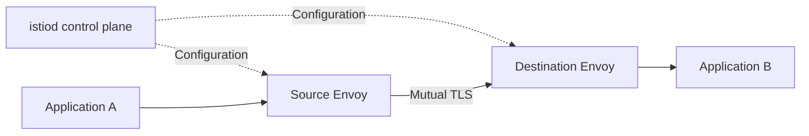
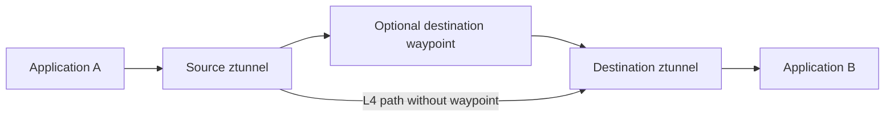
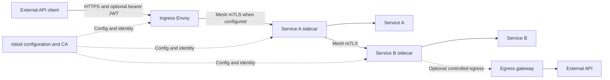

Istio is a service mesh that adds traffic control, workload security, and observability to communication between services. Use it after you understand Kubernetes Pods, Services, DNS, and networking. Start with the architecture, then work through the lab and troubleshooting checklist.

Related learning: [Kubernetes](https://chatgpt.com/space/page_9ba2ce239a4c8191a46e513a00fe2950) and [Networking](https://chatgpt.com/space/page_4901220035688191a5b80d7f41c6ec03).

# Course material

**[Download the original Istio course deck (PDF, 219 pages)](https://chatgpt.com/api/library/files/libfile_1f9a22a7e72c81919bcb8a9a415bed3d/download)**

The deck follows the classic **sidecar** model: foundations and Bookinfo (pp. 10–107), traffic management (pp. 108–160), security (pp. 162–184), and observability (pp. 186–212). The course explains how moving from a monolith to microservices lets teams deploy and scale independently but adds network failures, identity checks, and cross-service debugging. The mesh moves some of that repeated infrastructure work into proxies; it does not remove application-level responsibilities.

Use the deck for concepts and [current sidecar installation instructions](https://istio.io/latest/docs/setup/getting-started/) for commands. Its older minikube, API-version, Operator and SMI examples are historical. Keep the existing ambient exercise separate: it uses ztunnel and waypoints, not one Envoy sidecar per Pod.

# What Istio adds

Kubernetes provides deployment, service discovery, and network connectivity. Istio adds policies for how participating services communicate: encrypted workload connections, access control, request routing, and telemetry. It depends on the underlying cluster network. [What is Istio](https://istio.io/latest/docs/overview/what-is-istio/).

| Need | Example |
| --- | --- |
| Traffic management | Send a small percentage of requests to a new release |
| Workload security | Authenticate service identities with mutual TLS |
| Authorization | Allow only approved callers to reach a service |
| Observability | Examine request rates, errors, and latency |
| Resilience | Set timeouts and carefully bounded retries |

# Architecture

**Control plane:** `istiod` distributes proxy configuration and supports workload identity and certificates. **Data plane:** proxies handle application traffic and enforce the configuration. Application requests pass through the data plane; they do not go through `istiod` for every request. [Istio architecture and modes](https://istio.io/latest/docs/overview/dataplane-modes/).

## Sidecar mode

An Envoy proxy runs alongside each participating application workload. For a typical call, the source proxy handles outbound traffic and the destination proxy handles inbound traffic. Sidecar injection applies when Pods are created; labeling a namespace does not retrofit already running Pods. [Sidecar mode](https://istio.io/latest/docs/overview/dataplane-modes/).



## Ambient mode

Ambient separates the data plane into **ztunnel**, a per-node Layer 4 proxy for the secure overlay, and optional **waypoint** Envoy proxies for Layer 7 processing. HTTP routing, HTTP authorization, and HTTP telemetry require the appropriate Layer 7 path. A waypoint is not an ingress gateway. Istio’s quickstart recommends ambient as the starting point for new users; check feature compatibility for your workload. [Ambient overview](https://istio.io/latest/docs/ambient/overview/), [quickstart](https://istio.io/latest/docs/overview/quickstart/).



# Traffic management vocabulary

| Resource | Purpose |
| --- | --- |
| VirtualService | Defines request matching and routing, such as sending traffic to a particular version |
| DestinationRule | Defines destination subsets and traffic policies |
| Gateway in the Istio API | Configures gateway listener behavior; routing is configured separately |
| ServiceEntry | Adds an external or otherwise unregistered service to the mesh registry |
| Gateway and HTTPRoute in Kubernetes Gateway API | Separate Kubernetes APIs supported by Istio for gateway and routing use cases |

**Example:** deploy `reviews` versions v1 and v2, then route 90% of requests to v1 and 10% to v2. Traffic weights control routing independently of the replica ratio. Verify with many requests rather than expecting every set of ten calls to split exactly nine to one. For ambient HTTP routing, follow the waypoint-based workflow and its supported APIs. [Traffic management](https://istio.io/latest/docs/concepts/traffic-management/).

**Timeouts** limit how long a request can take. **Retries** attempt selected failed requests again; they can amplify traffic and duplicate non-idempotent operations. **Outlier detection** can temporarily remove unhealthy upstream instances. **Mirroring** copies traffic to another destination for testing, so consider any side effects. [Resilience and testing features](https://istio.io/latest/docs/concepts/traffic-management/).

## Kubernetes Service vs Istio VirtualService

A Kubernetes **Service** gives a group of backends a stable DNS name and usually a virtual IP. Its selector determines which Pods belong to it; Kubernetes tracks their addresses in **EndpointSlices**. An Istio **VirtualService** tells a proxy how to route matching traffic: for HTTP, this can include paths or headers, weights, rewrites, timeouts, and retries. It does not own the Pods or publish a Kubernetes ClusterIP. Istio can also route TCP and TLS traffic, and a destination can be registered through a ServiceEntry rather than a Kubernetes Service.

A **DestinationRule** supplies the version subsets and destination policies. Read the three files in this order: **Service finds the backends → DestinationRule groups them → VirtualService chooses a group for each request.** The Service selector must include both versions; the subset selector then filters by `version`. Routing weights are independent of replica counts.

### Worked example with myapp

In a disposable sidecar-enabled namespace, have workloads listening on 8080 with Pod labels `app: myapp` and either `version: v1` or `version: v2`. Apply the resources below in that same namespace. The first rule matches the `/status` prefix before the fallback. The fallback sends about 90% to v1 and 10% to v2 over many requests. For a simpler path-based exercise, replace the fallback’s weighted route with a single v1 destination. The deck uses the same idea with Bookinfo’s `reviews` versions, including a 75/25 split.

```yaml
# service.yaml
apiVersion: v1
kind: Service
metadata:
  name: myapp
spec:
  selector:
    app: myapp
  ports:
    - name: http
      port: 8080
      targetPort: 8080
---
# destinationrule.yaml
apiVersion: networking.istio.io/v1
kind: DestinationRule
metadata:
  name: myapp
spec:
  host: myapp
  subsets:
    - name: v1
      labels: {version: v1}
    - name: v2
      labels: {version: v2}
---
# virtualservice.yaml
apiVersion: networking.istio.io/v1
kind: VirtualService
metadata:
  name: myapp
spec:
  hosts: [myapp]
  http:
    - match:
        - uri: {prefix: /status}
      route:
        - destination: {host: myapp, subset: v2}
    - route:
        - destination: {host: myapp, subset: v1}
          weight: 90
        - destination: {host: myapp, subset: v2}
          weight: 10
```

### How the httpbin ingress example differs

The deck-style `httpbin` rule matches the external HTTP host `httpbin.example.com` and attaches to `httpbin-gateway`. That **Istio Gateway** configures the listener on selected ingress gateway Pods. Its **VirtualService** matches `/status` **or** `/delay` (two match entries) and routes to the `httpbin` **Kubernetes Service** on service port 8000. An unmatched path typically gets 404 if no other route applies. There is no DestinationRule requirement in this example because it does not name a subset. With no `gateways` field, the `myapp` rule defaults to `mesh`, not the ingress gateway; list both the named gateway and `mesh` only if both scopes are intended. Use a fully qualified Service name across namespaces, for example `httpbin.bar.svc.cluster.local` for the default cluster domain.

```yaml
# httpbin-gateway.yaml: plain HTTP for a disposable lab only.
# Verify this selector matches the ingress gateway Pod labels in your install.
apiVersion: networking.istio.io/v1
kind: Gateway
metadata:
  name: httpbin-gateway
spec:
  selector:
    istio: ingressgateway
  servers:
    - port: {number: 80, name: http, protocol: HTTP}
      hosts: [httpbin.example.com]
---
# httpbin-virtualservice.yaml
apiVersion: networking.istio.io/v1
kind: VirtualService
metadata:
  name: httpbin
spec:
  hosts: [httpbin.example.com]
  gateways: [httpbin-gateway]
  http:
    - match:
        - uri: {prefix: /status}
        - uri: {prefix: /delay}
      route:
        - destination:
            host: httpbin
            port: {number: 8000}
```

With a reachable NodePort in the HTTP lab, test the host match with `curl -H 'Host: httpbin.example.com' 'http://<node-ip>:<node-port>/status/200'`. This is a routing test, not the HTTPS configuration described below.

**Traffic experiments:** use a header match plus a fallback for A/B routing, or weights for splitting traffic independent of user identity. Inject a delay or an abort into a small, explicitly scoped test route to see how clients react. Use a request timeout as the overall budget and a retry per-try timeout for each attempt; avoid retrying operations that could repeat side effects. In a DestinationRule, connection-pool limits bound concurrent load and outlier detection can temporarily eject unhealthy endpoints. Test changes one at a time and remove the test policy afterward. [VirtualService](https://istio.io/latest/docs/reference/config/networking/virtual-service/) · [DestinationRule](https://istio.io/latest/docs/reference/config/networking/destination-rule/) · [Kubernetes Service](https://kubernetes.io/docs/concepts/services-networking/service/).

# Security

**Mutual TLS** encrypts a connection and authenticates both workloads. **Authorization** decides whether the authenticated caller may perform an action. Encryption alone does not define who is allowed to call a service. [Istio security](https://istio.io/latest/docs/concepts/security/).

| Policy | Question it answers |
| --- | --- |
| PeerAuthentication | What mutual TLS requirements apply to incoming workload traffic? |
| RequestAuthentication | How should a presented JWT be validated? |
| AuthorizationPolicy | Which requests or identities are permitted or denied? |

A JWT validation policy alone does not require a token: requests without a JWT can still be accepted unless authorization requires one. Layer 7 authorization in ambient needs a waypoint. Keep Kubernetes NetworkPolicy and mesh policy aligned; they act at different enforcement points. [Authentication and authorization](https://istio.io/latest/docs/concepts/security/), [ambient capabilities](https://istio.io/latest/docs/overview/dataplane-modes/).

## Client to ingress to workload

**Client → ingress.** For an HTTP API, the secured first hop is normally **HTTPS**, meaning HTTP inside TLS. The client verifies the gateway’s server certificate. A JWT usually travels inside the encrypted request as `Authorization: Bearer <token>`. TLS protects the connection; JWT request authentication verifies the token from the identity provider. If the listener is configured for **mTLS**, the client also presents a trusted certificate. This authenticates the client at the transport layer and does not replace a JWT policy when the API needs token-based identity.

At a TLS-terminating gateway, Envoy can validate JWTs against the issuer’s public keys (JWKS) with `RequestAuthentication` and authorize the request locally. To **require** a token, pair it with `AuthorizationPolicy`; JWT validation by itself does not reject requests merely because they lack a token. In TLS passthrough, the gateway cannot inspect the encrypted HTTP header; enforcement must occur where HTTP is decrypted. Do not confuse the gateway’s external server certificate with the mesh workload certificate or the JWT issuer’s signing keys.



**Ingress → Service A → Service B.** With ingress-to-workload mTLS configured, the destination proxy can authenticate the gateway as its immediate peer before passing the request to Service A. When A makes a new call to B, B sees A’s workload identity, not the original browser’s identity. If B needs end-user identity, explicitly propagate and validate appropriate request credentials. Outbound requests can go through a separately configured **egress gateway**; it is not on every outbound path by default. Its external TLS/mTLS settings and any API token are separate from mesh peer authentication. [Secure ingress](https://istio.io/latest/docs/tasks/traffic-management/ingress/secure-ingress/) · [TLS configuration](https://istio.io/latest/docs/ops/configuration/traffic-management/tls-configuration/).

## How certificates and public keys move

An **X.509 certificate** binds an identity to a **public key**. It includes the issuer, validity dates, permitted uses, and a CA signature. A public gateway certificate normally identifies the DNS name in a Subject Alternative Name; a workload certificate normally identifies the service account with a SPIFFE URI such as `spiffe://cluster.local/ns/default/sa/service-a`. The certificate, often with intermediate certificates, is what the peer sends during TLS. The peer checks the identity, validity and chain back to a root it already trusts. The private key is not transmitted to the remote peer. In modern TLS, a signature over handshake data proves possession, while ephemeral key exchange and key derivation produce symmetric traffic keys; bulk HTTP traffic is not encrypted with the certificate’s public key.

### Sidecar lifecycle from startup to rotation

1. **Establish trust.** `istiod` watches Kubernetes configuration and distributes routing and policy over xDS. The default Istio CA can sign workload certificates; deployments can also configure an organizational CA or another supported issuer. The CA path is distinct from application traffic.

2. **Start service A.** Kubernetes runs the Pod with its service account. Injection adds the `istio-proxy` container with `pilot-agent` and Envoy. The agent has a projected service-account credential in the standard Kubernetes setup.

3. **Generate keys and request a certificate.** The agent generates a private/public key pair locally and sends a signed certificate signing request (CSR) containing the public key, together with a workload credential, to the CA. The workload private key stays local. The CA authenticates the caller and signs for the authorized workload identity, not an arbitrary name supplied by the Pod.

4. **Give Envoy its identity.** The agent supplies the signed certificate and chain, local private key, and trust material to its Envoy using **Secret Discovery Service (SDS)**. Separately, Envoy receives routing and policy configuration over xDS. Service B does the same with its own workload identity and key pair.

5. **Connect.** A sends a request that is intercepted by its sidecar. The client and server proxies exchange key shares; B presents its certificate chain and proves possession of its key. For mTLS, B requests A’s certificate, and A presents its chain and proof of possession. Each validates the other using configured trust and identity checks. They derive symmetric keys and protect proxy-to-proxy traffic. This does not imply the application-to-local-proxy hop uses TLS.

6. **Authorize locally.** B’s proxy checks its authorization policy against A’s authenticated principal and, for HTTP where available, method/path. For example, allow service A to `GET /orders`; an explicit HTTP authorization denial commonly returns 403. Failed TLS authentication can instead stop the connection before any HTTP response.

7. **Rotate.** The agent obtains replacement credentials before expiry and updates Envoy through SDS. New handshakes use the replacement without restarting the app. Do not assume every installation has the same certificate lifetime or rotation interval. In ambient mode, per-node ztunnel manages workload identities on the L4 path instead of a per-Pod agent and sidecar.

**Policy checks from the course:** `PeerAuthentication` in `STRICT` requires incoming mTLS in the scope where it applies. `PERMISSIVE` accepts mTLS and plaintext, which helps migration. A namespace policy without a selector covers the namespace; a workload selector narrows it. `AuthorizationPolicy` evaluates enforcement actions in the order CUSTOM, DENY, then ALLOW; AUDIT records intent without blocking and needs an audit-capable integration. Scope policies deliberately. [Istio security and identity](https://istio.io/latest/docs/concepts/security/) · [Authentication policies](https://istio.io/latest/docs/tasks/security/authentication/authn-policy/) · [TLS 1.3](https://www.rfc-editor.org/rfc/rfc8446.html).

# Guided practice

Use a disposable learning cluster. Obtain `istioctl` and the sample application files from a supported Istio release, and follow the platform prerequisites and Gateway API setup in the official tutorial. Match the CLI and examples to the release you install. [Ambient getting started](https://istio.io/latest/docs/ambient/getting-started/).

```bash
# Confirm which learning cluster is selected
kubectl config current-context

# Install ambient components in that learning cluster
istioctl install --set profile=ambient

# Create and enroll a dedicated lab namespace
kubectl create namespace istio-lab
kubectl label namespace istio-lab istio.io/dataplane-mode=ambient

# Inspect components and configuration
kubectl get pods -n istio-system
kubectl get pods,svc -n istio-lab
istioctl analyze -n istio-lab
```

These commands install the mesh and enroll the namespace; they do not deploy a sample application or configure ingress. Continue with the official Bookinfo tutorial to deploy services, verify encrypted traffic, add authorization, attach a waypoint, and manage traffic. [Guided tutorial](https://istio.io/latest/docs/ambient/getting-started/).

1. Establish that the application works through its Kubernetes Service.

2. Enroll workloads and verify mesh participation and mutual TLS.

3. Apply a narrowly scoped authorization policy and test both allowed and denied callers.

4. Add a waypoint for an HTTP exercise and verify traffic actually traverses it.

5. Shift traffic between versions, observe results, and restore the baseline.

## Sidecar Bookinfo and observability lab

1. Follow the [sidecar quickstart](https://istio.io/latest/docs/setup/getting-started/) in a disposable cluster, enable sidecar injection before creating the workloads, and deploy the release-matched Bookinfo sample. Check `kubectl get pods` for `2/2 Ready` on an ordinary app-plus-proxy Pod. In Bookinfo, `productpage` calls `details` and `reviews`; some review versions call `ratings`. See the [annotated Bookinfo manifest](https://chatgpt.com/space/page_dad52531d1608191a392d666ac59665b).

2. Verify the ingress and repeat requests to `/productpage`. Open Kiali with `istioctl dashboard kiali` after installing the release-matched lab add-ons. Generate traffic before interpreting an empty graph. Compare app, versioned app, workload and service views; inspect health and config before changing policy.

3. Compare **metrics, traces and logs**. Prometheus collects request volume, error rate and duration; Grafana plots them. A tracing backend such as Jaeger shows which network hops contributed latency for a sampled request. Configure the tracer for your release and propagate trace-context headers in the application for related spans to link. Access logs help explain an individual request. Use the add-ons for experiments, not as a production monitoring setup. [Istio observability](https://istio.io/latest/docs/concepts/observability/).

## Reproducing the cross-namespace mTLS lesson safely

The older screenshots use Bookinfo in `default` and manually inject `httpbin` in namespace `bar` with `istioctl kube-inject`. For a fresh lab use disposable namespaces and the currently supported sample and injection methods. Wait for the caller and target Pods to be Ready. Before applying a policy, record an HTTP baseline from a sidecar-injected **application/client container** with curl and, separately, an uninjected client. The sample address in the screenshots is `http://productpage.default:9080`; adjust the service, namespace and path to your setup, for example `/productpage`. An application can call an `http://` Service URL while its proxy encrypts the network hop.

```yaml
apiVersion: security.istio.io/v1
kind: PeerAuthentication
metadata:
  name: demo-strict
  namespace: istio-lab
spec:
  mtls:
    mode: STRICT
```

Set the namespace to the Bookinfo **destination** namespace in your sidecar lab. After applying the example policy, the injected application client should still work if auto mTLS and the route are healthy. The plaintext client should fail. The screenshots show a `200` baseline and then `000` / curl exit 56 after STRICT when running from `istio-proxy` itself. Envoy-owned traffic can bypass ordinary interception, so curl from that container is not a reliable positive mTLS test; verify from an app/client container. `000` means curl saw no HTTP status, not that Istio sent an HTTP status of 000. Early `container not found` is consistent with the Pod still initializing; check `kubectl get pods` and rollout status first. Remove only your lab policy after testing.

# Troubleshooting

| Symptom | First checks |
| --- | --- |
| No connection | Pod readiness, Service selectors, EndpointSlices, ports, DNS, and network policy |
| Sidecar missing | Namespace labels, injection configuration, and whether the Pod was recreated |
| Ambient workload not enrolled | Namespace or Pod enrollment labels, CNI, and ztunnel health |
| HTTP rule has no effect | Traffic path, host and route match, and waypoint enrollment in ambient |
| Access denied | Workload identity, JWT requirements, policy scope, and enforcement point |
| Unexpected upstream errors | Healthy endpoints, TLS configuration, timeouts, and proxy logs |

```bash
kubectl get pods,svc,endpointslices -n istio-lab
kubectl describe pod <pod-name> -n istio-lab
istioctl analyze -n istio-lab

# For sidecar Envoy troubleshooting
istioctl proxy-status
istioctl proxy-config clusters <pod-name> -n istio-lab
```

`istioctl analyze` checks configuration for potential problems. Envoy proxy commands are useful for sidecars and relevant gateway proxies; use the dedicated ztunnel and waypoint diagnostics for ambient traffic. [istioctl diagnostics](https://istio.io/latest/docs/ops/diagnostic-tools/istioctl/), [ambient documentation](https://istio.io/latest/docs/ambient/).

## Reading the gateway Service and backend addresses

- `kubectl -n istio-system get svc istio-ingressgateway`: in the pasted output the gateway Service is **NodePort**, its ClusterIP is `172.16.68.6`, and its External-IP is `<none>`. A client that can reach a permitted node address can reach the gateway through `<node-IP>:<nodePort>`. `80:30080/TCP` would mean Service port 80 maps to NodePort 30080; it is an example, not the port in the truncated output. The Kubernetes Service gets you to Envoy; the Istio Gateway listener and VirtualService decide which HTTP host and path are routed.

- `kubectl describe svc myapp -n default`: the Service has ClusterIP `172.16.73.216`, IPv4 SingleStack, and TCP port 8080 named `http` mapping to target port 8080. The Service object’s own `app=mypp` label is separate from its Pod selector `app=myapp`. Only the selector determines the automatic backends. `Session Affinity: None` means no client-IP stickiness is configured, not a promise of round-robin across HTTP requests. `Internal Traffic Policy: Cluster` permits eligible endpoints across nodes. `Events: <none>` means none were listed at that time.

- `192.168.0.10:8080` and `192.168.0.11:8080` are two backend address/port pairs, normally two Pods for this selector-based example. They do not identify the Deployment by themselves: compare IPs and then check the Pods’ owner references (typically ReplicaSet → Deployment). Empty or unusable endpoints can come from a selector mismatch, readiness, namespace, or port configuration. Prefer EndpointSlices; `kubectl get ep myapp` is the older view.

```bash
kubectl -n istio-system get svc istio-ingressgateway -o yaml
kubectl -n default get svc myapp -o wide
kubectl -n default describe svc myapp
kubectl -n default get endpointslices -l kubernetes.io/service-name=myapp -o wide
kubectl -n default get pods -l app=myapp -o wide
```

# Learning checkpoints

- [ ] Explain what the control plane does and where application traffic flows.

- [ ] Draw the difference between a sidecar path and an ambient path.

- [ ] Distinguish service discovery, routing, authentication, and authorization.

- [ ] Explain when ambient needs a waypoint.

- [ ] Demonstrate a traffic split and an allowed versus denied request.

- [ ] Diagnose a broken Kubernetes Service before changing mesh policies.

```
                 YOUR LAPTOP                              CLUSTER
          ┌──────────────────────┐
browser ─►│ :8080 kubectl tunnel │──┐          Service istio-ingressgateway (istio-system)
          └──────────────────────┘  │          type LoadBalancer
                                    │          ┌──────────────────────────────────────────┐
   [cloud: browser ─► EXTERNAL-IP:80 ─►]───────│ port 80    → targetPort 8080  (HTTP)      │
                                               │ port 443   → targetPort 8443  (HTTPS)     │
                                               │ port 15021 → targetPort 15021 (health)    │
                                               │ nodePorts 3xxxx assigned automatically    │
                                               └────────────────────┬─────────────────────┘
                                                                    │ to pod 10.244.1.7
                              ┌─────────────────────────────────────▼──────────────────────┐
                              │  GATEWAY POD  (istio-system, label istio: ingressgateway)   │
   ROLE 1: FRONT DOOR         │  one container: istio-proxy  (pilot-agent + Envoy)          │
                              │                                                             │
                              │  Envoy listeners:                                           │
                              │    :8080  HTTP   ◄── Gateway "number: 80" → Svc 80 → 8080   │
                              │    :8443  HTTPS  (no Gateway server for it here, so idle)   │
                              │    :15021 health check  (readiness probe hits this)         │
                              │    :15090 Prometheus metrics                                │
                              │    :15000 admin (localhost only)                            │
                              │    :15020 agent health/metrics                              │
                              │                                                             │
                              │  Route table "http.80"  ◄── VirtualService "bookinfo"       │
                              │    /productpage, /static, /login, /logout, /api/v1/products │
                              │      → cluster outbound|9080||productpage.bookinfo.svc...   │
                              │    anything else → 404                                      │
                              └────────────────────────────┬────────────────────────────────┘
                                                           │ mTLS to 10.244.2.3:9080
                                                           │ (cert identity: istio-ingressgateway SA)
                                     Service productpage: port 9080 → targetPort 9080
                                                           │
             ┌─────────────────────────────────────────────▼──────────────────────────────┐
             │  PRODUCTPAGE POD  (bookinfo, labels app: productpage, version: v1)          │
   ROLE 2:   │  containers: productpage (Python)  +  istio-proxy (pilot-agent + Envoy)      │
   SIDECAR   │  init container istio-init already ran: iptables redirects installed        │
             │                                                                              │
             │   ───── INBOUND ─────                                                        │
             │   packet arrives at pod IP :9080                                             │
             │     │ iptables REDIRECT                                                      │
             │     ▼                                                                        │
             │   ┌──────────────────────┐                     ┌────────────────────────┐   │
             │   │ Envoy (istio-proxy)  │                     │ Python app             │   │
             │   │                      │  plain HTTP         │                        │   │
             │   │ :15006 inbound  ─────┼────────────────────►│ listens 0.0.0.0:9080   │   │
             │   │   terminate mTLS     │  to 127.0.0.1:9080  │ (containerPort 9080)   │   │
             │   │   PeerAuthentication │                     │                        │   │
             │   │   AuthorizationPolicy│                     │ app calls              │   │
             │   │                      │                     │  details:9080          │   │
             │   │ :15001 outbound ◄────┼─────────────────────┤  reviews:9080          │   │
             │   │   VirtualService     │  iptables REDIRECT  │                        │   │
             │   │   DestinationRule    │  of outbound calls  └────────────────────────┘   │
             │   │   start mTLS         │                                                   │
             │   │                      │                                                   │
             │   │ :15021 health check  │   (readiness probe → istio-proxy ready → 2/2)     │
             │   │ :15090 metrics       │                                                   │
             │   │ :15020 agent         │                                                   │
             │   │ :15000 admin (local) │                                                   │
             │   └──────────┬───────────┘                                                   │
             └──────────────┼───────────────────────────────────────────────────────────────┘
                            │ mTLS to details pod :9080     (cert identity: bookinfo-productpage SA)
                            │ mTLS to reviews  pod :9080    (90/10 → v1 or v2, LEAST_REQUEST)
                            ▼
                   each target pod: same layout, inbound :15006 → app 127.0.0.1:9080
```

