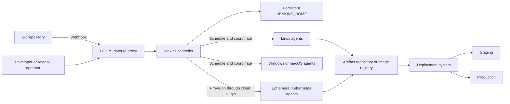
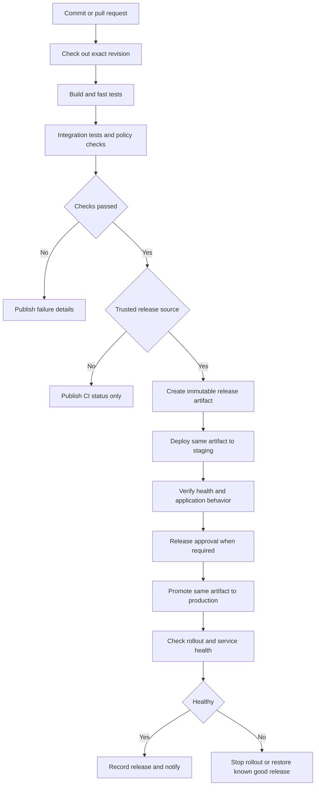

Jenkins is an open source automation server that coordinates repeatable work such as compiling software, running tests, producing release artifacts, and deploying applications. Its main value is making the path from a source change to a verified release visible, repeatable, and auditable.

This guide moves from fundamentals to production operation: purpose, architecture choices, setup, the full delivery lifecycle, Pipeline code, customization, plugins, security, scaling, recovery, and troubleshooting. The examples use Linux, Git, Maven, containers, and Kubernetes; the same orchestration principles apply to other languages and deployment targets. Start with a small pipeline, keep its definition in version control, and add infrastructure only when it solves a measured need. [Jenkins Handbook](https://www.jenkins.io/doc/book/)

**Version context as of October 24 2026:** select Jenkins core, Java, agent images, and plugins as a compatible set. The current Java policy lists Java 21 and 25 as supported runtimes; old tutorials assuming Java 8, 11, or 17 may target obsolete Jenkins releases. Application compilation can use a different JDK from the one running the Jenkins controller or agent. Blue Ocean has been deprecated since July 2026 and receives no further security or functionality updates; use Pipeline Graph View or Stage View for new installations. [Java support policy](https://www.jenkins.io/doc/book/platform-information/support-policy-java/), [Blue Ocean status](https://www.jenkins.io/doc/book/blueocean/)

# Screenshot study materials

Use the 31-page study guide for a structured path through the Jenkins training screenshots. It includes six practical labs, 30 review questions with answers, 24 flashcards, a seven-day study plan, and corrected Pipeline, shell, CLI, and API examples. The complete editable text appears in the Screenshot study guide section at the end of this page.

[Jenkins Study Guide PDF](library-file:fde1_bGliZmlsZV96UVo1SEZOZ0Y1WFpNZm82N3g4OUdB_FileDrive_fc98beb9c73c8191bcdca125cc9ba162)

[Jenkins Study Guide Word](library-file:fde1_bGliZmlsZV93d0NQQndvVzlxOW85QnJYaEU1TW1n_FileDrive_fc98beb9c73c8191bcdca125cc9ba162)

[Complete Jenkins Study Pack](library-file:fde1_bGliZmlsZV8tRmx4WDZ6MlZ4c3lseUhpb0NUc0FR_FileDrive_fc98beb9c73c8191bcdca125cc9ba162)

The complete pack includes both guide formats, copyable shell scripts and Jenkinsfiles, setup notes, and an index of all 101 screenshots. Of those captures, 98 contain readable lesson content and three are too small to use.

# Purpose and core concepts

## What Jenkins automates

A developer pushes a change. Jenkins receives an event, retrieves the relevant revision, allocates a suitable worker, executes a defined sequence, records the outcome, and reports success or failure. Build tools do the compilation, test frameworks run tests, and deployment tools update environments. Jenkins connects these tools and controls the order of work.

Typical uses include application CI/CD, scheduled integration tests, packaging libraries, building mobile applications, producing container images, validating infrastructure changes, and generating documentation. A job can also run maintenance scripts, provided its permissions and retry behavior match the task.

| Term | Meaning |
| --- | --- |
| Continuous integration or CI | Frequently integrate changes and automatically check that the combined code builds and passes its agreed tests |
| Continuous delivery | Keep a verified release ready for deployment, with an explicit decision before production |
| Continuous deployment | Automatically deploy every change that passes the defined release policy |
| Pipeline | The automation process expressed as a sequence or graph of steps |
| Jenkinsfile | A versioned file containing a Pipeline definition |
| Job | A configured Jenkins item that can produce runs |
| Build or run | One execution of a job, with its own number, logs, result, and metadata |
| Stage | A named part of the process, such as Build or Test |
| Step | An individual operation, such as running a shell command |
| Artifact | A retained output, such as a JAR, report, or release manifest |

These definitions separate the orchestration from the work it invokes. A green pipeline means its configured checks passed; it does not prove that every possible defect has been excluded.

## When Jenkins is a useful choice

Jenkins fits environments that need substantial control over execution machines, network access, toolchains, or existing integrations. It can coordinate Windows, Linux, macOS, specialized hardware, and private infrastructure.

The tradeoff is operational ownership: someone must maintain the controller, plugins, agents, credentials, capacity, and backups. For a simple repository with conventional hosted runners, compare this effort with a managed CI service. Evaluate the full operating cost, including maintenance and incident response, rather than only the software license.

# Architecture and internal execution

## Controller and agents

The **controller** hosts the web interface, configuration, scheduling, and Pipeline coordination. **Agents** supply execution capacity. An agent is usually a separate VM, container, physical host, or Kubernetes pod. An **executor** is a slot for concurrent work on a node; adding slots does not add CPU or memory. **Labels** describe capabilities used to select nodes.

Keep production builds off the controller by setting its built-in executors to zero, then provide separate agents. A workspace is the working directory used by a run; it is temporary execution state and should not be treated as the only copy of a release. Agents require a supported Java runtime and connectivity to the controller. [Using Jenkins agents](https://www.jenkins.io/doc/book/using/using-agents/)



The arrows describe logical responsibilities. The direction in which an agent connection is initiated depends on its launcher. Inbound agents can connect to Jenkins, including over WebSocket where supported; SSH launchers allow the controller to initiate the connection to a worker.

## What happens inside a run

The scheduler matches requested labels, available executors, node restrictions, and other constraints. Work can remain queued even when another machine is idle if that machine does not satisfy the job requirements.

Pipeline Groovy coordinates steps through the controller. Commands invoked by `sh`, `bat`, or `powershell` execute on the allocated agent. This distinction explains why moving heavy parsing into Groovy can overload the controller despite having large build workers.

Pipeline uses a continuation passing style transformation so execution state can be persisted and resumed. Restart recovery depends on the steps, persistence settings, and infrastructure surviving the interruption; deployments must still be designed to tolerate interruption. [Pipeline execution and CPS](https://www.jenkins.io/doc/book/pipeline/cps-method-mismatches/)

## Important storage boundaries

| Storage | What it holds | Design implication |
| --- | --- | --- |
| JENKINS_HOME | Controller configuration, job definitions, build records, plugins, secret related material | Persistent, access controlled, backed up |
| Agent workspace | Checkout and intermediate files | Rebuildable; isolate and clean between trust boundaries |
| Dependency cache | Maven, npm, or other downloaded dependencies | Improve speed; prevent untrusted jobs poisoning trusted caches |
| Artifact repository | Versioned packages intended for reuse or release | Use immutable versions, retention, and access controls |
| Container registry | Container manifests and image layers | Promote by digest where possible |
| External secret store | Tokens, keys, and short lived identities | Restrict by job, environment, and purpose |

An artifact repository and registry are architectural choices outside Jenkins core. Their exact configuration depends on the selected products.

## Jenkins home directory layout

`JENKINS_HOME` stores the controller's persistent state. Linux package installations commonly use `/var/lib/jenkins`; the Docker example later in this guide uses `/var/jenkins_home`. Confirm the actual location in **Manage Jenkins → System → Home directory**. [Jenkins home directory](https://www.jenkins.io/doc/book/managing/system-configuration/#jenkins-home-directory)

`tree /var/lib/jenkins` prints this hierarchy: indentation indicates nesting, and each branch is a file or directory. For example, job `payments-service`, build `42`, uses `jobs/payments-service/builds/42/`. Jenkins core uses file-based persistence for much of its state; plugins and external services can store data elsewhere.

The following simplified layout expands the directory details from the supplied screenshot. Build records normally belong to each job under `jobs/[JOBNAME]/builds/`; a top-level `builds/` directory is not the usual default. Folder jobs add further `jobs/` levels, and configured storage paths can differ.

```text
JENKINS_HOME/                   # e.g. /var/lib/jenkins
├── config.xml
├── *.xml                      # other global configuration files
├── credentials.xml            # local system credentials, if used
├── fingerprints/
├── identity.key.enc
├── jobs/
│   └── [JOBNAME]/
│       ├── config.xml
│       └── builds/
│           └── [BUILD_ID]/
│               ├── build.xml
│               ├── changelog.xml
│               └── log        # common Freestyle console storage
├── plugins/
│   └── [PLUGIN].jpi           # .hpi packages may also be present
├── secrets/
│   ├── hudson.util.Secret
│   ├── master.key
│   └── InstanceIdentity.KEY
├── userContent/
└── workspace/
```

### Configuration jobs and build records

| Path relative to JENKINS_HOME | Purpose |
| --- | --- |
| `config.xml` | Root Jenkins configuration |
| Other `*.xml` files | Site-wide and plugin configuration |
| `jobs/` | Job definitions, with a subdirectory for each job |
| `jobs/[JOBNAME]/config.xml` | Configuration of that individual job |
| `jobs/[JOBNAME]/builds/` | Retained build records for the job |
| `builds/[BUILD_ID]/build.xml` within a job | Persisted build metadata, including its result |
| `builds/[BUILD_ID]/changelog.xml` within a job | SCM change information when produced by the job and SCM integration; Pipeline layouts can differ |
| `fingerprints/` | Artifact fingerprint records, when fingerprinting is used |

`[JOBNAME]`, `[BUILD_ID]`, and `[PLUGIN]` are placeholders. Modern build directories normally use the build number, such as `42`. [Job build storage API](https://javadoc.jenkins.io/hudson/model/Job.html#getBuildDir()), [Build record backups](https://www.jenkins.io/doc/book/system-administration/backing-up/#jobs-subdirectory)

### Plugins secrets and instance identity

| Path relative to JENKINS_HOME | Purpose |
| --- | --- |
| `plugins/` | Installed plugin packages and their expanded directories |
| `plugins/[PLUGIN].jpi` or `.hpi` | Packaged plugin archive |
| `identity.key.enc` | Encrypted RSA key material identifying the instance |
| `secrets/` | Encryption and identity key material used by Jenkins and plugins |
| `secrets/hudson.util.Secret` | Key used to encrypt some stored Jenkins data, including credential secrets |
| `secrets/master.key` | Protects the stored `hudson.util.Secret` key |
| `secrets/InstanceIdentity.KEY` | Instance identity key material |

The identity files shown can vary with the installed components and version. Treat the secret material as sensitive controller state. Keep `master.key` in a separately secured recovery location, as described in **Backups upgrades and disaster recovery**. [Home directory reference](https://www.jenkins.io/doc/book/managing/system-configuration/#jenkins-home-directory), [Controller key backup guidance](https://www.jenkins.io/doc/book/system-administration/backing-up/#back-up-the-controller-key-separately)

### Served files and working directories

`userContent/` holds files served under `https://server/userContent/`, including any Jenkins URL context path. `workspace/` holds working directories for source checkouts and build intermediates on the controller when it executes builds. With separate agents, workspaces normally live on those agents; their location can be customized. Workspaces are rebuildable execution state, while build records retain run history. [Jenkins directory reference](https://www.jenkins.io/doc/book/managing/system-configuration/#jenkins-home-directory)

### Static content examples

Files placed here can be served at `https://your-jenkins-server/userContent/`. People use it for a company logo, custom CSS, a shared help page, or small helper scripts that jobs download. Access follows the instance's access controls; do not place secrets here. A fresh installation may include a `readme.txt`.

```
userContent/
├── readme.txt
├── acme-logo.png        → https://jenkins.acme.com/userContent/acme-logo.png
└── deploy-guide.html    → https://jenkins.acme.com/userContent/deploy-guide.html
```

---

### Workspace example

When a job runs on the Jenkins server itself, it checks out the source code here, in one folder per job, and runs its build steps there. It's scratch space: the next build reuses or cleans it, and can generally be recreated from source and dependencies. Clean it only when no active run needs it, and preserve any unarchived outputs or local state that matter.

```
workspace/
└── payments-service/
    ├── Jenkinsfile
    ├── pom.xml
    ├── src/
    │   └── main/java/BankAccount.java
    └── target/
        └── payments-service-1.4.0.jar
```

Builds that run on separate agent machines use workspaces on those machines instead of this folder.

### Other controller directories

A real JENKINS_HOME usually also contains:

- **`users/`**: one folder per Jenkins user, with per-user settings and, where applicable, API token metadata; storage layouts vary.

- **`nodes/`**: configuration for each agent machine.

- **`logs/`**: some controller or plugin logs; service logs may instead be in the system journal or another configured location.

- **`updates/`**: cached plugin update information.

- **`secret.key`**: an older key file kept for compatibility.

## Reading build records

Every time a job runs, Jenkins creates a numbered folder for that run (`1`, `2`, ..., `42`). This is the history you see on a job's page in the Jenkins web UI.

### Build result metadata

Jenkins is written in Java and retains historical Hudson package names. A job is a `hudson.model.Job`; each execution is a `hudson.model.Run`, such as a Freestyle build or Pipeline run. Jenkins uses XStream-based XML persistence for build metadata, saving state during the run as well as on completion. Typical storage is `JENKINS_HOME/jobs/[JOBNAME]/builds/[BUILD_NUMBER]/build.xml`. This simplified Freestyle example uses historical Jenkins version 2.462.3; XML details differ by job type and installed plugins.

```xml
<?xml version='1.1' encoding='UTF-8'?>
<build>
  <actions>
    <hudson.model.CauseAction>
      <causeBag class="linked-hash-map">
        <entry>
          <hudson.model.Cause_-UserIdCause>
            <userId>roshan</userId>
          </hudson.model.Cause_-UserIdCause>
          <int>1</int>
        </entry>
      </causeBag>
    </hudson.model.CauseAction>
  </actions>
  <queueId>57</queueId>
  <timestamp>1729789200000</timestamp>
  <startTime>1729789200512</startTime>
  <result>SUCCESS</result>
  <duration>84213</duration>
  <charset>UTF-8</charset>
  <keepLog>false</keepLog>
  <workspace>/var/lib/jenkins/workspace/payments-service</workspace>
  <hudsonVersion>2.462.3</hudsonVersion>
</build>
```

What the fields mean:

- **`UserIdCause` / `userId`**: the recorded cause attributes the request to account `roshan`. This commonly comes from a manual action, but alone does not prove a browser click. Other causes include timers, SCM polling and upstream jobs; webhook cause classes depend on the integration.

- **`timestamp` / `startTime`**: when the build was scheduled and when execution started, in milliseconds since 1 January 1970 (Unix epoch time).

- **`result`**: `SUCCESS`, `UNSTABLE` (for example, tests or quality checks failed), `FAILURE`, `ABORTED`, or `NOT_BUILT`.

- **`duration`**: 84,213 ms, about 1 minute 24 seconds.

- **`queueId`**: the associated queue-item identifier, here `57`.

- **`charset`**: the console text encoding, here UTF-8.

- **`workspace`**: the working directory used by this Freestyle run, on the machine where it executed.

- **`keepLog`**: if `true`, normal build discarders retain the build; this can be set through the UI, an API, or automation.

- **`hudsonVersion`**: the Jenkins version that ran the build. Jenkins was originally called Hudson, which is why `hudson` still appears throughout these files.

#### Interpreting actions and build causes

`<actions>` holds persisted action objects attached to the run. Core and plugin actions can carry parameters, test metadata, environment-related data or trigger information; not every action or report must live directly in this XML.

| XML element | Meaning |
| --- | --- |
| `hudson.model.CauseAction` | Records why the run was requested; builds can have multiple causes |
| `causeBag class="linked-hash-map"` | A `Map<Cause, Integer>` backed by a `LinkedHashMap`; distinct causes retain insertion order, while duplicate causes are combined into counts |
| `entry` | One cause as the key and its count as the value |
| `hudson.model.Cause_-UserIdCause` | XML spelling of Java nested class `Cause.UserIdCause` |
| `userId` | The Jenkins account identifier attributed to that user cause, here `roshan` |
| `int` with value `1` | One occurrence of this cause; a count rather than a priority or weight |

Java uses `$` in nested-class binary names. XStream encodes that character as `_-`, which explains `Cause_-UserIdCause`. Multiple requests can fold into one queued item, so one run can retain several causes. The XML describes recorded attribution, while the console log and provider delivery history help establish the wider sequence. [CauseAction source](https://github.com/jenkinsci/jenkins/blob/master/core/src/main/java/hudson/model/CauseAction.java), [UserIdCause API](https://javadoc.jenkins.io/hudson/model/Cause.UserIdCause.html)

### Source change records

SCM changelogs feed the run's **Changes** page. The comparison baseline and file format depend on the SCM plugin and checkout settings. A Git changelog can contain plain Git log text despite an `.xml` filename; Pipeline runs may have multiple checkout-specific changelog files. The illustrative object IDs below are examples, not verified repository objects:

```
commit 3f2a9c1e7b4d5a6f8e9c0b1a2d3e4f5a6b7c8d9e
tree 8a7b6c5d4e3f2a1b0c9d8e7f6a5b4c3d2e1f0a9b
parent 1e2d3c4b5a6f7e8d9c0b1a2f3e4d5c6b7a8f9e0d
author Jane Doe <jane@acme.com> 1729785600 -0700
committer Jane Doe <jane@acme.com> 1729785600 -0700

    Fix rounding error in withdraw()

:100644 100644 a1b2c3d e4f5a6b M	src/main/java/BankAccount.java
```

Here one commit attributed to Jane modified (`M`) `BankAccount.java`. With no relevant changes, the changelog may be empty or absent. First-build behavior, shallow history, branch selection and disabled changelog generation also affect what appears.

#### Interpreting the Git commit and raw diff

The example combines a formatted commit log with a raw diff summary. It is not the literal output of `git cat-file -p` alone: the leading `commit` line, message indentation and diff summary come from log formatting.

| Field | Meaning |
| --- | --- |
| `commit` | Object ID identifying the commit object |
| `tree` | Root tree object describing a snapshot, with names, modes and references to blobs or nested trees |
| `parent` | Immediate predecessor; root commits have none, ordinary commits one, and merges two or more |
| `author` | Recorded author identity and authorship time |
| `committer` | Recorded identity and time of the person or process creating this commit object; it can differ after applying a patch or cherry-picking |
| Message | Human-readable explanation, here `Fix rounding error in withdraw()`; issue linking or semantic versioning requires configured integrations |

Git is content addressed. A commit ID hashes its object header and contents, including its tree, parents, identities, times and message. A changed tracked file changes its blob and affected trees, then the commit referencing that tree. Git represents snapshots logically, while packfiles can use delta compression physically. The 40-character IDs shown use SHA-1; SHA-256 repositories use 64-character object IDs. Object IDs identify content and reveal alterations, but do not authenticate a person's identity or guarantee freedom from hash collisions. [Git objects](https://git-scm.com/book/en/v2/Git-Internals-Git-Objects), [Git hash transition](https://git-scm.com/docs/hash-function-transition)

`1729785600` is Unix time in seconds: October 24 2024 at 16:00 UTC, or 09:00 at offset `-0700`. That offset means UTC minus seven hours; it is compatible with Pacific Daylight Time but does not uniquely identify a timezone. Jenkins build timestamps in the preceding XML use milliseconds instead.

The line `:100644 100644 a1b2c3d e4f5a6b M` followed by a tab and `src/main/java/BankAccount.java` describes one changed path:

- The colon marks a raw diff record. The two modes describe the old and new file: `100644` is a regular non-executable file; `100755` is executable.

- `a1b2c3d` and `e4f5a6b` are abbreviated old and new blob IDs, not commit IDs.

- `M` means modified. Other statuses include `A` added, `D` deleted and `R` renamed; renames can include a similarity score and two paths.

- The final field identifies the changed path. A raw summary describes the file change, while a patch shows the changed lines. [Git raw diff format](https://git-scm.com/docs/diff-format)

Jenkins' Git integration fetches and checks out a selected revision using command-line Git or supported JGit configurations, then generates changelogs according to checkout options. The trigger cause answers **why the build ran**; the changelog answers **which source changes were recorded**. The triggering Jenkins user, Git author and Git committer can all be different people. [Jenkins Git plugin](https://plugins.jenkins.io/git/)

### Console output

A traditional Freestyle build commonly stores console output in `log` (sometimes compressed as `log.gz`). Pipeline or external log storage can use other layouts. An illustrative console session is:

```
Started by user Roshan Xavier
Running as SYSTEM
Building in workspace /var/lib/jenkins/workspace/payments-service
 > git fetch --tags --force --progress -- https://github.com/acme/payments-service.git
Checking out Revision 3f2a9c1e7b4d (refs/remotes/origin/main)
[payments-service] $ mvn clean package
[INFO] Tests run: 48, Failures: 0, Errors: 0, Skipped: 0
[INFO] BUILD SUCCESS
Finished: SUCCESS
```

[Run persistence and timing API](https://javadoc.jenkins.io/hudson/model/Run.html)

## Reading controller configuration

Root `config.xml` holds core global settings, including built-in node executors, security, views and default storage paths. Saving system or security settings can update it; plugin settings may be stored elsewhere. The XML below illustrates historical serialization, not a complete configuration to import. Its broad logged-in-user authorization is suitable only for understanding the fields. Use the restricted authorization strategy described in **Security and access control** for production.

```xml
<?xml version='1.1' encoding='UTF-8'?>
<hudson>
  <version>2.462.3</version>
  <numExecutors>0</numExecutors>
  <mode>NORMAL</mode>
  <useSecurity>true</useSecurity>
  <authorizationStrategy class="hudson.security.FullControlOnceLoggedInAuthorizationStrategy">
    <denyAnonymousReadAccess>true</denyAnonymousReadAccess>
  </authorizationStrategy>
  <securityRealm class="hudson.security.HudsonPrivateSecurityRealm">
    <disableSignup>true</disableSignup>
  </securityRealm>
  <workspaceDir>${JENKINS_HOME}/workspace/${ITEM_FULL_NAME}</workspaceDir>
  <buildsDir>${ITEM_ROOTDIR}/builds</buildsDir>
  <quietPeriod>5</quietPeriod>
  <views>
    <hudson.model.AllView>
      <name>all</name>
    </hudson.model.AllView>
  </views>
  <primaryView>all</primaryView>
  <slaveAgentPort>50000</slaveAgentPort>
</hudson>
```

What the key fields mean:

- **`numExecutors`**: built-in node execution slots, set to `0` here to keep builds off the controller. Setting it to `2` would allow two tasks concurrently on that node; this is not a limit on all agent capacity.

- **`authorizationStrategy`**: logged-in users can do everything, and anonymous visitors can't even view pages.

- **`securityRealm`**: Jenkins manages its own user list, and people can't sign themselves up.

- **`workspaceDir`** and **`buildsDir`**: these confirm the correction above. Builds are stored under each job's own folder (`${ITEM_ROOTDIR}`).

- **`quietPeriod`**: a default 5-second delay before eligible builds start; some triggers or jobs override it. Requests may coalesce, but this does not guarantee one build per burst of commits.

- **`slaveAgentPort`**: the inbound TCP agent port, here `50000`. The legacy field name remains; WebSocket or SSH connections do not require this port. Expose it only when that transport is used.

---

### Other global configuration files

Many plugins and settings descriptors save separate XML files at the root; some use other storage. Typical ones:

```
hudson.tasks.Maven.xml                          # Maven installations
hudson.plugins.git.GitTool.xml                  # Git installations
jenkins.model.JenkinsLocationConfiguration.xml  # Jenkins URL, admin email
credentials.xml                                 # stored credentials (encrypted)
```

For example, `jenkins.model.JenkinsLocationConfiguration.xml`:

```xml
<?xml version='1.1' encoding='UTF-8'?>
<jenkins.model.JenkinsLocationConfiguration>
  <adminAddress>jenkins-admin@acme.com</adminAddress>
  <jenkinsUrl>https://jenkins.acme.com/</jenkinsUrl>
</jenkins.model.JenkinsLocationConfiguration>
```

And `credentials.xml`, which matters for the `secrets` section later:

```xml
<com.cloudbees.plugins.credentials.SystemCredentialsProvider>
  <domainCredentialsMap class="hudson.util.CopyOnWriteMap$Hash">
    <entry>
      <com.cloudbees.plugins.credentials.domains.Domain>
        <specifications/>
      </com.cloudbees.plugins.credentials.domains.Domain>
      <java.util.concurrent.CopyOnWriteArrayList>
        <com.cloudbees.plugins.credentials.impl.UsernamePasswordCredentialsImpl>
          <scope>GLOBAL</scope>
          <id>github-token</id>
          <description>GitHub access for CI</description>
          <username>acme-ci-bot</username>
          <password>{AQAAABAAAAAQx7Kp2mN4vR8sT1uW...}</password>
        </com.cloudbees.plugins.credentials.impl.UsernamePasswordCredentialsImpl>
      </java.util.concurrent.CopyOnWriteArrayList>
    </entry>
  </domainCredentialsMap>
</com.cloudbees.plugins.credentials.SystemCredentialsProvider>
```

The `{AQAAAB...}` password is an illustrative encrypted value, not a usable credential. Credential IDs such as `github-token` let jobs refer to stored secrets without embedding them in the job definition. Usernames, IDs and descriptions can remain readable, and poorly configured jobs can still hard-code or expose secrets. Credential providers can also use folder, user or external storage. Manage these files through Jenkins or versioned configuration tooling; do not edit a live controller's XML as a routine configuration method.

`numExecutors`, `mode`, `useSecurity`, `views` and `primaryView` control core behavior; `charset` in build records describes log encoding. Historical `hudson` names reflect Jenkins' origin. The version strings in these sample files are examples, not installation recommendations. [Jenkins system configuration](https://www.jenkins.io/doc/book/managing/system-configuration/)

## Fingerprints and artifact provenance

Jenkins' traditional fingerprint mechanism identifies a file by its MD5 digest, commonly a build artifact such as a `.jar`. Jenkins uses it to answer questions such as "which build produced this exact file, and which other jobs used it?" That's useful when one job builds a library and another deploys it.

Files are spread across subfolders named after the first characters of the hash, so no single folder gets huge:

```
fingerprints/ab/cd/ef0123456789abcdef0123456789ab.xml
```

Sample content:

```xml
<?xml version='1.1' encoding='UTF-8'?>
<fingerprint>
  <timestamp>2026-10-24 10:00:00.0 UTC</timestamp>
  <original>
    <name>payments-service</name>
    <number>42</number>
  </original>
  <md5sum>abcdef0123456789abcdef0123456789ab</md5sum>
  <fileName>payments-service-1.4.0.jar</fileName>
  <usages>
    <entry>
      <string>deploy-to-staging</string>
      <ranges>17</ranges>
    </entry>
  </usages>
</fingerprint>
```

This reads as: `payments-service-1.4.0.jar` was created by build #42 of `payments-service` and later used by build #17 of `deploy-to-staging`. Records appear when jobs or plugins record fingerprints. Downstream usage appears only when the consuming jobs also fingerprint the same file; it is not inferred merely because the file was downloaded.

This XML is illustrative; providers and serializers can vary. MD5 fingerprints support dependency tracking, not a cryptographic guarantee of artifact authenticity. Use an artifact digest and signing policy for trusted releases. [Jenkins fingerprints](https://www.jenkins.io/doc/book/using/fingerprints/)

# Architecture options and tradeoffs

| Architecture | Appropriate use | Main tradeoff |
| --- | --- | --- |
| Controller and builds on one machine | Short local learning exercise | Commands share the controller security boundary and resources |
| Controller with static agents | Predictable workloads or specialized machines | Worker patching and tool drift require attention |
| Controller with ephemeral VM agents | Bursty demand with VM isolation | Image maintenance and provisioning latency |
| Controller with Kubernetes agents | Container based workloads on an existing cluster | Pod scheduling, networking, quotas, and cluster operations |
| Multiple independent controllers | Different teams, trust levels, or operational domains | More administration and cross-controller coordination |
| Jenkins CI with external deployment controller | Teams using GitOps or a dedicated release platform | Delivery state spans multiple systems |

A practical team starting point is one controller with durable storage, separate build agents, a small plugin set, versioned configuration, and an external place for releases. Add ephemeral workers when repeatability or burst capacity justifies them.

For larger organizations, separate untrusted pull requests, trusted releases, and privileged signing workloads through meaningful execution and credential boundaries. Labels alone route work; they do not enforce an authorization boundary.

Jenkins does not become an active-active controller cluster merely by adding replicas. Do not run two controllers concurrently against the same JENKINS_HOME. A replacement controller with fenced access to recovered storage is a recovery pattern; multiple independent controllers are a scaling pattern. Size from actual queueing, workload, and storage behavior. [Architecting for scale](https://www.jenkins.io/doc/book/scaling/architecting-for-scale/)

# Installation and first configuration

## Local Docker learning instance

Prerequisites are a working Docker installation, sufficient resources, and permission to create a local volume and container. This example exposes the web interface only on localhost and preserves Jenkins state in a named volume.

```bash
docker volume create jenkins_home

docker run -d --name jenkins-lab \
  --restart unless-stopped \
  -p 127.0.0.1:8080:8080 \
  -v jenkins_home:/var/jenkins_home \
  jenkins/jenkins:lts-jdk21

docker exec jenkins-lab \
  cat /var/jenkins_home/secrets/initialAdminPassword
```

Open `http://localhost:8080`, unlock Jenkins, complete the setup wizard, create an administrator account, and install the plugins required for the exercises. The password command displays the initial setup secret; keep it out of shared logs. A floating LTS image tag is convenient for a lab. Pin a tested image version or digest for repeatable production deployments. [Installing with Docker](https://www.jenkins.io/doc/book/installing/docker/)

## Configure a usable build environment

1. Set the canonical Jenkins URL, including the correct external scheme and hostname.

2. Configure identity and permissions before granting team access.

3. Add separate agents and assign labels such as `linux-maven` or `windows-dotnet`.

4. Set the built-in node executors to zero.

5. Ensure agents have the required tools and the Java runtime supported by your Jenkins version.

6. Add narrowly scoped credentials with descriptive IDs.

7. Configure source provider integration and authenticated webhooks.

8. Create a Pipeline or Multibranch Pipeline pointing to a repository.

9. Run a small build, inspect its logs, and confirm report publication.

10. Add retention and a tested backup procedure before relying on the service.

Agent Java and application Java are separate concerns: a supported agent JVM can launch a build using another JDK installed for the application. [Java support policy](https://www.jenkins.io/doc/book/platform-information/support-policy-java/)

## Production installation considerations

Choose a supported operating system, a compatible LTS baseline, TLS termination, durable storage, monitoring, and a documented recovery procedure. Restrict inbound network access to necessary clients and integrations. Enable only the agent connectivity method you actually use.

Preserve the external URL correctly through the reverse proxy, including scheme, host, and context path. Configure WebSocket forwarding if agents use that transport. The local Docker command is a learning environment; production identity, storage, connectivity, and release access require deliberate configuration.

# Jobs branches and triggers

## Choosing the job type

| Job type | Use |
| --- | --- |
| Freestyle | Simple UI configured tasks and existing legacy automation |
| Pipeline | A workflow loaded from a Jenkinsfile or configured script |
| Multibranch Pipeline | Discover and manage branch jobs from repositories containing Jenkinsfiles |
| Organization Folder | Discover repositories and their branch pipelines through a source provider integration |

For new application automation, keep the Jenkinsfile beside the application. Review changes to delivery logic with the same care as application code. Multibranch discovery, pull request behavior, and available metadata depend on the installed Branch Source plugin and its settings. Variables such as `BRANCH_NAME` and `CHANGE_ID` describe the discovered branch or change request. [Branches and pull requests](https://www.jenkins.io/doc/book/pipeline/multibranch/)

## Trigger choices

- **Webhook:** the source provider reports an event; Jenkins determines which jobs or scans should respond.

- **SCM polling:** Jenkins periodically checks for relevant changes.

- **Schedule:** run a maintenance or verification task at a time.

- **Manual or parameterized run:** a permitted user requests execution.

- **Upstream event:** a preceding process requests a downstream job.

- **API request:** an authenticated service submits a build.

Prefer provider webhooks for normal change driven builds and use periodic scans as reconciliation when needed. Confirm event delivery, provider authentication, repository permissions, branch filters, and proxy routing before debugging the Jenkinsfile.

Example directives to place inside a Declarative pipeline:

```groovy
triggers {
  cron('H 3 * * 1-5')
}
parameters {
  choice(name: 'TEST_SUITE',
         choices: ['smoke', 'full'],
         description: 'Select the verification suite')
}
```

Here `H` distributes the minute deterministically for the job; the schedule runs during the 3 AM hour on weekdays in Jenkins' configured scheduling timezone. Validate the intended timezone before using scheduled release or maintenance jobs. [Pipeline syntax and cron](https://www.jenkins.io/doc/book/pipeline/syntax/)

## Reading a Pipeline job configuration

Each job (also called a project or item) gets a folder named after it. Its `config.xml` holds everything you set on the job's "Configure" page: source code location, triggers, build steps, and history-retention rules.

The following simplified XML describes a standalone Pipeline that reads its steps from a repository. Installed plugin versions determine the complete serialized form:

```xml
<?xml version='1.1' encoding='UTF-8'?>
<flow-definition plugin="workflow-job">
  <description>Builds and tests the payments service</description>
  <keepDependencies>false</keepDependencies>
  <properties>
    <jenkins.model.BuildDiscarderProperty>
      <strategy class="hudson.tasks.LogRotator">
        <daysToKeep>30</daysToKeep>
        <numToKeep>20</numToKeep>
        <artifactDaysToKeep>-1</artifactDaysToKeep>
        <artifactNumToKeep>-1</artifactNumToKeep>
      </strategy>
    </jenkins.model.BuildDiscarderProperty>
    <org.jenkinsci.plugins.workflow.job.properties.PipelineTriggersJobProperty>
      <triggers>
        <hudson.triggers.SCMTrigger>
          <spec>H/5 * * * *</spec>
        </hudson.triggers.SCMTrigger>
      </triggers>
    </org.jenkinsci.plugins.workflow.job.properties.PipelineTriggersJobProperty>
  </properties>
  <definition class="org.jenkinsci.plugins.workflow.cps.CpsScmFlowDefinition">
    <scm class="hudson.plugins.git.GitSCM">
      <userRemoteConfigs>
        <hudson.plugins.git.UserRemoteConfig>
          <url>https://github.com/acme/payments-service.git</url>
          <credentialsId>github-token</credentialsId>
        </hudson.plugins.git.UserRemoteConfig>
      </userRemoteConfigs>
      <branches>
        <hudson.plugins.git.BranchSpec>
          <name>*/main</name>
        </hudson.plugins.git.BranchSpec>
      </branches>
    </scm>
    <scriptPath>Jenkinsfile</scriptPath>
    <lightweight>true</lightweight>
  </definition>
  <disabled>false</disabled>
</flow-definition>
```

What it says:

- **`LogRotator`**: discard ordinary eligible builds beyond 20 retained runs or 30 days. Protected runs, active builds and configured exceptions can survive these limits. `-1` removes the separate artifact-specific limit; artifacts can still disappear when their owning build is deleted.

- **`SCMTrigger` with `H/5 * * * *`**: check Git for new commits about every 5 minutes. The `H` spreads load by picking a consistent but varied minute for each job.

- **`url` / `credentialsId`**: which repository to use, logging in with the `github-token` credential from `credentials.xml`.

- **`*/main`**: build the `main` branch.

- **`scriptPath`**: the build steps live in a file called `Jenkinsfile` inside the repository.

That `Jenkinsfile`, maintained in your code repository and checked out into the build workspace, might look like this:

```groovy
pipeline {
    agent any
    stages {
        stage('Build') {
            steps {
                sh 'mvn clean compile'
            }
        }
        stage('Test') {
            steps {
                sh 'mvn test'
            }
        }
        stage('Package') {
            steps {
                sh 'mvn package -DskipTests'
                archiveArtifacts artifacts: 'target/*.jar', fingerprint: true
            }
        }
    }
}
```

The `fingerprint: true` argument records fingerprints for archived JARs. `agent any` requires an eligible worker with Maven and a compatible JDK; with built-in executors set to zero, that worker is an agent. The `lightweight` setting retrieves the Jenkinsfile without a full checkout when supported; it does not remove the source checkout required by the build.

## Connecting GitHub SCM and webhooks

For a Freestyle job, select **Git** under **Source Code Management**, enter the repository URL, select an appropriate credential and configure the branch. For a standalone Pipeline, select **Pipeline script from SCM → Git** and set the repository, credential, branch and `Jenkinsfile` path. For Multibranch Pipeline, use GitHub Branch Source and its repository discovery and webhook behavior.

1. Install compatible Git and GitHub integration plugins. Use a credential type matching the repository transport: username with token for HTTPS where supported, or SSH private key for SSH.

2. For the GitHub plugin's classic trigger, enable **GitHub hook trigger for GITScm polling** on the job. Register the Jenkins webhook URL shown by the plugin, normally `https://your-jenkins-server/github-webhook/`, including any Jenkins context path and trailing slash.

3. Configure the provider events and authentication supported by the integration, then confirm the endpoint is reachable through the reverse proxy.

4. Push a test change and inspect GitHub's delivery result, the Jenkins queue, console output and recorded cause. This trigger invokes the Git plugin's polling logic for matching repositories; receiving an event alone does not guarantee a build.

Hook management credentials, repository checkout credentials and build permissions serve different purposes. Multibranch discovery may schedule a scan before selecting a branch run. Use the preceding cause and changelog examples to distinguish the event that requested execution from the revision actually checked out. [GitHub plugin webhook setup](https://plugins.jenkins.io/github/), [Git SCM setup](https://plugins.jenkins.io/git/)

# Complete delivery workflow

A useful workflow produces evidence at each boundary. The following is a proposed release design; thresholds and required checks should match the application.



1. **Plan the change.** Define expected behavior, testing, rollout risk, and rollback constraints.

2. **Commit and review.** Store application code, test configuration, and pipeline changes in version control.

3. **Receive the event.** Authenticate it and avoid duplicate or unnecessary builds.

4. **Resolve the revision.** Record exactly what was checked out, including whether a PR build uses the head or a synthetic merge.

5. **Prepare execution.** Allocate an agent with the expected tools, isolate the workspace, and restore only appropriate caches.

6. **Run fast checks.** Compile and run unit tests before expensive downstream work.

7. **Apply policy checks.** Run the application's configured integration tests, static analysis, dependency checks, and image policy checks.

8. **Publish evidence.** Keep test reports, scan results, revision IDs, and logs with useful retention.

9. **Create a release.** Produce one versioned package or image and record its immutable identity.

10. **Deploy to staging.** Apply that release with environment specific configuration supplied separately.

11. **Verify staging.** Check both infrastructure rollout and user facing behavior.

12. **Authorize production.** Where required, capture approval by an authorized identity and tie it to the candidate.

13. **Promote the candidate.** Deploy the tested artifact without rebuilding it.

14. **Observe the rollout.** Check application health, errors, latency, and business critical operations.

15. **Recover when necessary.** Revert to an explicitly identified previous release or follow a forward recovery plan.

16. **Close the loop.** Record who released what, where, and when; route failures to an accountable owner.

A database migration can make application rollback unsafe. Prefer compatible schema transitions and document whether an application version can run against both old and new schemas. Deployment success should include service behavior, rather than stopping at a successful command exit.

# Pipeline fundamentals and a first Jenkinsfile

Declarative Pipeline provides a structured `pipeline` block. Scripted Pipeline gives more direct Groovy flow control, commonly around `node` blocks. Start with Declarative for conventional workflows and use small `script` blocks when necessary.

| Element | Responsibility |
| --- | --- |
| agent | Select execution environment |
| stages and stage | Name and order the major parts |
| steps | Invoke operations |
| environment | Define environment variables |
| options | Set execution policies |
| parameters | Declare supported user inputs |
| when | Conditionally run a stage |
| post | Perform actions after outcomes |

Use the controller's Pipeline Syntax Snippet Generator to generate arguments supported by the actual installed plugin versions. The syntax reference covers the complete set of directives. [Pipeline syntax](https://www.jenkins.io/doc/book/pipeline/syntax/)

## Minimal Maven CI pipeline

Prerequisites: Pipeline and JUnit plugins, Git checkout support, an agent labeled `linux-maven`, and a repository with an executable Maven wrapper and a configured Maven project. Save this as `Jenkinsfile`.

```groovy
pipeline {
  agent { label 'linux-maven' }

  options {
    skipDefaultCheckout(true)
    disableConcurrentBuilds()
    buildDiscarder(logRotator(numToKeepStr: '30'))
  }

  stages {
    stage('Checkout') {
      steps {
        deleteDir()
        checkout scm
      }
    }

    stage('Verify') {
      steps {
        sh './mvnw -B -ntp clean verify'
      }
      post {
        always {
          junit testResults: '**/target/surefire-reports/*.xml'
        }
      }
    }

    stage('Archive') {
      steps {
        archiveArtifacts artifacts: '**/target/*.jar',
                         fingerprint: true
      }
    }
  }

  post {
    failure {
      echo 'Inspect the failing stage and published test results.'
    }
    cleanup {
      deleteDir()
    }
  }
}
```

The source is checked out once into a clean workspace. Maven's result determines whether the Archive stage runs. Test reports are collected even when Verify fails. Adapt the report pattern for Failsafe or another framework if your project uses it; report collection does not run tests.

Missing reports are treated as a problem here. That is useful for a project expected to run tests, but a compilation failure may also produce a missing-report message. Diagnose the earliest relevant failure in the stage log. Fingerprinting helps track artifact relationships; use a cryptographic digest or signature when verifying release integrity. [Using a Jenkinsfile](https://www.jenkins.io/doc/book/pipeline/jenkinsfile/), [JUnit report publication](https://plugins.jenkins.io/junit/)

# End to end trusted release example

This example connects build, test, image publication, staging, approval, and production. It is a reference implementation to adapt and validate in your own environment.

**Trust prerequisites:** configure this as a release Pipeline whose SCM and branch are fixed to a protected main branch by trusted administrators. Restrict job configuration, replay, credential access, and pipeline changes to trusted maintainers. Keep fork and other untrusted CI in a separate credential and execution boundary. A branch check inside a Jenkinsfile cannot secure a Jenkinsfile that an attacker can edit. [Multibranch credential security](https://www.jenkins.io/doc/book/security/securing-org-folders-and-multibranch-pipelines/)

**Tool prerequisites:** a trusted dedicated Linux agent labeled `trusted-release` with Git, Maven wrapper support, Docker CLI and a suitable daemon, and kubectl. Install Pipeline, Git, JUnit, Credentials Binding, and Lockable Resources. Configure credentials `registry-push` as username and password, plus `staging-kubeconfig` and `production-kubeconfig` as secret files with narrowly scoped Kubernetes permissions. The approved user or group `release-managers` must exist in your identity configuration.

**Application prerequisites:** the repository contains `mvnw`, `pom.xml`, and a Dockerfile that packages its Maven output. The registry permits pushing the example repository. Both clusters already contain a Deployment named `demo-app` with a container named `app` in their respective namespaces. Replace example registry names and credential IDs.

```groovy
pipeline {
  agent { label 'trusted-release' }

  options {
    skipDefaultCheckout(true)
    disableConcurrentBuilds()
    buildDiscarder(logRotator(numToKeepStr: '30'))
    timeout(time: 90, unit: 'MINUTES')
  }

  environment {
    REGISTRY = 'registry.example.com'
    IMAGE_REPO = 'registry.example.com/team/demo-app'
  }

  stages {
    stage('Checkout') {
      steps {
        deleteDir()
        checkout scm
        script {
          env.REVISION = sh(
            script: 'git rev-parse HEAD',
            returnStdout: true
          ).trim()
          env.IMAGE_TAG = "b${env.BUILD_NUMBER}-${env.REVISION}"
        }
      }
    }

    stage('Build and test') {
      steps {
        sh './mvnw -B -ntp clean verify'
      }
      post {
        always {
          junit testResults: '**/target/surefire-reports/*.xml'
        }
      }
    }

    stage('Publish image') {
      steps {
        withCredentials([usernamePassword(
          credentialsId: 'registry-push',
          usernameVariable: 'REGISTRY_USER',
          passwordVariable: 'REGISTRY_PASSWORD'
        )]) {
          sh '''
            set +x
            set -eu
            export DOCKER_CONFIG="$(mktemp -d)"
            trap 'rm -rf "$DOCKER_CONFIG"' EXIT
            printf '%s' "$REGISTRY_PASSWORD" |
              docker login "$REGISTRY" \
                --username "$REGISTRY_USER" --password-stdin
            docker build -t "$IMAGE_REPO:$IMAGE_TAG" .
            docker push "$IMAGE_REPO:$IMAGE_TAG"
            docker image inspect "$IMAGE_REPO:$IMAGE_TAG" \
              --format '{{index .RepoDigests 0}}' > image-ref.txt
          '''
        }
        script {
          env.IMAGE_REF = readFile('image-ref.txt').trim()
          if (!env.IMAGE_REF.startsWith(env.IMAGE_REPO + '@sha256:')) {
            error('Expected a digest reference for the release repository')
          }
        }
        archiveArtifacts artifacts: 'image-ref.txt', fingerprint: true
      }
    }

    stage('Deploy staging') {
      steps {
        lock(resource: 'demo-app-staging') {
          withCredentials([file(
            credentialsId: 'staging-kubeconfig',
            variable: 'KUBECONFIG'
          )]) {
            sh '''
              set +x
              set -eu
              kubectl -n staging set image deployment/demo-app \
                app="$IMAGE_REF"
              kubectl -n staging rollout status deployment/demo-app \
                --timeout=180s
            '''
          }
        }
      }
    }

    stage('Approve production') {
      steps {
        timeout(time: 20, unit: 'MINUTES') {
          input message: "Promote ${env.IMAGE_REF} to production?",
                submitter: 'release-managers'
        }
      }
    }

    stage('Deploy production') {
      steps {
        lock(resource: 'demo-app-production') {
          withCredentials([file(
            credentialsId: 'production-kubeconfig',
            variable: 'KUBECONFIG'
          )]) {
            sh '''
              set +x
              set -eu
              kubectl -n production set image deployment/demo-app \
                app="$IMAGE_REF"
              kubectl -n production rollout status deployment/demo-app \
                --timeout=180s
            '''
          }
        }
      }
    }
  }

  post {
    failure {
      echo 'Release failed. Inspect the rollout and service before recovery.'
    }
    cleanup {
      deleteDir()
    }
  }
}
```

The pipeline records a repository digest after pushing the image, then uses that same digest for both environments. Require registry tag immutability to prevent concurrent publishers from overwriting the candidate tag. For multi-platform build tools, capture the manifest digest returned by that builder or registry rather than assuming a local image inspection has the desired manifest.

The example waits for Kubernetes rollout completion, which is only as useful as the configured readiness probes. Add application smoke tests, security policy checks, release metadata, and service monitoring according to the workflow above. It does not automatically reverse a failed deployment.

The top-level agent stays allocated during approval; this keeps the example straightforward but consumes a worker. For longer approval windows, split build and deployment into separate jobs or use stage-level agents with a securely transferred release manifest. The temporary Docker login configuration is removed, but local images and Docker daemon state need an independent retention policy.

Lockable Resources serializes cooperative jobs on this controller that use the same resource name. It does not prevent another controller or an external operator from deploying. Use an external release coordination mechanism if several systems manage the same environment. [Lockable Resources](https://plugins.jenkins.io/lockable-resources/)

# Deployment and recovery patterns

| Pattern | Behavior | Main requirement |
| --- | --- | --- |
| Rolling update | Replace instances incrementally | Compatible application versions and readiness checks |
| Blue green | Prepare a second environment and switch traffic | Capacity for both environments and a controlled switch |
| Canary | Send limited traffic to the candidate before increasing exposure | Routing controls and measurable success criteria |
| GitOps | Jenkins proposes a version change in an environment repository | A reconciler applies approved desired state |
| Manual promotion | An authorized operator advances a verified release | Candidate identity and approval evidence |

These are deployment designs Jenkins can coordinate through tools or APIs. They are not automatic features enabled by installing Jenkins.

A Kubernetes recovery example, run only after choosing an appropriate recorded rollout revision:

```bash
kubectl -n production rollout history deployment/demo-app
kubectl -n production rollout undo deployment/demo-app --to-revision=7
kubectl -n production rollout status deployment/demo-app --timeout=180s
```

Replace revision 7 with the intended previous revision. Retain sufficient Deployment revision history and verify the restored application's behavior. Reverting a Deployment does not reverse database migrations, external side effects, or every related configuration change.

For stronger release traceability, record the source commit, pipeline run URL, artifact digest, configuration version, environment, approval identity, and deployment result. Restrict who can modify both the record and the release candidate.

# Parallel matrix and container execution

## Parallel checks

Place the following stage inside a Declarative pipeline. It assumes the repository supplies the two named scripts and that they write to separate output paths. Both branches use the enclosing agent and workspace unless you allocate separate agents.

```groovy
stage('Independent checks') {
  parallel {
    stage('Lint') {
      steps { sh './ci/lint.sh' }
    }
    stage('Integration') {
      steps { sh './ci/integration-test.sh' }
    }
  }
}
```

Only parallelize independent work. Two processes writing to the same build directory can corrupt results. Separate agents provide separate workspaces but require explicit transfer of inputs.

## Runtime matrix

This standalone example assumes a `linux-python` worker with all named Python versions installed, plus a project with pytest and a requirements file.

```groovy
pipeline {
  agent none
  stages {
    stage('Python compatibility') {
      matrix {
        axes {
          axis {
            name 'PYTHON_VERSION'
            values '3.12', '3.13'
          }
        }
        agent { label 'linux-python' }
        stages {
          stage('Test') {
            steps {
              sh '''
                set -eu
                python$PYTHON_VERSION -m venv .venv
                .venv/bin/python -m pip install -r requirements.txt
                .venv/bin/python -m pytest
              '''
            }
          }
        }
      }
    }
  }
}
```

A matrix creates combinations of selected values. Exclude invalid combinations before creating a large operating system, architecture, and runtime cross product.

## Docker based build environment

This example requires Docker Pipeline and an eligible agent with Docker access. The container image must contain a shell and the tools needed by the steps. Pin an approved image digest for reproducibility.

```groovy
pipeline {
  agent {
    docker {
      image 'node:22-bookworm-slim'
      label 'docker-build'
    }
  }
  stages {
    stage('Test') {
      steps {
        sh 'npm ci'
        sh 'npm test'
      }
    }
  }
}
```

Running Jenkins itself in Docker does not automatically give its build agents Docker access. Mounting a host Docker socket gives substantial control of that Docker host; reserve such workers for appropriately trusted workloads. Container execution also introduces workspace ownership, mount path, image pull, and cache considerations. [Docker with Pipeline](https://www.jenkins.io/doc/book/pipeline/docker/)

# Kubernetes agents

The Kubernetes plugin can create agent pods on demand and remove them after use. The controller may run inside or outside the cluster. Configure the Kubernetes cloud, cluster credentials, Jenkins URL, connectivity, and appropriate pod permissions before using this example. [Kubernetes plugin](https://plugins.jenkins.io/kubernetes/)

```groovy
pipeline {
  agent {
    kubernetes {
      defaultContainer 'maven'
      yaml '''
apiVersion: v1
kind: Pod
spec:
  automountServiceAccountToken: false
  containers:
    - name: maven
      image: maven:3.9.9-eclipse-temurin-21
      command:
        - sleep
      args:
        - "1d"
      resources:
        requests:
          cpu: "500m"
          memory: "1Gi"
        limits:
          cpu: "2"
          memory: "3Gi"
'''
    }
  }
  stages {
    stage('Verify') {
      steps { sh 'mvn -B -ntp clean verify' }
    }
  }
}
```

The plugin supplies the agent connection container using its configured defaults. Ensure that container's image and JVM are compatible with the controller. The Maven image is an illustrative fixed version, not a claim that it is the newest image; select a maintained, scanned image for actual use.

Agent provisioning permissions belong to the controller's cloud identity. The build pod in this example does not receive a Kubernetes service account token, because compilation does not require Kubernetes API access. Apply namespace quotas, network policies, pod security controls, and approved image rules.

Ephemeral pods reduce leftover workspace state but still rely on cluster node capacity, image availability, external caches, and reachable services. Diagnose pending pods from scheduling events before increasing Jenkins executors.

# Credentials and trust boundaries

Store secrets in Jenkins credentials or an approved external provider, and refer to them by ID. Bind them only around the operation that needs them. Masking helps protect ordinary logs, but a process receiving a secret can still transmit it elsewhere; it is not a security boundary.

For shell commands, use single quoted Groovy strings so the shell expands the bound environment variable. Avoid Groovy interpolation of secrets and untrusted values into shell command text. Secret file bindings should stay outside browsable workspace subdirectories. [Credentials Binding](https://plugins.jenkins.io/credentials-binding/)

```groovy
withCredentials([string(
  credentialsId: 'artifact-api-token',
  variable: 'ARTIFACT_TOKEN'
)]) {
  sh '''
    set +x
    set -eu
    curl --fail --silent --show-error \
      --header "Authorization: Bearer $ARTIFACT_TOKEN" \
      https://artifacts.example.com/api/status
  '''
}
```

Replace the URL with an endpoint under your control. The endpoint must support bearer authentication. A trusted isolated worker is necessary because secrets in process environments or command arguments can be accessible to other processes with sufficient privileges.

Keep deployment, package signing, registry publishing, and read-only checkout identities separate. Use short lived identities where the selected provider supports them. Rotate credentials and verify that consumers use the replacement.

Treat application tests as executable code. Even an unchanged trusted Jenkinsfile can leak credentials if it binds secrets while running attacker-controlled tests. Keep PR verification outside production credential scope, isolate workers, and restrict the scan credentials inherited by branch jobs. [Securing Multibranch credentials](https://www.jenkins.io/doc/book/security/securing-org-folders-and-multibranch-pipelines/)

## Credential encryption and instance identity

Treat this directory as sensitive controller state. It holds key material used by core and plugins to protect locally stored secrets; external credential providers and some credential types use other mechanisms.

| File | Purpose |
|---|---|
| `master.key` | Top-level key. It encrypts `hudson.util.Secret`. |
| `hudson.util.Secret` | Protects secrets serialized through `hudson.util.Secret`, including many credential password fields. |
| `...InstanceIdentity.KEY` | Supports the instance identity from section 5. (The diagram's "identity to" is a typo for "identify," and the full file name is `org.jenkinsci.main.modules.instance_identity.InstanceIdentity.KEY`.) |

The encryption works as a chain:

```
master.key  ──decrypts──►  hudson.util.Secret  ──decrypts──►  {AQAAAB...} passwords
```

`identity.key.enc` holds encrypted RSA identity material used to identify or authenticate the instance in supported integrations. It is not human-readable configuration. The full confidential-key filename can be `org.jenkinsci.main.modules.instance_identity.InstanceIdentity.KEY`; the earlier layout abbreviates it as `InstanceIdentity.KEY`. Exact files and encodings depend on the implementation. Some key files are text-encoded, so unreadable bytes are not a security boundary. The practical points:

- Anyone who gets `master.key`, `hudson.util.Secret`, and `credentials.xml` together can decrypt locally stored values protected by that key chain. Protect this folder with strict file permissions and never commit it to Git.

- For recovery or migration, preserve the matching encryption material as well as encrypted credential data. Restore `master.key` from its separately secured recovery copy; keep it out of the ordinary backup. Without the required matching keys, encrypted values cannot be recovered from `credentials.xml` alone.

[Instance identity implementation](https://github.com/jenkinsci/instance-identity-module/blob/master/src/main/java/org/jenkinsci/main/modules/instance_identity/InstanceIdentity.java), [Controller key recovery](https://www.jenkins.io/doc/book/system-administration/backing-up/#back-up-the-controller-key-separately)

# Customization with configuration as code

Different customization mechanisms solve different problems.

| Mechanism | What it controls |
| --- | --- |
| Jenkinsfile | One application's execution workflow |
| Shared Library | Reusable pipeline steps and conventions |
| JCasC | Supported controller and plugin configuration |
| Job DSL | Creation and configuration of job items |
| Agent image | Operating system tools and runtime environment |
| Plugin | Additional Jenkins functionality or integrations |
| Theme and views | Presentation and navigation |
| Administrative Groovy | Privileged controller automation requiring careful review |

## JCasC example

Install Configuration as Code and provide a YAML file through `CASC_JENKINS_CONFIG`. This fragment configures basic non-secret settings; it is not a complete security configuration.

```yaml
jenkins:
  systemMessage: "Team automation service"
  numExecutors: 0
  mode: EXCLUSIVE

unclassified:
  location:
    url: "https://jenkins.example.com/"
    adminAddress: "jenkins-admin@example.com"
```

Use the instance's JCasC reference and export tools to discover the schema for its installed plugins. Keep secrets outside source control and supply them through an approved secret source. JCasC configures installed functionality; it does not itself install the required plugins. [Configuration as Code](https://plugins.jenkins.io/configuration-as-code/)

## Reproducible controller image

This Dockerfile expects a reviewed `plugins.txt` and the configuration file above in the build context.

```dockerfile
FROM jenkins/jenkins:lts-jdk21
COPY --chown=jenkins:jenkins plugins.txt /usr/share/jenkins/ref/plugins.txt
RUN jenkins-plugin-cli --plugin-file /usr/share/jenkins/ref/plugins.txt
COPY --chown=jenkins:jenkins jenkins.yaml /var/jenkins_home/jenkins.yaml
ENV CASC_JENKINS_CONFIG=/var/jenkins_home/jenkins.yaml
```

For a learning image, `plugins.txt` can begin with these IDs:

```text
workflow-aggregator
git
junit
credentials-binding
configuration-as-code
lockable-resources
pipeline-graph-view
```

For production, replace floating selections with tested versions, pin the base image, and retain the resolved dependency inventory. Existing plugin files in a persistent home can affect the effective plugin set, so confirm the actual installed versions after startup. Complete identity, authorization, agent, and secret configuration before making the service available. [Managing plugins](https://www.jenkins.io/doc/book/managing/plugins/)

# Shared Libraries and generated jobs

## Shared Library structure

Use a Shared Library when several repositories repeat delivery logic.

```text
company-pipeline-library/
  vars/
    mavenVerify.groovy
    mavenVerify.txt
  src/
    com/example/ReleaseMetadata.groovy
  resources/
    com/example/report-template.txt
```

An original reusable step in `vars/mavenVerify.groovy`:

```groovy
def call() {
  sh './mvnw -B -ntp clean verify'
}
```

After an administrator registers a library named `company-ci`, a Jenkinsfile can load an approved version:

```groovy
@Library('company-ci@v1.2.0') _

pipeline {
  agent { label 'linux-maven' }
  stages {
    stage('Verify') {
      steps { mavenVerify() }
    }
  }
}
```

Use protected immutable tags or commit IDs and review library changes. A trusted global library can execute privileged code; write access to its repository is a powerful permission. Folder libraries and sandboxed libraries have different trust behavior. Keep public APIs small and test changes against representative consumers. [Shared Libraries](https://www.jenkins.io/doc/book/pipeline/shared-libraries/)

## Job DSL example

Job DSL creates job definitions; it does not replace the application's Pipeline code. This seed script creates a Pipeline job that reads a Jenkinsfile from a fixed branch.

```groovy
pipelineJob('demo-app-ci') {
  definition {
    cpsScm {
      scm {
        git {
          remote {
            url('https://git.example.com/team/demo-app.git')
            credentials('scm-readonly')
          }
          branch('*/main')
        }
      }
      scriptPath('Jenkinsfile')
      lightweight(true)
    }
  }
}
```

Prerequisites are Job DSL, the Pipeline and Git integrations, a seed job, repository access, and the named credential. Adapt the repository URL. Review generated changes and seed-job privileges before enabling deletion or bulk replacement behavior. Consult the installed DSL API because available constructs depend on plugins. [Job DSL](https://plugins.jenkins.io/job-dsl/)

# Plugin selection and management

Install a plugin when it supplies a needed capability. Check the plugin's Jenkins baseline, dependencies, security warnings, maintenance status, and interaction with your current installation. The following catalog is a capability map, not a requirement to install every entry.

| Plugin and ID | Purpose | When to add it |
| --- | --- | --- |
| [Pipeline](https://plugins.jenkins.io/workflow-aggregator/) — workflow-aggregator | Pipeline plugin suite | Versioned automation workflows |
| [Git](https://plugins.jenkins.io/git/) — git | Git checkout and related operations | Git repositories |
| [GitHub Branch Source](https://plugins.jenkins.io/github-branch-source/) — github-branch-source | GitHub repository and branch integration | GitHub Multibranch and organization discovery |
| [Credentials Binding](https://plugins.jenkins.io/credentials-binding/) — credentials-binding | Bind stored credentials to steps | Commands that require secrets |
| [JUnit](https://plugins.jenkins.io/junit/) — junit | Publish XML test reports and history | Frameworks producing compatible reports |
| [Docker Pipeline](https://plugins.jenkins.io/docker-workflow/) — docker-workflow | Docker integration in Pipeline | Container agents or Docker specific Pipeline APIs |
| [Kubernetes](https://plugins.jenkins.io/kubernetes/) — kubernetes | Dynamic agent pods | Execution on a Kubernetes cluster |
| [Configuration as Code](https://plugins.jenkins.io/configuration-as-code/) — configuration-as-code | Declarative controller configuration | Repeatable administration |
| [Job DSL](https://plugins.jenkins.io/job-dsl/) — job-dsl | Generate job configurations | Managing many similar jobs |
| [Role Strategy](https://plugins.jenkins.io/role-strategy/) — role-strategy | Permissions grouped into roles | Role based authorization |
| [Matrix Authorization](https://plugins.jenkins.io/matrix-auth/) — matrix-auth | Fine grained permission matrix | Matrix based authorization |
| [Lockable Resources](https://plugins.jenkins.io/lockable-resources/) — lockable-resources | Serialize access to named resources | Shared deployment environments or hardware |
| [SonarQube Scanner](https://plugins.jenkins.io/sonar/) — sonar | Integrate SonarQube analysis | Teams using SonarQube quality checks |
| [Warnings](https://plugins.jenkins.io/warnings-ng/) — warnings-ng | Publish warnings and analysis findings | Supported compiler and static analysis outputs |
| [HTML Publisher](https://plugins.jenkins.io/htmlpublisher/) — htmlpublisher | Publish generated HTML reports | Coverage and other browsable reports |
| [Pipeline Graph View](https://plugins.jenkins.io/pipeline-graph-view/) — pipeline-graph-view | Show pipeline execution as a graph | Pipeline navigation and diagnosis |
| [Stage View](https://plugins.jenkins.io/pipeline-stage-view/) — pipeline-stage-view | Compare stage history across runs | Consistent stage based workflows |
| [Prometheus metrics](https://plugins.jenkins.io/prometheus/) — prometheus | Expose metrics for scraping | Existing Prometheus monitoring |
| [Slack Notification](https://plugins.jenkins.io/slack/) — slack | Deliver Slack notifications | Teams routing CI status into Slack |
| [Email Extension](https://plugins.jenkins.io/email-ext/) — email-ext | Flexible email notifications | SMTP based notifications |

Choose an authorization strategy deliberately; Role Strategy and Matrix Authorization are alternative strategies, not two cumulative permission layers. Provider-specific integration plugins may still be required for your identity or source hosting service.

Plugins generally run with substantial access inside Jenkins. A large plugin set increases the compatibility and security maintenance burden. Adoption or co-maintainer notices are signals to assess support continuity, not proof that a plugin has stopped functioning.

## Plugin packages and marker files

Nearly all Jenkins features (Git, Pipeline, credentials, Slack notifications) come from plugins. Plugin packages use `.jpi` or `.hpi` extensions and contain Java archive contents; `.hpi` is not exclusively an obsolete format. On startup, Jenkins unpacks each into a folder of the same name. Marker files control behaviour:

```
plugins/
├── git.jpi                  # the plugin package
├── git/                     # unpacked contents
├── workflow-aggregator.jpi
├── workflow-aggregator/
├── credentials.jpi
├── credentials/
├── slack.jpi
├── slack.jpi.disabled       # marker: plugin is turned off
└── git.jpi.pinned           # legacy Jenkins 1.x pinning marker
```

The normal path is **Manage Jenkins → Plugins**, which resolves dependencies. An administrator can also install a compatible package manually and restart Jenkins, provided dependencies are supplied. A `.disabled` marker disables the named plugin, with dependent plugins and restart requirements to consider. `.pinned` controlled bundled-plugin replacement in Jenkins 1.x; the feature was removed in Jenkins 2.0 and is not a current version-locking mechanism. Use a tested plugin inventory for reproducible versions. [Managing plugins](https://www.jenkins.io/doc/book/managing/plugins/)

## Safe plugin change workflow

1. Capture the current core, JVM, plugin versions, and controller configuration.

2. Read release notes, dependency requirements, and security notices.

3. Rehearse the change on an isolated controller with representative configuration.

4. Test authentication, permissions, agents, branch discovery, and representative pipelines.

5. Back up consistently and schedule any required restart.

6. Apply the tested set and inspect failed plugin loads and administrative warnings.

7. Keep a recovery path for both software and persisted configuration.

Uninstalling a plugin can affect saved job configuration or dependent plugins. A downgrade may not undo configuration migrations, so recovery can require restoring the earlier controller state. [Managing plugins](https://www.jenkins.io/doc/book/managing/plugins/)

# Reports quality gates and notifications

Separate a **tool result**, a **published report**, and a **release decision**. A scanner can produce findings without failing its command, and a report publisher may mark a run unstable rather than stop it. Configure the desired release policy explicitly.

For a SonarQube integration, install its scanner plugin, configure the server and scanner authentication, invoke the appropriate scanner for the project, and configure the webhook used by asynchronous quality gate checking. Scanner success alone should not be treated as a passed quality gate. [SonarQube Scanner](https://plugins.jenkins.io/sonar/)

Generated reports can be published with a step such as the following. It requires HTML Publisher and an actual `coverage/index.html` produced by the build.

```groovy
publishHTML(target: [
  reportDir: 'coverage',
  reportFiles: 'index.html',
  reportName: 'Coverage',
  keepAll: true,
  alwaysLinkToLastBuild: false,
  allowMissing: false
])
```

Apply retention because retaining reports for every run consumes storage. Treat reports from untrusted builds as untrusted content and preserve content security protections when serving them. [HTML Publisher](https://plugins.jenkins.io/htmlpublisher/)

After configuring Slack Notification and its credentials, a Pipeline can send a concise failure message:

```groovy
post {
  failure {
    slackSend(
      channel: '#ci-alerts',
      message: "Failed: ${env.JOB_NAME} #${env.BUILD_NUMBER} ${env.BUILD_URL}"
    )
  }
}
```

This is a Pipeline fragment, not a standalone Jenkinsfile. Route alerts to the responsible team, link directly to the run, and avoid including secrets or unrestricted log extracts. Prefer actionable failures and recovery messages over repetitive success notifications. [Slack Notification](https://plugins.jenkins.io/slack/)

# APIs and external automation

Jenkins exposes resource specific APIs, commonly through `api/json`. Inspect the API help beneath the actual resource you want to automate. Use a dedicated account with an API token and only the required permissions. API token authentication is exempt from the usual CSRF crumb requirement for supported Jenkins versions; do not disable CSRF protection as an integration workaround. [Remote access API](https://www.jenkins.io/doc/book/using/remote-access-api/)

The shell examples assume `JENKINS_URL`, `JENKINS_USER`, and `JENKINS_API_TOKEN` are securely provided. Avoid placing secrets in shared shell history or enabling command tracing.

```bash
# Read a particular job's most recent build.
curl --fail --silent --show-error \
  --user "$JENKINS_USER:$JENKINS_API_TOKEN" \
  "$JENKINS_URL/job/demo-app-ci/lastBuild/api/json"

# Enqueue a parameterized job and show response headers.
curl --fail --silent --show-error -i \
  --user "$JENKINS_USER:$JENKINS_API_TOKEN" \
  --data-urlencode 'TEST_SUITE=smoke' \
  "$JENKINS_URL/job/demo-app-ci/buildWithParameters"
```

Configure the declared parameter on the job before submitting it. For jobs inside folders, include each `/job/folder-name` segment and correctly encode path components. A successful enqueue response is not a completed build: retain the queue location, follow it to the resulting run, then observe its outcome. Choose retry semantics that do not unintentionally schedule duplicate releases.

Prefer CLI or API automation for supported administrative operations. The Script Console is a privileged administrative tool with broad access to the controller and its secrets; do not use it as a routine application API.

# Security and access control

Protect Jenkins as a service capable of reading source code, running arbitrary commands, and reaching delivery infrastructure.

| Boundary | Control |
| --- | --- |
| Human login | Organizational identity, appropriate authentication policy, restricted administrator membership |
| Job administration | Limit who can create, configure, replay, or edit privileged jobs |
| Source code | Protect pipeline and shared library changes |
| Worker execution | Separate trust levels and prevent access to controller storage |
| Credentials | Scope by folder, job purpose, and environment; rotate and audit |
| Networking | Restrict controller exposure and worker access to sensitive services |
| Plugins | Keep a reviewed inventory and apply security updates |
| Reports and logs | Retain access controls, content security, and appropriate retention |

Keep Jenkins security features such as CSRF protection enabled. Configure authorization explicitly and test the effective permissions of a regular user. Avoid sharing administrator API tokens with integrations. [Securing Jenkins](https://www.jenkins.io/doc/book/security/)

Setting controller executors to zero is an important first step, but isolation also requires agents not to share controller files, controller credentials, or unnecessarily privileged host access. Arbitrary build code on an agent must not be able to modify the controller installation. [Controller isolation](https://www.jenkins.io/doc/book/security/controller-isolation/)

Treat an approval gate as part of the release process, not as protection against untrusted Pipeline authors. Someone who can rewrite the release pipeline may remove the approval or access credentials through another step. Place trust restrictions in repository controls, Jenkins permissions, credential scope, and worker boundaries outside that editable code.

# Performance scalability and operational monitoring

## Measure before adding workers

Separate **queue delay** from **execution time**. Long queue delay can mean missing labels, agent failures, resource locks, or insufficient capacity. Long execution time can mean slow tests, dependency downloads, storage latency, or an overloaded worker.

A rough planning example: if 20 independent builds arrive per hour and occupy one executor for 12 minutes each, their average demand is 4 busy executors. Planning for 70 percent average utilization gives about 6 executors before considering peaks, specialized labels, or shared resources. This is an illustrative workload calculation, not a Jenkins sizing guarantee.

Use one executor per worker initially for heavy or sensitive builds, then increase based on CPU, memory, disk, and isolation requirements. More executors can reduce throughput when every build competes for the same constrained resource.

## Pipeline and storage practices

Keep Groovy focused on orchestration. Run large transformations and heavy computation in external processes on agents. Avoid transferring large collections through the controller. Use `stash` and `unstash` for limited within-run transfers, and an appropriate artifact repository or artifact manager for large or long lived outputs.

Avoid duplicating checkout, retain only useful history, and reuse dependencies with correctly scoped caches. Do not blindly retry failing tests; retries should distinguish infrastructure interruption from a real regression. [Pipeline best practices](https://www.jenkins.io/doc/book/pipeline/pipeline-best-practices/)

## What to monitor

Track controller availability, heap and garbage collection, CPU, disk latency and free space, queue age, executor utilization, agent connection failures, build duration, result trends, and artifact growth. Also monitor the registry, source provider, identity service, and deployment targets.

Prometheus metrics can expose Jenkins metrics to an existing scraper. Secure its endpoint and avoid unnecessary high cardinality labels. Connect infrastructure signals to user impact: the useful question is how long developers wait for trustworthy feedback. [Prometheus metrics](https://plugins.jenkins.io/prometheus/)

# Backups upgrades and disaster recovery

Back up controller configuration, job definitions and required history, plugin inventories and packages needed for repeatable recovery, and the secret material required to restore credentials. Follow Jenkins guidance to keep `master.key` in a separately secured recovery location rather than bundling it into ordinary backups. Access to backups plus decryption material can expose stored credentials.

Use a consistent backup method, such as an appropriate filesystem snapshot or a stopped controller. Workspaces and recreatable caches usually need different retention from configuration and release records. A backup is useful only after a restore has been tested. [Backing up and restoring Jenkins](https://www.jenkins.io/doc/book/system-administration/backing-up/)

## File selection for backups and migration

| Preserve for recovery | Usually recreate or retain separately |
| --- | --- |
| Root `config.xml`, other required `*.xml`, and locally stored `credentials.xml` | Workspaces and dependency caches when inputs are reproducible and needed outputs are archived |
| `jobs/`, including job configurations and required build history, console records and artifacts | Expanded `plugins/*/` directories, which can be reconstructed from retained compatible packages |
| Required `secrets/` material, excluding `master.key` from the ordinary backup; preserve legacy `secret.key` if used | `updates/`, which caches update information |
| `users/`, `nodes/`, a plugin inventory and tested `.jpi` or `.hpi` packages | Logs only when operational, audit and retention requirements allow their removal |
| `master.key` in a separately secured recovery location | Rebuildable data only after checking that no unique outputs will be lost |

Jenkins core commonly persists controller configuration and run records in files rather than requiring a separate relational database. This does not mean all operational state is contained in one directory: agents, external artifact and log storage, secret providers, plugins, service settings and reverse-proxy configuration can need separate recovery steps.

Copying a consistent `JENKINS_HOME` is a useful migration foundation, with the matching separately protected keys, file ownership, compatible Java, Jenkins and plugin versions, service configuration and external dependencies restored as well. Stop the controller or use a consistent snapshot, prevent two controllers from sharing the same live home, and validate the restored jobs and credentials. Do not commit a whole Jenkins home to source control; version reviewed configuration and pipeline definitions without secrets. [Jenkins backup and restore guidance](https://www.jenkins.io/doc/book/system-administration/backing-up/)

## Recovery procedure

1. Fence the failed controller so it cannot resume concurrently against recovered state.

2. Provision compatible infrastructure and restore the known core, Java, and plugin set.

3. Restore controller state and separately protected key material with correct permissions.

4. Start in an isolated environment that cannot deploy or send unintended notifications.

5. Verify login, authorization, credential decryption, job definitions, and a non-destructive build.

6. Reconnect agents, webhooks, and external integrations deliberately.

7. Reconcile in-flight releases against actual target state before rerunning them.

8. Restore normal routing and observe the service.

Define a recovery point objective, meaning acceptable data loss, and a recovery time objective, meaning acceptable outage duration. Practice against those targets.

## Upgrade procedure

Read the LTS upgrade notes and plugin requirements, rehearse on an isolated copy, take a consistent recoverable backup, then upgrade the tested combination. Test identity, agents, source discovery, representative jobs, and deployment permissions afterward. Keep the prior image, plugin set, and pre-upgrade state available together. [LTS upgrade guides](https://www.jenkins.io/doc/upgrade-guide/)

# Troubleshooting common failures

The following is a diagnostic playbook. Start with the earliest relevant error and preserve enough evidence to distinguish application failure from infrastructure failure.

| Symptom | First checks | Likely next action |
| --- | --- | --- |
| Build waits for an executor | Required label, online nodes, available slots, usage restrictions | Fix eligibility or agent provisioning before adding generic capacity |
| Build waits on a lock | Named resource owner and other jobs using it | Identify the active holder; avoid bypassing a real deployment conflict |
| Agent disconnects | Agent JVM, network, proxy idle timeouts, host health | Compare agent and controller logs around the disconnect |
| Webhook does not trigger | Provider delivery log, response status, integration configuration | Fix authentication, routing, event selection, or branch discovery |
| Git checkout denied | Credential type, repository scope, host trust, network | Validate the same identity's intended access |
| Tool command not found | Agent image, PATH, container selection | Install or select tools on the actual worker |
| Test report missing | Test execution, working directory, report path | Correct the pattern or the test configuration |
| No such DSL method | Installed plugin and generated step syntax | Install the required compatible plugin or use the correct step |
| Pipeline sandbox rejection | Rejected signature and intended operation | Rewrite using supported steps or have an administrator review narrowly |
| NotSerializableException | Objects retained across Pipeline suspension | Keep state simple and move work out of Groovy |
| Kubernetes pod pending | Pod events, quotas, node capacity, image pulls | Resolve scheduling or infrastructure constraints |
| Docker permission denied | Daemon access and worker security design | Fix approved daemon access on a trusted worker |
| Deployment times out | Target events, image availability, probes, permissions | Inspect actual target state before retry or recovery |
| Controller storage grows | Build history, artifacts, logs, workspaces | Apply separate retention policies |
| Works locally only | Runtime, environment, locale, paths, dependencies | Reproduce the agent environment and make assumptions explicit |

For Pipeline serialization errors, `@NonCPS` is not a universal fix. Such methods must not call CPS transformed Pipeline steps such as `sh`, `node`, or `input`. Keep non-serializable objects out of suspended execution state and prefer small serializable values. [CPS method mismatches](https://www.jenkins.io/doc/book/pipeline/cps-method-mismatches/)

# Advanced customization and plugin development

Start by deciding whether the need belongs in application scripts, a Shared Library, controller configuration, or a plugin. A reusable shell script is often sufficient for an external tool command. A Shared Library suits pipeline conventions. A plugin makes sense when Jenkins needs a new native integration, extension point, persistent configuration model, or user interface.

Plugin development uses the Jenkins plugin toolchain and requires attention to core baselines, dependencies, class loading, permissions, input validation, and distributed execution. Work that belongs on a worker must not accidentally read or execute on the controller. Support Pipeline deliberately and test against representative controller and agent configurations. [Plugin development](https://www.jenkins.io/doc/developer/plugin-development/)

A practical development sequence is to create a small plugin using the official tutorial, implement one narrow feature, add tests for permissions and agent behavior, test upgrades and saved configuration, document required permissions, and establish a release and security maintenance process.

For visual customization, prefer supported views and maintained theme integrations. Avoid arbitrary administrative scripting or fragile internal overrides merely to adjust navigation. Validate accessibility, readability, and compatibility after core or plugin upgrades.

# Production readiness and learning exercises

## Readiness checklist

- [ ] Core, Java, controller image, agent images, and plugin versions form a tested compatible set.

- [ ] The controller has zero build executors and durable protected storage.

- [ ] Identity, authorization, job configuration, and replay permissions have been tested.

- [ ] Untrusted code cannot access release credentials or privileged workers.

- [ ] Jenkinsfiles, Shared Libraries, agent definitions, and controller configuration are reviewed and versioned.

- [ ] Build and test reports are retained with sensible limits.

- [ ] Releases have immutable artifact identities.

- [ ] Approval and deployment ownership are clear.

- [ ] Shared environments have effective deployment coordination.

- [ ] Rollout verification checks actual application behavior.

- [ ] Recovery addresses database compatibility and external side effects.

- [ ] Monitoring covers queueing, workers, controller health, and storage.

- [ ] Backups and separately protected key material have passed a restore exercise.

- [ ] Upgrades and plugin changes have an owner and a rehearsed process.

## Suggested practical exercises

1. Run the local Jenkins lab and complete the setup wizard.

2. Attach a separate agent and disable controller builds.

3. Add the Maven CI Jenkinsfile to a small repository.

4. Intentionally fail a test and inspect both the console and JUnit result.

5. Create a Multibranch Pipeline and compare branch and PR metadata.

6. Build an image on a trusted worker and record its digest.

7. Deploy the same digest to a disposable staging environment.

8. Add a time limited approval and a cooperative environment lock.

9. Move a repeated step into a versioned Shared Library.

10. Export suitable controller settings into JCasC.

11. Practice restoring an isolated controller and reconciling an interrupted release.

The code here is instructional and requires the stated plugins, credentials, applications, and infrastructure. Validate it on a disposable environment before using it for releases. No example has been executed against your Jenkins installation.

## Further official references

Use the [Jenkins Handbook](https://www.jenkins.io/doc/book/) for administration, the [Pipeline Steps Reference](https://www.jenkins.io/doc/pipeline/steps/) for plugin-provided step APIs, the [plugin directory](https://plugins.jenkins.io/) for compatibility and maintenance information, and [Jenkins security advisories](https://www.jenkins.io/security/advisories/) when maintaining the installation.

# Screenshot study guide

Jenkins coordinates the work needed to turn source code into tested software. This guide explains how its controller, agents, jobs, plugins, and security settings work together, then develops the freestyle and Maven examples into repeatable workflows.

By the end, you should be able to create a job, read a Jenkinsfile, publish build outputs and test reports, diagnose common failures, trigger builds from a command line or API, and explain how access is controlled.

## How to use this guide

Read the concepts first, then type the examples into a disposable Jenkins lab. Predict each command's result before running it. Use the review questions without looking at the answers, and return to the relevant chapter when an answer is unclear.

The examples assume a Linux build agent. Replace repository addresses, tool names, agent labels, and credential IDs with values configured in your lab. Commands shown in the guide are study examples; they do not change a running Jenkins installation by themselves.

## Learning route

| Part | Topics |
| --- | --- |
| Foundations | Controller and agents; installation; Jenkins home; job types and plugins |
| Building workflows | Freestyle shell jobs; artifacts; Pipeline syntax; environment and parameters |
| Practical pipelines | Maven; source control; tests; local deployment; restart behavior |
| Automation and security | CLI; HTTP API; CSRF; authentication and authorization |
| Revision | Corrections; practical labs; 30 questions with answers; flashcards; quick reference |

## Source navigation

Screenshot references such as S047 identify files in chronological filename order. The source map at the end connects all 101 files to the topics in this guide. Three tiny captures contain no usable study content; 98 screenshots contribute to the material. The screenshots are from KodeKloud's Jenkins training and include demonstrations recorded in 2024.

Official references R1 to R19 identify documentation used to check commands and changes in behavior. Current-version notes were checked on 25 October 2026. The accompanying examples folder contains copyable versions of the principal scripts and Jenkinsfiles.

## Architecture and execution

Source screenshots S001 and S003 to S005

The controller is the coordinating Jenkins process. It provides the web interface, stores configuration, manages jobs and credentials, queues work, and records results. Agents execute the build work assigned to them. A node is a configured execution environment; an agent is the process that connects that environment to Jenkins. An executor is a slot that allows work to run on a node.

| Component | Responsibility | Example |
| --- | --- | --- |
| Controller | Scheduling and coordination | Queues a Maven build and records its result |
| Agent or worker | Runs assigned commands | Checks out code and runs tests on Linux |
| Executor | Supplies execution capacity | Two executors can run two eligible tasks concurrently |
| Workspace | Working files for a job | Repository checkout and target directory |
| Plugin | Adds an integration or feature | Git checkout or JUnit report publishing |

### Follow one build

1. A user, schedule, webhook, or external client requests a job.

2. Jenkins places the work in its queue and looks for an available executor on a suitable node.

3. The agent receives the work, prepares its workspace, and runs the required commands.

4. Logs and status become visible in Jenkins. Publishing steps retain reports and selected artifacts.

5. The build finishes with a result such as SUCCESS, UNSTABLE, FAILURE, or ABORTED.

### Basic and distributed deployments

The screenshots contrast a single machine running both coordination and builds with separate controller and worker machines. Separation allows more build capacity and different operating systems while reducing interference with the controller. For example, Linux agents can build a service while a macOS agent handles platform-specific work.

For a durable setup, run builds on agents and set the built-in node's executor count to zero. An agent must not have unnecessary access to the controller's files or credentials. Separating machines alone is not a complete security boundary. [R1](https://www.jenkins.io/doc/book/security/controller-isolation/)

### Connections and labels

The diagrams show SSH and JNLP. Treat JNLP as older terminology for inbound agents. SSH launch generally connects from the controller to the agent; an inbound agent connects back to Jenkins. Available launch methods depend on the installed plugins and deployment. SSH is not inherently Linux-only, and inbound agents are not inherently Windows-only.

Docker containers and Kubernetes pods can provide temporary agent environments. Labels such as linux or java identify suitable capabilities. A label is a selection rule, not proof that tools are installed.

**Check yourself:** If four eligible builds are queued and only two executors are free, at most two of those tasks can start immediately. Adding stages to a Jenkinsfile does not add executors.

## Installation and Jenkins home

Source screenshots S006 to S010

The screenshots list WAR files, operating-system packages, installers, cloud templates, Docker, and Kubernetes. These are deployment choices for the same Jenkins system. A WAR can run with Java; an operating-system package normally manages Jenkins as a service; a container needs persistent storage for its data. [R2](https://www.jenkins.io/doc/book/installing/)

### Requirements and initial setup

The slide gives a minimum of 2 CPU cores, 256 MB RAM, and 1 GB disk, with 4 cores, 4 GB RAM, and 50 GB or more recommended. Treat those CPU figures as course examples. The current Linux documentation still lists 256 MB RAM and 1 GB disk as minima, and 4 GB or more RAM and 50 GB or more disk for a small team. Real sizing depends on plugins, build history, concurrency, and artifacts. [R3](https://www.jenkins.io/doc/book/installing/linux/)

Current Jenkins releases require a supported Java runtime; the current support policy lists Java 21 and 25. Match the precise Jenkins version to that policy. The Java 17 seen in the recorded terminal is historical. A project's build JDK can differ from the Java runtime used by the controller and agents. [R4](https://www.jenkins.io/doc/book/platform-information/support-policy-java/)

After installation, open the configured Jenkins URL, unlock the instance with its initial administrator password, select plugins, create an administrator account, and set the instance URL. On Linux package installations, the default HTTP port is normally 8080. Follow the current platform instructions for the installation commands. [R3](https://www.jenkins.io/doc/book/installing/linux/)

### What Jenkins home contains

JENKINS_HOME is the controller's persistent data directory. /var/lib/jenkins is a common Linux package location, but the actual location depends on installation settings. It is different from JAVA_HOME and from an agent's workspace.

```text
JENKINS_HOME/
  config.xml                 controller configuration
  jobs/JOB_NAME/config.xml   job configuration
  jobs/JOB_NAME/builds/      build records and retained output
  plugins/                  plugin archives and expanded content
  secrets/                  keys used to protect stored secrets
  fingerprints/             artifact traceability records
  userContent/              user-provided files served by Jenkins
  workspace/                local workspaces when used here
```

Folders and multibranch projects introduce additional nesting beneath jobs. Agent workspaces can be on other machines. The slide's top-level builds directory is a simplified layout; ordinary job build records belong beneath their job directory.

**Recovery principle:** preserve configuration, jobs, required artifacts, and credential recovery material. Protect backups as sensitive data, keep master.key separately secured, and test restoration. Copying only job XML does not preserve an entire working Jenkins system. [R5](https://www.jenkins.io/doc/book/system-administration/backing-up/)

## Job types and plugin management

Source screenshots S011 to S013 and S021 to S026

| Job type | Use it for |
| --- | --- |
| Freestyle | A small sequence of configured build steps and post-build actions |
| Pipeline | A workflow expressed as code, including stages and multiple agents |
| Multibranch Pipeline | Discovering and building branches that contain a Jenkinsfile |
| Maven project | Maven-specific job integration when its plugin is installed |
| Multi-configuration | A matrix of configuration combinations |
| Organization Folder | Discovering repositories and their branches through a supported SCM source |

A Folder groups jobs into a namespace. A View filters how jobs are displayed. Neither is itself a build. Availability of project types depends on installed plugins.

### Freestyle and Pipeline

Freestyle is convenient for small jobs configured through the UI. Its build steps normally execute in order. Connecting many freestyle jobs can make dependencies and artifact movement difficult to follow. Pipeline expresses that workflow in a Jenkinsfile that can be reviewed and versioned alongside the application.

Pipeline supports explicit parallel branches, human approvals, and persistent workflow state. These features do not make every step automatically parallel, and persistence does not repair a failed test. Freestyle configuration can also be managed through automation; the slide's non-code-based description refers to the usual UI workflow.

### Plugins extend Jenkins

The slides group plugin uses into source control, build tools, quality checks, notifications, cloud integrations, and distributed execution. Typical examples are Git, JUnit, Slack, Docker Pipeline, and cloud agent integrations. Installing a plugin does not automatically provide an external program: the Git plugin still needs a usable checkout implementation, and a shell command such as mvn needs Maven in the execution environment.

In Manage Jenkins, open Plugins to inspect installed plugins, find available ones, apply updates, and review advanced settings. Check dependencies, Jenkins compatibility, maintenance status, and security notices before an update. Some changes require a restart. A missing plugin can appear as an unknown Pipeline step. [R6](https://www.jenkins.io/doc/book/managing/plugins/)

### Plugin files

Plugin archives use .hpi and .jpi suffixes. Jenkins stores downloaded plugins under JENKINS_HOME/plugins with a .jpi suffix. The screenshot's terminal path ending in /plugin should be /plugins. Prefer the plugin manager or supported installation tooling instead of keeping competing copies of an archive. [R6](https://www.jenkins.io/doc/book/managing/plugins/)

**Check yourself:** Pipeline is a job type; Declarative and Scripted are two ways to write its workflow. Multibranch changes how branch jobs are discovered and managed.

## Freestyle lab with a shell script

Source screenshots S014 to S020

The ASCII artwork example fetches JSON, extracts an advice message, checks its word count, and displays it through cowsay. This is a compact demonstration of input, validation, and output. The stage called deployment in the lesson is printing artwork, not deploying an application service.

### Set up the job

1. Prepare a Linux agent with curl, jq, and cowsay. Install operating-system packages during agent setup, rather than granting every build permission to install them.

2. Create a Freestyle project named ascii-artwork and restrict it to the prepared agent if needed.

3. Add an Execute shell build step and use the script below.

4. Save, choose Build Now, and inspect Console Output and the workspace.

5. Add a post-build action to archive advice.json, advice.message, and artwork.txt.

```bash
#!/usr/bin/env bash
set -euo pipefail
export PATH="$PATH:/usr/games:/usr/local/games"

for tool in curl jq cowsay; do
  command -v "$tool" >/dev/null || {
    echo "Missing required tool: $tool" >&2
    exit 1
  }
done

curl --fail --silent --show-error --max-time 20 \
  https://api.adviceslip.com/advice -o advice.json
jq -er '.slip.advice | strings | select(length > 0)' \
  advice.json > advice.message

words=$(wc -w < advice.message)
if [ "$words" -le 5 ]; then
  echo "Expected more than 5 words; received $words" >&2
  exit 1
fi

cowsay < advice.message | tee artwork.txt
```

### What each part teaches

The shebang selects Bash, which supports pipefail. A failed download, invalid JSON field, missing tool, or failed word-count check stops the script. Merely printing an error with echo would not reliably mark the build as failed. The external API can return short advice, so a failed length check can be a legitimate lab result.

On some Linux systems cowsay is installed in /usr/games. A program working in an interactive root terminal does not prove it is in the Jenkins agent user's PATH. Print PATH and run command -v as part of the job when diagnosing this difference. The original randomized cow selection is optional; using the default cow keeps the learning example portable.

## Workspaces artifacts and reports

Source screenshots S027 S040 S041 S064 S066 S068 and S069

Files created by a build initially live in its workspace. That workspace can be reused, cleaned, or disappear with a temporary agent. Decide which outputs must survive the build, which must move between stages, and which should be interpreted as reports.

| Mechanism | Purpose | Typical lifetime |
| --- | --- | --- |
| Workspace file | Intermediate input or output | Until cleaned or the agent disappears |
| archiveArtifacts | Retain downloadable build output | According to build and artifact retention |
| stash and unstash | Move selected files within one Pipeline run | Usually the current run |
| junit | Publish structured test results | With the retained build record |
| Copy Artifact plugin | Retrieve artifacts from another job or build | Copy created in the consumer workspace |

### Retaining output

For a freestyle job, add Archive the artifacts under Post-build Actions. Use paths relative to the workspace. For the Maven example, the observed output prefix is hello-demo, so an appropriate pattern is target/hello-demo-*.jar.

```groovy
archiveArtifacts artifacts: 'target/hello-demo-*.jar',
                 fingerprint: true
```

The screenshot failure uses target/hello-world-*.jar, which matches nothing. Check the actual directory before changing the pattern. Enabling an empty archive would hide this error. Fingerprinting records artifact identity for traceability; it does not prove that an artifact is trusted or correctly tested.

### Publishing tests

Running mvn test executes tests. Running junit publishes already-generated XML. The Tests screen can be empty even when tests ran if no publishing step read the reports.

```groovy
post {
  always {
    junit testResults: 'target/surefire-reports/TEST-*.xml'
  }
}
```

Place that post block inside the test stage so reports can be published even when the test command fails. A missing-report error is useful when reports are expected. Only permit empty results deliberately, with an explanation of why no reports is acceptable. [R10](https://www.jenkins.io/doc/pipeline/steps/junit/)

### Passing files between freestyle jobs

The screenshots show separate build, test, and deploy job names and installation of Copy Artifact. A complete chain needs archived producer files, permission for the consumer to copy them, and a build selector. Select the intended upstream build rather than casually selecting the latest build, which can change while other work runs. This is a workflow extension, not a fully visible configuration in the captures.

## Pipeline fundamentals

Source screenshots S028 to S035 and S042

A Pipeline describes a delivery workflow as executable code. A stage groups related work, while a step performs an action. A Jenkinsfile can live in the job's script field or in source control. Keeping it in the repository makes changes reviewable and ties application history to workflow history.

The conceptual flow in the slides is build, unit test and lint, containerize, scan, deploy, and integration test. Each stage needs real commands and dependencies. A line that prints Docker Build Image does not build an image.

### Minimal Declarative Pipeline

```groovy
pipeline {
  agent any
  stages {
    stage('Build') {
      steps {
        echo 'Build commands go here'
      }
    }
    stage('Test') {
      steps {
        echo 'Test commands go here'
      }
    }
  }
}
```

Read the nesting as pipeline, stages, stage, steps. The pipeline is the outer structure; agent selects execution capacity; stages contains the stage sequence. agent any means any eligible available agent, not every agent. A Linux shell command uses sh; a Windows worker commonly uses bat or powershell.

### Scripted Pipeline

```groovy
node('linux') {
  stage('Build') {
    echo 'Build commands go here'
  }
  stage('Test') {
    echo 'Test commands go here'
  }
}
```

Scripted Pipeline uses Groovy control flow more directly. Declarative provides a defined structure for common workflow concerns. A script block allows Groovy inside Declarative steps; it does not convert the entire job into a Scripted Pipeline. [R7](https://www.jenkins.io/doc/book/pipeline/syntax/)

**Failure rule:** a failing sh command normally throws an error, stops its stage, and prevents later ordinary stages from running. post blocks provide a place for reporting and cleanup. Explicit error handling can change the behavior, so always read the Jenkinsfile before interpreting its status.

## Environment tools and parameters

Source screenshots S036 S039 S042 S049 S050 and S074

An environment variable is a string available to the process running a step. A parameter is an input supplied when a build starts. A tool declaration selects a named tool installation configured in Jenkins. Keep these concepts separate when reading a Jenkinsfile.

### Scope and expansion

```groovy
pipeline {
  agent any
  parameters {
    choice(name: 'TARGET_ENV', choices: ['dev', 'test'],
           description: 'Target environment')
  }
  environment {
    MESSAGE = 'global value'
  }
  stages {
    stage('Show global value') {
      steps { sh 'echo "$MESSAGE"' }
    }
    stage('Show local value') {
      environment { MESSAGE = 'stage value' }
      steps {
        sh 'echo "$MESSAGE"'
        echo "Selected environment: ${params.TARGET_ENV}"
      }
    }
  }
}
```

The first stage prints global value. The second prints stage value and the chosen parameter. In Groovy, read environment variables through env.NAME and parameters through params.NAME. Single-quoted Groovy strings let the shell expand $NAME; double-quoted Groovy strings can interpolate ${...} before the shell runs. Never splice untrusted build inputs directly into a shell command. [R8](https://www.jenkins.io/doc/book/pipeline/jenkinsfile/)

### Named tool installations

```groovy
tools { maven 'M398' }
```

M398 is the configured installation name shown in the demo, not a Jenkins keyword. It must match the entry in Manage Jenkins, Tools. The screenshots contain a comment mentioning M3 while the code selects M398; the actual identifier controls behavior. Confirm java -version, mvn -version, and git --version on the agent before blaming the Pipeline.

The Maven Wrapper files mvnw and mvnw.cmd shown in the repository offer another way to select the project's Maven distribution. A compatible JDK is still needed. A Docker agent likewise needs an image containing the tools required by the steps; an arbitrary base operating-system image does not supply Maven automatically.

## Conditions approvals and Groovy

Source screenshots S035 S037 S038 and S039

### Conditional stages

In a Multibranch Pipeline, this condition runs a stage only on main:

```groovy
stage('Deploy') {
  when { branch 'main' }
  steps { sh './deploy.sh' }
}
```

The repository must actually contain deploy.sh and the agent must be able to execute it. In a regular parameterized job, use a condition such as expression { params.TARGET_ENV == 'test' }. A bare branch variable, as used in the slide's expression, is not automatically defined. Also, a branch-selection parameter is not a security approval: users able to change it may be able to select different code.

### Human approval

```groovy
stage('Approve release') {
  steps {
    timeout(time: 10, unit: 'MINUTES') {
      input message: 'Deploy the tested build?', ok: 'Deploy'
    }
  }
}
```

This step pauses the run until someone proceeds, aborts, or the timeout expires. An approval step can also restrict submitters. In this simple form, a previously allocated top-level agent remains occupied while waiting; larger workflows may use stage-level agents to avoid reserving build capacity for the approval period. The Declarative stage input directive has its own structure. Generate the syntax supported by the installed version instead of treating a standalone slide fragment as a complete Pipeline. [R7, R16]

### Groovy inside script

```groovy
stage('List files') {
  steps {
    script {
      def files = ['file1.txt', 'file2.txt']
      files.each { fileName ->
        echo "Processing ${fileName}"
      }
    }
  }
}
```

Use script for logic that does not fit Declarative directives. Ordinary steps such as echo and junit usually do not need it. Keep extensive application logic in repository scripts so it can be maintained independently.

**Sandbox meaning:** the Groovy sandbox restricts certain script operations and may require administrator approval for unsupported calls. It is not a general operating-system sandbox for shell commands. The agent account and its permissions still matter.

## Parallel work and file transfer

Source screenshots S028 S040 and S041

Sequential stages wait for earlier stages to finish. Parallel branches may overlap when resources are available. Independent checks are good candidates; steps that modify the same files need separate workspaces or coordination.

```groovy
pipeline {
  agent none
  stages {
    stage('Checks') {
      parallel {
        stage('Unit tests') {
          agent { label 'linux' }
          steps {
            checkout scm
            sh './mvnw test'
          }
        }
        stage('Repository check') {
          agent { label 'linux' }
          steps {
            checkout scm
            sh 'test -f pom.xml'
          }
        }
      }
    }
  }
}
```

This example assumes an SCM-backed job, a linux label, Git, a compatible JDK, and an executable Maven Wrapper. Jenkins may also perform a default checkout in a Declarative agent context; use skipDefaultCheckout(true) when making checkout fully explicit. The repository check illustrates independent work; it is not a replacement for a vulnerability scan. In Declarative syntax, parallel sits inside a stage, not directly inside pipeline as the abbreviated slide suggests.

### Moving files between agents

```groovy
// In the producing stage's steps block:
stash name: 'package', includes: 'target/hello-demo-*.jar'

// In the consuming stage's steps block:
unstash 'package'
```

Each agent has its own filesystem. A file created on agent A is not automatically on agent B. stash saves selected files for reuse within the run; unstash restores them to the current workspace. It is intended for relatively small transfers. Use an artifact repository or appropriate external artifact storage for large outputs. Stashes are normally deleted when the run finishes; preserveStashes can retain them for supported restart scenarios. [R9](https://www.jenkins.io/doc/pipeline/steps/workflow-basic-steps/)

**Distinction:** use archiveArtifacts when people or downstream processes need retained build output, and stash when stages in the current workflow need to exchange working files.

## A complete Maven Pipeline

Source screenshots S042 to S056 and S066 to S069

This Jenkinsfile implements the course's build-and-test flow with reliable report publication. Use it in a Pipeline from SCM or Multibranch job. The agent label linux, Maven tool M398, a compatible JDK, Git, Pipeline, Git, and JUnit support must already be available. The repository must contain pom.xml and produce the shown JAR prefix.

```groovy
pipeline {
  agent { label 'linux' }
  tools { maven 'M398' }
  options {
    skipDefaultCheckout(true)
    disableConcurrentBuilds()
    buildDiscarder(logRotator(numToKeepStr: '20'))
  }
  stages {
    stage('Checkout') {
      steps { checkout scm }
    }
    stage('Tool versions') {
      steps { sh 'java -version; mvn -version' }
    }
    stage('Package') {
      steps { sh 'mvn -B clean package -DskipTests=true' }
    }
    stage('Unit tests') {
      steps { sh 'mvn -B test' }
      post {
        always {
          junit 'target/surefire-reports/TEST-*.xml'
        }
      }
    }
    stage('Archive tested package') {
      steps {
        archiveArtifacts artifacts: 'target/hello-demo-*.jar',
                         fingerprint: true
      }
    }
  }
  post {
    always { echo "Result: ${currentBuild.currentResult}" }
  }
}
```

The separate package and test stages mirror the lesson. In a simpler workflow, mvn -B clean verify can combine the normal lifecycle, with reports published afterward. Maven's standard phases include compile, test, package, verify, install, and deploy; mvn build is not a standard lifecycle command. Maven deploy publishes to a Maven repository and does not inherently deploy a web service. [R17](https://maven.apache.org/guides/introduction/introduction-to-the-lifecycle.html)

## Source control and multibranch jobs

Source screenshots S047 S049 to S056 S065 S070 and S073

### Load a Jenkinsfile from source control

1. Commit a file named Jenkinsfile at the repository root, or choose another explicit script path.

2. Create a Pipeline job and select Pipeline script from SCM.

3. Choose Git, enter the repository URL, and select credentials if it is private.

4. Set the branch specifier to the real branch, such as */main.

5. Set Script Path to Jenkinsfile, save, and run the job.

6. Confirm the checkout revision and use Changes to see the commit associated with the run.

An inline Pipeline has no SCM definition merely because it contains a git step. checkout scm is most useful in jobs with an SCM context. For a simple inline example, provide an explicit branch:

```groovy
git branch: 'main',
    url: 'https://git.example.com/team/hello-demo.git',
    credentialsId: 'repo-read'
```

The address and credential ID above are placeholders. The recorded Gitea host belongs to the demonstration environment and is not a repository supplied with this folder.

### Diagnose the branch mismatch

S047 shows Jenkins trying refs/remotes/origin/master, then reporting that it cannot find a revision. S051 shows a repository with a main branch. Correct the configured branch instead of repeatedly rerunning the same job. Check the repository URL, branch existence, access permissions, and fetch rules if the error remains.

If Declarative has already checked out the correct SCM revision, another git step may duplicate the checkout or select the wrong branch. The complete example disables default checkout and calls checkout scm once, making the behavior explicit.

### Multibranch discovery

A Multibranch Pipeline scans a repository and creates branch jobs for discovered branches with a Jenkinsfile. The branch-indexing log explains discovery; a branch build's console explains execution. Scanning can succeed even when there is no eligible Jenkinsfile to build. Discovery and webhook behavior depend on the SCM source plugin. [R11](https://www.jenkins.io/doc/book/pipeline/multibranch/)

An Organization Folder extends discovery across repositories in a supported organization. In multibranch work, env.BRANCH_NAME identifies the branch context. Avoid using BRANCH_NAME as a custom parameter in that job type because it creates confusing overlap with the built-in value.

**Study task:** explain why a successful repository scan does not establish that Maven compiled successfully. These are separate operations with separate logs.

## Tests and build failure diagnosis

Source screenshots S043 to S048 S053 S064 S068 and S069

The Spring Boot README shown in the screenshots describes six tests, with five passing and one failing. A test expects the greeting to start with Hola; the later edit changes that expectation to Hello. The later test view reports all six tests passing.

That sequence demonstrates a failing assertion and a subsequent change. In real work, inspect the application requirement before editing a test: either the implementation or the expectation could be wrong. A green build alone does not establish that the test is meaningful.

### Run tests and publish their evidence

Maven Surefire typically writes unit-test XML under target/surefire-reports. If mvn test exits unsuccessfully, a junit step placed after it in the same ordinary steps block may never execute. A stage-level post always block solves that publication problem. It does not turn a failed test into a successful build. [R10](https://www.jenkins.io/doc/pipeline/steps/junit/)

| Symptom in the captures | Interpretation | Useful next check |
| --- | --- | --- |
| Cannot find a revision to build | Checkout could not select a commit | Branch name and repository access |
| Unit Test skipped | Earlier work failed | First failed stage and its console |
| No tests archived | No published report is available | Test command and JUnit pattern |
| No artifacts match | Archive pattern differs from output | Actual files under target |
| Expected Hola but received Hello | Assertion and result disagree | Intended application behavior |

### Read statuses accurately

SUCCESS means the job's configured checks completed successfully. FAILURE usually indicates a failed command or step. UNSTABLE often means reported test or quality failures without a hard execution failure. ABORTED means the run was cancelled or interrupted, including some timeout paths. A skipped stage is a consequence to investigate, not necessarily the original cause.

Maven returning a nonzero exit status can make a run FAILURE even if JUnit also processes failing reports. Conversely, a test runner can return success while JUnit marks the run UNSTABLE from its XML. The actual control flow and step settings determine the final result.

### A repeatable diagnosis sequence

Start with the earliest error, identify the stage and agent, read the exact command and exit status, check expected files and inputs, and make one targeted correction. Re-run and inspect the evidence. Do not hide a missing artifact with allowEmptyArchive or hide a failing command with an unconditional success message.

## Parameterized builds

Source screenshots S039 and S070 to S074

The course exposes BRANCH_NAME, APP_PORT, and SLEEP_TIME. A parameter can change the branch to build, the port used by the application, or how long a demonstration waits. The build form collects these values before the run begins.

```groovy
parameters {
  choice(name: 'SOURCE_BRANCH', choices: ['main', 'test'],
         description: 'Application branch')
  choice(name: 'APP_PORT', choices: ['6767', '6768'],
         description: 'Free port on the dedicated lab agent')
  choice(name: 'SLEEP_TIME', choices: ['0', '5', '10'],
         description: 'Optional initial delay in seconds')
}
```

The examples use SOURCE_BRANCH to avoid confusion with the multibranch environment variable. With a string parameter, validate and constrain its value before using it. For a regular Pipeline from SCM job, a branch specifier can reference a preconfigured parameter, for example */${SOURCE_BRANCH}. Parameters defined only inside a Jenkinsfile may require an initial run before Jenkins displays the parameter form; establish the initial branch and job parameters deliberately.

### Know which code a parameter selects

A branch parameter used in the job's SCM settings can affect the Jenkinsfile itself. A parameter used in a later checkout changes application code within a workflow that has already been loaded. These are different designs. Avoid allowing untrusted branch content to obtain deployment credentials.

The companion Jenkinsfile.parameterized demonstrates the second design: configure the job to load a trusted Jenkinsfile, then check out the selected application branch into an app directory. It packages, tests, archives, and runs a local smoke test. Before using it, change the placeholder repository URL and repo-read credential ID, and provide the prepared linux agent and M398 Maven tool.

### Port and delay inputs

APP_PORT must be free on the machine that starts the application. Disabling concurrent builds prevents overlap for that job, but it does not reserve the port against other jobs or users. Use a dedicated lab agent or isolated runtime for the local demonstration.

SLEEP_TIME is an initial delay, not proof of readiness. A robust integration check polls the endpoint with a time limit and checks the HTTP status. The next page supplies that pattern. A successful curl connection alone does not guarantee an HTTP 200 response.

**Check yourself:** a user entering the word main in a parameter does not make the run a Multibranch Pipeline and does not automatically populate all multibranch metadata.

## Local deployment and integration testing

Source screenshots S043 S044 S071 S072 and S074

The recorded lab starts the Spring Boot JAR and calls /hello on port 6767. The following script makes that experiment bounded and cleans up its own process. It is a local smoke test, not a production service deployment. Run it from the application workspace after packaging and unit tests, on a dedicated agent with a free port.

```bash
#!/usr/bin/env bash
set -euo pipefail
APP_PORT=${APP_PORT:-6767}
SLEEP_TIME=${SLEEP_TIME:-0}
[[ "$APP_PORT" =~ ^[0-9]{4,5}$ ]] || exit 2
(( APP_PORT >= 1024 && APP_PORT <= 65535 )) || exit 2
[[ "$SLEEP_TIME" =~ ^[0-9]{1,2}$ ]] || exit 2

shopt -s nullglob
jars=(target/hello-demo-*.jar)
[ "${#jars[@]}" -eq 1 ] || {
  echo 'Expected exactly one executable hello-demo JAR' >&2
  exit 1
}
java -jar "${jars[0]}" --server.port="$APP_PORT" > app.log 2>&1 &
app_pid=$!
trap 'kill "$app_pid" 2>/dev/null || true; wait "$app_pid" 2>/dev/null || true' EXIT
sleep "$SLEEP_TIME"
ready=0
for attempt in {1..30}; do
  kill -0 "$app_pid" 2>/dev/null || { cat app.log; exit 1; }
  status=$(curl -sS --max-time 2 -o response.txt \
    -w '%{http_code}' "http://127.0.0.1:$APP_PORT/hello" || true)
  if [ "$status" = '200' ]; then
    ready=1
    break
  fi
  sleep 1
done
[ "$ready" -eq 1 ] || { cat app.log; exit 1; }
grep -q '^Hello' response.txt
cat response.txt
```

The script starts, probes, and stops the process within one shell step. Jenkins can clean up background processes when a step ends, so placing java -jar ... & and the test in unrelated shell steps is unreliable. The log is retained for diagnosis instead of being discarded to /dev/null.

**Containers and Kubernetes:** S071 replaces deployment commands with echo statements mentioning Docker and Argo CD. Those lines are placeholders. A real workflow needs an image build, registry credentials, a push, a deployment mechanism, and a reachable health check. The earlier kubectl apply example also requires a manifest, cluster access, and deployment verification.

## Restart behavior and build management

Source screenshots S032 S033 and S057 to S062

The demonstration inserts a loop with a one-second sleep, restarts the controller, and shows the same run resuming between counter values. That is evidence of Pipeline persistence across this restart, not proof that every interrupted activity can resume.

```groovy
stage('Observe persistence') {
  steps {
    script {
      for (int i = 1; i <= 60; i++) {
        echo "${i}"
        sleep time: 1, unit: 'SECONDS'
      }
    }
  }
}
```

Use this experiment only in a disposable controller you administer. A controlled restart, an operating-system crash, an agent disappearing, and a command returning an error are different failure modes. Resumption depends on saved workflow state, durable storage, step behavior, and the agent's condition. Some steps cannot resume in the middle of their work.

### Options shown in the job configuration

| Setting | Practical purpose |
| --- | --- |
| Discard old builds | Limits stored history and potentially retained artifacts |
| Do not allow concurrent builds | Serializes runs of the same job |
| Do not allow resume | Disables Pipeline resumption after controller restart |
| Speed or durability override | Trades persistence overhead against recovery behavior |
| Preserve stashes | Supports retaining files for applicable stage restarts |
| Parameterized project | Collects build inputs |
| Throttle builds | Limits concurrency through the relevant plugin |

Some of these settings can also be declared as Pipeline options. Examples include disableConcurrentBuilds(), buildDiscarder(logRotator(...)), disableResume(), and preserveStashes(buildCount: 5). Do not enable disableResume when the aim is to learn restart recovery.

### Resume restart and replay

Resume continues a saved in-progress run after a controller restart. Restart from Stage starts a new execution from a supported stage of a previous Declarative run, with restrictions on inputs and retained files. Replay reruns a Pipeline with modified script content where permitted; it is not a replacement for committing a reviewed Jenkinsfile change.

**Check yourself:** a failed assertion remains a failed assertion after restart. Recoverability preserves execution state; correcting the test or application requires a separate change.

## Pipeline views and notifications

Source screenshots S037 S053 S055 and S063 to S069

The classic Jenkins pages provide build history, console output, changes, stage status, and workspaces. The captured Blue Ocean interface offers a Pipeline graph, per-stage logs, Changes, Tests, and Artifacts tabs, plus a graphical editor that writes Pipeline code.

### Read the views as evidence

The Pipeline graph helps locate the failed stage. Console Output gives the actual command and error. Changes links the run to source changes. Tests requires published test reports, and Artifacts requires archived files. An empty Tests tab does not prove that no test process executed, and a green graph does not prove that an omitted quality check ran.

The branch-indexing page belongs to discovery. Opening a discovered branch's build provides the execution log. When no branch appears, check scan output, SCM permissions, discovery rules, and the Jenkinsfile path before investigating Maven.

### Current Blue Ocean status

The official documentation states that Blue Ocean has been deprecated since July 2026 and will receive no further security fixes or functionality updates. Use the screenshots to understand the recorded interface. For new work, use maintained Pipeline Graph View or Pipeline Stage View and the Pipeline Syntax snippet generator. [R12](https://www.jenkins.io/doc/book/blueocean/)

The snippet generator reflects the steps and plugin versions installed on the actual controller. This matters for optional arguments, tool names, and integration-specific steps.

### Reporting the result

```groovy
post {
  always {
    echo "Final result: ${currentBuild.currentResult}"
  }
  failure {
    echo 'Inspect the first failed stage and its console log'
  }
}
```

post can apply to a stage or the whole Pipeline. Common conditions include always, success, failure, unstable, and cleanup. Use reporting to make a failure understandable; avoid replacing a failure with a misleading success message.

The slide's slackNotifier call is not the standard step supplied by the Slack Notification plugin. The documented step is slackSend, which requires that plugin and configured Slack credentials. For example, after setup, a post block could call slackSend channel: '#builds', message: "Result: ${currentBuild.currentResult}". This guide does not configure or send notifications. [R19](https://www.jenkins.io/doc/pipeline/steps/slack/)

## Jenkins command line interface

Source screenshots S075 to S078 and S080 to S083

The CLI exposes Jenkins commands through SSH or the Jenkins CLI JAR. Download the JAR from your own instance at JENKINS_URL/jnlpJars/jenkins-cli.jar and use a compatible Java runtime. Inspect the command help supplied by that instance. Authentication and job permissions still apply. [R13](https://www.jenkins.io/doc/book/managing/cli/)

### JAR client example

Create a private credential file containing one line, username:API_TOKEN, and restrict its permissions. Do not copy the demonstration's password or visible token.

```bash
export JENKINS_URL='https://jenkins.example.com/'
export JENKINS_AUTH_FILE='/secure/path/jenkins-cli-auth'
java -jar jenkins-cli.jar -s "$JENKINS_URL" -webSocket \
  -auth "@$JENKINS_AUTH_FILE" who-am-i
java -jar jenkins-cli.jar -s "$JENKINS_URL" -webSocket \
  -auth "@$JENKINS_AUTH_FILE" list-jobs
java -jar jenkins-cli.jar -s "$JENKINS_URL" -webSocket \
  -auth "@$JENKINS_AUTH_FILE" build hello-world-pipeline -s -v
java -jar jenkins-cli.jar -s "$JENKINS_URL" -webSocket \
  -auth "@$JENKINS_AUTH_FILE" get-job hello-world-pipeline
```

who-am-i identifies the authenticated user. list-jobs lists visible jobs. build requests a run. get-job returns the job configuration XML. These operations require different permissions; successful login does not imply permission to modify every job.

| Build option | Meaning |
| --- | --- |
| -p NAME=value | Supply a parameter; repeat for additional parameters |
| -s | Wait for completion and pass interruption to the build |
| -f | Follow completion without passing interruption to the build |
| -v | Print console output with a waiting or following mode |
| -w | Wait until the build starts |
| -c | Request a build only when SCM changes are detected |

### SSH mode

Jenkins' CLI SSH service is separate from the operating system's SSH server and is disabled by default in a new installation. Configure its port and add the user's public SSH key before connecting. The X-SSH-Endpoint response header can reveal the configured endpoint; 53801 in the screenshot is an example, not a universal port.

```bash
ssh -l jenkins_user -p 53801 jenkins.example.com help
ssh -l jenkins_user -p 53801 jenkins.example.com \
  build hello-world-pipeline -f -v
```

The screenshot error anonymous is missing Overall/Read indicates absent or ineffective authentication. Correct the identity and permissions; do not solve it by granting unrestricted anonymous access.

## Remote access API

Source screenshots S079 and S084 to S088

Jenkins offers HTTP APIs at the controller, job, and build levels. Visit an object's /api/ page to inspect what that object exposes. Use GET to retrieve data and POST for actions such as starting a build. Use HTTPS and a dedicated account with only the required permissions. [R14](https://www.jenkins.io/doc/book/using/remote-access-api/)

### Read a compact job list

These examples assume JENKINS_URL includes a trailing slash and JENKINS_NETRC points to a private netrc file containing the host, login, and API token as its password. Supply that file through your normal secret-handling mechanism.

```bash
curl --fail --silent --show-error --globoff \
  --netrc-file "$JENKINS_NETRC" \
  "${JENKINS_URL}api/json?tree=jobs[name,url,color]"
```

The screenshots show tree=jobs returning largely class metadata. Selecting the nested fields gives a useful listing. --globoff prevents curl interpreting square brackets as URL glob expressions. Legacy color values can include blue for success; read explicit result fields when examining a particular build.

### Trigger a parameterized run

```bash
curl --fail --silent --show-error \
  --netrc-file "$JENKINS_NETRC" \
  -D queue-headers.txt -o /dev/null -X POST \
  "${JENKINS_URL}job/parameterized-pipeline-job/buildWithParameters" \
  --data-urlencode 'SOURCE_BRANCH=test' \
  --data-urlencode 'APP_PORT=6767' \
  --data-urlencode 'SLEEP_TIME=5'
```

For the recorded job, use its actual parameter name BRANCH_NAME; SOURCE_BRANCH belongs to this guide's example. A successful submission normally queues work. It does not prove that the build has finished successfully. Inspect the returned queue location and the resulting build. Folder paths use repeated /job/ components, and names must be URL-encoded.

### Plugin installation request

The slide demonstrates an administrator API action. The XML must be well formed:

```xml
<jenkins><install plugin="PLUGIN_ID@VERSION" /></jenkins>
```

An administrator can POST that XML to pluginManager/installNecessaryPlugins with Content-Type: text/xml and a suitable token. PLUGIN_ID and VERSION are placeholders, not literal values. This changes controller software and needs administrative rights. Confirm compatibility and completion; an accepted HTTP request does not prove that installation and any required restart are complete. The CLI install-plugin command is another documented administration path. [R6](https://www.jenkins.io/doc/book/managing/plugins/)

## CSRF crumbs and session cookies

Source screenshots S086 S087 and S089 to S094

Cross-site request forgery tricks a browser into making an unwanted authenticated action. Jenkins uses a crumb to help verify modifying requests. The demonstration's password-authenticated POST fails with HTTP 403 because it supplies no valid crumb.

For scripts using username and password, request a crumb and save its session cookie. Send both back with the POST using the same identity. A crumb fetched in one session is not sufficient when the session cookie is missing. API-token authentication is exempt from Jenkins' crumb requirement; ordinary permissions still apply. Keep CSRF protection enabled. [R15](https://www.jenkins.io/doc/book/security/csrf-protection/)

### Password authenticated example

Here JENKINS_NETRC_PASSWORD points to a protected netrc file containing the account's password. Prefer an API token for routine automation. This example explains the recorded failure and requires Bash, curl, and jq.

```bash
umask 077
cookie_file=$(mktemp)
trap 'rm -f "$cookie_file"' EXIT

crumb_json=$(curl --fail --silent --show-error \
  --netrc-file "$JENKINS_NETRC_PASSWORD" \
  --cookie-jar "$cookie_file" \
  "${JENKINS_URL}crumbIssuer/api/json")
crumb_field=$(printf '%s' "$crumb_json" | \
  jq -er '.crumbRequestField')
crumb_value=$(printf '%s' "$crumb_json" | jq -er '.crumb')

curl --fail --silent --show-error \
  --netrc-file "$JENKINS_NETRC_PASSWORD" \
  --cookie "$cookie_file" \
  -H "$crumb_field: $crumb_value" -X POST \
  "${JENKINS_URL}job/parameterized-pipeline-job/buildWithParameters" \
  --data-urlencode 'SOURCE_BRANCH=test' \
  --data-urlencode 'APP_PORT=6767'
```

Read the header name from crumbRequestField instead of assuming its spelling. Cookies and crumbs are session data; do not print or share them while troubleshooting.

### A version difference in the screenshot

S089 says the default crumb includes the user's IP address and shows Enable proxy compatibility. Current documentation explains that this option was removed in Jenkins 2.543. Current default crumb inputs include the username, session ID, and instance salt. Do not search for the old checkbox on a newer installation. [R15](https://www.jenkins.io/doc/book/security/csrf-protection/)

**Troubleshooting distinction:** a 403 can also reflect inadequate permissions. Read the response message, establish the authenticated identity, and check authorization rather than assuming every 403 is a crumb problem.

## Authentication authorization and credentials

Source screenshots S095 to S101

Authentication establishes who a user is. A security realm performs that job and may provide group memberships. Authorization decides what that identity may do. An authorization strategy checks permissions on Jenkins resources. Credentials are secrets used to access another system; they are not interchangeable with a user's permission to administer Jenkins. [R18](https://www.jenkins.io/doc/book/security/access-control/)

The slides mention Jenkins' own user database, Unix users and groups, servlet-container security, LDAP, Active Directory, and SAML single sign-on. Availability depends on the deployment and installed plugins; do not treat all of these as built-in options on every current instance. The Mock Security Realm shown in the lab is a testing setup, not a production identity provider.

### Matrix authorization

A permission matrix places users or groups against actions such as Overall/Read, Job/Read, Job/Build, Job/Configure, and Overall/Administer. Global matrix rules apply broadly. Project-based matrix authorization can add item-level rules and configurable inheritance. Role-based authorization is a separate model commonly supplied by a role strategy plugin. A named role is a collection of permissions, not the resource itself.

| Example identity | Illustrative access |
| --- | --- |
| Viewer | Overall/Read and read access to appropriate jobs |
| Build operator | Viewer access plus Job/Build and, if needed, Job/Cancel |
| Job maintainer | Selected job configuration rights within a trusted scope |
| Administrator | Overall/Administer for a small trusted group |

These are design examples, not a ready-made policy. In the mock user list, tina belongs to developer and qa. Her effective access can reflect both groups and inherited grants. Permissions generally accumulate; an unchecked cell is not necessarily an explicit deny. Project inheritance and broad group grants must be reviewed together. [R18](https://www.jenkins.io/doc/book/security/access-control/)

### Configuration rights are powerful

Someone who can alter a job or its Jenkinsfile may execute code with the job's available credentials. Under project-based matrix authorization, item configuration rights can also permit changing item permissions. Treat these as trusted capabilities. Keep a known administrator's access when changing authorization, and verify the outcome with a separate test account. [R18](https://www.jenkins.io/doc/book/security/access-control/)

### Using a secret in a Pipeline

```groovy
withCredentials([string(credentialsId: 'service-token',
                        variable: 'SERVICE_TOKEN')]) {
  sh '''
    set +x
    curl --fail -H "Authorization: Bearer $SERVICE_TOKEN" \
      https://service.example.com/status
  '''
}
```

This illustrative snippet requires Credentials Binding and a configured secret-text credential. The shell expands the secret; it is not inserted into the Groovy command string. Log masking helps, but it does not make untrusted build code safe. [R8](https://www.jenkins.io/doc/book/pipeline/jenkinsfile/)

## Corrections and practical cautions

Use this page when comparing the study examples with the screenshots

| Screenshot detail | What to remember |
| --- | --- |
| S010 shows a top-level builds folder | Ordinary build records sit beneath each job; folder jobs add nesting |
| S024 uses /var/lib/jenkins/plugin | The directory is plugins, plural |
| S029 runs mvn build | Use actual Maven lifecycle phases such as package or verify |
| S034 and S035 use ubuntu:alpine | Choose a real, approved image with the necessary JDK and build tools |
| S035 uses branch == 'main' | Use multibranch when { branch 'main' }, or an explicitly defined value |
| S037 calls slackNotifier | The standard Slack Notification plugin step is slackSend |
| S038 and S039 show an isolated input block | Place it in valid Pipeline context and check supported directive arguments |
| S040 and S041 show abbreviated stash fragments | Put steps inside valid steps blocks and specify intended file patterns |
| S041 places parallel under pipeline | Declarative parallel branches belong inside a stage |
| S047 and S052 use master | The captured repository uses main; choose the branch that exists |
| S049 comment says M3 while code says M398 | Tool installation names must match configuration exactly |
| S064 has no archived tests | Execute tests and publish their XML; these are separate actions |
| S068 archives hello-world JAR files | The demonstration produces hello-demo JAR files |
| S071 contains echo deployment commands | Printed messages do not build containers or deploy applications |
| S080 shows Java 17 and a password | Follow current Java compatibility and use protected API tokens for automation |
| S089 shows proxy compatibility for crumbs | The IP-related option was removed in Jenkins 2.543 |

### Principles behind the corrections

Prefer complete executable structure over isolated slide fragments. A stage's name does not implement the activity it describes. A published report is not a test runner. A successful queue request is not a successful build. Resuming a Pipeline is not retrying a failed business operation.

The screenshots include a token-shaped credential in a command. The reusable examples intentionally use placeholders and protected credential files. If that captured credential is still active, revoke it and create a replacement before sharing the screenshot folder.

**Validation boundary:** the scripts in this pack are teaching examples based on the screenshots and documentation. The original application repository and a running Jenkins controller were not part of the supplied folder, so the complete workflows still need execution in your lab with its actual tools, repository, and credentials.

## Practical exercises

Complete these in a disposable lab and save the evidence from each run

### Lab 1 Trace the execution environment

Create a small job that prints the working directory, selected tool paths, and a harmless message. Record the node name, workspace, executor, and build result. Explain why the workspace is different from JENKINS_HOME and why a command available to root may be missing for the agent user.

**Expected evidence:** a console log with the intended agent and a successful command lookup. If the job stays queued, check node availability, labels, and executor capacity.

### Lab 2 Build and validate ASCII artwork

Use the freestyle script. Archive all three outputs. For deterministic practice, create a local advice.json containing a known sentence instead of calling the API. Test one message with six or more words and another with five or fewer.

**Expected evidence:** the long sentence succeeds; the short sentence returns failure. The failed run must not quietly proceed as though the validation passed.

### Lab 3 Move the Maven workflow into source control

Configure the complete Maven Pipeline from SCM against your lab application. Intentionally select a nonexistent branch once, then correct it. Compare the failed checkout console with the successful checkout revision.

**Expected evidence:** the bad branch fails before compilation. The corrected run builds, runs tests, publishes XML, and archives the actual JAR pattern.

### Lab 4 Investigate a failing test

Change a greeting assertion in the practice project to an intentionally incorrect value. Run the Pipeline, inspect the report, and restore the expected behavior based on the requirement.

**Expected evidence:** the test report remains accessible for the failing run, and the tested-package archive stage does not run after the failed unit-test command.

### Lab 5 Parameterize and probe the application

Configure the companion parameterized example with two permitted branch names and a dedicated agent. Choose a free port. Run the local smoke test and confirm its process is stopped afterward. Then try an invalid input in a controlled test of the script.

**Expected evidence:** valid input yields HTTP 200 and the expected greeting; invalid input fails before launching the application. Keep the log for a deliberately failed startup.

### Lab 6 Automate and restrict access

Use the CLI to identify your account and list jobs. Trigger a parameterized run with the HTTP API. With separate viewer and operator accounts, confirm that only the operator can request the intended build.

**Expected evidence:** the submission leads to an identifiable build; the viewer cannot perform the restricted action. Explain why an API token avoids a crumb but does not grant missing permissions.

## Review questions

Answer these before reading the key

1. What are the separate responsibilities of a controller and an agent?

2. How do a node, an executor, and a workspace differ?

3. Why is running arbitrary builds on the built-in node undesirable?

4. What is the difference between JENKINS_HOME and JAVA_HOME?

5. Where would you normally look for a job's configuration and build records?

6. When would you choose Multibranch Pipeline instead of a single Pipeline job?

7. Does installing the Maven-related Jenkins integration guarantee that mvn is usable on every agent?

8. Why might cowsay work in a root terminal but fail in Jenkins?

9. What must a validation script do to make a failed check fail the build?

10. How do archiveArtifacts, stash, and junit serve different purposes?

11. Write the normal Declarative nesting from pipeline down to a shell step.

12. What does agent any mean, and what does it not mean?

13. When is a script block useful in a Declarative Pipeline?

14. How do you read a build parameter in Groovy and an environment variable in the shell?

15. A stage overrides MESSAGE. Which value is seen by shell steps in that stage?

16. Why does when { branch 'main' } require an appropriate multibranch context?

17. What is wrong with putting parallel directly inside the outer pipeline block?

18. What does the name M398 identify in tools { maven 'M398' }?

19. Why is mvn build a problem in a normal Maven project?

20. The checkout log asks for origin/master, but the repository has only main. What should you change?

21. Why might a junit step after mvn test never execute?

22. A test expected Hola, while the response begins Hello. What must you establish before editing the assertion?

23. Why is allowing an empty archive a poor fix for a wrong filename pattern?

24. Does a successful branch scan prove a branch build passed?

25. How does Pipeline resumption differ from fixing a failed test?

26. What practical difference is there between CLI build -s and build -f?

27. What does a successful buildWithParameters POST prove, and what does it not prove?

28. Why can a password-authenticated POST fail even after a crumb was fetched?

29. Does using an API token bypass authorization?

30. How are authentication, authorization, and stored credentials different?

### Suggested scoring

Award one point for each correct answer that includes the reason. A score of 26 to 30 suggests strong understanding; 20 to 25 means review the missed topics; below 20 means repeat the core labs before adding deployment integrations. This is a self-study rubric, not an official certification score.

## Answer key

Questions 1 to 15

1. The controller manages configuration, queues, coordination, and results. Agents execute assigned build commands in their environments.

2. A node is an execution environment, an executor supplies a slot for work, and a workspace contains the files used by that work.

3. Build scripts can interfere with controller resources and access files available to the Jenkins service. Use separate, appropriately restricted agents.

4. JENKINS_HOME stores Jenkins data. JAVA_HOME identifies a Java installation. Neither is automatically the application's workspace.

5. Under JENKINS_HOME/jobs/JOB_NAME, ordinarily config.xml for the configuration and builds for build records. Nested folders add more path levels.

6. Use Multibranch when Jenkins should discover and manage eligible branches of a repository separately, each with its Jenkinsfile.

7. No. The actual Maven executable or an appropriate tool installation must be available where the step runs. A wrapper also needs a compatible JDK.

8. The accounts and environments can differ. Check the agent's PATH and command location; cowsay may be under /usr/games.

9. Return a nonzero exit status and let the build step propagate it. Printing an error message alone does not establish failure.

10. archiveArtifacts retains downloadable output; stash transfers selected files within a run; junit interprets existing test XML for reports and trends.

11. pipeline { stages { stage('Name') { steps { sh 'command' } } } }, with the required agent declaration in a valid position.

12. It selects any eligible available agent for the work. It does not run the work on all agents and does not guarantee a specific toolset.

13. Use script for Groovy control flow or calculations that do not fit ordinary Declarative directives. Most individual Jenkins steps do not require it.

14. Use params.PARAMETER_NAME in Groovy and $VARIABLE_NAME in the shell. Use env.VARIABLE_NAME for an environment value in Groovy.

15. The stage-level override is visible to that stage's steps. The broader value remains the default outside that stage's scope.

### Explain rather than memorize

For each answer, connect the definition to a failure you could diagnose. For example, distinguishing the controller from an agent explains why installing a tool on the controller may not fix a build on another machine. Distinguishing a workspace from an artifact archive explains why files can disappear when an agent is replaced.

## Answer key continued

Questions 16 to 30

16. The branch condition uses multibranch branch metadata. A regular job needs an explicitly defined parameter or another reliable source of branch information.

17. Declarative syntax requires the parallel branches inside a stage, with each branch containing a valid stage definition.

18. It is the exact Jenkins tool installation name configured by an administrator. The label is not itself a Maven command or a guaranteed version.

19. build is not a standard Maven lifecycle phase. Use the appropriate phase, such as package or verify, for the project.

20. Correct the job's branch selection or explicit checkout to main. Then verify the selected commit and repository access.

21. A nonzero exit from mvn test normally aborts the steps block. Publish the reports in the test stage's post always block.

22. Establish the intended greeting from the requirement. The test or the application may be wrong; changing the assertion simply to get green is not sufficient.

23. It suppresses evidence that the promised artifact was never retained. Inspect target and correct the pattern, such as hello-demo rather than hello-world.

24. No. A scan discovers branch jobs. Compilation, tests, and publication happen in separate branch builds.

25. Resumption continues saved execution after interruption. A failed test requires a justified change and another execution, not merely restarting Jenkins.

26. Both can wait for a result, but -s passes interruption to the build, while -f follows without passing that interruption through.

27. It shows that Jenkins accepted or queued the request, subject to the response. You still need to follow the queue item and build result to establish success.

28. The POST must reuse the crumb's session cookie and identity. An expired or different session invalidates the crumb; permissions can also cause a 403.

29. No. API-token requests are exempt from Jenkins' crumb requirement, but the account still needs the permissions required by the operation.

30. Authentication establishes identity; authorization grants actions on resources; stored credentials let approved work access other systems.

### Three scenario answers to rehearse aloud

**All stages are green but no test report appears.** Confirm that a test command actually ran, identify the report path, and add or repair publication. Green stages may contain only echo statements.

**An API request returns 403.** Read its message. Establish identity, check the operation's permission, and then check crumb and cookie requirements for the authentication method used.

**The controller returns after restart but a build fails.** Inspect whether saved workflow state, agent availability, workspace files, and the interrupted step survived. Persistence is conditional; it is not a promise that every external operation is reversible or restartable.

## Flashcards and rapid recall

Cover the right column and answer aloud

| Prompt | Answer |
| --- | --- |
| Controller | Coordinates jobs and stores Jenkins state |
| Agent | Executes assigned work |
| Executor | A slot for running work on a node |
| Workspace | Temporary working files for a build |
| Jenkinsfile | Versionable Pipeline definition |
| Stage | Named group of related workflow activity |
| Step | An individual Pipeline action |
| Multibranch | Automatic branch-job discovery using Jenkinsfiles |
| Security realm | Identity and group membership source |
| Authorization strategy | Rules determining permitted actions |
| Credential ID | Reference to a stored secret, not the secret itself |
| params.NAME | Read a build parameter in Groovy |
| env.NAME | Read an environment variable in Groovy |
| tools name | Exact configured installation identifier |
| post always | Work attempted regardless of the associated result |
| junit | Publishes existing test XML |
| archiveArtifacts | Retains selected build output |
| stash | Saves selected files for use within a run |
| Crumb | Jenkins CSRF token linked to request context |
| Session cookie | Preserves the web session used with a crumb |
| API token | Script authentication secret subject to account permissions |
| Branch scan | Repository discovery, distinct from build execution |
| Fingerprint | Artifact identity record used for traceability |
| UNSTABLE | Quality or test concerns without necessarily a hard step failure |

### Seven day study plan

Day 1: draw the controller-agent architecture and explain every component.

Day 2: complete the freestyle exercise and diagnose a PATH or validation failure.

Day 3: write a minimal Jenkinsfile from memory, then add environment and parameters.

Day 4: build the Maven example, publish reports, and correct a branch or artifact mismatch.

Day 5: explore multibranch discovery, local integration checks, and restart concepts.

Day 6: use the CLI and HTTP API, then explain crumbs, cookies, and permissions.

Day 7: answer all 30 questions without notes and repeat the labs behind missed answers.

## Quick reference

Use the reference with the full explanations and prerequisites earlier in the guide

| Need | Pattern or location |
| --- | --- |
| Jenkins data | Actual JENKINS_HOME directory |
| Plugin management | Manage Jenkins then Plugins |
| Tool installation names | Manage Jenkins then Tools |
| Security settings | Manage Jenkins then Security |
| Current job script assistance | Pipeline Syntax and Snippet Generator |
| Groovy parameter | params.SOURCE_BRANCH |
| Groovy environment | env.BUILD_NUMBER |
| Shell environment | "$APP_PORT" |
| Package without running unit tests | mvn -B clean package -DskipTests=true |
| Run unit tests | mvn -B test |
| Normal verification lifecycle | mvn -B clean verify |
| Publish unit reports | junit 'target/surefire-reports/TEST-*.xml' |
| Retain the demonstration JAR | archiveArtifacts 'target/hello-demo-*.jar' |
| Main branch in Multibranch | when { branch 'main' } |
| Identity diagnostic | CLI who-am-i |
| Command-specific help | CLI help build |
| List jobs over HTTP | GET /api/json?tree=jobs[name,url,color] |
| Trigger ordinary job | POST /job/NAME/build |
| Trigger parameterized job | POST /job/NAME/buildWithParameters |
| Obtain a crumb | GET /crumbIssuer/api/json |

### Before pressing Build

Check the actual agent label, available executor, JDK and Maven, repository access, branch name, Jenkinsfile path, expected report path, and artifact name. For a deployment test, check the target identity, free port or isolated environment, readiness condition, and cleanup behavior.

### Before interpreting success

Confirm that the intended commands ran, the required tests were executed, the results were published, and the expected artifact was retained. Inspect the commit associated with the run. If the workflow submitted a deployment, verify the running application's health as a separate result.

### Final learning target

You should be able to describe a build from trigger to queue, agent, workspace, commands, reports, artifacts, and final status. You should also be able to identify the user or service account performing an action and the permission that authorizes it.

## Screenshot coverage map

All files are named Screenshot 2026-10-25 at followed by the time below and AM.png

Screenshot IDs follow chronological filename order. The companion screenshot_index.csv records every individual filename, dimensions, and topic so the source can be found without reproducing the captured credentials.

| IDs | Time range | Material represented |
| --- | --- | --- |
| S001 to S005 | 10.51.44 to 10.53.15 | Controller, workers, executors, connection types |
| S006 to S010 | 10.53.43 to 10.54.44 | Requirements, installation, Jenkins home |
| S011 to S013 | 10.55.17 to 10.55.49 | Project types and freestyle limitations |
| S014 to S020 | 10.56.07 to 10.56.56 | Advice API, jq, cowsay, PATH troubleshooting |
| S021 to S027 | 10.57.28 to 10.58.49 | Plugins, Copy Artifact, archiving |
| S028 to S035 | 10.59.17 to 11.00.49 | Pipeline flow, styles, benefits, syntax |
| S036 to S041 | 11.00.57 to 11.01.37 | Environment, post, input, parameters, stash, parallel |
| S042 to S048 | 11.01.57 to 11.02.53 | Maven, Spring Boot tests, branch and assertion failures |
| S049 to S056 | 11.03.05 to 11.04.00 | Jenkinsfile creation, SCM settings and changes |
| S057 to S062 | 11.04.06 to 11.04.36 | Controller restart and build options |
| S063 to S069 | 11.04.49 to 11.05.34 | Blue Ocean, indexing, artifact and report views |
| S070 to S074 | 11.05.51 to 11.06.25 | Parameters, branch selection, deployment placeholders |
| S075 to S083 | 11.06.49 to 11.08.03 | CLI through SSH and JAR, authentication, build options |
| S084 to S094 | 11.08.16 to 11.09.23 | HTTP API, 403 errors, tokens, crumbs and cookies |
| S095 to S101 | 11.09.44 to 11.10.48 | Authentication, permissions and security matrices |

### Captures with no usable content

S002 at 10.51.53 is 2 by 2 pixels. S008 at 10.54.11 is 4 by 2 pixels. S046 at 11.02.36 is 52 by 28 pixels. These were accounted for but cannot supply a readable lesson.

### How source and explanation relate

Repeated slides and consecutive UI captures are consolidated into their shared topics. The shell scripts, complete Jenkinsfiles, exercises, and explanations develop the visible lessons into study examples. Version-specific corrections are marked in the relevant sections and tied to the official references that follow. The guide does not imply coverage of course lessons that appear only as sidebar titles.

## Official references

Checked on 25 October 2026

[R1 Controller isolation](https://www.jenkins.io/doc/book/security/controller-isolation/)

[R2 Installation options](https://www.jenkins.io/doc/book/installing/)

[R3 Linux installation and requirements](https://www.jenkins.io/doc/book/installing/linux/)

[R4 Java support policy](https://www.jenkins.io/doc/book/platform-information/support-policy-java/)

[R5 Backup and recovery](https://www.jenkins.io/doc/book/system-administration/backing-up/)

[R6 Managing plugins](https://www.jenkins.io/doc/book/managing/plugins/)

[R7 Pipeline syntax](https://www.jenkins.io/doc/book/pipeline/syntax/)

[R8 Using a Jenkinsfile](https://www.jenkins.io/doc/book/pipeline/jenkinsfile/)

[R9 Basic Pipeline steps including stash](https://www.jenkins.io/doc/pipeline/steps/workflow-basic-steps/)

[R10 JUnit report publication](https://www.jenkins.io/doc/pipeline/steps/junit/)

[R11 Branches and pull requests](https://www.jenkins.io/doc/book/pipeline/multibranch/)

[R12 Blue Ocean status and alternatives](https://www.jenkins.io/doc/book/blueocean/)

## Official references continued

[R13 Jenkins CLI](https://www.jenkins.io/doc/book/managing/cli/)

[R14 Remote access API](https://www.jenkins.io/doc/book/using/remote-access-api/)

[R15 CSRF protection](https://www.jenkins.io/doc/book/security/csrf-protection/)

[R16 Pipeline Input Step](https://www.jenkins.io/doc/pipeline/steps/pipeline-input-step/)

[R17 Maven build lifecycle](https://maven.apache.org/guides/introduction/introduction-to-the-lifecycle.html)

[R18 Access control and matrix authorization](https://www.jenkins.io/doc/book/security/access-control/)
https://plugins.jenkins.io/matrix-auth/

[R19 Slack notification steps](https://www.jenkins.io/doc/pipeline/steps/slack/)

### Continue learning in your own controller

Use the job's Pipeline Syntax page to generate steps for its installed plugins. Read command-specific CLI help and an object's /api/ page before scripting against it. Match installation and Java guidance to the Jenkins release you actually run.

When a screenshot and current documentation differ, distinguish the historical demonstration from the current interface. The enduring skill is understanding what operation is being performed, where it executes, what evidence it produces, and what permissions it needs.