Kubernetes runs containerized applications across a cluster and continually works to keep them in the state you declare. Learning it becomes easier when you follow one application from its YAML definition, through scheduling and container startup, to networking, updates, and recovery.

This guide takes you from the architecture and runtime topics in your screenshots to practical application deployment and production operations. The exercises use a disposable local `kind` cluster on your Mac. Start with sections 1–8, complete the main lab in section 9, then work through the operational topics. Your original installation transcript is preserved at the end.

# 1 Learning roadmap

| Stage | What to understand | Evidence that you understand it |
| --- | --- | --- |
| Foundations | Containers, clusters, control plane, nodes, reconciliation | Explain what happens after you request three replicas |
| Runtime | CRI, OCI, containerd, kubelet, runtime commands | Choose between kubectl, crictl, ctr, and nerdctl |
| Application basics | Pods, YAML, labels, namespaces, Deployments | Deploy an application from a file and inspect its ownership |
| Connectivity | Services, DNS, ports, Gateway and Ingress | Reach the application and diagnose an empty backend set |
| Reliability | Probes, resources, rollout, storage, scaling | Replace a Pod, roll back a bad release, and explain data lifetime |
| Operations | RBAC, policy, monitoring, maintenance, backups | Diagnose a failed workload without deleting the cluster |

Prerequisites: basic terminal navigation, HTTP and TCP ports, a little Linux, and the distinction between an image and a running container. YAML is taught below. You do not need to install containerd directly on macOS for these labs.

# 2 What Kubernetes does

An **image** packages an application and its dependencies. A **container** is a running instance of that image. A **Pod** is the Kubernetes execution unit containing one or more containers. A **node** is a machine that runs Pods. A **cluster** combines nodes with a control plane.

Kubernetes provides scheduling, replacement of failed workloads, service discovery, declarative updates, and integration with networking and storage. You supply the application image and configuration. You still need to design application health checks, data recovery, security, and capacity. For one small application, a simpler hosting service may be easier to operate. [Kubernetes concepts](https://kubernetes.io/docs/concepts/).

## Desired state and reconciliation

**Visual guide to reconciliation**

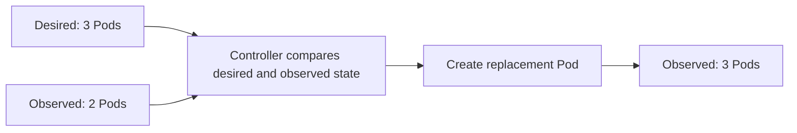

Kubernetes repeatedly reconciles state. A replacement Pod has a new identity; it is not the deleted Pod coming back.

If a Deployment requests three replicas and only two healthy instances exist, controllers work toward creating another. This repeated comparison between desired and observed state is **reconciliation**. It is asynchronous: a successful API request means the object was accepted, not that the application is already ready.

Think of a controller as a loop: observe → compare → act → observe again. Different controllers handle different resources; there is no single process that performs every task. The API server is their shared interface. [Controllers](https://kubernetes.io/docs/concepts/architecture/controller/).

# 3 Cluster architecture


*Control plane and worker components. The control plane manages desired state; worker components run Pods. The rkt logo is historical; use the CRI runtime guidance in this section.*

Your slides call the coordinating machine the “Master.” The current term is **control plane**. It can span several machines. A worker is a role, not a special type of hardware; nodes can be virtual or physical, and local environments can combine roles.

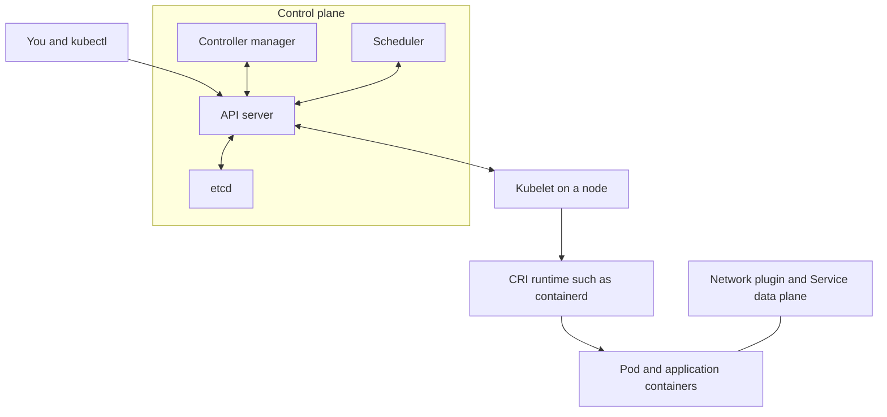

The arrows show logical relationships, not a literal synchronous call sequence. In production, redundant control-plane instances and multiple workers reduce failure impact. Some network plugins implement Service forwarding without kube-proxy. [Cluster architecture](https://kubernetes.io/docs/concepts/architecture/).

| Component | Responsibility | What it does not do |
| --- | --- | --- |
| kube-apiserver | Exposes the cluster API and processes requests | Does not run application containers |
| etcd | Stores Kubernetes API data | Does not hold the contents of every application database volume |
| kube-scheduler | Assigns unscheduled Pods to suitable nodes | Does not start containers |
| kube-controller-manager | Runs built-in reconciliation controllers | Does not replace the node runtime |
| cloud-controller-manager | Integrates supported cloud infrastructure | Is not required in every local cluster |
| kubelet | Manages assigned Pods on its node | Does not decide general cluster-wide placement |
| container runtime | Pulls images and runs containers through CRI | Does not manage Deployment replica counts |
| kube-proxy or replacement | Implements Service forwarding behavior | Does not provide application-level routing by itself |
| Cluster DNS | Resolves names such as Service names | Does not publish every Service on the internet |

[Kubernetes components](https://kubernetes.io/docs/concepts/overview/components/).

## What happens after you apply a Deployment

**From manifest to running application**

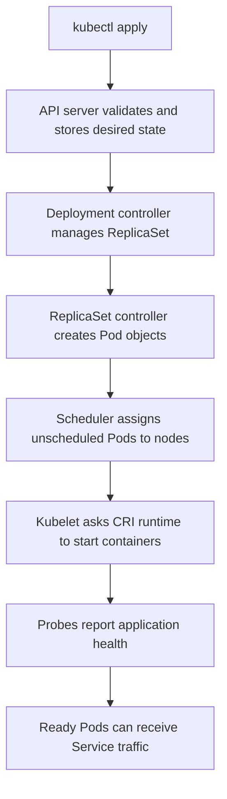

This is a conceptual progression. Components watch API state and reconcile asynchronously.

1. `kubectl` sends the manifest to the API server using your selected context and credentials.

2. Authentication, authorization, admission, and validation determine whether it can be accepted.

3. The Deployment controller creates or updates a ReplicaSet; the ReplicaSet controller creates Pod objects.

4. The scheduler assigns the new Pods to nodes.

5. Each node's kubelet works with its runtime and networking/storage integrations to start the containers.

6. Readiness determines when instances can become suitable Service backends.

7. Controllers continue reconciling changes and failures.

A Deployment owns ReplicaSets, and ReplicaSets own Pods. That ownership chain explains why deleting a managed Pod usually causes a replacement. [Deployments](https://kubernetes.io/docs/concepts/workloads/controllers/deployment/).

# 4 Container runtimes and the tools in your screenshots

## CRI and OCI

**CRI OCI and CNI have different jobs**

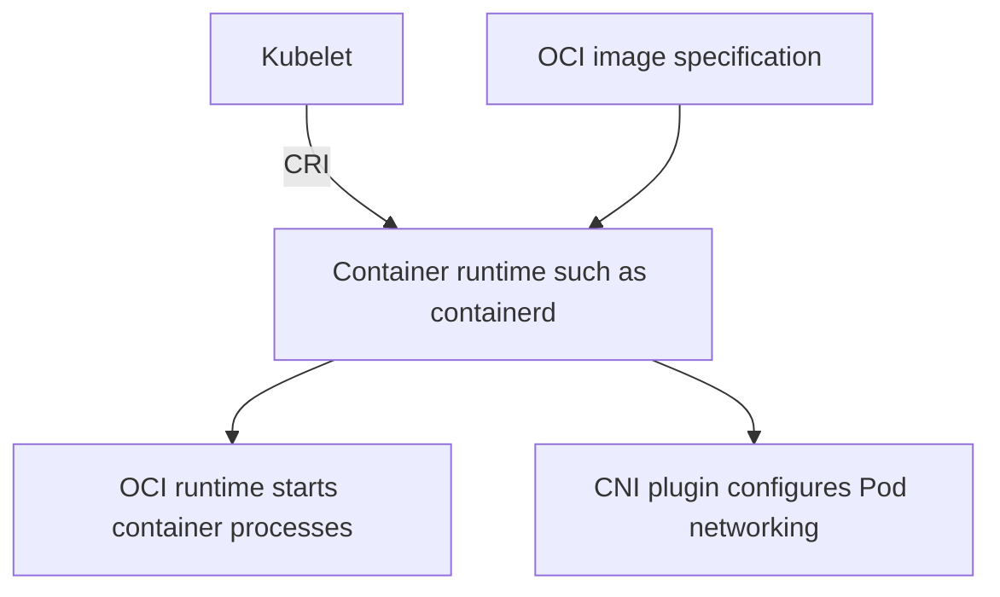

CRI connects Kubernetes to the runtime. OCI defines image and runtime standards. CNI handles network setup.


*Container runtime architecture. The containerd architecture illustrates the layers below Kubernetes. Kubernetes talks to a CRI implementation; OCI specifications govern container images and execution.*

**CRI**, the Container Runtime Interface, is the API between kubelet and a compatible runtime. It lets Kubernetes use runtimes such as containerd and CRI-O. **OCI**, the Open Container Initiative, defines image and low-level runtime standards. These solve different problems: CRI connects Kubernetes to a runtime; OCI standardizes how images and container execution are represented.

A common Linux stack is kubelet → CRI → containerd → shim and OCI runtime such as runc → container process. CNI concerns networking, while CSI concerns storage integration. [CRI](https://kubernetes.io/docs/concepts/containers/cri/), [container runtimes](https://kubernetes.io/docs/setup/production-environment/container-runtimes/).

Docker-built compatible images can still run in Kubernetes. Removing Kubernetes' old dockershim integration did not make those images unusable. Docker Engine itself needs an adapter such as cri-dockerd when used as the Kubernetes runtime. The `rkt` examples in your slides are historical: that project ended. For current study, focus on containerd or CRI-O. [Runtime integration](https://kubernetes.io/docs/setup/production-environment/container-runtimes/), [rkt project status](https://github.com/rkt/rkt).

## Choose the right command


*nerdctl capabilities. nerdctl is a Docker-like client for containerd. Feature availability depends on the installed runtime and configuration.*

| Tool | Connects to | Typical use |
| --- | --- | --- |
| kubectl | Kubernetes API server | Create and inspect Kubernetes resources |
| crictl | A node's CRI endpoint | Diagnose Pod sandboxes, images, and containers |
| ctr | containerd's native API | Low-level containerd debugging |
| nerdctl | containerd's native API | Docker-like container workflow and Compose support |
| docker | Docker Engine | Build/run containers and operate kind's outer node containers |
| kind | A supported container provider | Create local Kubernetes nodes as containers |

`ctr` is bundled with containerd but is intended for debugging. `nerdctl` provides a more general-purpose interface. Neither command creates a Kubernetes Deployment just because it starts a container. [containerd command-line tools](https://github.com/containerd/containerd/blob/main/docs/getting-started.md).

`nerdctl` features such as lazy image pulling, signing, encryption, or image distribution depend on the feature and supporting configuration. They are not automatically enabled in every Kubernetes cluster. Also, the containerd namespace `k8s.io` is different from Kubernetes namespaces such as `default` and `kube-system`. Kubernetes containers on a given containerd instance normally share the `k8s.io` containerd namespace. [nerdctl](https://github.com/containerd/nerdctl).

## Runtime inspection examples

Run these on the relevant Linux node, with appropriate permissions and the correct runtime endpoint—not against an unrelated containerd instance on your Mac:

```bash
# CRI diagnostics
sudo crictl info
sudo crictl pods
sudo crictl ps -a
sudo crictl images
# Replace CONTAINER_ID with an ID returned above
sudo crictl inspect CONTAINER_ID
sudo crictl logs CONTAINER_ID

# containerd inspection
sudo ctr -n k8s.io containers list
sudo ctr -n k8s.io tasks list
sudo nerdctl --namespace k8s.io ps -a
```

`crictl ps` lists running containers; `ps -a` includes stopped ones. Configure its runtime endpoint for your node if automatic configuration is unavailable. Prefer Kubernetes manifests for application lifecycle; direct runtime changes can conflict with kubelet's reconciliation. [Debugging with crictl](https://kubernetes.io/docs/tasks/debug/debug-cluster/crictl/).

The containerd installation screenshot uses an older Linux archive example. Do not copy its architecture or version blindly. A manual Linux installation involves compatible containerd, OCI runtime, networking components, service configuration, and cgroup settings. With kind, the node image supplies the internal runtime stack. [containerd installation](https://github.com/containerd/containerd/blob/main/docs/getting-started.md).

# 5 Pods and container lifecycle


*Pods replicated across nodes. Replicas are separate Pods and can run on different nodes. A Deployment maintains their desired count.*

A Pod is the smallest deployable Kubernetes compute unit. Its containers are placed together on one node. Containers within a Pod share a network namespace, IP address, and port space; they can communicate through `localhost`. They can share explicitly mounted volumes, but their entire root filesystems are not automatically shared.

Use one application container per Pod in the common case. Put multiple containers together when they have a close lifecycle relationship, such as a server and a helper that refreshes its files. Put independently scaled services in separate Pods. Increasing replicas normally creates more Pods rather than adding duplicate app containers to one Pod. [Pods](https://kubernetes.io/docs/concepts/workloads/pods/).

## App containers and helpers

**Inside one Pod**

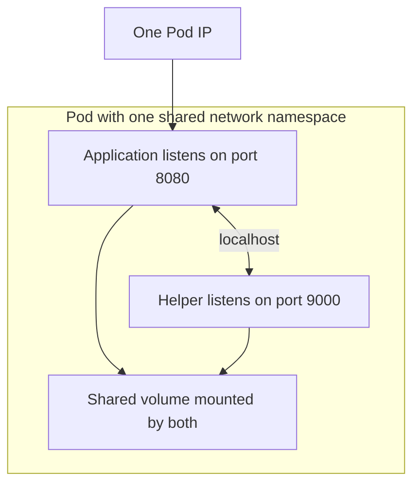

Containers share the Pod IP and port space, so they must avoid conflicting listening ports. Their root filesystems remain separate.


*Application and helper inside a Pod. Containers in the same Pod share networking. They can share a volume when it is explicitly mounted into each container.*

- An **application container** runs the main workload.

- A **regular init container** finishes a preparation task before the next init container or app starts.

- A **sidecar** continues alongside the application, providing a supporting function.

- An **ephemeral container** is added for diagnosis when ordinary tooling is insufficient.

The Python/.NET helper examples in your screenshots illustrate co-location; the language itself does not decide whether containers belong together. Regular init containers run sequentially and must succeed. Kubernetes also supports lifecycle-aware sidecars; learn their specific fields before relying on startup and shutdown ordering. [Init containers](https://kubernetes.io/docs/concepts/workloads/pods/init-containers/).

## Read status accurately

**Pod status is a starting point**

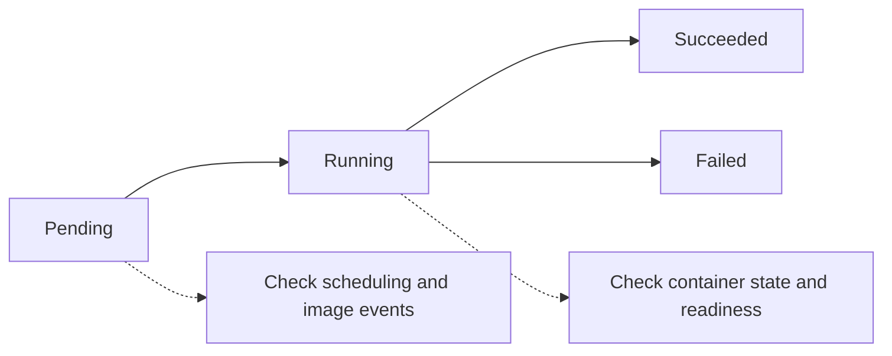

Running does not mean Ready. ImagePullBackOff and CrashLoopBackOff describe container waiting reasons, not additional Pod phases.

| Display or phase | Meaning | First investigation |
| --- | --- | --- |
| Pending | Pod has not completed startup; it may be unscheduled or waiting on setup | Describe the Pod and check scheduling or volume events |
| ContainerCreating | Container setup is underway | Image, CNI, and mount events |
| Running | At least one container is running or starting/restarting | Readiness and per-container state |
| Succeeded | Containers completed successfully under the Pod lifecycle rules | Expected for completed work |
| Failed | Pod execution ended with failure | Exit reasons and events |
| CrashLoopBackOff | A container repeatedly exits and restart attempts are delayed | Previous logs and exit details |
| ImagePullBackOff | Image retrieval keeps failing with retries delayed | Image name, credentials, registry reachability |

The STATUS column is a helpful summary, not always the Pod's formal phase. `Running` is not equivalent to application health. A replacement Pod has a new identity and may receive a different IP. A bare Pod has no workload controller to recreate it after deletion. [Pod lifecycle](https://kubernetes.io/docs/concepts/workloads/pods/pod-lifecycle/).

# 6 YAML and Kubernetes object definitions


*YAML maps lists and values. Read indentation first: mappings use key–value pairs, and list items begin with a dash.*


*YAML indentation. Use spaces consistently. Changing indentation changes which object owns a field.*


*YAML list of dictionaries. Each list item can contain its own mapping. Kubernetes uses this pattern for containers, ports, environment variables, and volumes.*

YAML represents mappings, sequences, and scalar values. A mapping uses `key: value`; a sequence uses `-`. Indentation expresses nesting. Use spaces consistently, not tabs. Keys at the same indentation belong to the same level. Lists are ordered; mapping key order generally does not change meaning.

```yaml
# A teaching example, not a Kubernetes resource
servers:
  - name: server1
    owner: John
    created: "2026-11-01"
    status: active
  - name: server2
    owner: Roshan
    status: inactive
```

Here, `servers` is a list of two mappings. Each mapping has its own fields. In your last screenshot, `created` and `status` sit outside the list item's indentation. Whether that is correct depends on the intended structure; to make them properties of `server1`, align them with `name` and `owner` as above. Quote strings that resemble numbers or booleans when the receiving field expects a string.

Most workload manifests have four familiar fields:

| Field | Purpose | Example |
| --- | --- | --- |
| apiVersion | Selects an API group/version | apps/v1 |
| kind | Resource type | Deployment |
| metadata | Identity and organizational information | name, namespace, labels |
| spec | Desired behavior | replicas, containers, selectors |

The system reports observed state in `status`. The required fields vary by resource: a ConfigMap uses `data`, for example. Kubernetes validates its own schema, so syntactically valid YAML can still be an invalid resource. [Working with objects](https://kubernetes.io/docs/concepts/overview/working-with-objects/).

Useful discovery commands:

```bash
kubectl api-resources
kubectl explain deployment.spec.template.spec.containers
kubectl create deployment demo --image=nginx:stable-alpine \
  --dry-run=client -o yaml
```

`--dry-run=client` can generate a starting manifest; it does not prove that an image exists or that the cluster can run it. A server-side dry run also checks server validation and relevant admission behavior:

```bash
kubectl apply --dry-run=server -f app.yaml
kubectl diff -f app.yaml
kubectl apply -f app.yaml
```

# 7 Namespaces labels and workload resources

## Namespaces and context

A kubeconfig **context** identifies a cluster, user, and optional default namespace. Always check it before a change. A Kubernetes namespace scopes resource names; it does not create a separate cluster or, by itself, enforce network isolation. Nodes and PersistentVolumes are cluster-scoped.

```bash
kubectl config current-context
kubectl config get-contexts
kubectl get namespaces
kubectl get pods -n kube-system
kubectl get pods -A
```

`No resources found in default namespace` means that query found no matching resources in that namespace. It does not prove the whole cluster is empty. `kube-system` holds many system workloads. [Namespaces](https://kubernetes.io/docs/concepts/overview/working-with-objects/namespaces/).

## Labels and selectors

**Ownership and selection are different relationships**

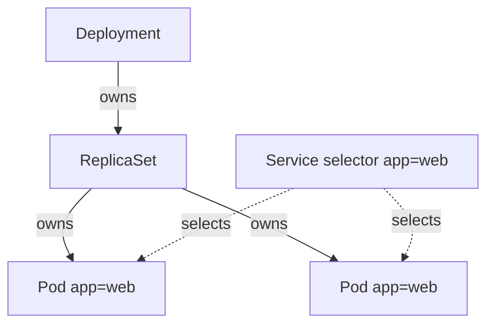

The Service discovers matching Pods in its own namespace. It does not own them.

Labels such as `app: web` identify groups. A Deployment selector matches its Pod template labels. A Service selector finds backend Pods in its namespace. Resource names alone do not establish that association.

```bash
kubectl get pods -n learning --show-labels
kubectl get pods -n learning -l app=web
```

A selector mismatch can leave a Service with no application backends even when Pods are running. Annotations hold supporting metadata rather than normal selection criteria. [Labels and selectors](https://kubernetes.io/docs/concepts/overview/working-with-objects/labels/).

## Which workload should you choose

| Resource | Use case | Key idea |
| --- | --- | --- |
| Pod | Short experiments or an execution unit owned by a controller | Individual instance |
| ReplicaSet | Maintaining a replica count, usually managed by a Deployment | Matching replicas |
| Deployment | Stateless services and rolling application updates | Interchangeable instances |
| StatefulSet | Workloads needing stable identity and associated storage | Distinct instances |
| DaemonSet | Node agents such as log collectors | Runs on eligible nodes |
| Job | Finite work that should complete | Completion and retry handling |
| CronJob | Scheduled Job creation | Periodic execution |

StatefulSet does not automatically provide database replication or backups. CronJob and Job applications should tolerate retries; do not design important side effects around an assumption of exactly-once execution. [Workload management](https://kubernetes.io/docs/concepts/workloads/controllers/).

# 8 Your Mac learning environment

**Where your application actually runs on a Mac**

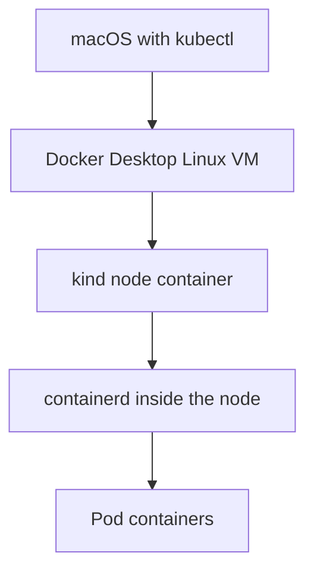

This explains why Docker on your Mac, the kind node, and containers inside Pods are different places to inspect.

Your saved transcript records ARM64 Mac binaries for kind and kubectl. Those version strings describe that installation, not proof of the currently running cluster's version. Use the matching architecture when installing tools and keep kubectl within one minor version of the API server. [Version skew policy](https://kubernetes.io/releases/version-skew-policy/).

For these exercises, use Docker Desktop with its engine running, plus kind and kubectl. If the tools are already installed, start with verification; no reinstall is necessary. If using Homebrew for a fresh installation, the standard packages are `kind` and `kubernetes-cli`:

```bash
# Only if these tools are not installed
brew install kind kubernetes-cli

# Verify tools and the outer container engine
docker info
kind version
kubectl version --client
```

Use kind's default supported node image for your installed kind release, or a specifically supported pinned node image for a repeatable lab. Do not combine arbitrary Kubernetes and kind versions. Docker provides the outer node containers; containerd normally runs inside each kind node. [kind quick start](https://kind.sigs.k8s.io/docs/user/quick-start/).

Create a new, disposable cluster without replacing your existing one. Save this as `kind-learning.yaml` in a new working directory:

```yaml
kind: Cluster
apiVersion: kind.x-k8s.io/v1alpha4
nodes:
  - role: control-plane
  - role: worker
  - role: worker
```

```bash
kind create cluster --name learning --config kind-learning.yaml --wait 120s
kubectl config use-context kind-learning
kubectl get nodes -o wide
kubectl get pods -n kube-system
```

Three nodes need more laptop resources than a single-node cluster. If necessary, remove the worker entries before creating the lab. A single-node lab teaches the API but cannot demonstrate resilience to loss of its only machine. [kind configuration](https://kind.sigs.k8s.io/docs/user/configuration/).

# 9 Main lab from YAML to a working application

The following commands are instructions for your disposable lab; they have not been run against your machine or an existing cluster. Confirm `kind-learning` is selected. Save the following as `app.yaml`:

```yaml
apiVersion: v1
kind: Namespace
metadata:
  name: learning
---
apiVersion: apps/v1
kind: Deployment
metadata:
  name: web
  namespace: learning
spec:
  replicas: 2
  selector:
    matchLabels:
      app: web
  template:
    metadata:
      labels:
        app: web
    spec:
      containers:
        - name: web
          image: nginx:stable-alpine
          ports:
            - name: http
              containerPort: 80
          resources:
            requests:
              cpu: 100m
              memory: 64Mi
            limits:
              cpu: 500m
              memory: 128Mi
          readinessProbe:
            httpGet:
              path: /
              port: http
            initialDelaySeconds: 2
            periodSeconds: 5
          livenessProbe:
            httpGet:
              path: /
              port: http
            initialDelaySeconds: 10
            periodSeconds: 10
---
apiVersion: v1
kind: Service
metadata:
  name: web
  namespace: learning
spec:
  selector:
    app: web
  ports:
    - name: http
      port: 80
      targetPort: http
  type: ClusterIP
```

The two selectors and the Pod template's `app: web` label must agree. The Service's named target port matches the container's named port. `containerPort` describes the intended port; the application must actually listen there. The image tag is convenient for learning but mutable; production releases should use reviewed, immutable image digests.

```bash
kubectl apply -f app.yaml
kubectl rollout status deployment/web -n learning --timeout=120s
kubectl get deployment,replicaset,pods,service -n learning
kubectl get pods -n learning -o wide
kubectl get endpointslices -n learning \
  -l kubernetes.io/service-name=web
kubectl port-forward -n learning service/web 8080:80
```

While port-forward is running, open `http://localhost:8080` or run `curl http://localhost:8080` in a second terminal. Expect the nginx welcome page and two ready replicas. Stop forwarding with Ctrl+C. Port-forward is a development connection to a selected backend; it does not prove that external load balancing works or exercise every replica.

## Inspect and scale

```bash
kubectl describe deployment web -n learning
kubectl logs -n learning deployment/web --tail=50
kubectl scale deployment/web -n learning --replicas=3
kubectl get pods -n learning -w
```

Stop the watch with Ctrl+C. Then update `replicas` in `app.yaml` to 3 if that is your intended saved state; applying an older manifest with `replicas: 2` can undo the manual scale change. Inspect a Pod's owner references to trace it to a ReplicaSet, then to its Deployment:

```bash
kubectl get pods -n learning \
  -o 'custom-columns=NAME:.metadata.name,OWNER:.metadata.ownerReferences[0].kind'
```

## Observe recovery

Choose one Pod name from the listing, then replace `POD_NAME`:

```bash
kubectl delete pod POD_NAME -n learning
kubectl get pods -n learning -w
```

The controller should create a replacement with a new name. This demonstrates replica reconciliation, not recovery of unsaved application data. [Scaling and recovery practice](https://kubernetes.io/docs/tutorials/kubernetes-basics/scale/scale-intro/).

# 10 Pod networking Services DNS and external access

## Pod IPs and node IPs


*Node and Pod IP addresses. The node has its own IP, while each Pod has a separate IP. The pictured addresses are examples; inspect your cluster for its actual ranges.*

The November 1 networking screenshots distinguish the node's address from addresses inside its Pod network. In the first image, `192.168.1.2` identifies the example node, while `10.244.0.2`, `10.244.0.3`, and `10.244.0.4` identify three Pods. The cloud marked `10.244.0.0` represents a network range conceptually; without a prefix length, it is not a complete CIDR definition.

Ordinary Pods receive distinct cluster-wide addresses for each configured IP family. Containers in the same Pod share its network namespace, including IP and port space, and can use `localhost` to communicate. Containers in different Pods use the Pod network instead. Host-network Pods are a special case because they use the node's network namespace. [Pod networking](https://kubernetes.io/docs/concepts/workloads/pods/#pod-networking).

## Communication across nodes

The second screenshot shows both nodes using `10.244.0.2`, with an X between their networks. Treat this as an illustration of a connectivity/addressing problem, not the final configuration: two ordinary Pods cannot share the same address in one flat cluster Pod network.

For a corrected teaching example, assign Node A a Pod subnet of `10.244.0.0/24` and Node B `10.244.1.0/24`:

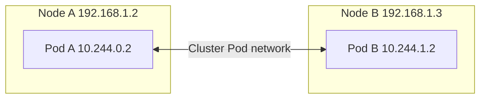

These addresses and /24 allocations are illustrative; actual allocation depends on the networking implementation. The required outcome is unique, reachable Pod addresses, not these particular ranges or necessarily a separate /24 for every node.

The Kubernetes model allows Pods to communicate directly across nodes without address translation, subject to intentional isolation such as NetworkPolicy. “Without NAT” describes this direct Pod-to-Pod model; it does not mean that Service forwarding or internet egress never uses address translation. Reachability also requires working networking and an application listening on the requested port. [Kubernetes network model](https://kubernetes.io/docs/concepts/services-networking/#the-kubernetes-network-model).

## Network plugins and CNI

Kubernetes defines the networking model, while a network implementation supplies connectivity. On Linux, container runtimes commonly invoke **CNI**, the Container Network Interface, to integrate Pod networking. The implementation handles network setup and address allocation through its components and may connect nodes using routing or an overlay. Installing a Service or changing DNS does not by itself repair broken Pod networking. [Network plugins](https://kubernetes.io/docs/concepts/extend-kubernetes/compute-storage-net/network-plugins/).

The third screenshot presents networking products and projects as alternatives. They are not a list of components that every cluster must install:

| Example | What to learn |
| --- | --- |
| Cilium | Networking and security using eBPF; Hubble adds network observability |
| Flannel | Pod networking with configurable backends; NetworkPolicy enforcement requires additional capabilities |
| Vendor platforms such as the Cisco and NSX examples | Integration depends on the platform, supported Kubernetes versions, and selected networking product |

[Cilium overview](https://docs.cilium.io/en/stable/overview/intro/), [Flannel project](https://github.com/flannel-io/flannel).

Choose a supported implementation for the cluster's requirements, including policy enforcement, routing, observability, and infrastructure compatibility. Do not install every plugin from a slide into the same cluster. Your earlier terminal output lists `kindnet`, so inspect the existing kind networking before considering a different implementation in a separate lab.

## Inspect the actual network

```bash
kubectl get nodes -o wide
kubectl get pods -A -o wide
kubectl get nodes -o 'custom-columns=NAME:.metadata.name,PODCIDRS:.spec.podCIDRs'
kubectl get pods -n kube-system -o wide
```

Compare node addresses, Pod addresses, and placement. The `podCIDRs` field may be empty for implementations that manage allocation differently; an empty field alone does not establish failure. If connectivity fails, check Pod readiness, the actual listening port, network-plugin health, routes, and NetworkPolicy. Test direct Pod access and Service/DNS access separately to identify which layer is failing.

## Services and discovery

A Pod IP can change when a Pod is replaced. A **Service** provides a stable discovery endpoint and maps traffic to backends. EndpointSlices describe those backend endpoints. DNS commonly lets a Pod use `web` in the same namespace or `web.learning` across namespaces; the full domain depends on the cluster's configured DNS domain.

| Access method | Purpose | Local learning implication |
| --- | --- | --- |
| ClusterIP | Internal virtual Service IP | Not normally a directly routable Mac address |
| NodePort | Exposes a Service through a node port | Needs a reachable node and correct port mapping |
| LoadBalancer | Requests a load-balancer implementation | A local cluster needs a suitable implementation |
| ExternalName | DNS alias to an external name | Does not proxy traffic itself |
| Headless Service | Discovery without a normal virtual ClusterIP | Often used for identity-aware clients |
| port-forward | Temporary local development access | Useful before configuring external networking |

`port` is the Service port; `targetPort` is the backend port; `nodePort` is the node-facing port when used. [Services](https://kubernetes.io/docs/concepts/services-networking/service/).

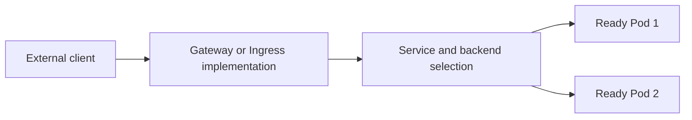

This is a conceptual request path. Some implementations forward directly to backend Pod endpoints rather than sending packets through the Service virtual IP.

**Ingress** describes HTTP/HTTPS routing rules and requires an implementation. Its API remains available but is frozen. Kubernetes recommends **Gateway API** for newer routing capabilities. Gateway API separates infrastructure and application routing responsibilities through resources such as GatewayClass, Gateway, and HTTPRoute; it requires its CRDs and a compatible controller. Creating a routing resource alone does not install a proxy. [Ingress](https://kubernetes.io/docs/concepts/services-networking/ingress/), [Gateway API](https://gateway-api.sigs.k8s.io/docs/introduction/).

On a Mac, kind's nodes usually sit inside a container-engine VM. A NodePort is therefore not automatically available at `localhost`. If using kind `extraPortMappings`, the mapped node `containerPort` must equal the Service's `nodePort`. Use port-forward for the first lab; learn explicit mappings separately. [kind port mappings](https://kind.sigs.k8s.io/docs/user/configuration/#extra-port-mappings).

### Reading the kubernetes Service in your transcript

The recorded `kubectl get svc` output lists only the built-in `kubernetes` Service in the current namespace. Your three application Pods have `app=myapp` and `type=front-end` labels, but creating a Deployment does not automatically create a Service for them. `svc` is the short name for Service; without `-A`, the listing is namespace-scoped.

| Recorded field | Meaning in this snapshot |
| --- | --- |
| ClusterIP 10.96.0.1 | Virtual address of the Kubernetes API Service |
| Port 443/TCP | Port clients use on that Service |
| TargetPort 6443/TCP | API server backend port |
| Endpoint 172.18.0.2:6443 | Backend address recorded for this API endpoint |
| Selector <none> | No Pod-label selector on this Service |
| EXTERNAL-IP <none> | No external IP shown; not a fault for a ClusterIP Service |

A selectorless Service can still have backends supplied by a controller or administrator. This built-in API Service is maintained by the system; do not add your application's labels to it. Its endpoint is not an nginx Pod address. The exact IPs and ports above describe the transcript, not constants to copy into every cluster. [Services without selectors](https://kubernetes.io/docs/concepts/services-networking/service/#services-without-selectors).

### Backend selection and packet delivery are different jobs

For a normal selector-based application Service, controllers maintain EndpointSlices from matching Pods and their conditions. The Service data plane—kube-proxy or a replacement—uses this information to forward traffic to eligible backends. The CNI/Pod network provides delivery to the selected Pod. The Service object itself is not a process that receives every packet.

With an iptables-based implementation, a new connection to the virtual IP can undergo destination NAT to a backend. Connection tracking applies the reverse translation to replies so the client sees the expected Service-side connection. This is reverse NAT, not simply a reply that is “un-NATed.” Other data planes can implement the abstraction differently. Selection is generally per connection/flow, not a promise to distribute every HTTP request evenly. [Service proxies and virtual IPs](https://kubernetes.io/docs/reference/networking/virtual-ips/).

A ClusterIP is stable for the Service object's lifetime; deleting and recreating it can allocate a different address. Prefer the Service DNS name for application configuration rather than hardcoding a Pod or ClusterIP.

### Give the application its own Service

For the transcript's labels, this is a complete example to save as `myapp-service.yaml`. First confirm that nginx actually listens on port 80; `Port: <none>` in a Pod description only means no container port was declared.

```yaml
apiVersion: v1
kind: Service
metadata:
  name: myapp
  namespace: default
spec:
  type: ClusterIP
  selector:
    app: myapp
    type: front-end
  ports:
    - name: http
      port: 80
      targetPort: 80
```

Both selector labels must match a Pod. Avoid selecting `pod-template-hash`: that changes across releases and would tie the Service to one ReplicaSet.

```bash
kubectl apply -f myapp-service.yaml
kubectl get service myapp -n default -o wide
kubectl get endpointslices -n default -l kubernetes.io/service-name=myapp
kubectl port-forward --address 127.0.0.1 -n default service/myapp 8080:80
```

Use an available local port if 8080 is already occupied. From another terminal, test `curl http://127.0.0.1:8080`. The application Service has a separate identity from the built-in API Service. Port-forward remains a development path; it does not publish the ClusterIP on the Mac's network.

### Why HTTP through port forward can work while ping fails

The attachment shows an nginx response from `curl http://localhost:8080` while `ping 10.244.0.26` receives an upstream “Destination Net Unreachable” response. These tests use different destinations and protocols:

| Test | Protocol and destination | Uses kubectl port forward |
| --- | --- | --- |
| curl http://127.0.0.1:8080 | HTTP over TCP to the Mac's forwarded port | Yes, when the forwarding process owns that listener |
| ping 10.244.0.26 | ICMP echo to the Pod address | No |
| ping localhost | ICMP echo to local loopback | No; this tests the Mac itself |

Port-forward carries TCP streams, not ICMP or UDP, and does not install a route to the Pod CIDR. The unreachable response shows that this ping attempt did not reach its target through a usable route. It does not establish the exact Pod subnet mask or prove that the Pod refuses ICMP. On a standard Docker Desktop/kind setup, direct Mac-to-Pod routing is not provided automatically; specialized networking can change that. [Port-forward limitations](https://kubernetes.io/docs/tasks/access-application-cluster/port-forward-access-application-cluster/).

If the listener is the intended port-forward session, the nginx response verifies that selected backend's HTTP response at that moment. It does not prove direct Pod reachability, ICMP support, every replica's health, or the external Service path. Check that the forwarding terminal shows the expected mapping; another local server could otherwise answer on the same port.

### The control plane forwarding path

A useful logical model is:

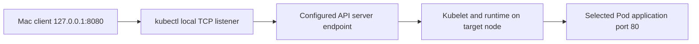

The streaming API request reaches the selected Pod through node/runtime forwarding support. It does not require a NodePort or a route from your Mac directly to the Pod address. The exact transport and final runtime connection are implementation/version dependent; do not hardcode a particular WebSocket/SPDY mechanism or a node's internal API address. On kind, kubeconfig commonly points to a published loopback API endpoint rather than directly to the node container's `172.18.x.x` address.

```bash
kubectl config view --minify -o jsonpath='{.clusters[0].cluster.server}'
kubectl port-forward --address 127.0.0.1 -n default service/myapp 8080:80
```

Keep that command running and issue curl in another terminal. Ctrl+C ends the local forward. If its selected Pod terminates, start a new forwarding session. When the target is a Service, kubectl selects a backing Pod and forwards to its target port; it does not test the Service virtual-IP load-balancing path. [kubectl port-forward](https://kubernetes.io/docs/reference/kubectl/generated/kubectl_port-forward/).

### Test direct Pod connectivity from the right location

First obtain the current Pod IP with `kubectl get pods -n default -l app=myapp -o wide`. The address `10.244.0.26` is a historical example and can change. A disposable in-cluster test can check a different path:

```bash
# Replace POD_IP with the current address
kubectl run netcheck --namespace default --rm -it --restart=Never \
  --image=busybox:stable -- ping -c 3 POD_IP
```

This creates a temporary Pod and needs suitable permissions, image access, runtime capabilities, and policy. Successful ICMP is not guaranteed. For an HTTP check, replace the command after `--` with `wget -qO- http://POD_IP:80`. An interrupted test can leave its Pod behind; inspect and remove that named diagnostic Pod if needed.

For kind using Docker, `docker exec NODE_CONTAINER ping -c 3 POD_IP` tests from the node when ping is installed and permitted. It is a different perspective from a Pod-to-Pod test. On the Mac, `route -n get POD_IP` inspects the selected route without adding one. Compare results before deciding whether the issue is host routing, cluster networking, protocol filtering, or the application.

### ClusterIP NodePort and LoadBalancer in detail

**Three Service access patterns**

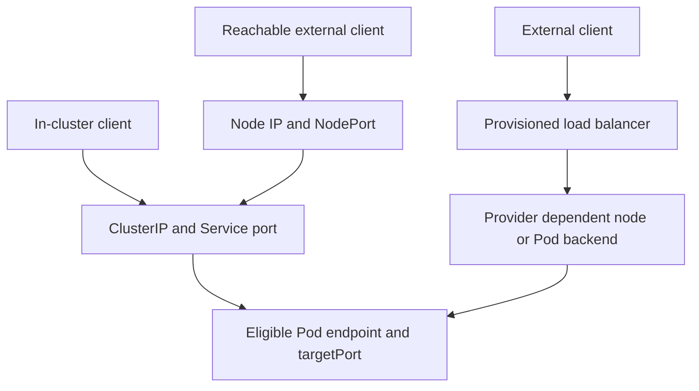

ClusterIP is internal access. NodePort needs a reachable node address and port. LoadBalancer needs an implementation that provisions external connectivity.

| Type | Address clients use | Infrastructure and usual role |
| --- | --- | --- |
| ClusterIP | Service DNS name or virtual IP and Service port | Internal application discovery; normally reachable within cluster networking |
| NodePort | Reachable node address and allocated node port | ClusterIP behavior plus node-facing forwarding; useful with explicit node reachability |
| LoadBalancer | Provisioned load-balancer IP or hostname | ClusterIP behavior plus a supported load-balancer integration; public or internal according to configuration |

ClusterIP reachability is a routing and policy question, not an absolute prohibition on any external client. Service DNS domains are configurable; `myapp.default.svc.cluster.local` is an example when the cluster domain is `cluster.local`. Pod clients in the same namespace can normally use `myapp`.

NodePort commonly allocates from 30000–32767, but the range is configurable. Its availability on node interfaces depends on the Service data plane and address configuration. It is not necessarily a userspace process visible as an ordinary listening socket. With the usual cluster traffic policy, a node can forward to a backend on another node. Under `externalTrafficPolicy: Local`, traffic uses node-local eligible endpoints and can preserve the original client address; a node with none cannot serve it through a remote endpoint. Verify firewall, source-IP, and health-check behavior for your implementation.

The common layering “LoadBalancer includes NodePort includes ClusterIP” has an exception: implementations that route directly to Pods can use `allocateLoadBalancerNodePorts: false`. A LoadBalancer therefore does not universally forward through node ports. Provisioning may be handled by a cloud controller or another installed controller, and an internal load balancer need not be internet-facing. Cost, listeners, protocols, addresses, and backend behavior depend on the implementation. [Service types](https://kubernetes.io/docs/concepts/services-networking/service/).

### NodePort example for your application

The earlier `myapp-service.yaml` is the ClusterIP example. To study NodePort separately, save this as `myapp-nodeport.yaml`:

```yaml
apiVersion: v1
kind: Service
metadata:
  name: myapp-np
  namespace: default
spec:
  type: NodePort
  selector:
    app: myapp
    type: front-end
  ports:
    - name: http
      port: 80
      targetPort: 80
      nodePort: 30080
```

Port 30080 must be in the configured allocation range and unused; omit `nodePort` for automatic allocation. The equivalent quick command is `kubectl expose deployment myapp-deployment -n default --port=80 --target-port=80 --type=NodePort --name=myapp-np`, which chooses an available port automatically. Use one creation approach, not both for the same object.

```bash
kubectl apply -f myapp-nodeport.yaml
kubectl get service myapp-np -n default
kubectl get endpointslices -n default -l kubernetes.io/service-name=myapp-np
kubectl port-forward --address 127.0.0.1 -n default service/myapp-np 8080:80
```

The output `80:30080/TCP` means Service port 80 and node port 30080. Curl through this port-forward still bypasses the NodePort path. To test NodePort itself, use a reachable node address and port 30080. For kind on Docker Desktop, host port mappings or another supported exposure path are needed; configuring `extraPortMappings` at cluster creation maps a host port to the matching node port. See the kind access notes above.

### LoadBalancer configuration and interpretation

For an alternative experiment on a cluster with an appropriate load-balancer implementation, use a separate Service definition:

```yaml
apiVersion: v1
kind: Service
metadata:
  name: myapp-lb
  namespace: default
spec:
  type: LoadBalancer
  selector:
    app: myapp
    type: front-end
  ports:
    - name: http
      port: 80
      targetPort: 80
```

Creating it can provision billable infrastructure on cloud clusters. Choose the implementation and internal/public settings deliberately. `EXTERNAL-IP: <pending>` means no ingress address has been reported yet; it may be normal during provisioning or indicate a missing controller, provider error, quota, or configuration problem. Inspect `kubectl describe service myapp-lb -n default` and controller events rather than assuming Pod failure.

Kind can use Cloud Provider KIND; supported bare-metal implementations include MetalLB. Neither is automatically installed just because a Service requests LoadBalancer. Verify platform reachability before assuming the reported address is accessible from the Mac. [kind LoadBalancer guide](https://kind.sigs.k8s.io/docs/user/loadbalancer/).

Service LoadBalancer is primarily a transport-level abstraction. For HTTP host/path routing across several Services, use an appropriate Gateway API or Ingress implementation; the chosen implementation can itself be exposed through a LoadBalancer. The routing object and the external load-balancer infrastructure solve different parts of the request path.

### How Service load balancing actually selects backends

**Discovery and delivery**

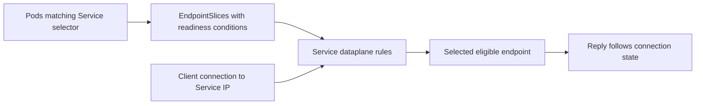

A Service usually forwards each connection to one eligible backend. Multiple HTTP requests on a reused connection may reach the same Pod.

For a normal virtual-IP application Service, the data plane selects eligible backend endpoints from EndpointSlice information. With TCP, selection normally applies to a connection/flow. Several HTTP requests on one keep-alive connection—or many gRPC calls on one long-lived connection—can stay on one Pod. More replicas do not guarantee equal request counts.

| Access path | Where selection occurs |
| --- | --- |
| ClusterIP | Service data plane chooses a backend |
| NodePort | Service data plane forwards from an eligible node address/port to a backend |
| LoadBalancer | Implementation may balance to nodes or directly to Pods; there is not universally a two-step node-then-Pod path |
| Headless Service | DNS can return backend addresses; the client must decide how to use them |
| ExternalName | DNS alias; the Service itself does not proxy or balance connections |
| kubectl port-forward | Selects one Pod for the forwarding session; it is not a replica-balancing test |

A bare-metal load-balancer implementation such as MetalLB can advertise an address while the Service data plane handles backend forwarding; it need not be a separate appliance distributing connections across node ports. Whether nodes, endpoints, or other targets receive load-balancer health checks depends on the integration. See the LoadBalancer exceptions above. [MetalLB concepts](https://metallb.io/concepts/).

In iptables mode, probabilistic rules can distribute new connections; a three-backend chain can use one-third, then one-half of the remaining traffic, then the last backend. This is statistical distribution, not awareness of current application load. Other implementations use different algorithms. nftables is another kube-proxy mode; IPVS is deprecated in current Kubernetes documentation, so the attachment's scaling comparison should not be treated as a recommendation for a new deployment. eBPF is an implementation technology, not one universal selection algorithm or an automatic performance guarantee. [Service proxy implementations](https://kubernetes.io/docs/reference/networking/virtual-ips/).

On a kind node using iptables-based kube-proxy, an illustrative inspection command is:

```bash
docker exec NODE_CONTAINER iptables -t nat -S
```

Replace the node name and look for the relevant Service/backend chains. Missing `KUBE-SVC` rules are not enough to diagnose failure if the cluster uses another data plane. Do not modify controller-managed rules as part of this inspection.

### Readiness affinity and locality

Ordinary traffic normally excludes unready endpoints, but EndpointSlices can retain them with readiness conditions. Readiness changes affect new backend selection; they do not automatically move or terminate every established connection. Special configurations such as publishing not-ready addresses and terminating-endpoint handling need separate consideration.

`sessionAffinity: ClientIP` requests affinity based on the client IP visible to the data plane. The default sticky timeout is 10,800 seconds, or three hours; backend changes can still affect the destination, and source NAT can make many users appear as one client. Affinity is not durable application-session storage. [Session affinity](https://kubernetes.io/docs/reference/networking/virtual-ips/#session-affinity).

`internalTrafficPolicy: Local` is a strict node-local endpoint requirement for applicable internal traffic, not a soft preference. A node without eligible local endpoints cannot simply select a remote one under that policy. By contrast, topology-aware routing or supported `trafficDistribution` preferences can favor nearby endpoints with their documented fallback behavior. For external traffic, `externalTrafficPolicy: Local` and provider health checks must be configured together; do not assume the load balancer automatically repairs every local-endpoint imbalance. [Traffic distribution and policies](https://kubernetes.io/docs/reference/networking/virtual-ips/#traffic-distribution).

If long-lived connections create skew, consider a client that actually balances across discovered addresses or an appropriate application-layer proxy. A headless Service alone does not make the client balance, and adding an Ingress or mesh does not guarantee a particular per-request algorithm.

### Observe distribution with a marked in-cluster test

Use the existing `myapp` ClusterIP Service defined above, after verifying its selectors and EndpointSlices. Avoid creating another Service merely to repeat the experiment. Choose a unique request marker each time:

```bash
kubectl get endpointslices -n default -l kubernetes.io/service-name=myapp
kubectl run lb-check -n default --rm -i --restart=Never \
  --image=busybox:stable -- sh -c \
  'i=1; while [ "$i" -le 30 ]; do wget -qO- "http://myapp/?lbcheck=lab-01&request=$i" >/dev/null || exit 1; i=$((i+1)); done'
```

This makes separate wget invocations, encouraging separate connections. It creates a disposable test Pod and requires image access and policy permission. Confirm all requests completed. Then inspect only the marked nginx access entries, replacing `CONTAINER_NAME` with the real container name:

```bash
for p in $(kubectl get pods -n default -l app=myapp,type=front-end -o name); do
  echo "$p"
  kubectl logs -n default "$p" -c CONTAINER_NAME --since=5m |
    grep -F 'lbcheck=lab-01' | wc -l
done
```

Plain `kubectl logs | wc -l` counts startup messages, other traffic, and errors as well as requests; it is not a reliable request counter. This marked test still depends on nginx access logging, Pod lifetime, and the selected time window. Thirty requests can produce uneven counts by chance. Affinity, connection reuse, local endpoint policies, and other traffic can also change the result. It is an observation exercise, not proof of an exact one-third allocation.

### Reuse the Service YAML and test each access path separately

The ClusterIP, NodePort, and LoadBalancer manifests already in this section cover the attachment's three resource types. Port-forward remains a command, not a fourth Service kind or standalone Kubernetes YAML object. Multiple complete resource documents can be kept in one file separated by `---`.

Do not apply both NodePort examples with the same fixed `30080`: a node port is allocated cluster-wide and cannot be reserved by two separate Services. Reuse one name/manifest or request automatic allocation.

- Test ClusterIP by its Service name from a suitable Pod.

- Test NodePort using a reachable node address and its allocated port. Node loopback is not supported uniformly across proxy modes; prefer an eligible node IP rather than assuming `localhost:30080` works.

- Test LoadBalancer using its reported ingress address from a network that can reach it.

- Test port-forward with curl to the bound local port; this bypasses the normal Service and NodePort data paths.

Use EndpointSlices for backend inspection instead of building new exercises around the deprecated Endpoints API. A LoadBalancer may be provided by an enabled platform integration rather than specifically MetalLB or Cloud Provider KIND; inspect the platform before installing another controller. Keep local forwards on `127.0.0.1` unless access from other machines is intentional.

When finished, stop forwards and delete only the test Services you created, for example `kubectl delete service SERVICE_NAME -n default`. Deleting a Service removes that discovery/exposure object, not its selected Deployment or Pods. LoadBalancer deletion can also trigger external infrastructure cleanup.

## NetworkPolicy

**Both sides of a connection must permit traffic**

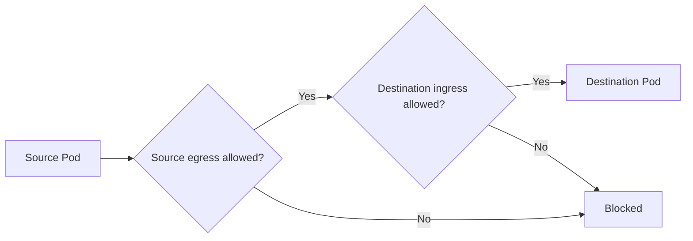

For directions where a Pod is isolated, matching allow rules are additive. Enforcement requires a network implementation that supports NetworkPolicy.

NetworkPolicy specifies allowed traffic for selected Pods at the IP/port level. Enforcement requires a supporting network plugin; merely saving a policy does not guarantee traffic will be blocked. Allowed policies combine additively. To establish default isolation, select the relevant Pods and deny the relevant directions, then add the required flows—including DNS egress when needed. Policies are not a replacement for HTTP authentication or TLS. [Network policies](https://kubernetes.io/docs/concepts/services-networking/network-policies/).

## Docker networking compared with Kubernetes

Docker bridge networking gives each attached container a network interface, address, gateway, and routes. Containers on a user-defined bridge can discover each other by name. Bridge traffic leaving the host commonly uses masquerading; publishing a port creates an inbound access path. Kubernetes adds a cluster-wide Pod network and stable Service discovery rather than requiring a published host port for every Pod. [Docker networking](https://docs.docker.com/engine/network/), [Docker bridges](https://docs.docker.com/engine/network/drivers/bridge/).

For example, `docker run -p 127.0.0.1:8080:80 nginx:stable-alpine` publishes a container's port 80 on host loopback port 8080. The Dockerfile's EXPOSE instruction alone does not publish a port. A Kubernetes `containerPort` declaration likewise does not create external access, though Docker publishing and Kubernetes exposure use different mechanisms.

On Docker Desktop for Mac, the engine runs inside a Linux VM. With kind using Docker, the conceptual path can include Pod → kind node container → Docker networking/VM → Mac networking → destination. The exact backend may use proxies as well as NAT. A working Docker internet connection does not prove every Pod's DNS and policy are correct, and Pod addresses are not automatically reachable from the Mac. [Docker Desktop networking](https://docs.docker.com/desktop/features/networking/).

## Outbound traffic and return routes

**Pod egress and return traffic**

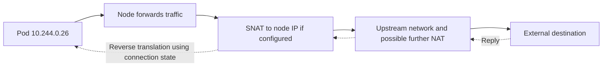

Forwarding, address translation, routing, firewall rules, and DNS are separate pieces. A working IP route does not prove name resolution works.

For a Pod to reach an external service, check a usable route and forwarding path, a valid return path, DNS when using names, and permission through policies and firewalls. Many installations provide outbound access automatically, but this is configuration-dependent.

Source NAT may rewrite a Pod's address to a node or gateway address when the external network has no route back to the Pod range. Other designs route Pod addresses directly within a VPC or connected network, or perform translation at a different gateway. Therefore, every cluster does not require the same node-level MASQUERADE rule. A private subnet may use a NAT gateway, an egress proxy, private endpoints, or another supported route depending on the destination. [IP masquerading](https://kubernetes.io/docs/tasks/administer-cluster/ip-masq-agent/).

### Linux IP forwarding

The following commands describe a Linux node or its relevant network namespace. They are administrator lab examples, not instructions to change macOS kernel settings or an existing managed cluster.

```bash
# Inspect the current IPv4 forwarding setting
sysctl net.ipv4.ip_forward

# Enable it at runtime in an appropriate Linux lab
sudo sysctl -w net.ipv4.ip_forward=1
```

| Part | Meaning |
| --- | --- |
| sudo | Requests the privileges needed to change the setting |
| sysctl | Reads or writes a kernel parameter |
| -w | Writes the supplied value |
| net.ipv4.ip_forward | Controls IPv4 forwarding between interfaces |
| =1 | Enables forwarding; zero disables it |

Forwarding lets the kernel route a packet that is passing through the node rather than addressed to a local application. It does not create missing routes, allow firewall traffic, configure DNS, or perform NAT. IPv6 has separate forwarding settings. A runtime write does not itself persist across reboot; on a systemd-based Linux host, an administrator can manage a setting in `/etc/sysctl.d/` and load it with the distribution's sysctl mechanism. Containerized nodes and managed systems need their platform's configuration workflow. [Linux IP sysctl reference](https://docs.kernel.org/networking/ip-sysctl.html).

### Understanding the supplied masquerade rule

```bash
sudo iptables -t nat -A POSTROUTING \
  -s 10.244.0.0/16 ! -d 10.244.0.0/16 -j MASQUERADE
```

| Part | Meaning |
| --- | --- |
| iptables -t nat | Select the IPv4 address-translation table |
| -A POSTROUTING | Append a rule at the hook used for source translation after routing |
| -s 10.244.0.0/16 | Match sources in that example Pod range |
| ! -d 10.244.0.0/16 | Exclude destinations in that same range |
| -j MASQUERADE | Use an address of the outgoing interface as the translated source |

The /16 spans 10.244.0.0 through 10.244.255.255. This is an example range, not proof of your actual cluster CIDR. The destination condition excludes only that range; it does not recognize every possible Pod network, private destination, or IPv6 range. With no output-interface condition, the rule can also match traffic leaving toward other internal networks. It is a teaching rule rather than a universal Kubernetes repair. [Source NAT](https://www.netfilter.org/documentation/HOWTO/NAT-HOWTO-6.html).

For an illustrative flow, Pod `10.244.0.26` sends to an external server. After routing, masquerading might translate its source to node address `192.168.1.2`. Connection tracking records the translation and reverses it for reply traffic. Because that node address is also private, internet access may still require another translation or proxy upstream. MASQUERADE selects the interface address dynamically; SNAT with `--to-source` specifies a source address explicitly. [iptables NAT targets](https://www.man7.org/linux/man-pages/man8/iptables-extensions.8.html).

Inspect the implementation before adding rules: it may use iptables, nftables, eBPF, cloud routing, or a combination. Repeated `-A` commands append duplicates, rule ordering matters, and manual changes can conflict with the networking controller. Durable configuration belongs in the supported plugin or platform settings.

```bash
# Linux inspection examples
sudo iptables -t nat -S POSTROUTING
sudo iptables -t nat -L POSTROUTING -n -v

# Remove one exact rule only if you added it in this lab
sudo iptables -t nat -D POSTROUTING \
  -s 10.244.0.0/16 ! -d 10.244.0.0/16 -j MASQUERADE
```

NAT-chain counters generally reflect connection setup rather than every packet, because established traffic uses connection-tracking state. Increasing counters show matching traffic reached the rule; they do not prove that a remote service replied successfully. Runtime firewall changes need an appropriate persistence mechanism if they are meant to survive restart; do not assume kube-proxy will restore an arbitrary manually added rule.

## DNS firewall and egress policy checks

**Service name resolution**

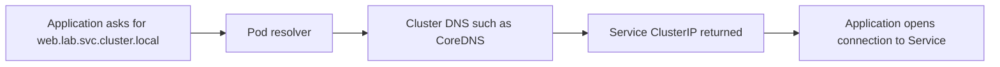

DNS discovers an address; it does not carry the application request. DNS traffic must also be permitted by network policy and firewalls.

```bash
kubectl get pods -n kube-system -l k8s-app=kube-dns
kubectl get networkpolicy -A
# Replace POD_NAME and use a container with these tools installed
kubectl exec -n learning POD_NAME -- nslookup example.com
kubectl exec -n learning POD_NAME -- curl -I --connect-timeout 5 https://example.com
```

An absent `curl` or `nslookup` executable is a tooling issue, not proof of network failure. DNS queries commonly use UDP and can also use TCP. If an applicable egress policy isolates a Pod, both the DNS path and the intended application destination need appropriate permissions. Cloud firewalls, security groups, network ACLs, proxies, and upstream routing can impose additional restrictions.

The attachment's `egress: - {}` policy is an **allow-all egress** example. In a policy whose `podSelector` is `{}`, it allows every selected Pod in that policy's namespace to send to all destinations on all ports, subject to other enforcement layers. Standard NetworkPolicy allowances combine additively; a more restrictive policy does not cancel this broad allow. Use it only when that broad access is intended, not as the default fix for a production DNS problem. [NetworkPolicy behavior](https://kubernetes.io/docs/concepts/services-networking/network-policies/).

## Inbound exposure and kind access

Use the Service, Gateway, Ingress, and port-forward approaches described above for deliberate inbound access. NodePort needs a reachable node and the selected port; LoadBalancer needs an implementation; Gateway/Ingress needs a controller and routing configuration. Direct Pod access is possible where routing, return paths, and policy support it—Pod IPs are not inherently limited to one universal private-address design.

`hostNetwork` shares the node network namespace, while `hostPort` maps a specified host port to a Pod's container port. Both affect host port availability and should be chosen deliberately. Open only the intended exposure path in applicable firewalls; the usual NodePort allocation range is 30000–32767, but clusters can configure another range.

For the local lab, keep port-forward bound to loopback:

```bash
kubectl port-forward --address 127.0.0.1 -n learning service/web 8080:80
```

Binding to `0.0.0.0` instead listens on all host IPv4 interfaces and may expose the application to other machines permitted by routing and firewalls. It is not required for local browser access. For persistent kind port exposure, configure `extraPortMappings` at cluster creation and align the mapped node port with the Service's NodePort. [kind port mapping](https://kind.sigs.k8s.io/docs/user/configuration/#extra-port-mappings).

### Diagnose by layer

| Symptom | Investigate next |
| --- | --- |
| Direct external IP connection fails | Route, forwarding/data plane, return route or NAT, policy, firewall |
| IP connection works but name lookup fails | Resolver configuration, CoreDNS, DNS traffic permissions |
| DNS resolves but HTTPS fails | TCP reachability, proxy, TLS, destination policy, application |
| Direct Pod connection works but Service fails | Service selector, target port, EndpointSlices, Service data plane |
| Internal access works but external access fails | Exposure/controller, node or load-balancer reachability, port mapping, firewall |

A ping failure alone does not establish that HTTP is blocked: the destination or policy may treat ICMP differently. Verify the actual protocol and port you need.

# 11 ConfigMaps and Secrets

**Configuration reaches containers in two common ways**

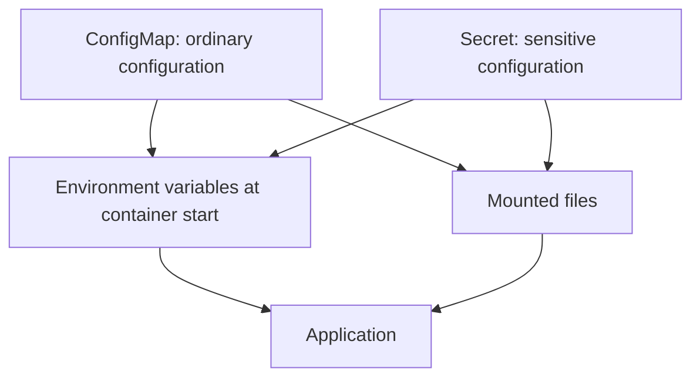

Base64 encoding in a Secret is not encryption. Applications may need a restart or reload to observe changes, depending on how configuration is consumed.

Use ConfigMaps for ordinary settings and Secrets for sensitive values. Applications can consume them through environment variables or mounted files. A ConfigMap does not encrypt data. Environment variables in an existing container do not automatically change when the source ConfigMap changes; restart or roll out the workload when appropriate. Mounted ConfigMap updates are eventual, and subPath mounts have different update behavior. [ConfigMaps](https://kubernetes.io/docs/concepts/configuration/configmap/).

```bash
kubectl create configmap web-settings -n learning \
  --from-literal=APP_MODE=learning \
  --dry-run=client -o yaml
```

To consume a key, add this under the appropriate container in a manifest:

```yaml
env:
  - name: APP_MODE
    valueFrom:
      configMapKeyRef:
        name: web-settings
        key: APP_MODE
```

Base64 in a Secret is an encoding, not encryption. Protect Secrets using least-privilege API access, encryption at rest where configured, careful handling of backups, and a suitable secret-management workflow. Do not commit real credentials in plain manifests. A user who can create Pods with access to a Secret may be able to read its contents even without direct Secret read permissions. [Secrets](https://kubernetes.io/docs/concepts/configuration/secret/).

# 12 Storage and stateful applications

**From a storage request to persistent data**

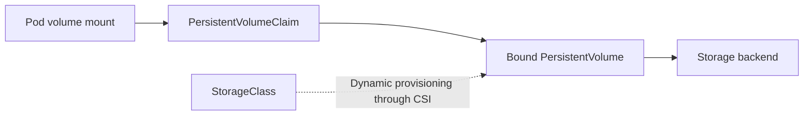

The claim requests storage; the volume represents it. Deleting a Pod does not by itself delete the claim, and persistence does not replace backups.

| Storage concept | Lifetime or responsibility |
| --- | --- |
| Container writable layer | Not reliable persistent application storage |
| emptyDir | Shared Pod-scoped storage; survives container restart but ends with that Pod |
| PersistentVolume or PV | Cluster resource representing storage |
| PersistentVolumeClaim or PVC | Namespaced request for storage |
| StorageClass | Describes dynamic provisioning behavior |
| CSI driver | Integrates the storage system |

A PVC needs suitable storage or a provisioner. `ReadWriteOnce` generally describes attachment for read-write use on one node, not a guarantee of one Pod. Persistent storage can outlive a Pod, but reclaim policy affects what happens after a claim is removed. A volume is not a backup. [Persistent volumes](https://kubernetes.io/docs/concepts/storage/persistent-volumes/).

[Volume lifetimes](https://kubernetes.io/docs/concepts/storage/volumes/).

For a separate storage exercise, inspect available StorageClasses with `kubectl get storageclass`, then create a PVC using a supported class. Mount it in a workload, write a marker, replace the Pod, and verify the marker. Finally inspect the PV reclaim policy before deleting the claim. Do not use a local kind disk as evidence of production disaster recovery: deleting its node containers can destroy local data.

## Shared volume and init container exercise

**Init container prepares files before the application starts**

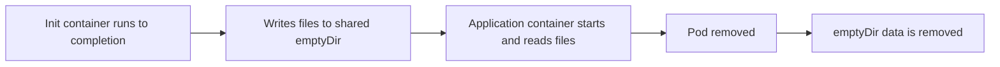

An emptyDir can survive an application container restart within the same Pod, but it does not survive removal of that Pod.

Save as `shared-pod.yaml`:

```yaml
apiVersion: v1
kind: Pod
metadata:
  name: shared-demo
  namespace: learning
spec:
  volumes:
    - name: content
      emptyDir: {}
  initContainers:
    - name: prepare
      image: busybox:stable
      command: ["sh", "-c", "printf 'Hello from the init container\n' > /work/index.html"]
      volumeMounts:
        - name: content
          mountPath: /work
  containers:
    - name: web
      image: nginx:stable-alpine
      volumeMounts:
        - name: content
          mountPath: /usr/share/nginx/html
          readOnly: true
```

```bash
kubectl apply -f shared-pod.yaml
kubectl wait -n learning --for=condition=Ready pod/shared-demo --timeout=120s
kubectl logs -n learning shared-demo -c prepare
kubectl port-forward -n learning pod/shared-demo 8081:80
```

Open `http://localhost:8081`. This demonstrates ordered preparation and a shared volume. The init container is expected to complete, not remain running. It is not a long-running sidecar. [Init container behavior](https://kubernetes.io/docs/concepts/workloads/pods/init-containers/).

# 13 Probes resources and graceful operation

## Three health checks

**What each probe changes**

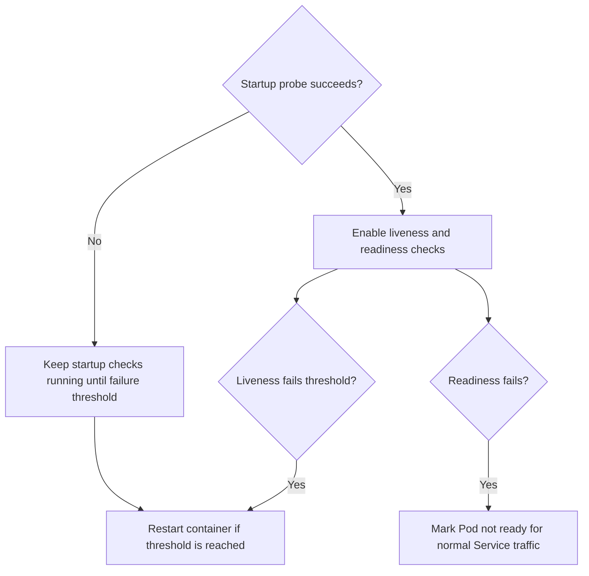

Readiness failure does not restart a container. A configured startup probe delays liveness and readiness checking until startup succeeds.

| Probe | Question | Consequence of persistent failure |
| --- | --- | --- |
| startup | Has initialization finished? | Container restart after its configured failure threshold |
| readiness | Can this instance accept traffic? | Normally removes it from ready Service backends |
| liveness | Is restarting this container likely to help? | Container restart |

When a startup probe is configured, readiness and liveness checks wait for it to succeed. Readiness failure alone does not restart a container. Set thresholds to match real startup and failure behavior. Avoid a liveness check that fails whenever a downstream database has a temporary outage; that can cause restart storms. [Probe configuration](https://kubernetes.io/docs/tasks/configure-pod-container/configure-liveness-readiness-startup-probes/).

## Requests and limits

**Scheduling reservations and runtime limits**

```mermaid
flowchart TD
 Q["Resource requests"] --> S["Scheduler checks node capacity"]
 L["Resource limits"] --> C["CPU limit can throttle execution"]
 L --> M["Memory limit can lead to OOM termination"]
```

Requests influence placement and resource allocation. Limits constrain runtime use; they are not a promise that the application has enough resources.

Requests influence scheduling. CPU limits constrain CPU use, commonly through throttling. Memory limits can result in an OOM kill when exceeded; they do not throttle memory like CPU. `100m` means one tenth of a CPU, and `128Mi` means 128 mebibytes. A request does not mean the container is continuously using that much.

Set values from measurements and leave room for initialization and bursts. Inspect `OOMKilled`, exit codes, node pressure, and resource events before changing limits. Namespace ResourceQuota and LimitRange can enforce capacity and default policies. [Resource management](https://kubernetes.io/docs/concepts/configuration/manage-resources-containers/).

Applications should handle termination signals, finish in-flight work, and exit within the configured grace period. Readiness, endpoint updates, connection draining, and application shutdown all contribute to safe termination; no single probe guarantees uninterrupted service. [Pod termination](https://kubernetes.io/docs/concepts/workloads/pods/pod-lifecycle/#termination-of-pods).

# 14 Releases scaling and scheduling

## Rolling updates and rollback

**A rolling update replaces replicas gradually**

```mermaid
flowchart LR
 O["Old ReplicaSet: 3 ready"] --> N["Create new Pod within surge budget"]
 N --> R{"New Pod ready?"}
 R -->|Yes| D["Scale down old replicas gradually"]
 R -->|No| W["Rollout waits or stalls"]
 D --> F["New ReplicaSet serves all replicas"]
```

With three replicas, maxSurge 1, and maxUnavailable 0, a failed new Pod can coexist with three healthy old Pods. Availability alone does not prove the new release succeeded.

Changing a Deployment's Pod template creates a rollout. `maxSurge` controls extra capacity during a rolling update; `maxUnavailable` controls allowed unavailability. These settings still depend on readiness checks, available node capacity, and the application's compatibility.

Practise a failed release only in the lab:

```bash
kubectl set image -n learning deployment/web \
  web=nginx:tag-that-does-not-exist-learning
kubectl rollout status -n learning deployment/web --timeout=60s
kubectl get pods -n learning
kubectl rollout history -n learning deployment/web
kubectl rollout undo -n learning deployment/web
kubectl rollout status -n learning deployment/web --timeout=120s
```

The invalid image should prevent the new replica from becoming ready; inspect its events. Rollback restores a previous Pod template, not external database state or every configuration change. Reconcile your saved manifest with the release you intend to keep. [Update and rollback practice](https://kubernetes.io/docs/tutorials/kubernetes-basics/update/update-intro/).

Blue-green releases keep old and new environments available and switch traffic. Canary releases send a limited share to a new version and compare outcomes. A Deployment alone does not provide precise request-percentage routing; that requires a suitable traffic layer or deployment system.

## Autoscaling

**Pod scaling and node scaling solve different shortages**

```mermaid
flowchart TD
 M["Workload metrics"] --> H["HPA adjusts desired replica count"]
 H --> P["More Pods created"]
 P --> S{"Enough node capacity?"}
 S -->|Yes| R["Schedule Pods"]
 S -->|No| U["Pods remain unschedulable"]
 U --> N["Configured node autoscaler may add capacity"]
 N --> R
```

HPA scales replicas, while a node autoscaler scales infrastructure. Metric availability and autoscaler configuration determine what can happen.

Manual scaling sets replicas directly. The **HorizontalPodAutoscaler** adjusts replicas from observed metrics. CPU utilization targets depend on CPU requests; resource metrics commonly require Metrics Server. Custom metrics need suitable adapters. A local kind cluster does not necessarily include these components, so `kubectl top` or HPA metrics can be unavailable until configured.

HPA changes Pod count; node autoscaling changes infrastructure capacity. A vertical autoscaler adjusts resource recommendations or requests according to its implementation and configuration. These are separate mechanisms. If HPA manages replicas, avoid another workflow continuously overwriting that field. [Horizontal autoscaling](https://kubernetes.io/docs/concepts/workloads/autoscaling/horizontal-pod-autoscale/).

## Placement and disruptions

Use node selectors or node affinity for placement constraints. Pod affinity/anti-affinity and topology spread can help distribute related workloads. Taints repel Pods unless they have matching tolerations; a toleration permits consideration but does not guarantee placement. Overly strict constraints can leave Pods Pending. [Assigning Pods](https://kubernetes.io/docs/concepts/scheduling-eviction/assign-pod-node/).

Multiple replicas only improve resilience if failures do not affect all of them together. Spread important replicas across appropriate nodes and failure zones. PodDisruptionBudgets constrain qualifying voluntary evictions; they do not prevent node failures, and direct Pod deletion can bypass them. [Disruptions](https://kubernetes.io/docs/concepts/workloads/pods/disruptions/).

# 15 Security and access control

**How an API request is checked**

```mermaid
flowchart LR
 R["API request"] --> A["Authentication: who are you?"]
 A --> B["Authorization: may you do this?"]
 B --> C["Admission: is this object acceptable?"]
 C --> V["Persist accepted resource state"]
```

RBAC grants permissions to users, groups, and service accounts. Admission policies can validate or mutate requests after authorization.

Separate three questions: **authentication** establishes identity, **authorization** decides whether that identity may perform an operation, and **admission** evaluates or modifies the requested resource before persistence. A ServiceAccount represents an application identity inside Kubernetes; it is not a human user's account.

RBAC uses Roles or ClusterRoles to define permissions and bindings to grant them. A Role is namespaced. A RoleBinding can grant a ClusterRole's namespaced permissions within its own namespace. Permissions are additive; RBAC does not provide a general explicit deny rule.

```bash
kubectl auth can-i get pods -n learning
kubectl auth can-i delete deployments -n learning
```

Prefer the minimum required permissions rather than cluster-admin for application workloads. [RBAC](https://kubernetes.io/docs/reference/access-authn-authz/rbac/).

For production workloads, use an image that supports non-root execution, reduce capabilities, disable privilege escalation, apply an appropriate seccomp profile, and avoid unnecessary host mounts and privileged mode. Pod Security Standards define Privileged, Baseline, and Restricted profiles; Pod Security Admission is one enforcement mechanism. A security setting must be compatible with the application: adding `runAsNonRoot` to an image that expects root can stop it starting. [Pod Security Standards](https://kubernetes.io/docs/concepts/security/pod-security-standards/).

Also review image provenance, vulnerability updates, registry credentials, network exposure, and secret distribution. A namespace is an organizational boundary; combine it with access control, quotas, and networking policies for your isolation requirements.

# 16 Troubleshooting the screenshot from your cluster


*Control plane failure in your lab. This captured failure shows controller and scheduler problems. Follow the diagnosis below; a created Deployment alone does not prove its Pods were created.*

The October 31 screenshot at 4:21:19 AM shows four distinct observations:

1. The `kubernetes` ClusterIP Service is `10.96.0.1` on port 443.

2. SSH to that address fails with “Network is unreachable.”

3. A Deployment and NodePort Service are accepted, but no application Pods appear in `default`.

4. In `kube-system`, the controller manager and scheduler show `CrashLoopBackOff`, while the API server and etcd appear Running.

## Why SSH is the wrong access method

`10.96.0.1` is the virtual IP of a Service exposing the Kubernetes API, not the address of a node with an SSH server. The displayed Service port is 443; SSH normally targets port 22. On kind for macOS, cluster virtual IPs are also not normally routed directly from the Mac. Use kubectl for the API, port-forward for a development application, and provider-specific node access for node diagnosis. [Service networking](https://kubernetes.io/docs/concepts/services-networking/service/).

## Why a Deployment can exist without Pods

The API server can accept a Deployment while reconciliation components are unhealthy. A controller-manager failure is consistent with the Deployment/ReplicaSet/Pod creation chain not progressing. A scheduler failure would prevent new unbound Pods being placed. The screenshot supports investigating those components first, but it does not establish why they crashed. Resource exhaustion, configuration, certificates, or other causes require logs and events.

Do not infer that nginx is broken simply because its Deployment was accepted without a running Pod. Diagnose the layer where progress stopped:

```bash
kubectl config current-context
kubectl get nodes -o wide
kubectl get deployment,replicaset,pods -n default
kubectl describe deployment nginx-server -n default
kubectl get events -n default --sort-by=.metadata.creationTimestamp
kubectl get pods -n kube-system -o wide
```

If no ReplicaSet exists, investigate the Deployment controller. If a ReplicaSet exists but no Pod objects appear, inspect ReplicaSet events, admission, quotas, and its controller. If Pods exist without assigned nodes, investigate scheduling and capacity. [Cluster troubleshooting](https://kubernetes.io/docs/tasks/debug/debug-cluster/).

Get the current component Pod names first; names from an old screenshot may no longer exist:

```bash
kubectl get pods -n kube-system \
  -l component=kube-controller-manager
kubectl get pods -n kube-system \
  -l component=kube-scheduler

# Replace COMPONENT_POD with one returned name
kubectl describe pod COMPONENT_POD -n kube-system
kubectl logs COMPONENT_POD -n kube-system --previous
kubectl logs COMPONENT_POD -n kube-system
```

`--previous` retrieves the previous terminated container instance when available. For a multi-container Pod, add `-c CONTAINER_NAME`. Capture the exit reason, restart pattern, and relevant log lines before changing configuration. [Container logs](https://kubernetes.io/docs/concepts/cluster-administration/logging/).

If this is a kind cluster and the API is unreliable, inspect it through the outer provider:

```bash
kind get clusters
kind get nodes --name CLUSTER_NAME
kind export logs ./kind-diagnostics --name CLUSTER_NAME
docker stats --no-stream
# Replace NODE_CONTAINER with a name returned by kind get nodes
docker exec NODE_CONTAINER crictl ps -a
```

The Docker commands assume kind uses Docker. The node names in the screenshot alone do not prove which provider or installer created it. Select the actual cluster name, not the new `learning` cluster by habit. Exporting logs preserves evidence; recreating a cluster can destroy its local workloads and data. [kind diagnostics](https://kind.sigs.k8s.io/docs/user/quick-start/#exporting-cluster-logs).

## A correction to the tutorial command

Use normal double hyphens:

```bash
kubectl run nginx-test --image=nginx:stable-alpine -n learning
kubectl create deployment nginx-demo --image=nginx:stable-alpine -n learning
```

Current `kubectl run` creates a Pod. Use `kubectl create deployment` or a Deployment manifest for managed replicas. The older slide's generated name and typography should not be treated as exact current output. [kubectl run](https://kubernetes.io/docs/reference/kubectl/generated/kubectl_run/).

# 17 A repeatable troubleshooting method

**Follow the failure from object to traffic**

```mermaid
flowchart TD
 A["Correct context and namespace?"] --> B["Desired object exists?"]
 B --> C["Controller created Pods?"]
 C --> D["Pods scheduled?"]
 D --> E["Images pulled and containers started?"]
 E --> F["Application ready?"]
 F --> G["Service has eligible endpoints?"]
 G --> H["DNS routing policy and client access work?"]
```

Start at the first failed step. Events explain scheduling and image failures; logs explain application behavior.

Work from evidence: selected context → namespace → object existence → ownership → scheduling → container startup → readiness → networking → application behavior. Change one thing at a time and compare before/after evidence.

| Symptom | Useful next check | Typical categories to investigate |
| --- | --- | --- |
| No Pods at all | Deployment and ReplicaSet status/events | Controllers, admission, quota, wrong namespace |
| Pending Pod without a node | Describe Pod | Capacity, affinity, taints, storage binding, scheduler |
| ImagePullBackOff | Pod events | Typo, tag, credentials, registry, architecture |
| CrashLoopBackOff | Previous logs and termination reason | Bad config, process exit, permissions, OOM, liveness |
| Running but not ready | Probe details and app response | Wrong path/port, dependencies, startup time |
| Service has no usable backends | Labels, selectors, EndpointSlices | Selector mismatch or unhealthy Pods |
| App reachable locally but not externally | Service, routing implementation, mappings | Exposure path, firewall, local VM boundaries |
| DNS failure | DNS Pod health and test from a workload | Name, namespace, network policy, DNS service |
| Forbidden | Identity and auth can-i | Missing API permissions |

`Pending` is not a diagnosis by itself, and `CrashLoopBackOff` describes restart behavior rather than the underlying error. Read events and termination details before assuming a cause. [Debug Pods](https://kubernetes.io/docs/tasks/debug/debug-application/debug-pods/).

## Entering a Pod or a node

The shell prompt in the attachment names `myapp-deployment-658b44ccc5-57kt6`, which is an application Pod. Being root inside its container does not mean you are in the node's shell or have unrestricted host permissions.

| Intended destination | Tool | What you enter |
| --- | --- | --- |
| Running application container | kubectl exec | A new process inside the selected container |
| kind node using Docker | docker exec | The outer Docker container representing a node |
| Kubernetes node diagnostics | kubectl debug node | A newly created diagnostic Pod with node access |

### Open an application shell

Discover current names; rollout-created Pods are replaceable:

```bash
kubectl get pods -n default -l app=myapp -o wide
kubectl get pod POD_NAME -n default -o jsonpath='{.spec.containers[*].name}'
kubectl exec -it POD_NAME -n default -c CONTAINER_NAME -- sh
```

Replace both placeholders. Your earlier Deployment transcript names its application container `nginx-containers`; do not assume it is named `nginx`. Use `bash` only if it exists. The `--` separates kubectl options from the command to execute. `exit` ends that shell session without normally stopping nginx. [Debug running Pods](https://kubernetes.io/docs/tasks/debug/debug-application/debug-running-pod/).

### Open the kind node using its container provider

For kind configured to use Docker:

```bash
kind get clusters
kind get nodes --name CLUSTER_NAME
docker ps --format '{{.Names}}'
docker exec -it NODE_CONTAINER bash
```

Replace `CLUSTER_NAME` and `NODE_CONTAINER` with observed names. `desktop-control-plane` is the name in this transcript, not a universal node name. Use `sh` if needed. Inside the node, `ip addr`, `ip route`, and `crictl ps -a` inspect the node/runtime perspective. These commands differ from running `ip` in an application Pod. Other kind providers require their own equivalent; cloud nodes are not necessarily Docker containers accessible from your laptop.

### Create a node diagnostic Pod

An alternative, where your account, node OS, runtime, and admission policy permit it:

```bash
kubectl debug node/NODE_NAME -it --image=busybox:stable -- sh
```

This creates a diagnostic Pod rather than executing directly into a node object. On supported Linux nodes, the diagnostic Pod uses host namespaces and mounts the node root filesystem at `/host`. It is not automatically privileged; `chroot /host` can fail without the required privileges and available host binaries. Elevated debugging profiles require explicit administrative authorization and suitable policy. This method is not guaranteed to work on every cluster.

When finished, exit, identify the created `node-debugger-...` Pod in its namespace, and delete that diagnostic Pod. Exiting its shell alone does not remove the object. [Node debugging](https://kubernetes.io/docs/tasks/debug/debug-cluster/kubectl-node-debug/).

## When a container does not contain ip or other tools

`ip: command not found` means the executable is missing, not that the container has no network. Minimal images often omit diagnostics. Do not assume every nginx image is Debian-based: inspect `/etc/os-release` if present and use the image variant's tooling.

For basic inspection without installing packages, run available commands inside the container:

```bash
cat /etc/hosts
cat /etc/resolv.conf
cat /proc/net/route
cat /proc/net/fib_trie
hostname -i
```

`/etc/hosts` can show the Pod hostname mapping; `/etc/resolv.conf` shows resolver/search settings, possibly a cluster DNS service or node-local resolver. `/proc/net/route` uses hexadecimal IPv4 fields, while `fib_trie` contains routing/local-address information rather than a simple authoritative Pod-IP listing. These files and commands depend on the container's environment. From outside, prefer `kubectl get pod POD_NAME -n default -o wide` for the Kubernetes-reported address.

Installing packages in a running container requires a compatible package manager, permissions, writable filesystem, and network access. On a suitable Debian-based disposable container, `apt-get update` followed by `apt-get install -y iproute2 iputils-ping` supplies those tools. That changes the running container, not its source image, and is not durable across container recreation. Use a dedicated diagnostic image when rebuilding the application image is unnecessary.

### Add an ephemeral diagnostic container

**Debug without changing the application image**

```mermaid
flowchart LR
 U["kubectl debug targets a Pod"] --> D["Ephemeral diagnostic container"]
 D --> N["Joins the Pod network namespace"]
 N --> T["Inspect interfaces DNS and network traffic"]
 A["Application container"] --> N
```

A diagnostic container can provide missing network tools. Access to process details depends on runtime support, targeting, and permissions.

An ephemeral container avoids installing tools into the application container, but it **does modify the running Pod**. It requires the relevant API permissions and policy approval. Existing ephemeral containers cannot be individually removed from the Pod specification after addition. [Ephemeral containers](https://kubernetes.io/docs/concepts/workloads/pods/ephemeral-containers/).

Select an approved diagnostic image with the tools you need and substitute it for `DEBUG_IMAGE`:

```bash
kubectl debug -it POD_NAME -n default --image=DEBUG_IMAGE -- sh
```

The diagnostic container shares the Pod's network namespace. Add `--target=CONTAINER_NAME` when you need to target another container's process namespace and the runtime supports it; this flag is not what enables shared Pod networking. In the attachment's netshoot example, `--target=nginx` must match an actual container name, and a third-party image should be reviewed and versioned for the environment. Tools and privileges vary by diagnostic image/profile.

Read the actual `ip addr` and `ip route` output rather than expecting `10.244.0.26`, gateway `10.244.0.1`, or interface `eth0`: those are examples and are not established by this attachment's command failure. A failed ping can reflect ICMP filtering; test the application's real protocol and port before concluding that networking is broken.

### Package warnings and the confirmed Pod address

In the attached session, debconf cannot use its Dialog or Readline frontend because optional UI components are absent, then falls back to Teletype. The output continues with package setup, and `ip addr show` subsequently works. These messages concern package-configuration interfaces; they are not Kubernetes or network-connectivity errors. Missing `Term/ReadLine.pm` does not by itself mean the application needs a Perl dependency.

In a suitable noninteractive Debian-based diagnostic build, a command-scoped `DEBIAN_FRONTEND=noninteractive apt-get install -y iproute2 iputils-ping` can avoid interactive frontend selection. It uses default or preseeded answers and does not suppress genuine package failures. Inspect the exit status and package state; do not globally change the frontend just to hide a warning. [Debconf frontends](https://manpages.debian.org/trixie/debconf-doc/debconf.7.en.html).

The new interface output supplies evidence that the earlier examples did not:

| Recorded interface or field | Interpretation |
| --- | --- |
| lo with 127.0.0.1/8 and ::1/128 | Loopback addresses within this Pod's network namespace |
| eth0@if36 with 10.244.0.26/24 | Pod interface and its recorded IPv4 address/prefix |
| brd 10.244.0.255 | IPv4 broadcast address for that configured /24 |
| UP and LOWER_UP on eth0 | Interface is administratively enabled and reports a lower-layer link |
| fe80::…/64 scope link | IPv6 link-local address, not evidence of full dual-stack cluster connectivity |
| tunl0, gre0, gretap0, erspan0 and similar entries DOWN | Tunnel interfaces exist, but this output does not establish that they carry application traffic |

`eth0@if36` identifies a linked peer interface index; it does not mean node 36 or Pod 36. Multiple DOWN tunnel interfaces alone do not identify the active CNI or prove a fault. Likewise, the large reported MTU is an interface property, not a guarantee of the end-to-end path MTU. [Linux address inspection](https://man7.org/linux/man-pages/man8/ip-address.8.html).

This snapshot confirms `10.244.0.26/24` for that Pod at that time. It does not print a default route, so gateway `10.244.0.1` still needs verification with `ip route`. Interface state and an assigned address are not complete application health checks.

After leaving the container, curl from the Mac directly to `10.244.0.26:80` fails. Installing tools inside a Pod does not add a Mac-to-Pod route or publish nginx. Compare in-Pod `curl http://127.0.0.1:80`, in-cluster access to the current Pod IP, Service access, and a local port-forward to isolate the failing layer. Keep the Pod-versus-Mac distinction from the port-forward lesson above.

## Command reference

```bash
# Locate resources
kubectl get nodes -o wide
kubectl get pods -A
kubectl get pods -n learning -o wide
kubectl describe pod POD_NAME -n learning
kubectl get events -n learning --sort-by=.metadata.creationTimestamp

# Application inspection
kubectl logs POD_NAME -n learning --tail=100
kubectl logs POD_NAME -n learning --previous
kubectl exec -it POD_NAME -n learning -- sh
kubectl get endpointslices -n learning
kubectl get deployment web -n learning -o yaml

# Manage declared state
kubectl diff -f app.yaml
kubectl apply -f app.yaml
kubectl rollout status deployment/web -n learning
kubectl rollout history deployment/web -n learning
```

`exec` requires a running container and an available executable; minimal images may not contain `sh`. Resource names in uppercase are placeholders. `kubectl get all` is not a complete inventory of every resource type; use `api-resources` and targeted queries when investigating missing objects.

# 18 Production operations and advanced topics

## Observability

Use **metrics** for rates, latency, saturation, and capacity; **logs** for events and errors; **traces** for a request across services; and Kubernetes **events** for recent orchestration activity. Capture application logs through stdout/stderr and send them to a backend with a lifetime independent of the Pods. Kubernetes itself is not a complete long-term log storage system. [Logging architecture](https://kubernetes.io/docs/concepts/cluster-administration/logging/).

Alert on user impact and system symptoms together: error rate, latency, available replicas, restart spikes, failed scheduling, and node pressure. The fact that the API server answers requests is not enough to declare the whole cluster healthy, as your screenshot demonstrates.

## Maintenance and backups

For planned node maintenance, cordon prevents ordinary new scheduling, drain requests eligible Pod evictions, and uncordon restores scheduling eligibility. Review replica capacity, disruption budgets, and local storage before draining. Example workflow for a chosen node:

```bash
kubectl cordon NODE_NAME
kubectl drain NODE_NAME --ignore-daemonsets
# Perform planned maintenance, then:
kubectl uncordon NODE_NAME
```

Drain may refuse to proceed when safety conditions are unmet. Do not add force or data-deletion flags just to bypass the message without understanding the consequence. [Safely drain a node](https://kubernetes.io/docs/tasks/administer-cluster/safely-drain-node/).

Protect cluster configuration/API data and application data separately. etcd backups protect cluster state; application databases and persistent volumes need their own consistent backup and restore procedures. Test recovery in a separate environment. For managed clusters, understand what the provider protects and what remains your responsibility.

Before upgrades, check deprecated APIs, add-on/runtime compatibility, supported component skew, storage and networking changes, and rollback/recovery procedures. Upgrade in the sequence supported by the distribution or provider rather than treating every binary as independently interchangeable. [Version policy](https://kubernetes.io/releases/version-skew-policy/).

## Packaging automation and extensions

**Helm** packages related Kubernetes resources as charts and renders them using values. Review the rendered manifests and chart provenance rather than assuming a package's defaults fit your environment. [Helm charts](https://helm.sh/docs/topics/charts/).

**Kustomize** composes and modifies manifests through bases and overlays. `kubectl kustomize DIRECTORY` previews the result and `kubectl apply -k DIRECTORY` applies it. It is useful for environment-specific differences without copying entire manifest sets. [Kustomize](https://kubernetes.io/docs/tasks/manage-kubernetes-objects/kustomization/).

**GitOps** uses version-controlled desired state and a reconciler to apply it. Define who owns fields to avoid conflicts between manual commands, autoscalers, and deployment automation. **CustomResourceDefinitions** add resource types; controllers implement their behavior. An **Operator** commonly combines custom resources and operational controllers to automate application-specific tasks. Learn these after understanding ordinary reconciliation. [Extending Kubernetes](https://kubernetes.io/docs/concepts/extend-kubernetes/).

Further areas to study include admission webhooks and policies, service meshes, Gateway routing policies, multi-cluster networking, Windows nodes, GPU/device scheduling, certificate rotation, etcd quorum, topology-aware storage, and application disaster recovery. Each is a separate operational subject; master the core workflow before adding more controllers.

# 19 Practice plan and knowledge checks

| Session | Exercise | Checkpoint |
| --- | --- | --- |
| 1 | Draw the architecture and explain all components | Distinguish API acceptance from running application |
| 2 | Compare runtime commands and inspect kube-system | Explain CRI versus OCI and kubectl versus crictl |
| 3 | Write a Pod and Deployment manifest | Explain mappings, lists, labels, and ownership |
| 4 | Run the main lab and reach nginx | Trace port-forward and normal Service routing separately |
| 5 | Scale, delete a replica, and recover from a bad image | Explain which controller repaired which condition |
| 6 | Run the shared-volume exercise and plan PVC persistence | Distinguish container, Pod, volume, and backup lifetime |
| 7 | Review probes, resources, and a deliberately broken selector | Use events and EndpointSlices to explain failure |
| 8 | Review RBAC, network isolation, and release packaging | Describe a production deployment checklist in your own words |

Answer these without looking, then verify against the guide:

1. **Who chooses a node, and who starts the container?** The scheduler chooses; kubelet coordinates local startup through the runtime.

2. **Why can three replicas still fail together?** They may share a node, failure zone, dependency, or bad configuration.

3. **Does deleting a managed Pod reduce the desired replica count?** No; the workload controller normally replaces it.

4. **Can two ordinary containers in one Pod both bind the same IP/port?** Normally no; they share that network namespace.

5. **Does a readiness failure restart a container?** No, readiness controls traffic eligibility; liveness/startup failure can trigger restart.

6. **Is base64 a security boundary?** No; encoding does not encrypt the Secret.

7. **Why can a Service exist without working backends?** Its selector may match nothing, Pods may be unhealthy, or controllers may not have produced them.

8. **Why did SSH to 10.96.0.1 fail in the screenshot?** It is a cluster Service virtual IP for the API, not a reachable SSH node address.

9. **Why are runtime and Kubernetes namespaces different?** They belong to different APIs and scope different objects.

10. **What should you collect before recreating a broken lab?** Current objects, events, component logs, versions, node/container health, and any data that needs preserving.

## Capstone

Build an application Deployment with at least two replicas, a Service, external development access, a ConfigMap, health probes, resource settings, and a documented release/rollback workflow. Record how you would add persistent data, least-privilege access, network isolation, monitoring, and backups. Break one selector and one image tag in the disposable lab, diagnose both, and restore the intended state from your saved files.

## Clean up the lab

When finished, the following deletes the disposable cluster and its local resources. Confirm the name carefully; it is not a repair command for your existing cluster:

```bash
kind delete cluster --name learning
```

# 20 Screenshot reference map

The supplied screenshots are learning references, not instructions to execute commands on an existing cluster. Repeated frames are grouped here so you can connect the lessons to the original material.

| Screenshot date and times | Material | Where to study it |
| --- | --- | --- |
| Oct 30 at 10:19:11 AM | Master and worker overview | Cluster architecture |
| Oct 30 at 10:19:49, 10:19:55, 10:20:22, 10:20:32, 10:20:46, 10:20:56 AM | API, etcd, scheduler, controllers, runtime, kubelet | Architecture and reconciliation |
| Oct 30 at 10:23:11 and 10:26:10 AM | Node roles, runtime, CRI and OCI | Runtime interfaces and historical corrections |
| Oct 30 at 10:28:10, 10:28:19, 10:29:11 AM | containerd internals, installation, ctr | Runtime setup and command selection |
| Oct 30 at 10:29:49, 10:40:57, 10:41:02 AM | nerdctl and advanced features | Runtime tools and namespace distinction |
| Oct 30 at 10:39:13, 10:40:07, 10:40:47, 10:41:08 AM | crictl and ctr comparisons | Runtime inspection examples |
| Oct 31 at 4:21:19 AM | Cluster commands, failed SSH, component crashes | Troubleshooting your screenshot |
| Oct 31 at 4:45:46, 4:46:20, 4:46:45, 4:49:06, 4:51:03 AM | Pods, helpers, replication, kubectl run | Pods, workloads, main lab |
| Oct 31 at 4:54:05, 4:55:18, 4:59:48, 5:00:47 AM | YAML mappings, lists and indentation | YAML and manifest definitions |

The October 31 at 4:02:15 AM image is an unrelated browser window and contributes no Kubernetes lesson. The original slides include older rkt, Docker linking, and kubectl examples; the current workflows above take precedence for practice. Docker-style helper links are an analogy, not how Kubernetes expresses Pod networking.

# 21 Lessons from your terminal practice

These examples come from the supplied terminal transcript, added November 1, 2026. They extend the main lab with errors encountered during your own practice. Outputs describe those recorded sessions, not the current health of your cluster. Use the commands below in the intended learning context and namespace.

## Connection refused is different from an application failure

The transcript contains successful API access at `https://127.0.0.1:52956`, followed in other commands by requests to `http://localhost:8080` that fail. The port 52956 belongs to that recorded cluster session; it should not be hardcoded into a new kubeconfig. A changed or missing effective kubeconfig/context is one possible explanation for the endpoint change, but the transcript does not show the exact configuration change.

Separately, `curl http://127.0.0.1:8080` returns an nginx welcome page. This proves that an HTTP server answered at that address at that moment; it does not prove that the Kubernetes API is reachable. The failed requests use IPv6 loopback `[::1]`, whereas the successful curl explicitly uses IPv4 `127.0.0.1`. Both endpoint identity and address family matter.

Check configuration before editing application YAML:

```bash
kubectl config current-context
kubectl config get-contexts
kubectl config view --minify \
  -o jsonpath='{.clusters[0].cluster.server}'
printenv KUBECONFIG
kubectl cluster-info
```

Select the intended existing context with `kubectl config use-context CONTEXT_NAME`, replacing the placeholder. Check that its cluster is running. Avoid sharing complete kubeconfig credentials. Disabling schema validation with `--validate=false` cannot make an unavailable API server reachable. The `memcache.go` message here concerns API discovery; it is not evidence that your application's cache is broken. [Kubeconfig contexts](https://kubernetes.io/docs/tasks/access-application-cluster/configure-access-multiple-clusters/).

## File names resource names and container names

These are three different identities:

| Identity | Example from the transcript | Used for |
| --- | --- | --- |
| Local manifest filename | rs-definition.yml | Reading a file with `-f` |
| Kubernetes resource name | myapp-rs | Addressing the live ReplicaSet |
| Container name | ngnix in the failed Pod | Selecting a container for logs or image updates |

`kubectl edit replicaset rs-definition.yml` asks for a ReplicaSet literally named `rs-definition.yml`, which is why it returns NotFound. The successful command targets `myapp-rs`:

```bash
kubectl get replicaset -n default
kubectl edit replicaset myapp-rs -n default
```

That edits the live object, not the local manifest. To keep a reproducible definition, edit the local file and apply it. The `.yaml` and `.yml` extensions are both usable, but the actual filename must match: the transcript lists `re-definition.yaml` while a command requests the nonexistent `rc-definition.yaml`. Check with `pwd` and `ls` before changing the cluster. [kubectl edit](https://kubernetes.io/docs/reference/kubectl/generated/kubectl_edit/).

The command `kubectl set image pod/redis redis=redis` also fails because a Pod named `redis` does not exist in the queried namespace. In image-update syntax, the left side of `CONTAINER_NAME=IMAGE` must match the container's name, not merely the Pod or image name. Inspect the target first. For a managed application, update its Deployment template or saved manifest rather than making an isolated change to one Pod.

## Correcting API versions and field spelling

Your Deployment attempts progress through discovery errors and strict decoding errors before creation succeeds. These are separate from the later image-pull failure.

| Rejected value or field | Correct form | Reason |
| --- | --- | --- |
| apiVersion: v1.37 | apiVersion: apps/v1 for a Deployment | Cluster release numbers are not resource API versions |
| kind: deployment | kind: Deployment | Kind names are case-sensitive |
| spec.replica | spec.replicas | The field is plural |
| spec.selector.matchlabels | spec.selector.matchLabels | The field uses a capital L |

For built-in Deployment resources, a generic “ensure CRDs are installed first” message does not mean you need a Deployment CRD. First correct the API group/version and kind. Use `kubectl api-resources`, `kubectl explain deployment.spec`, and a server-side dry run to check the manifest. [Kubernetes object definitions](https://kubernetes.io/docs/concepts/overview/working-with-objects/).

## ImagePullBackOff caused by a misspelled repository

The failed Pod's description shows `Image: ngnix:1.25`, `PodScheduled: True`, a waiting container, and image-pull errors. Scheduling had succeeded; retrieving the application image had not. The repository spelling is `nginx`, not `ngnix`.

The registry message mentions access denial or authorization as possible explanations. In this example, inspect the obvious repository typo before assuming credentials are missing. Correct the image in the Deployment manifest to an intended, available tag or digest, then apply it and inspect the rollout. The later output shows three replacement Deployment Pods `1/1 Running`, consistent with recovery, although the final edited manifest is not printed in the transcript. [Diagnosing Pod startup](https://kubernetes.io/docs/tasks/debug/debug-application/debug-pods/).

The container's own name `ngnix` is a separate field: a misleading name does not by itself cause an image-pull failure. If using `kubectl set image`, target the actual existing container name or deliberately rename it in the manifest.

## Create apply and editing live objects

`kubectl create -f FILE` requests a new object. If the same kind, namespace, and name already exist, `AlreadyExists` is expected. Repeating create does not update it. For a file-managed learning resource, use `kubectl apply -f FILE` consistently from the beginning.

Your first apply after imperative creation reports a missing `kubectl.kubernetes.io/last-applied-configuration` annotation and says it will be patched automatically; the following `configured` message indicates that request succeeded. This is a configuration-management warning, not a Pod failure. Review the intended file and live state before adopting an existing object into a new management workflow. A live `edit` also does not update your file. [Declarative object management](https://kubernetes.io/docs/tasks/manage-kubernetes-objects/declarative-config/).

`no objects passed to create` means no usable resource objects reached the create operation. Check whether the file is empty, contains only comments, is unsaved, or has the wrong content. It is different from a missing file and different from AlreadyExists.

## ReplicationController and ReplicaSet observations

The printed ReplicationController first omits `spec.replicas` and the output shows one Pod. After `replicas: 3` is added and the file applied, three Pods appear. ReplicationController is a legacy API; learn it to understand the exercise, but use Deployments for normal stateless application releases. [ReplicationController](https://kubernetes.io/docs/concepts/workloads/controllers/replicationcontroller/).

Later, the standalone ReplicaSet has three Pods. After a successful edit, a fourth appears. This is consistent with increasing its desired replica count. Inspect `.spec.replicas` to confirm; the actual edited ReplicaSet manifest is not included. Do not independently scale a ReplicaSet owned by a Deployment—manage the Deployment instead.

An especially useful observation is that repeated `pod/my-app created` messages are followed by a listing that contains only the three ReplicaSet Pods. **Possible explanation:** a ReplicaSet can adopt an otherwise unowned Pod whose labels match its selector and then remove excess replicas. This could explain a new bare Pod disappearing, but the transcript does not print the ReplicaSet selector or the Pod's owner references at that moment, so adoption is not proven. [ReplicaSet Pod adoption](https://kubernetes.io/docs/concepts/workloads/controllers/replicaset/#non-template-pod-acquisitions).

To investigate a repeat of that behavior, collect evidence promptly:

```bash
kubectl get replicaset myapp-rs -n default -o yaml
kubectl get pods -n default --show-labels
kubectl get pod my-app -n default -o yaml
kubectl describe replicaset myapp-rs -n default
kubectl get events -n default --sort-by=.metadata.creationTimestamp
kubectl get pods -n default -w
```

Look for matching labels, `metadata.ownerReferences`, and creation/deletion events. If `my-app` is already gone, its live YAML cannot be recovered with `get`; capture the watch/events during another disposable experiment. Give unrelated workloads distinct selectors to avoid controller overlap. A standalone ReplicaSet maintains count but does not provide Deployment-style rolling updates when its template changes.

## There is no Docker style stop command for a Pod

The transcript's `kubectl stop app` and `kubectl get stop app` attempts fail because `stop` is neither that command nor a resource type. For a bare learning Pod, deletion removes it. For a managed workload, scale its owning controller to zero when your intent is to keep the definition but run no replicas; deleting a managed Pod generally triggers replacement.

```bash
# Examples only: choose the resource and namespace you intend to change
kubectl delete pod app -n default
kubectl scale deployment my-web-app -n default --replicas=0
```

These are alternatives for different objects, not a sequence to run indiscriminately. Restore the intended count in both the live workload and saved manifest when resuming. [Deployment scaling](https://kubernetes.io/docs/concepts/workloads/controllers/deployment/#scaling-a-deployment).

## Reading successful output without overclaiming recovery

In one recorded snapshot, the scheduler and controller manager are `1/1 Running` with six historical restarts each; an nginx workload is also running. This adds a healthy snapshot to the earlier screenshot case, but the transcript does not record the repair that changed the component state. Other outputs have different Pod names and very young system-Pod ages; they may represent recreated clusters or sessions. Do not infer a particular reset or repair command from those differences alone.

The `describe pod app` output also confirms `containerd://` as that container's runtime identifier, shows the node assignment and Pod IP, and records Scheduled → Pulling → Pulled → Created → Started events. `QoS Class: BestEffort` indicates that this Pod has no CPU/memory requests or limits. `Port: <none>` means no container port was declared in that specification; it does not prove that nginx is not listening. [Pod quality of service](https://kubernetes.io/docs/concepts/workloads/pods/pod-qos/).

# 22 Deployment history and rollback lessons

Your November 1 terminal session follows `myapp-deployment` through creation, image changes, a stalled update, and a successful rollback. It provides a useful distinction between an accepted configuration, available replicas, and a completed release.

## Replace record with an explicit change cause

`--record=trur` fails because `trur` is not a valid Boolean. Changing it to `true` fixes that spelling error, but the CLI also warns that `--record` is deprecated. Use a deliberate change-cause annotation instead of relying on that flag.

The rejected field `metadata.kubernetes.io/change-cause` belongs inside the `annotations` mapping. This is a metadata excerpt to merge into your existing Deployment, not a complete manifest:

```yaml
metadata:
  name: myapp-deployment
  annotations:
    kubernetes.io/change-cause: "Update nginx to the reviewed release"
```

Use a specific message for each intended release, ideally with a version or commit reference. Your history repeats “Initial deployment of myapp” because that description remained unchanged; it does not mean the image stayed unchanged. A top-level Deployment annotation is also not automatically a Pod annotation, so `Annotations: <none>` on a Pod does not disprove the Deployment's change cause. [Annotations](https://kubernetes.io/docs/concepts/overview/working-with-objects/annotations/).

## Update an existing Deployment without deleting it

The AlreadyExists and missing last-applied-configuration messages are the same management lessons covered in section 21. Deleting and recreating a Deployment is not necessary for an ordinary image update: deletion normally removes its managed workloads and loses the previous object's rollout history. Recreating the same name creates a new object identity. Use the existing file-management workflow for updates.

In the transcript, a second delete returns NotFound because the named Deployment has already been removed in that namespace. That is not evidence of a new cluster failure.

## Use the resource type and current Pod names

`describe` is a kubectl subcommand, not a standalone shell command. Similarly, rollout status needs a resource type as well as the name:

```bash
kubectl describe deployment myapp-deployment -n default
kubectl rollout status deployment/myapp-deployment -n default --timeout=120s
kubectl get pods -n default -l app=myapp
```

After an update, describing the old Pod returns NotFound because that instance has been replaced. List the current Pods instead of reusing a name from earlier output. Confirm ownership when a selector could match other workloads.

## Read the release through its ReplicaSets

The first described Pod uses `nginx:1.12` and is owned by `myapp-deployment-68b565d86c`. After applying a change, a replacement Pod uses `nginx` and belongs to `myapp-deployment-658b44ccc5`. A later description shows the original ReplicaSet active again with `nginx:1.12`. These observations demonstrate changes to the Pod template and the management of old and new replicas.

A template change triggers a Deployment rollout; scaling alone does not create a new rollout revision. Returning to a previous template can reuse its ReplicaSet, while the Deployment revision still advances. The hash in a Pod/ReplicaSet name is not its rollout revision number. Top-level change-cause text alone is not a template change. [Deployment revision behavior](https://kubernetes.io/docs/concepts/workloads/controllers/deployment/).

An image written as `nginx` implies the `latest` tag; it does not identify an immutable release. `nginx:1.12` is the historical image in this exercise, not a recommended current production version. Inspect the actual digest and `imagePullPolicy`. Kubernetes sets the default pull policy when the object is created and does not automatically recalculate it just because you later change the image tag. This helps explain why a changed template can report an image already present on the node. [Image tags and pull policies](https://kubernetes.io/docs/concepts/containers/images/).

## Available does not mean updated

During the failing rollout, the transcript shows:

| Field or observation | Recorded value | Interpretation |
| --- | --- | --- |
| READY | 3/3 | Three replicas are ready |
| UP-TO-DATE | 1 | Only one replica has the latest requested template |
| AVAILABLE | 3 | Three replicas satisfy availability criteria |
| New Pod | 0/1 ImagePullBackOff | The new instance cannot start its image |
| Old Pods | Three instances still 1/1 Running | The previous application version remains available |

For the displayed three-replica strategy, `maxUnavailable: 25%` rounds down to zero and `maxSurge: 25%` rounds up to one. That permits an extra new replica while keeping three available. The stalled new Pod therefore need not remove the old healthy replicas. The failing image itself is not printed in this part of the attachment; use its events to determine the cause rather than assuming the earlier `ngnix` typo recurred. [Rolling update behavior](https://kubernetes.io/docs/tutorials/kubernetes-basics/update/update-intro/).

Ctrl+C stops the local rollout-status watch; it does not cancel the Deployment controller's work. Re-run the status command to inspect progress. Ready Pods alone also do not prove that requests through a Service or external route succeed.

## Inspect a revision before choosing a rollback

```bash
kubectl rollout history deployment/myapp-deployment -n default
# Replace REVISION_NUMBER with a retained revision from the history
kubectl rollout history deployment/myapp-deployment -n default \
  --revision=REVISION_NUMBER
```

Compare the template, image, and release record rather than relying on the repeated change-cause text. Undo without a target selects the preceding retained revision, which is not necessarily the version you intended. For a deliberate rollback in your learning cluster:

```bash
# Replace REVISION_NUMBER with the verified target
kubectl rollout undo deployment/myapp-deployment -n default \
  --to-revision=REVISION_NUMBER
kubectl rollout status deployment/myapp-deployment -n default --timeout=120s
```

A rollback is another change to the desired template, so revision numbers advance rather than rewinding. History is retained through ReplicaSets and cleanup policy, not as a permanent audit log of every command. Your final history contains revisions 3, 5, and 6; missing numbers alone do not establish a failed rollback. [Rollout history and undo](https://kubernetes.io/docs/concepts/workloads/controllers/deployment/#rolling-back-a-deployment).

## Reconcile the saved file after rollback

The CLI explicitly warns that undo does not update the client-side apply annotation. It also does not rewrite `deployment.yml`. Applying a file that still requests the failing template can reintroduce that release, which is why emergency recovery and the saved desired state must be reconciled.

For the normal file-managed workflow, restore the reviewed working configuration in version control or the local manifest, update its change cause, inspect `kubectl diff -f deployment.yml`, and apply it. If you use undo for immediate recovery, bring the saved file back into agreement before the next apply. Avoid blindly editing the last-applied annotation to silence the warning.

The final output confirms that the last rollback completed successfully at the Kubernetes Deployment level. Verify application behavior through its normal access path separately, and record the working image/template so the next release starts from a known state.

# Original Mac installation transcript

(base) roshanxavier\@ACA2174LT200899 \~ % mkdir -p \~/bin && cd \~/bin


(base) roshanxavier\@ACA2174LT200899 bin % curl -Lo kind [https://github.com/kubernetes-sigs/kind/releases/latest/download/kind-darwin-arm64](https://github.com/kubernetes-sigs/kind/releases/latest/download/kind-darwin-arm64)


  % Total    % Received % Xferd  Average Speed  Time    Time    Time   Current

                                 Dload  Upload  Total   Spent   Left   Speed

  0      0   0      0   0      0      0      0                              0

  0      0   0      0   0      0      0      0                              0

100  9.50M 100  9.50M   0      0 10.45M      0                              0

(base) roshanxavier\@ACA2174LT200899 bin % chmod +x kind


(base) roshanxavier\@ACA2174LT200899 bin % curl -LO "[https://dl.k8s.io/release/$(curl](https://dl.k8s.io/release/$\(curl) -L -s [https://dl.k8s.io/release/stable.txt)/bin/darwin/arm64/kubectl](https://dl.k8s.io/release/stable.txt\)/bin/darwin/arm64/kubectl)"


  % Total    % Received % Xferd  Average Speed  Time    Time    Time   Current

                                 Dload  Upload  Total   Spent   Left   Speed

100 56.83M 100 56.83M   0      0 22.96M      0   00:02   00:02         24.36M

(base) roshanxavier\@ACA2174LT200899 bin % chmod +x kubectl


(base) roshanxavier\@ACA2174LT200899 bin % echo 'export PATH="$HOME/bin:$PATH"' >> \~/.zshrc


(base) roshanxavier\@ACA2174LT200899 bin % source \~/.zshrc


(base) roshanxavier\@ACA2174LT200899 bin % kind version

kind v0.33.0 go1.26.7 darwin/arm64

(base) roshanxavier\@ACA2174LT200899 bin % kubectl version --client

Client Version: v1.37.1

Kustomize Version: v5.8.1

(base) roshanxavier\@ACA2174LT200899 bin % 