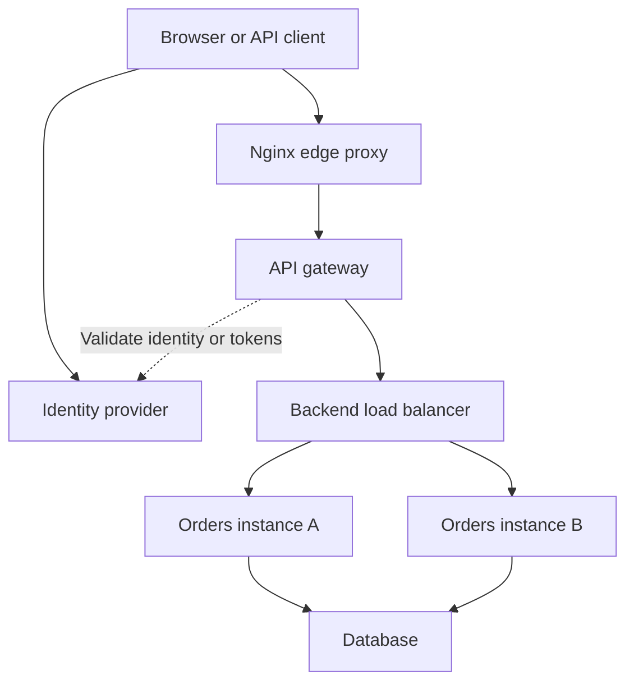

Learn how a request travels from a browser to an application and back, then configure and troubleshoot each component along that journey.

Suggested pace: **16 weeks at 6–8 hours per week**. Advance when you can complete each lab and explain its behavior.

Use one evolving project throughout: **an Orders API running on Java servers, behind Nginx, with HTTPS, load balancing, and login**. Spend roughly one-third of each module reading, one-third building, and one-third deliberately breaking and diagnosing the system.

# Server types and responsibilities

A server can mean a physical machine, a virtual machine, or a program accepting requests. One machine can run several server programs.

| Type or role | Responsibility | Examples |
|---|---|---|
| Physical or virtual server | Provides CPU, memory, storage, networking | Bare metal, cloud VM |
| Web server | Handles HTTP; serves files and proxies requests | Nginx, Apache HTTP Server, Caddy |
| Servlet container | Executes Java applications using Servlet APIs | Tomcat, Jetty |
| Full Jakarta EE application server | Provides broader enterprise Java services | WildFly, Payara |
| Reverse proxy | Receives requests on behalf of backend services | Nginx, HAProxy, Envoy |
| Forward proxy | Makes outbound requests on behalf of clients | Corporate internet proxy |
| Load balancer | Distributes traffic across backend instances | HAProxy, Nginx, cloud load balancers |
| API gateway | Routes API traffic and applies shared policies | Kong, managed API gateways |
| Identity server | Handles login and issues identity or access tokens | OpenID Connect provider |
| Database, cache, message server | Stores data or coordinates work | PostgreSQL, Redis, RabbitMQ |
| DNS server | Answers queries about domain names | Authoritative and recursive DNS servers |

Roles overlap. Nginx can act as a web server, reverse proxy, and load balancer simultaneously. Tomcat and Jetty accept HTTP and execute Java application code. Apache HTTP Server and Apache Tomcat are separate products.

# Reference architecture

Start with fewer components and add them gradually.



DNS helps clients find the public endpoint; it is not usually a component through which each HTTP request passes.

A smaller deployment can use one Nginx process for edge proxying and backend load balancing. Add separate components when their responsibilities justify them. Token validation may use locally cached signing keys rather than contact the identity provider on every request.

# Learning schedule

| Weeks | Topic | Outcome |
|---|---|---|
| 1–2 | Operating systems and networking | Explain processes, ports, DNS, TCP, reachability |
| 3 | HTTP | Read requests, responses, headers, status codes |
| 4 | HTTPS and TLS | Explain certificates, handshakes, termination |
| 5–6 | Nginx and routing | Serve files, proxy requests, configure HTTPS and redirects |
| 7–8 | Tomcat and Jetty | Deploy Java applications and configure connectors |
| 9–10 | Load balancing | Choose algorithms, check health, handle failures |
| 11 | API gateways | Configure routes, upstreams, API policies |
| 12–13 | Authentication and authorization | Implement login and enforce access rules |
| 14 | Performance and resilience | Configure timeouts, pools, retries, caching |
| 15 | Deployment and operations | Monitor, deploy, reload, troubleshoot |
| 16 | Capstone | Build and explain the complete system |

# Weeks 1 and 2 Operating systems and networking

## Topics

- Processes, threads, services, environment variables, file permissions.

- CPU, memory, disk I/O, file descriptors, sockets.

- IP addresses, IPv4/IPv6, subnets, routing tables, NAT.

- TCP versus UDP.

- Listening ports versus client connections.

- Binding to `127.0.0.1`, a particular interface, or `0.0.0.0`.

- DNS records: A, AAAA, CNAME; caching and TTL.

- Firewalls, public/private networks, container networking.

- TCP connection establishment, reuse, closure.

Practice with a Linux VM or containers. Linux tools:

```bash
ps aux
ss -lntp
dig example.com
curl -v http://localhost:8080/
```

## Lab

Start a small HTTP application on port 8080. Identify its process and listening socket. Bind it to localhost, then a network interface, and observe reachability changes.

## Checkpoint

Explain why a running application can be unreachable: wrong binding, port, firewall, DNS, routing, or container port exposure.

# Week 3 HTTP and request handling

## Topics

- URL components: scheme, hostname, port, path, query string.

- GET, POST, PUT, PATCH, DELETE, OPTIONS, HEAD.

- Request and response headers, bodies, content types.

- `Host`, `Authorization`, `Cookie`, `Set-Cookie`, `Location`, `Cache-Control`.

- Status codes: 200, 201, 204, 301, 302, 303, 307, 308, 400, 401, 403, 404, 429, 500, 502, 503, 504.

- Safe and idempotent methods.

- Cookies and server-side sessions.

- Persistent connections, compression, caching, conditional requests.

- HTTP/1.1 versus HTTP/2 multiplexing.

HTTP semantics describe methods, headers, and status codes independently of many wire-format details. Read selected sections of [RFC 9110](https://www.rfc-editor.org/rfc/rfc9110.html).

## Lab

Inspect an API call in browser Developer Tools and reproduce it with `curl`. Change the method, token, body, and path; explain each response.

## Checkpoint

Distinguish an HTTP error response from a failure occurring before HTTP, such as DNS failure or TLS handshake failure.

# Week 4 HTTPS and TLS

## Communication flow

For a typical new HTTPS connection using HTTP/1.1 or HTTP/2:

1. Resolve the hostname.

2. Establish a TCP connection.

3. Negotiate TLS parameters and shared cryptographic keys.

4. The server presents its certificate and proves possession of its private key.

5. The client validates the chain, hostname, and certificate validity.

6. Exchange HTTP messages over the encrypted connection.

Existing connections and TLS session resumption can shorten the process. TLS provides confidentiality, integrity, and server authentication. Mutual TLS also authenticates the client.

HTTP/3 uses QUIC over UDP and integrates TLS 1.3 rather than following the same TCP sequence. Learn it after TCP-based HTTP.

## Topics

- Certificates, private keys, certificate authorities, trust stores.

- Subject Alternative Names and intermediate certificates.

- SNI for selecting a TLS virtual host.

- ALPN for protocol negotiation.

- Certificate issuance, renewal, rotation.

- TLS 1.2 and 1.3.

- Mutual TLS versus user login.

- HSTS and its effect on browsers.

| Arrangement | Behavior |
|---|---|
| Termination | Proxy decrypts client traffic and sends HTTP to backend |
| Termination and re-encryption | Proxy opens a separate HTTPS connection to backend |
| Passthrough | Proxy forwards encrypted traffic; backend terminates TLS |

HTTPS on the public side does not automatically encrypt backend traffic. Re-encryption requires upstream TLS settings and certificate verification.

## Lab

Configure HTTPS with a locally trusted test certificate. Inspect it:

```bash
openssl s_client -connect api.example.test:443 \
  -servername api.example.test
```

Break the hostname or certificate chain and diagnose the failure.

## Checkpoint

Explain where encryption begins and ends, who validates each certificate, and which component sees plaintext.

References: [TLS 1.3](https://www.rfc-editor.org/rfc/rfc8446.html), [HTTP/3](https://www.rfc-editor.org/rfc/rfc9114.html), [upstream TLS](https://docs.nginx.com/nginx/admin-guide/security-controls/securing-http-traffic-upstream/).

# Weeks 5 and 6 Nginx routing rewrites and redirects

## Configuration structure

- `events`: connection processing settings.

- `http`: HTTP configuration.

- `server`: virtual server.

- `listen`: address and port.

- `server_name`: hostname matching.

- `location`: request-path handling.

- `upstream`: backend group.

- `proxy_pass`: forwarding destination.

- Logs, limits, timeouts, reloads.

Study exact, prefix, and regular-expression location matching. Predict which block handles a request before testing.

| Operation | Behavior | Client makes another request |
|---|---|---|
| Routing | Select a handler or backend | Usually no |
| Reverse proxying | Make an upstream request on the client’s behalf | No |
| Internal rewrite | Change the URI used internally | Usually no |
| Redirect | Tell the client to visit another URL | Yes, if followed |

307 and 308 preserve the method. 303 directs retrieval using GET or HEAD. 301 and 302 can cause POST to become GET.

## Lab configuration

This illustrative configuration assumes two local application instances and existing certificate files. Ports and paths must match your environment.

```nginx
events {}

http {
    upstream orders_backend {
        least_conn;

        server 127.0.0.1:8081;
        server 127.0.0.1:8082;
    }

    server {
        listen 80;
        server_name api.example.test;

        return 308 https://api.example.test$request_uri;
    }

    server {
        listen 443 ssl;
        server_name api.example.test;

        ssl_certificate     /etc/nginx/certs/fullchain.pem;
        ssl_certificate_key /etc/nginx/certs/privkey.pem;
        ssl_protocols TLSv1.2 TLSv1.3;

        location /api/ {
            proxy_pass http://orders_backend;

            proxy_set_header Host $host;
            proxy_set_header X-Forwarded-Proto $scheme;
            proxy_set_header X-Forwarded-For $remote_addr;

            proxy_connect_timeout 3s;
            proxy_read_timeout 30s;
        }
    }
}
```

Restrict access to the private key.

URI behavior in this location:

- `proxy_pass http://orders_backend;` preserves `/api/orders`.

- `proxy_pass http://orders_backend/;` replaces the matching prefix, producing `/orders`.

`proxy_read_timeout` limits inactivity between reads, not total request duration.

This example treats Nginx as the public edge and replaces client-supplied forwarding information. Multiple-proxy deployments need explicit trusted proxy addresses and header handling.

Validate before reloading:

```bash
nginx -t
nginx -s reload
```

## Lab

Route `/api/` to Java and serve `/static/` from disk. Test trailing slashes, unknown hosts, redirects, incorrect backend paths.

## Checkpoint

Explain every line and predict the public URL, upstream URL, and headers received by the application.

References: [beginner’s guide](https://nginx.org/en/docs/beginners_guide.html), [request processing](https://nginx.org/en/docs/http/request_processing.html), [proxy module](https://nginx.org/en/docs/http/ngx_http_proxy_module.html), [HTTPS configuration](https://nginx.org/en/docs/http/configuring_https_servers.html).

# Weeks 7 and 8 Tomcat and Jetty

## Java request lifecycle

Connector accepts traffic → request parsing → application selection → filters and security → servlet or controller → response.

Learn Servlet APIs, filters, listeners, context paths, WAR files, embedded servers, class loading, and deployment. Match the Java version and Servlet/Jakarta API generation to the selected server release.

## Tomcat

| Configuration area | Study |
|---|---|
| `conf/server.xml` | Connectors and Server/Service/Engine/Host structure |
| Context configuration | Application deployment and resources |
| `WEB-INF/web.xml` | Servlet/filter mappings and deployment metadata |
| Connector settings | Binding, ports, connections, threads, queues, timeouts |
| JVM settings | Heap, garbage collection, diagnostics |

Local HTTP connector example:

```xml
<Connector
    address="127.0.0.1"
    port="8081"
    protocol="HTTP/1.1"
    connectionTimeout="20000"
    maxThreads="100"
    maxConnections="1000"
    acceptCount="100" />
```

Study what each setting limits. An external executor changes how thread settings apply. These values are lab starting points, not performance recommendations.

Behind a TLS-terminating proxy, learn how Tomcat discovers the original scheme, host, port, and client address. Wrong proxy metadata can produce HTTP links or redirect loops.

## Jetty

- Embedded versus standalone operation.

- `JETTY_HOME` versus `JETTY_BASE`.

- Modules and `start.d/*.ini`.

- Connectors, handlers, contexts, thread pools.

- HTTP, HTTPS, HTTP/2, keystores, forwarding support.

- Servlet deployment modules matching the Jakarta version.

From the configured base directory:

```bash
java -jar "$JETTY_HOME/start.jar" --add-modules=http
java -jar "$JETTY_HOME/start.jar" jetty.http.port=8082
```

This configures a connector; deploying the application is a separate step.

## Lab

Run a compatible Orders application on Tomcat, then Jetty. Return an instance identifier from each deployment. Observe context paths, logs, headers, sessions.

## Checkpoint

Explain which work Nginx performs and which work the Java container performs.

References: [Tomcat documentation](https://tomcat.apache.org/tomcat-11.0-doc/index.html), [Tomcat HTTP connector](https://tomcat.apache.org/tomcat-11.0-doc/config/http.html), [Jetty connectors and protocols](https://jetty.org/docs/jetty/12.1/operations-guide/protocols/index.html). Use documentation matching your installed version.

# Weeks 9 and 10 Load balancing

Separate the balancing layer, selection algorithm, and failure policy.

## Balancing layers

| Layer | Selection information | Typical use |
|---|---|---|
| Layer 4 | Transport connection details; sometimes TLS metadata | TCP/UDP services and TLS passthrough |
| Layer 7 | HTTP host, path, headers, cookies, method | Web/API routing and policies |
| DNS/global steering | DNS answers, region, health, latency policies | Direct clients toward regions/endpoints |

## Algorithms

| Algorithm | Behavior | Useful when |
|---|---|---|
| Round robin | Rotate across eligible backends | Similar instance capacity |
| Weighted round robin | Assign a larger share to selected instances | Different capacities |
| Least connections | Prefer fewer active connections | Connection durations vary |
| Weighted least connections | Consider connections and weights | Capacities and durations vary |
| Random or power of two choices | Sample candidates | Large pools; implementation dependent |
| Least response time | Use latency/load measurements | Supported by chosen product |
| Hash or consistent hash | Map a key to a backend | Affinity or cache locality |
| Sticky sessions | Keep a client/session on one backend | Local application session state |

Availability differs by product and edition. Consult the selected product’s reference.

## Reliability topics

- Active checks: periodic probes.

- Passive checks: failures observed during real traffic.

- Readiness versus liveness.

- Failure/recovery thresholds.

- Connection draining and graceful shutdown.

- Retry policies and duplicate side effects.

- Session storage, affinity, failover.

- Load balancer redundancy.

- DNS failover limitations caused by caching.

TCP checks establish reachability; HTTP readiness checks can test whether an application can serve traffic.

## Lab

Balance across two instances. Stop one, make one slow, and make one return errors. Observe selection and recovery. Use HAProxy to practice active HTTP checks.

## Checkpoint

Explain why half the requests does not necessarily mean half the CPU load, and why blindly retrying a payment POST can duplicate work.

References: [Nginx HTTP balancing](https://nginx.org/en/docs/http/load_balancing.html), [upstream module](https://nginx.org/en/docs/http/ngx_http_upstream_module.html), [HAProxy health checks](https://www.haproxy.com/documentation/haproxy-configuration-tutorials/reliability/health-checks/).

# Week 11 API gateways

A gateway provides a shared place for API-facing policies.

## Topics

- Host, path, method, header matching.

- Upstreams and backend discovery.

- Path preservation or stripping.

- Authentication integration.

- Rate limits and quotas.

- Request-size limits and validation.

- CORS handling.

- Header transformations.

- Timeouts, tracing, API version routing.

- Separation of gateway administration from public traffic.

In Kong, a Route matches incoming traffic and attaches it to a Gateway Service. Policies can apply at different scopes.

| Incoming request | Destination | Policy |
|---|---|---|
| `/api/orders` | Orders service | Valid access token |
| `/api/catalog` | Catalog service | Public reads, rate limit |
| `/api/admin` | Admin service | Administrative permission |
| `/health` | Selected health endpoint | Restricted where appropriate |

## Lab

Add a gateway. Configure two services and different route policies. Confirm callers cannot bypass the gateway through publicly exposed backend ports.

## Checkpoint

Explain why gateway token validation does not replace application checks such as whether a user owns order 123.

Reference: [Kong Routes](https://developer.konghq.com/gateway/entities/route/).

# Weeks 12 and 13 Authentication and authorization

Authentication establishes identity. Authorization decides whether that identity may perform an action on a resource.

## Concepts

| Concept | Purpose |
|---|---|
| Session cookie | Identifies a browser session |
| API key | Identifies a caller/application under a policy |
| OAuth 2.0 | Framework for delegated access |
| OpenID Connect | Authentication layer built on OAuth 2.0 |
| JWT | Token format, not a login protocol |
| Mutual TLS | Authenticates a certificate-bearing peer |

## Authorization Code flow with PKCE

1. The application directs the browser to the identity provider.

2. The user signs in there.

3. The provider redirects to a registered callback with an authorization code.

4. The client exchanges the code using the PKCE verifier.

5. The application validates returned identity information.

6. It establishes a session or uses access tokens according to its architecture.

Learn exact redirect URI registration, `state`, OIDC `nonce`, refresh tokens, logout, expiration. Use current OAuth security guidance alongside introductory material.

For JWT validation, study signature verification, allowed algorithms, issuer, audience, expiration, token purpose, signing-key rotation. Decoding is not validation. Signed JWTs are not necessarily encrypted. Distinguish ID tokens intended for the client from access tokens intended for APIs.

## Authorization models

- RBAC: permissions associated with roles.

- ABAC: decisions based on attributes.

- Ownership and tenant boundaries.

- Scopes versus application permissions.

- Deny-by-default rules.

- Enforcement in backend applications.

- Audit records for sensitive decisions.

Also study secure cookies, CSRF, XSS, and CORS. CORS is a browser access policy; it does not provide authentication or stop arbitrary clients calling an API.

## Lab

Create customer and administrator roles. Test:

- Missing and expired credentials.

- Valid token for the wrong audience.

- Customer accessing another customer’s order.

- Customer accessing administration.

- Cross-tenant access.

- Logout and session expiration.

## Checkpoint

Explain why a correctly signed token can still be unsuitable for an API request.

References: [OpenID Connect Core](https://openid.net/specs/openid-connect-core-1_0.html), [OAuth security RFC 9700](https://www.rfc-editor.org/rfc/rfc9700.html), [JWT security RFC 8725](https://www.rfc-editor.org/rfc/rfc8725.html).

# Week 14 Performance and resilience

Understand configuration as interacting limits.

| Area | Questions |
|---|---|
| Connections | How many can each layer accept and reuse |
| Threads | How much application work can execute concurrently |
| Queues | Where requests wait and for how long |
| Database pools | Whether the database supports application concurrency |
| Timeouts | Which deadline or inactivity limit applies at each hop |
| Retries | Which operations are safe to repeat |
| Caching | What can be cached and how it is invalidated |
| Overload | Where work is rejected before resources are exhausted |

Study connection pooling, keepalive, backpressure, circuit breakers, bounded retries with jitter, compression, cache keys.

## Lab

Generate load, record throughput and p50/p95/p99 latency, introduce a slow database. Change one setting at a time.

## Checkpoint

Explain why increasing the Java thread pool can worsen latency when the database is saturated.

# Week 15 Deployment observability and troubleshooting

## Topics

- Containers, images, networks, persistent configuration.

- Environment-specific configuration and secrets.

- Graceful reloads and shutdown.

- Rolling, blue-green, canary deployments.

- Structured logs, request IDs, metrics, distributed traces.

- Certificate-expiry and capacity monitoring.

- Kubernetes Services, Ingress/Gateway concepts, probes, discovery.

- Service mesh concepts after ordinary proxies.

## Troubleshooting from outside inward

| Symptom | First areas to investigate |
|---|---|
| DNS failure | Records, resolver, caching |
| Connection refused | Listener, binding, port, process |
| Connection timeout | Reachability, firewall, routing, overload |
| TLS failure | Hostname, chain, validity, protocol |
| 404 | Host/path matching, context path, rewrite |
| 401 | Missing or invalid authentication |
| 403 | Permissions or access policy |
| 502 | Upstream connection or response failure |
| 503 | Availability, overload, readiness |
| 504 | Gateway/upstream timeout |
| Redirect loop | Scheme detection, proxy headers, login callback |

The component returning a status code determines its precise meaning in the deployment.

## Lab

Introduce a wrong port, failed certificate, incorrect path, untrusted forwarding header, expired token, slow backend. Diagnose using logs and client traces.

## Checkpoint

Locate the failing hop and support the diagnosis with observations.

# Week 16 Capstone

## Build

- Nginx serving a frontend and accepting HTTPS.

- Two Java API instances.

- Load balancing and health checks.

- API gateway with explicit route policies.

- OpenID Connect login.

- Customer ownership checks and administrator permissions.

- Private backend connectivity.

- Request correlation, logs, latency metrics.

- Deployment process that drains old instances.

- Verified TLS on internal hops where configured.

## Explain one complete request

A logged-in customer calls:

```http
GET https://api.example.test/api/orders/123
```

Explain DNS, connection, TLS endpoint, HTTP route matching, token/session validation, backend selection, Java handler, ownership check, database call, response, and failure behavior.

## Deliverables

- Architecture diagram.

- Configuration files.

- Request walkthrough.

- Troubleshooting runbook.

## Completion checklist

- [ ] Explain server roles and networking fundamentals.

- [ ] Inspect and reproduce HTTP requests.

- [ ] Configure and diagnose HTTPS.

- [ ] Explain Nginx routing, proxying, rewrites, redirects.

- [ ] Deploy and configure Tomcat and Jetty.

- [ ] Compare load-balancing algorithms and health checks.

- [ ] Configure gateway routes and API policies.

- [ ] Implement authentication and resource-level authorization.

- [ ] Diagnose timeouts, overload, and failures.

- [ ] Demonstrate and explain the capstone.

Start with a directly accessible application on port 8080. Add Nginx, HTTPS, a second instance, load balancing, a gateway, and identity in that order. Each addition should answer a concrete question demonstrated in the lab.

# Official reference index

Start with guides. Use reference manuals for specific lab questions.

| Topic | Reference |
|---|---|
| HTTP | [RFC 9110](https://www.rfc-editor.org/rfc/rfc9110.html) |
| TLS 1.3 | [RFC 8446](https://www.rfc-editor.org/rfc/rfc8446.html) |
| HTTP/3 | [RFC 9114](https://www.rfc-editor.org/rfc/rfc9114.html) |
| Nginx basics | [Beginner’s guide](https://nginx.org/en/docs/beginners_guide.html) |
| Nginx request matching | [Request processing](https://nginx.org/en/docs/http/request_processing.html) |
| Nginx proxying | [Proxy module](https://nginx.org/en/docs/http/ngx_http_proxy_module.html) |
| Nginx balancing | [Upstream module](https://nginx.org/en/docs/http/ngx_http_upstream_module.html) |
| Tomcat | [Documentation](https://tomcat.apache.org/tomcat-11.0-doc/index.html) |
| Jetty | [Connectors and protocols](https://jetty.org/docs/jetty/12.1/operations-guide/protocols/index.html) |
| HAProxy | [Documentation and tutorials](https://www.haproxy.com/documentation/) |
| Gateway routing | [Kong Routes](https://developer.konghq.com/gateway/entities/route/) |
| Identity | [OpenID Connect Core](https://openid.net/specs/openid-connect-core-1_0.html) |
| OAuth security | [RFC 9700](https://www.rfc-editor.org/rfc/rfc9700.html) |
| JWT security | [RFC 8725](https://www.rfc-editor.org/rfc/rfc8725.html) |