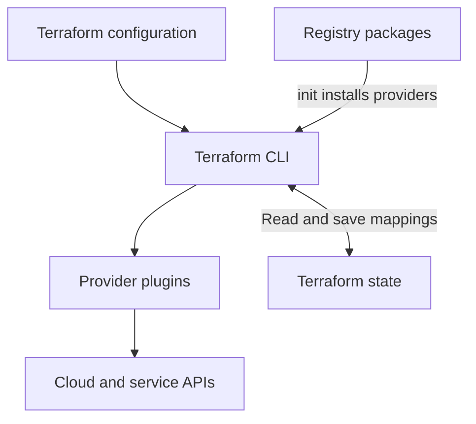
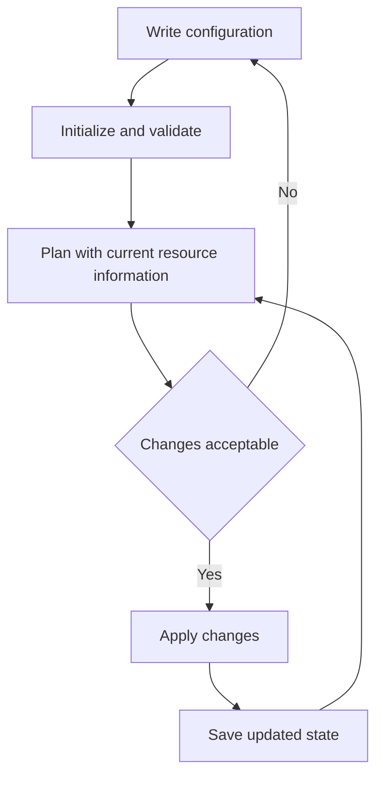
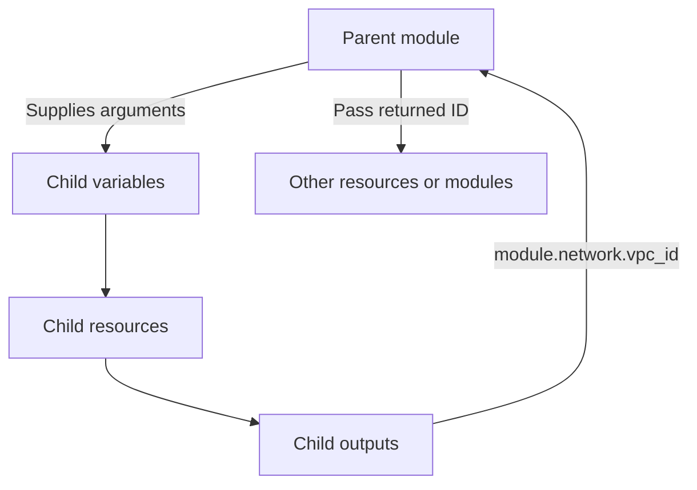
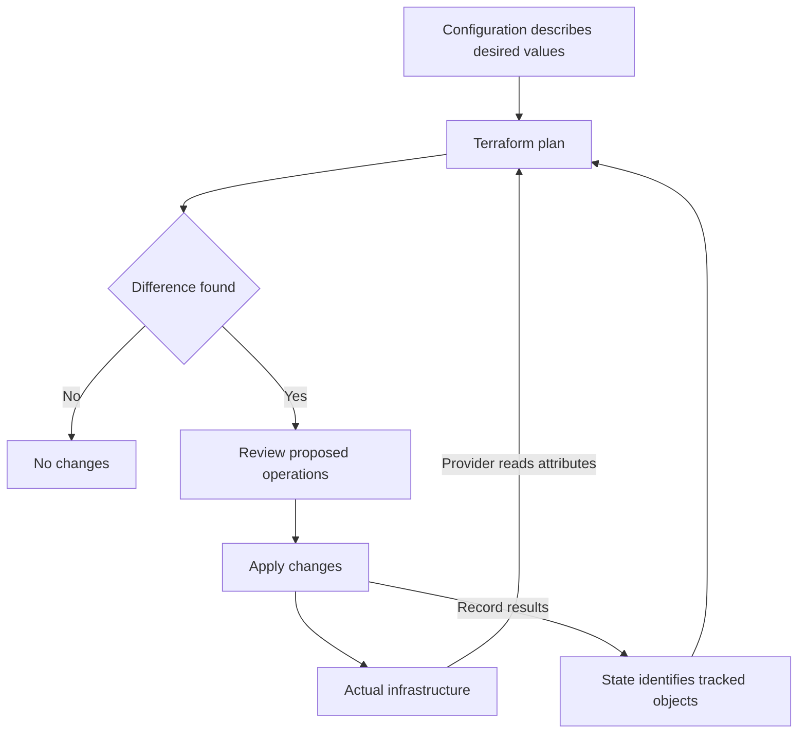
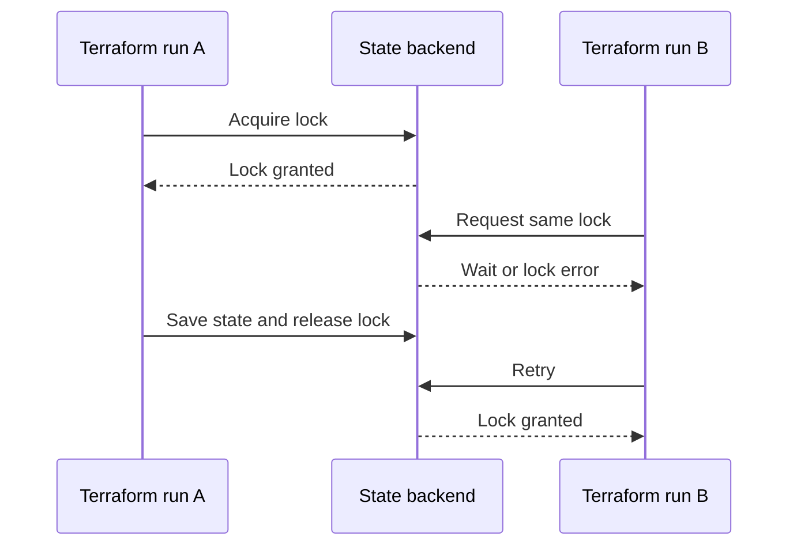
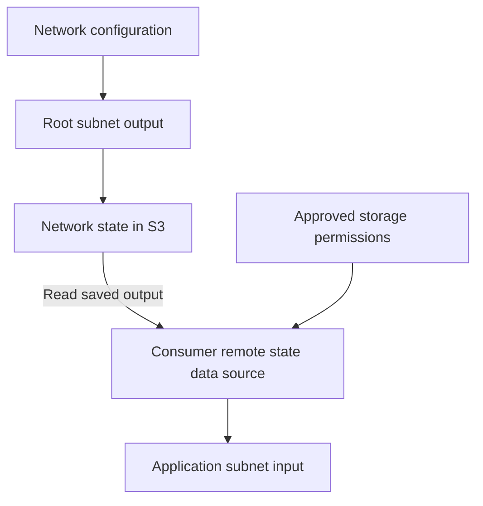
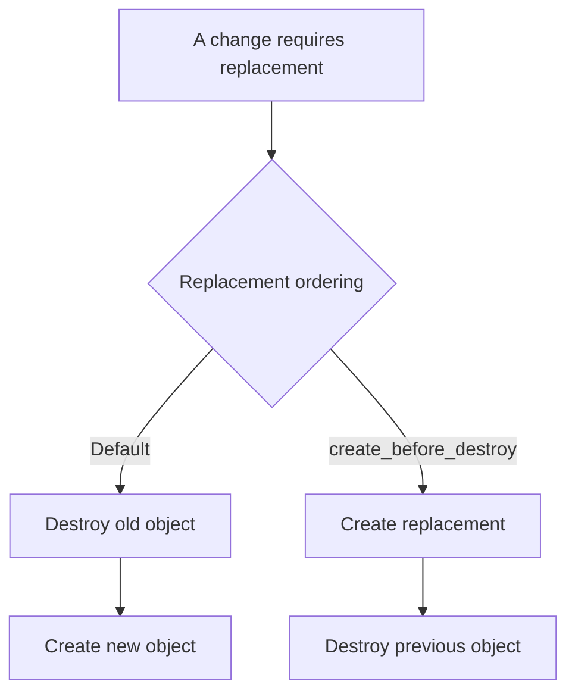

> [!CALLOUT] 📘
>
> **Expanded illustrated edition:** This page covers Terraform fundamentals, workflow, state, modules, validation, refactoring, testing, troubleshooting, and hands-on examples. The downloadable Word edition includes the complete screenshot collection.
>
> [Download the illustrated Terraform Learning Guide](library-file:fde1_bGliZmlsZV81TFhVb2dlam9PbVRzcER3MVY0dERn_FileDrive_fc98beb9c73c8191bcdca125cc9ba162)

Terraform describes the infrastructure you want, uses providers to interact with platforms, and uses state to track managed objects. Work through the local file lab first, then the AWS network module example. The local lab needs no AWS account.

This reference brings together installation, HCL, providers, resources, variables, locals, data sources, outputs, modules, types, functions, repetition, state, and the supplied screenshots. Examples are independent unless explicitly grouped into one project. Resource IDs and terminal results are illustrative.

# Study route

| Step | Topic | Learning goal |
|---|---|---|
| 1 | Installation and HCL | Identify blocks, arguments, labels, expressions, and braces |
| 2 | Local file lab | Understand init, plan, apply, show, and output |
| 3 | Providers and resource attributes | Explain where aws_vpc.main.id comes from |
| 4 | Variables and locals | Separate caller inputs from internal calculations |
| 5 | Data and outputs | Look up existing infrastructure and expose results |
| 6 | Modules | Pass inputs to a child and consume its outputs |
| 7 | Expressions and repetition | Choose functions, conditionals, for, count, for_each, or dynamic |
| 8 | State | Explain how Terraform tracks real resources |

# Terraform fundamentals

Terraform is an infrastructure as code tool. You describe an intended configuration in text, review proposed changes, and apply them through provider plugins.

Terraform is declarative: resource blocks describe what you want. References establish dependencies, and Terraform determines the necessary operations. File order is not an execution order.

| Concept | Job | Example |
|---|---|---|
| Provider | Communicates with a service or platform | hashicorp/aws |
| Resource | Declares an object to manage | aws_vpc |
| Data source | Reads or computes information | data "aws_vpc" |
| Variable | Accepts input | var.environment |
| Local | Names an internal expression | local.name_prefix |
| Module | Packages reusable configuration | ./modules/network |
| Output | Exposes a result | module.network.vpc_id |
| State | Records tracked objects and their attributes | aws_vpc.main mapped to a VPC ID |



The Registry distributes packages and documentation. Providers interact with infrastructure APIs; the Registry itself does not create a VPC.

# Installation

The screenshots show Terraform 0.13.0 on Linux AMD64. This is historical training material. Use a supported version appropriate for your project and select the operating system and CPU architecture that match your machine.

## macOS

With Homebrew installed:

```bash
brew tap hashicorp/tap
brew install hashicorp/tap/terraform
terraform version
```

## Windows

Download the appropriate ZIP from the [official installation page](https://developer.hashicorp.com/terraform/install), extract terraform.exe, add its directory to PATH, and open a new terminal.

For example, put terraform.exe in C:\terraform and add C:\terraform to PATH.

If Chocolatey is already installed, another option is:

```powershell
choco install terraform
terraform version
```

## Ubuntu and Debian

Install prerequisites and add the HashiCorp repository:

```bash
sudo apt-get update
sudo apt-get install -y gnupg wget lsb-release ca-certificates

wget -O - https://apt.releases.hashicorp.com/gpg |
  sudo gpg --dearmor -o /usr/share/keyrings/hashicorp-archive-keyring.gpg

echo "deb [arch=$(dpkg --print-architecture) signed-by=/usr/share/keyrings/hashicorp-archive-keyring.gpg] https://apt.releases.hashicorp.com $(. /etc/os-release; echo "${UBUNTU_CODENAME:-$VERSION_CODENAME}") main" |
  sudo tee /etc/apt/sources.list.d/hashicorp.list

sudo apt-get update
sudo apt-get install terraform
terraform version
```

Use the [official install instructions](https://developer.hashicorp.com/terraform/install) for other distributions and repository changes. In a minimal container running as root, sudo may be absent; run the commands directly as root.

## Understand the installation screenshots

| Command | Purpose |
|---|---|
| wget URL | Download the archive |
| unzip archive.zip | Extract the executable |
| mv terraform /usr/local/bin | Put the executable in a directory commonly on PATH |
| terraform version | Check that the shell can find and run Terraform |

Moving into /usr/local/bin may require sudo. Downloading and unzipping alone does not put the executable on PATH. Do not reuse the screenshot's 0.13.0 URL as a current version recommendation.

Optional completion:

```bash
terraform -install-autocomplete
```

Restart your shell afterward. tfenv manages multiple Terraform versions. OpenTofu is a separate tool derived from Terraform, rather than a Terraform version manager.

# HCL syntax and files

HCL means HashiCorp Configuration Language. Native Terraform configuration uses HCL syntax in .tf files.

```hcl
resource "aws_vpc" "main" {
  cidr_block = "10.10.0.0/16"

  tags = {
    Name = "orders-dev-vpc"
  }
}
```

| Part | Meaning |
|---|---|
| resource | Block type |
| "aws_vpc" | Resource type supplied by the AWS provider |
| "main" | Local label chosen by you |
| Outer braces | Enclose the resource block body |
| cidr_block = ... | Assign an expression to an argument |
| Braces after tags = | Construct an object of tag keys and values |
| "orders-dev-vpc" | String expression |

Braces can enclose block bodies or object values. The surrounding syntax tells you which. Square brackets construct collection values or index elements, depending on context.

## References and interpolation

```hcl
vpc_id = aws_vpc.main.id
Name   = "orders-${var.environment}-vpc"
```

The first line uses a value directly. The second embeds an expression in a string. If environment is dev, the name is orders-dev-vpc. A standalone reference does not need interpolation syntax.

## Comments

```hcl
# Single-line comment

// Also a single-line comment

/*
A comment spanning
multiple lines.
*/
```

Comments do not affect evaluation.

## Typical files

| File | Purpose |
|---|---|
| main.tf | Resources and module calls |
| variables.tf | Input declarations |
| locals.tf | Named internal expressions |
| outputs.tf | Exposed results |
| providers.tf | Provider configurations |
| versions.tf | Terraform and provider requirements |
| terraform.tfvars | Input values |
| terraform.tfstate | Default local state |
| .terraform.lock.hcl | Provider selections and checksums |
| .terraform/ | Installed packages and working data |

Terraform combines .tf files directly within a module directory. These filenames organize the code; they do not change execution order. Subdirectories are separate modules and are not automatically loaded as part of the parent.

## TypeScript clarification

A .ts file in a code project usually contains TypeScript, a language based on JavaScript with types. A .tsx file can contain JSX. Native Terraform examples here belong in .tf files.

The earlier statement that Node.js cannot run TypeScript directly was too broad: some Node versions can execute a subset of TypeScript. Support for TypeScript features depends on the runtime and toolchain. TypeScript is separate from native Terraform HCL.

Reference: [Files and configuration structure](https://developer.hashicorp.com/terraform/language/files).

# Providers and the Registry

A provider is a plugin that defines resource types, data sources, and their schemas, and implements interactions with a platform.

```hcl
terraform {
  required_providers {
    aws = {
      source  = "hashicorp/aws"
      version = "~> 6.0"
    }
  }
}

provider "aws" {
  region = "us-west-2"
}
```

| Part | Meaning |
|---|---|
| terraform | Terraform-level settings |
| required_providers | Declare provider dependencies |
| aws = { ... } | Requirement associated with local provider name aws |
| source | Identify the provider package |
| hashicorp/aws | Namespace hashicorp and provider name aws |
| version = "~> 6.0" | Example constraint allowing compatible 6.x releases |
| provider "aws" | Configure an AWS provider instance |
| region | AWS region for this configuration |

The example constraint is not a claim about the latest version. Select compatible versions deliberately.

The default full address is registry.terraform.io/hashicorp/aws. Similarly, hashicorp/azurerm identifies the Azure Resource Manager provider.

required_providers identifies a plugin dependency; provider configures a plugin instance. Use supported profiles, environment variables, or other credential mechanisms instead of hardcoding credentials.

## Multiple providers

You can configure more than one provider in the same file:

```hcl
terraform {
  required_providers {
    aws = {
      source = "hashicorp/aws"
    }
    local = {
      source = "hashicorp/local"
    }
  }
}

provider "aws" {
  region = "us-west-2"
}
```

The local provider normally needs no configuration block. Its resources operate on the machine running Terraform. For multiple configurations of one provider, such as two AWS regions, use provider aliases.

The [Terraform Registry](https://registry.terraform.io/) supplies package listings, versions, and documentation for providers and modules. The attachment diagrams show that different resource types have different arguments. Their local-provider link is not the documentation for AWS or Google Cloud resources.

Reference: [Provider configuration](https://developer.hashicorp.com/terraform/language/block/provider).

# Resources and attributes

You asked whether aws_vpc follows a provider_resource pattern. That is a common resource naming convention: aws identifies the provider's local name and vpc identifies the infrastructure type.

| Resource type | Infrastructure |
|---|---|
| aws_vpc | AWS private network |
| aws_subnet | Subnet within a VPC |
| aws_instance | EC2 virtual server |
| aws_s3_bucket | S3 bucket |
| local_file | File on the Terraform execution machine |

A VPC is a Virtual Private Cloud, a private network in AWS.

## Understand this and id

```hcl
resource "aws_vpc" "this" {
  cidr_block = "10.10.0.0/16"
}
```

Its reference is:

```hcl
aws_vpc.this.id
```

| Part | Where it comes from |
|---|---|
| aws_vpc | Resource type defined by the provider |
| this | Label chosen by you |
| id | Attribute exposed by the provider |

this is not a special keyword. If you rename the label my_network, the reference becomes aws_vpc.my_network.id.

AWS assigns the VPC's identifier during creation. The provider exposes it through id. Other providers can compute identifiers differently; a local file's ID is not an AWS-generated ID.

## Discover available fields

1. Open the appropriate resource or data source documentation.

2. Select the provider version used by your project.

3. Read Argument Reference or Schema for configurable inputs.

4. Read Attribute Reference or Read-Only attributes for returned fields.

5. Use the installed provider schema for exact declared types.

```bash
terraform init
terraform providers schema -json
```

With jq installed, list VPC resource attributes:

```bash
terraform providers schema -json |
  jq '.provider_schemas["registry.terraform.io/hashicorp/aws"]
      .resource_schemas.aws_vpc.block.attributes | keys'
```

For data sources, use .data_source_schemas instead of .resource_schemas. Documentation explains behavior beyond what the schema alone describes. Fields differ across resource types and provider versions.

References: [AWS VPC resource](https://registry.terraform.io/providers/hashicorp/aws/latest/docs/resources/vpc), [Provider schema command](https://developer.hashicorp.com/terraform/cli/commands/providers/schema).

# Local file practice lab

This complete project adapts the screenshots' local_file.pet example. It requires no cloud account.

Create an empty directory and save this as main.tf:

```hcl
terraform {
  required_providers {
    local = {
      source  = "hashicorp/local"
      version = "~> 2.0"
    }
  }
}

variable "environment" {
  type    = string
  default = "DEV"
}

locals {
  environment = lower(trimspace(var.environment))
  message     = "We love pets! Environment: ${local.environment}\n"
}

resource "local_file" "pet" {
  filename        = "${path.module}/pets.txt"
  content         = local.message
  file_permission = "0644"
}

output "pet_file_path" {
  value = local_file.pet.filename
}

output "pet_file_id" {
  value = local_file.pet.id
}

output "pet_message" {
  value = local.message
}
```

| Expression | Meaning |
|---|---|
| local_file | Resource type from hashicorp/local |
| pet | Resource label |
| path.module | Directory containing the module |
| filename | File to create |
| content | Text to write |
| file_permission | Permission mode on supporting platforms |
| local_file.pet.id | Provider-defined identifier |
| local.message | Named local value |

The local in local.message refers to a locals block. The local in local_file is a resource type prefix. They are different concepts.

The screenshots use /root/pets.txt. The lab uses the module directory so it is easier to run on your Mac. It specifies 0644 instead of 0777. On Unix-like systems, 0644 grants owner read/write and group/others read, subject to system behavior such as umask.

Run from the practice directory:

```bash
terraform init
terraform fmt
terraform validate
terraform plan
terraform apply
terraform show
terraform state list
terraform state show local_file.pet
terraform output
```

Open pets.txt in your editor. Expected text:

```text
We love pets! Environment: dev
```

Run terraform plan again. With unchanged inputs and no drift, expect no changes.

Now change an input:

```bash
terraform plan -var="environment=TEST"
terraform apply -var="environment=TEST"
```

Review whether the file change is an update or replacement; the provider schema determines this.

To remove this lab's managed file:

```bash
terraform destroy
```

Use destroy in the intended practice directory: it proposes removing resources managed by that configuration and state.

Reference: [Local file resource](https://registry.terraform.io/providers/hashicorp/local/latest/docs/resources/file).

# Workflow and commands

| Command | Purpose |
|---|---|
| init | Initialize backend, install providers, and obtain modules |
| fmt | Apply standard formatting |
| validate | Check configuration consistency |
| plan | Read current information and propose changes |
| apply | Perform operations and save updated state |
| show | Display current state or a supplied saved plan |
| state list | List tracked resource addresses |
| state show ADDRESS | Inspect saved attributes for one resource |
| output | Read saved root outputs |
| console | Evaluate expressions interactively |
| destroy | Remove managed infrastructure after reviewing its plan |

All commands above are prefixed with terraform. validate does not prove your credentials, permissions, or deployment settings will succeed.



init does not create infrastructure. plan previews operations; apply performs them.

| Plan symbol | Meaning |
|---|---|
| + | Create |
| ~ | Update in place |
| - | Destroy |
| -/+ | Destroy then recreate |
| +/- | Create replacement then destroy old object |
| <= | Read a data source |

The screenshot's “1 to add, 0 to change, 0 to destroy” describes its one file. “known after apply” means a value is not available during planning.

## Save a specific plan

```bash
terraform plan -out=tfplan
terraform show tfplan
terraform apply tfplan
```

A plain terraform apply produces a new plan. Applying tfplan uses the saved proposal, subject to validity checks. Saved plans may contain sensitive information.

The screenshots show older CLI wording and provider selection messages; modern formatting may differ.

# Variables and locals

Variables are caller-facing inputs. Locals name expressions evaluated inside the module.

```hcl
variable "app_name" {
  type    = string
  default = "orders"
}

variable "environment" {
  type    = string
  default = "DEV"
}

locals {
  environment = lower(trimspace(var.environment))
  name_prefix = "${var.app_name}-${local.environment}"

  common_tags = {
    Application = var.app_name
    Environment = local.environment
    ManagedBy   = "Terraform"
  }
}
```

| Reference | Value with defaults |
|---|---|
| var.app_name | "orders" |
| var.environment | "DEV" |
| local.environment | "dev" |
| local.name_prefix | "orders-dev" |
| local.common_tags | Shared map of tags |

The original input is unchanged. Define with locals, plural; reference with local, singular.

## Why use a local instead of another variable

A variable default is a literal fallback. It cannot calculate a result from another input.

```hcl
# Invalid:
# variable "normalized_environment" {
#   default = lower(var.environment)
# }

locals {
  normalized_environment = lower(var.environment)
}
```

You can use lower(var.environment) directly wherever needed. A local helps when the calculation is reused or its name improves readability.

## Supply input values

In terraform.tfvars:

```hcl
app_name    = "payments"
environment = "TEST"
```

Or through the CLI:

```bash
terraform plan -var="environment=prod"
```

Root inputs can also come from TF_VAR_ environment variables. Do not add var. to keys inside .tfvars. Child inputs are passed by the parent's module block; a child's terraform.tfvars is not automatically loaded.

## Practical use

```hcl
resource "aws_vpc" "main" {
  cidr_block = "10.10.0.0/16"

  tags = merge(local.common_tags, {
    Name = "${local.name_prefix}-vpc"
  })
}
```

With payments and TEST as inputs, the name becomes payments-test-vpc and Environment becomes test. The caller chooses inputs; locals consistently construct names and tags.

References: [Input variables](https://developer.hashicorp.com/terraform/language/values/variables), [Local values](https://developer.hashicorp.com/terraform/language/values/locals).

# Data sources and filters

A data source reads information or performs a provider-defined calculation. Looking up a VPC does not import it into management.

```hcl
data "aws_vpc" "existing" {
  tags = {
    Name        = "shared-network"
    Environment = "dev"
  }
}
```

This looks for one VPC matching both tags in the selected AWS region and account. Additional tags are allowed.

It does not print a result automatically. It exposes attributes:

```hcl
data.aws_vpc.existing.id
data.aws_vpc.existing.cidr_block
data.aws_vpc.existing.tags
```

Terraform normally attempts the lookup during planning. It can defer reading until apply if required inputs are not known yet.

## Available VPC lookup arguments

| Argument | Purpose |
|---|---|
| id | Match a particular VPC ID |
| cidr_block | Match primary IPv4 CIDR |
| default | Match whether it is the default VPC |
| dhcp_options_id | Match its DHCP options set |
| state | Match pending or available |
| tags | Match tag key/value pairs |
| filter | Supply AWS API filter criteria |
| region | Override provider region where supported |

These arguments are provider-version-specific. Every data source has its own schema; filter is not a universal data-block option.

## Filter syntax and logic

```hcl
data "aws_vpc" "existing" {
  filter {
    name   = "tag:Name"
    values = ["shared-network"]
  }

  filter {
    name   = "tag:Environment"
    values = ["dev"]
  }
}
```

Each filter defines a field name and accepted values. Multiple filters are AND conditions.

Within one filter, multiple values mean OR:

```hcl
filter {
  name   = "tag:Environment"
  values = ["dev", "test"]
}
```

This accepts dev or test; it does not guarantee one match.

| AWS filter name | Example values |
|---|---|
| tag:Name | ["shared-network"] |
| tag:Environment | ["dev"] |
| tag-key | ["Environment"] |
| vpc-id | ["vpc-0123456789abcdef0"] |
| cidr | ["10.10.0.0/16"] |
| is-default | ["true"] |
| state | ["available"] |
| owner-id | ["123456789012"] |
| dhcp-options-id | ["dopt-0123456789abcdef0"] |

The Terraform argument cidr_block and AWS filter name cidr differ. Filter names come from the AWS API.

## Multiple matching VPCs

| Data source | Expected result | Several matches |
|---|---|---|
| aws_vpc | Exactly one VPC object | Error |
| aws_vpcs | Matching VPC IDs | Collection |

aws_vpc also fails when no VPC matches. Narrow the criteria if you want one, or use aws_vpcs for several:

```hcl
data "aws_vpcs" "development" {
  tags = {
    Environment = "dev"
  }
}

output "development_vpc_ids" {
  value = data.aws_vpcs.development.ids
}
```

Illustrative result:

```hcl
[
  "vpc-11111111111111111",
  "vpc-22222222222222222",
]
```

Other data sources have different matching rules; do not generalize this behavior to all data sources.

References: [Data sources](https://developer.hashicorp.com/terraform/language/data-sources), [VPC lookup](https://registry.terraform.io/providers/hashicorp/aws/latest/docs/data-sources/vpc), [VPC collection](https://registry.terraform.io/providers/hashicorp/aws/latest/docs/data-sources/vpcs), [AWS filter names](https://docs.aws.amazon.com/AWSEC2/latest/APIReference/API_DescribeVpcs.html).

# Types and returned values

A single ordinary data source instance exposes an object with named attributes. Each attribute has its own type.

| Reference | Type | Example |
|---|---|---|
| data.aws_vpc.existing.id | string | "vpc-0123456789abcdef0" |
| data.aws_vpc.existing.enable_dns_support | bool | true |
| data.aws_vpc.existing.tags | map(string) | { Name = "shared-network" } |
| data.aws_vpcs.development.ids | list(string) | ["vpc-a", "vpc-b"] |

## Terraform value types

| Type | Meaning | Example |
|---|---|---|
| string | Text | "dev" |
| number | Numeric value | 3 or 2.5 |
| bool | Boolean | true |
| list(string) | Ordered sequence of strings | ["web", "worker"] |
| set(string) | Unique strings without meaningful order | toset(["web", "worker"]) |
| map(string) | String values keyed by strings | { env = "dev" } |
| object({...}) | Named attributes with individually defined types | { id = "x", enabled = true } |
| tuple([...]) | Ordered positions with individually defined types | ["dev", 3, true] |

A map has one element type. An object can have different attribute types. Collections can be nested, for example list(object({ id = string, enabled = bool })).

null represents absence, not another ordinary primitive type. Unknown during planning means a value will be determined later; it is different from null.

With for_each, the block's reference is a map of instance objects. With count, it is a sequence of instance objects.

## Inspect types

Run terraform console in an initialized project and enter:

```hcl
type(data.aws_vpc.existing.id)
type(data.aws_vpc.existing.tags)
type(data.aws_vpc.existing)
```

The first two ordinarily report string and map(string). Values depend on the configuration and available state. Use the provider schema for declared attribute types.

Reference: [Types and values](https://developer.hashicorp.com/terraform/language/expressions/types).

# Outputs

An output exposes the result of an expression. It does not create infrastructure.

```hcl
output "vpc_id" {
  description = "ID of the application's VPC"
  value       = aws_vpc.main.id
}
```

| Part | Meaning |
|---|---|
| vpc_id | Output name chosen by you |
| description | Optional explanation |
| value | Expression to expose |
| sensitive | Optional redaction setting |

## Root outputs display in the terminal

```hcl
output "message" {
  value = "Hello, Terraform!"
}
```

After apply:

```text
Outputs:

message = "Hello, Terraform!"
```

Root outputs are saved in state. A new output must be applied before terraform output can retrieve its saved value.

| Command | Purpose |
|---|---|
| terraform output | Read saved root outputs |
| terraform output vpc_id | Read one output |
| terraform output -raw vpc_id | Plain scalar text without Terraform formatting |
| terraform output -json | Structured JSON for automation |

terraform output does not perform a fresh AWS lookup.

## Structured output

```hcl
output "network_details" {
  value = {
    id         = aws_vpc.main.id
    cidr_block = aws_vpc.main.cidr_block
    tags       = aws_vpc.main.tags
  }
}
```

Outputs can expose primitive values, collections, and objects. Expressions can use variables, locals, resources, data sources, and child module outputs.

## Sensitive output

```hcl
variable "api_token" {
  type      = string
  sensitive = true
}

output "api_token" {
  value     = var.api_token
  sensitive = true
}
```

Normal display redacts the value. Ordinary sensitive outputs still reside in state. Explicit retrieval, raw output, or JSON output can reveal the value.

## Child outputs

A child output exposes a value to its parent:

```hcl
module.network.vpc_id
```

Child outputs do not automatically appear in terraform output. A root output must expose them if terminal access is needed.

Inside the module defining a VPC, use aws_vpc.main.id. There is no ordinary output.vpc_id reference.

References: [Output values](https://developer.hashicorp.com/terraform/language/values/outputs), [Output CLI](https://developer.hashicorp.com/terraform/cli/commands/output).

# Modules and a complete AWS project

A module is a directory of Terraform configuration. The directory where you run Terraform is the root module; a called module is a child module.

| Programming analogy | Terraform equivalent |
|---|---|
| Parameters | Variables |
| Implementation | Resources and expressions |
| Returned values | Outputs |
| Function call | Module block |

This is an interface analogy. Terraform evaluates dependencies rather than executing module calls as sequential statements.



## Project structure

| File | Role |
|---|---|
| providers.tf | Root provider requirement and configuration |
| main.tf | Root module calls |
| outputs.tf | Root CLI outputs |
| modules/network/versions.tf | Child provider requirement |
| modules/network/variables.tf | Child inputs |
| modules/network/main.tf | Child implementation |
| modules/network/outputs.tf | Child results |

All files in this example form one project. It requires AWS credentials and permission to create a VPC and subnet. It creates a network and subnet, not a complete internet-connected application environment.

## Root provider configuration

providers.tf:

```hcl
terraform {
  required_providers {
    aws = {
      source  = "hashicorp/aws"
      version = "~> 6.0"
    }
  }
}

provider "aws" {
  region = "us-west-2"
}
```

## Child requirement

modules/network/versions.tf:

```hcl
terraform {
  required_providers {
    aws = {
      source = "hashicorp/aws"
    }
  }
}
```

The child declares its dependency and inherits the parent's default AWS configuration. Provider requirements and configurations are different things.

## Child inputs

modules/network/variables.tf:

```hcl
variable "app_name" {
  type = string
}

variable "environment" {
  type = string
}

variable "vpc_cidr" {
  type = string
}

variable "subnet_cidr" {
  type = string
}
```

No defaults means the caller must supply these inputs.

## Child implementation

modules/network/main.tf:

```hcl
locals {
  environment = lower(trimspace(var.environment))
  name_prefix = "${var.app_name}-${local.environment}"

  common_tags = {
    Application = var.app_name
    Environment = local.environment
    ManagedBy   = "Terraform"
  }
}

resource "aws_vpc" "this" {
  cidr_block = var.vpc_cidr

  tags = merge(local.common_tags, {
    Name = "${local.name_prefix}-vpc"
  })
}

resource "aws_subnet" "this" {
  vpc_id     = aws_vpc.this.id
  cidr_block = var.subnet_cidr

  tags = merge(local.common_tags, {
    Name = "${local.name_prefix}-subnet"
  })
}
```

The subnet's reference to aws_vpc.this.id establishes its dependency. Both resources can use the label this because their types differ.

## Child outputs

modules/network/outputs.tf:

```hcl
output "vpc_id" {
  value = aws_vpc.this.id
}

output "subnet_id" {
  value = aws_subnet.this.id
}
```

## Root call

main.tf:

```hcl
module "dev_network" {
  source = "./modules/network"

  app_name    = "orders"
  environment = "DEV"
  vpc_cidr    = "10.10.0.0/16"
  subnet_cidr = "10.10.1.0/24"
}
```

source locates module code; the remaining arguments supply values to its declared variables.

## Root outputs

outputs.tf:

```hcl
output "dev_vpc_id" {
  value = module.dev_network.vpc_id
}

output "dev_subnet_id" {
  value = module.dev_network.subnet_id
}
```

The child returns IDs to the root, and the root exposes them to CLI users and automation. Run init, fmt, validate, plan, and apply from the root project directory.

## Reuse the module

Add another call to root main.tf:

```hcl
module "test_network" {
  source = "./modules/network"

  app_name    = "orders"
  environment = "TEST"
  vpc_cidr    = "10.20.0.0/16"
  subnet_cidr = "10.20.1.0/24"
}
```

| Module call | VPC name | Range |
|---|---|---|
| dev_network | orders-dev-vpc | 10.10.0.0/16 |
| test_network | orders-test-vpc | 10.20.0.0/16 |

They reuse code but manage separate objects. Both share the same root state in this example. Naming one test does not create state isolation.

| Purpose | Reference or address |
|---|---|
| Read child output in HCL | module.dev_network.vpc_id |
| Identify internal resource in state or CLI | module.dev_network.aws_vpc.this |

The parent cannot ordinarily read child internals as module.dev_network.aws_vpc.this.id. Use an output.

## Module sources

Modules can come from local directories, registries, and supported remote sources such as Git. Registry modules support a version argument; Git sources commonly use ?ref= to select a revision.

A module's source locates Terraform code. A source inside required_providers identifies a plugin. Run terraform init after adding modules or changing their sources.

References: [Modules](https://developer.hashicorp.com/terraform/language/modules), [Module block](https://developer.hashicorp.com/terraform/language/block/module), [Providers within modules](https://developer.hashicorp.com/terraform/language/modules/develop/providers).

# Useful functions

Functions calculate or transform values using function_name(arguments).

Terraform includes built-in functions and supports provider-defined functions. You cannot declare ordinary custom functions directly in HCL.

## Strings

| Expression | Result |
|---|---|
| upper("hello") | "HELLO" |
| lower("PROD") | "prod" |
| trimspace(" dev ") | "dev" |
| join("-", ["app", "dev", "web"]) | "app-dev-web" |
| split(",", "dev,test") | ["dev", "test"] |
| replace("my_app", "_", "-") | "my-app" |

```hcl
locals {
  environment = lower(trimspace(var.environment))
  server_name = join("-", ["orders", local.environment, "web"])
}
```

The input " DEV " produces orders-dev-web.

## Lookup with a fallback

```hcl
locals {
  instance_types = {
    dev  = "t3.micro"
    test = "t3.small"
    prod = "m5.large"
  }

  selected_type = lookup(
    local.instance_types,
    var.environment,
    "t3.micro"
  )
}
```

lookup(map, key, fallback) returns the entry for a present key. For a missing key, it returns the fallback.

| Key | Result |
|---|---|
| dev | t3.micro |
| prod | m5.large |
| sandbox | t3.micro |

A present key with value null returns null, not the fallback.

## Collections and conversions

| Expression | Result |
|---|---|
| length(["a", "b"]) | 2 |
| contains(["dev", "prod"], "dev") | true |
| distinct(["a", "a", "b"]) | ["a", "b"] |
| concat(["a"], ["b", "c"]) | ["a", "b", "c"] |
| merge({ env = "dev" }, { env = "prod" }) | { env = "prod" } |
| toset(["a", "a", "b"]) | Set containing a and b |
| tonumber("443") | 443 |

merge uses later values for repeated keys. toset removes duplicates and meaningful ordering.

Use terraform console to experiment with functions without creating infrastructure.

Reference: [Function catalog](https://developer.hashicorp.com/terraform/language/functions).

# Conditionals

A conditional chooses between two values:

```hcl
condition ? value_if_true : value_if_false
```

```hcl
locals {
  instance_type = var.environment == "prod" ? "m5.large" : "t3.micro"
}
```

| Environment | Selected type |
|---|---|
| prod | m5.large |
| dev | t3.micro |
| test | t3.micro |

The condition must be boolean and the two result branches must have compatible types.

| Operator | Meaning |
|---|---|
| == | Equal |
| != | Not equal |
| > and < | Greater than and less than |
| >= and <= | Inclusive numeric comparisons |
| && | Both conditions true |
| ! | Negation |

Logical OR is written as two vertical bars.

A boolean input can control optional creation:

```hcl
count = var.create_server ? 1 : 0
```

The result still must satisfy the receiving argument's rules. A conditional does not bypass type checking.

Reference: [Conditionals](https://developer.hashicorp.com/terraform/language/expressions/conditionals).

# Count and for_each

These meta-arguments repeat resources, module instances, or data lookups. They are not ordinary functions.

## Count uses numeric indexes

Assume ami_id is a valid AMI for the configured region:

```hcl
variable "ami_id" {
  type = string
}

resource "aws_instance" "server" {
  count = 3

  ami           = var.ami_id
  instance_type = "t3.micro"

  tags = {
    Name = "server-${count.index}"
  }
}
```

| Address | Name tag |
|---|---|
| aws_instance.server[0] | server-0 |
| aws_instance.server[1] | server-1 |
| aws_instance.server[2] | server-2 |

count.index starts at zero. Even count = 1 produces an indexed instance.

```hcl
output "server_ids" {
  value = aws_instance.server[*].id
}
```

count must be a nonnegative integer known before remote operations.

## For each uses keys

```hcl
resource "aws_instance" "server" {
  for_each = toset(["web", "api", "worker"])

  ami           = var.ami_id
  instance_type = "t3.micro"

  tags = {
    Name = each.key
  }
}
```

Addresses include:

```hcl
aws_instance.server["web"]
aws_instance.server["api"]
aws_instance.server["worker"]
```

Resource-level for_each accepts a map or a set of strings. It does not automatically accept an ordinary list. For a string set, each.key equals each.value.

## Maps provide settings per instance

```hcl
locals {
  servers = {
    web = {
      instance_type = "t3.micro"
    }
    worker = {
      instance_type = "t3.small"
    }
  }
}

resource "aws_instance" "server" {
  for_each = local.servers

  ami           = var.ami_id
  instance_type = each.value.instance_type

  tags = {
    Name = each.key
  }
}
```

each.key is web or worker; each.value is the corresponding object. Read an ID using aws_instance.server["worker"].id.

Keys must be known during planning. Sensitive values cannot identify instances. Do not use count and for_each on the same block.

## Choose between them

| Situation | Usually use |
|---|---|
| A quantity of similar instances | count |
| Simple zero-or-one resource | count with a conditional |
| Named instances with different settings | for_each |
| Items added and removed by name | for_each |

With count, deriving settings from a list can cause unwanted changes when removing a middle item shifts later indexes. for_each keeps remaining objects associated with stable keys.

The earlier ami-123 is a placeholder, not a usable AMI. EC2 snippets also need appropriate networking, permissions, and a valid image.

References: [Count](https://developer.hashicorp.com/terraform/language/meta-arguments/count), [For each](https://developer.hashicorp.com/terraform/language/meta-arguments/for_each).

# For expressions

A for expression transforms a collection into another value. It does not directly create resources.

## Transform each element

```hcl
locals {
  names       = ["web", "api", "worker"]
  upper_names = [for n in local.names : upper(n)]
}
```

Result:

```hcl
["WEB", "API", "WORKER"]
```

| Part | Meaning |
|---|---|
| local.names | Source collection |
| n | Current element |
| upper(n) | Output expression |
| Square brackets | Produce a tuple, convertible to a list when suitable |

## Filter elements

```hcl
locals {
  names = ["web", "", "worker"]

  nonempty_names = [
    for n in local.names : n
    if n != ""
  ]
}
```

Result: ["web", "worker"].

## Produce an object

```hcl
locals {
  names = ["web", "worker"]

  server_types = {
    for n in local.names : n => "t3.micro"
  }
}
```

Result:

```hcl
{
  web    = "t3.micro"
  worker = "t3.micro"
}
```

Braces produce an object. => separates a key from its value. Default object construction requires unique resulting keys.

For resources created with for_each, collect IDs by name:

```hcl
output "server_ids_by_name" {
  value = {
    for name, server in aws_instance.server :
    name => server.id
  }
}
```

This exposes a new value, not additional servers.

Reference: [For expressions](https://developer.hashicorp.com/terraform/language/expressions/for).

# Dynamic blocks

dynamic generates repeated nested blocks supported by the enclosing resource's schema.

```hcl
variable "vpc_id" {
  type = string
}

variable "ports" {
  type    = list(number)
  default = [80, 443]
}

resource "aws_security_group" "web" {
  name   = "web-access"
  vpc_id = var.vpc_id

  dynamic "ingress" {
    for_each = var.ports
    iterator = port

    content {
      from_port   = port.value
      to_port     = port.value
      protocol    = "tcp"
      cidr_blocks = ["10.0.0.0/8"]
    }
  }
}
```

This describes one security group containing two ingress rules. The source CIDR is illustrative.

The generated nested blocks are equivalent to:

```hcl
ingress {
  from_port   = 80
  to_port     = 80
  protocol    = "tcp"
  cidr_blocks = ["10.0.0.0/8"]
}

ingress {
  from_port   = 443
  to_port     = 443
  protocol    = "tcp"
  cidr_blocks = ["10.0.0.0/8"]
}
```

| Part | Meaning |
|---|---|
| dynamic "ingress" | Generate ingress nested blocks |
| for_each | Collection to iterate |
| iterator = port | Temporary iterator name |
| content | Template for each nested block |
| port.value | Current port |

Without iterator = port, its default iterator is ingress and the reference becomes ingress.value.

Unlike resource-level for_each, dynamic can iterate suitable collections such as this list of numbers. It cannot generate unsupported nested blocks or meta-argument blocks such as lifecycle.

Avoid managing the same AWS security group rules through both inline rules and separate rule resources.

## Compare the repetition features

| Feature | Produces |
|---|---|
| count | Numerically indexed resource or module instances |
| Resource-level for_each | Instances keyed by names |
| for expression | A transformed value |
| dynamic | Nested configuration blocks |

Reference: [Dynamic blocks](https://developer.hashicorp.com/terraform/language/expressions/dynamic-blocks).

# Terraform state

State is the saved record Terraform uses to track managed objects, their attributes, and mappings to real infrastructure. It also stores root output values and metadata.

| Code address | Actual object |
|---|---|
| aws_vpc.main | vpc-0123456789abcdef0 |
| module.dev_network.aws_subnet.this | subnet-0123456789abcdef0 |
| local_file.pet | File on the execution machine |

Names and tags do not establish ownership. The mapping in state does.

## Configuration state and reality



State is not automatically a live mirror of AWS. A normal plan reads current resource information.

## Example lifecycle

1. First apply creates the VPC and records its ID against aws_vpc.main.

2. A later plan finds the tracked VPC and compares current information with the code.

3. Changing its Name tag in code usually proposes an update.

4. Applying performs the operation and records results.

5. Removing the resource block normally proposes destroying the tracked VPC.

Some attribute changes require replacement instead of an in-place update.

## Drift

Drift means a change outside Terraform. If someone changes a tag in AWS, a normal plan generally proposes restoring the configured value. If someone deletes the VPC while its declaration remains, Terraform generally proposes recreating it.

A reviewed refresh-only operation updates state and outputs to reflect external changes without changing infrastructure. It does not rewrite .tf files.

## Local and remote state

Default local state is stored in terraform.tfstate. A backend determines state storage. Teams commonly use remote storage such as a supported S3 backend or HCP Terraform.

Remote state lets teammates and automation use the same record. Use appropriate access controls, backups or versioning, and locking support. State may contain secrets even when normal CLI display redacts them.

| Item | Source control |
|---|---|
| .tf configuration | Commit |
| .terraform.lock.hcl | Usually commit |
| .terraform/ | Do not commit |
| State and state backups | Do not commit |
| Saved plan files | Do not commit |
| .tfvars containing secrets | Do not commit |

## State locking



Locking prevents conflicting writers when supported by the backend and enabled. Do not force-unlock while another valid run is using the state.

## Losing state

Deleting state does not delete infrastructure. It removes tracking information. A subsequent plan may propose duplicate resources or encounter conflicts.

Restore state or deliberately import existing objects to reconnect management. Matching tags alone will not recover ownership. Import establishes a managed mapping; a data source only reads.

## Inspect state

```bash
terraform state list
terraform state show aws_vpc.main
terraform show
terraform output
```

Use supported Terraform commands and refactoring tools instead of manually editing state JSON.

State tracks infrastructure. It is not a backup of database contents or application data.

References: [State](https://developer.hashicorp.com/terraform/language/state), [State purpose](https://developer.hashicorp.com/terraform/language/state/purpose), [Remote storage](https://developer.hashicorp.com/terraform/language/state/remote), [Locking](https://developer.hashicorp.com/terraform/language/state/locking).

# State structure and management commands

## Why Terraform retains state

State provides resource identity mappings, cached attributes, and dependency metadata. A normal plan still refreshes current information through providers; caching does not mean Terraform always skips API reads.

Dependency metadata helps Terraform handle operations even when configuration changes remove references that existed previously. Without a tracked mapping or an explicit import, an existing cloud object is not automatically recognized as belonging to a resource block.

## Simplified state JSON

The following is an incomplete illustration, not a valid state file to copy or restore:

```json
{
  "version": 4,
  "terraform_version": "1.9.0",
  "resources": [
    {
      "mode": "managed",
      "type": "aws_instance",
      "name": "web",
      "instances": [
        {
          "attributes": {
            "id": "i-0abc123def456",
            "instance_type": "t3.micro"
          }
        }
      ]
    }
  ]
}
```

| Field | Meaning |
|---|---|
| version | State file format version, not the Terraform CLI version |
| terraform_version | Terraform version recorded by this example |
| type and name | Form the address aws_instance.web |
| instances | Tracked instances of the resource |
| attributes.id | Provider identifier for the tracked object |
| attributes.instance_type | Saved resource attribute |

The version numbers here are examples, not installation recommendations. Real state also contains additional bookkeeping. Use supported Terraform tools rather than editing this JSON manually.

## Inspect move remove and import

These commands illustrate different operations; do not run them as one sequence.

| Command | Effect | Changes the cloud object |
|---|---|---|
| terraform state list | List tracked addresses | No |
| terraform state show aws_instance.web | Inspect saved attributes | No |
| terraform state mv aws_instance.old aws_instance.new | Change a tracked address | Does not itself change the object |
| terraform state rm aws_instance.web | Forget the object | Does not itself delete it |
| terraform import aws_instance.web i-0abc123def456 | Bind an existing object to an address | Does not itself create it |

state mv must agree with the resource addresses in configuration. state rm leaves infrastructure behind; if its resource declaration remains, the next plan can propose creating another object.

Import requires an appropriate resource declaration and the provider's documented import ID format. After import, review the plan: configuration may request changes to the imported object.

## Declarative resource renaming

For a resource renamed from old to new, update the resource label in code and retain a moved block:

```hcl
moved {
  from = aws_instance.old
  to   = aws_instance.new
}
```

Terraform can then show the address migration during planning instead of interpreting it as an unrelated deletion and creation. moved blocks preserve a reviewable refactoring history.

## Declarative import

Terraform 1.5 and later support import blocks:

```hcl
import {
  to = aws_instance.web
  id = "i-0abc123def456"
}
```

Declare aws_instance.web with the intended settings as well. Plan and apply the import deliberately; the import block does not make configuration differences disappear.

## Refresh state with review

terraform refresh is deprecated. It updates state automatically without a separate confirmation step. Prefer a reviewable refresh-only workflow:

```bash
terraform plan -refresh-only -out=refresh.tfplan
terraform show refresh.tfplan
terraform apply refresh.tfplan
```

Alternatively:

```bash
terraform apply -refresh-only
```

Refresh-only records observed changes in state and outputs without changing infrastructure or rewriting .tf files. Restoring a tag in AWS to match code requires a normal apply.

References: [State commands](https://developer.hashicorp.com/terraform/cli/commands/state), [Moved blocks](https://developer.hashicorp.com/terraform/language/modules/develop/refactoring), [Import](https://developer.hashicorp.com/terraform/language/import), [Refresh deprecation](https://developer.hashicorp.com/terraform/cli/commands/refresh).

# Remote state and backend configuration

Remote state stores Terraform's tracking record in centrally accessible storage. It lets approved teammates and CI jobs use the same state instead of maintaining conflicting copies on separate laptops.

Local state is useful for learning. Sharing it manually is fragile, although local state is not inherently unshareable and the local backend does provide filesystem locking.

## Storage choices

| Storage or service | Typical use |
|---|---|
| Amazon S3 | AWS-based state storage |
| Azure Blob Storage through azurerm backend | Azure-based state storage |
| Google Cloud Storage through gcs backend | Google Cloud-based state storage |
| HCP Terraform | Managed state and workflow service |
| PostgreSQL Consul or HTTP backends | Specialized infrastructure and operational requirements |

A backend's storage, locking, encryption, and recovery capabilities differ. Remote storage alone does not automatically enable version history, correct permissions, or locking.

## S3 backend example

For Terraform 1.10 and later, native S3 locking is available:

```hcl
terraform {
  backend "s3" {
    bucket       = "my-company-tf-state"
    key          = "prod/network/terraform.tfstate"
    region       = "us-west-2"
    encrypt      = true
    use_lockfile = true
  }
}
```

The bucket name is illustrative. The bucket must already exist and the execution identity must have the necessary permissions before backend initialization. Manage this prerequisite separately from the configuration whose state it will store.

| Setting | Meaning |
|---|---|
| bucket | Existing bucket containing state |
| key | State object path for the default workspace |
| region | Region containing the bucket |
| encrypt | Enable server-side encryption for stored state and lock objects |
| use_lockfile | Opt into native S3 state locking |

Enable bucket versioning separately. Encryption does not replace access control; versioning does not make restoring an old state a complete infrastructure rollback.

S3 locking requires permissions for its lock object as well as state access. Check the official S3 backend permissions for your path and any KMS key used.

## Initialize or migrate

For a configuration with no existing state to move:

```bash
terraform init
```

To migrate existing state after changing backend configuration:

```bash
terraform init -migrate-state
```

Review migration prompts and verify the destination. Coordinate with other operators so they do not apply against the old state during migration. -reconfigure resets backend initialization settings but does not substitute for migrating existing state.

Backend settings cannot refer to ordinary input variables or resource attributes. Partial configuration can receive values at initialization:

```hcl
terraform {
  backend "s3" {
    key          = "prod/network/terraform.tfstate"
    region       = "us-west-2"
    encrypt      = true
    use_lockfile = true
  }
}
```

```bash
terraform init -backend-config="bucket=my-company-tf-state"
```

For existing state needing migration, include -migrate-state as appropriate. Avoid passing secrets as backend-config values: backend settings can be saved in local working data and plans. Use supported credential mechanisms.

The S3 backend is part of Terraform's backend system. It is not configured by the AWS provider block; the backend and provider authenticate and configure their own operations.

## Separate state boundaries

| State path | Intended ownership |
|---|---|
| dev/network/terraform.tfstate | Development networking |
| prod/network/terraform.tfstate | Production networking |
| prod/app/terraform.tfstate | Production application |

Split state according to ownership, permissions, change cadence, and recovery needs. Every boundary introduces dependencies that must be coordinated. CLI workspaces provide multiple states for a configuration, but workspace names alone are not strong account or permission isolation.

## Read another configuration's outputs

The producer must expose a root output, for example:

```hcl
output "private_subnet_id" {
  value = aws_subnet.private.id
}
```

After that output is applied, a separate consumer can read it:

```hcl
data "terraform_remote_state" "network" {
  backend = "s3"

  config = {
    bucket = "my-company-tf-state"
    key    = "prod/network/terraform.tfstate"
    region = "us-west-2"
  }
}

output "selected_subnet_id" {
  value = data.terraform_remote_state.network.outputs.private_subnet_id
}
```

An application resource could use the same expression as its subnet_id. The referenced producer resource aws_subnet.private is an example and must exist in the producer's configuration.



terraform_remote_state exposes root outputs in expressions, but an identity authorized to fetch the backing state snapshot can access its other contents too. It is not a security boundary around outputs. The reader sees the producer's saved results and does not trigger a producer apply.

For narrower sharing, publish selected values through a parameter store, service discovery, or another controlled interface, or look up resources using provider data sources.

References: [S3 backend](https://developer.hashicorp.com/terraform/language/backend/s3), [Backend initialization](https://developer.hashicorp.com/terraform/cli/commands/init), [Remote state outputs](https://developer.hashicorp.com/terraform/language/state/remote-state-data), [Workspaces](https://developer.hashicorp.com/terraform/language/state/workspaces).

# State locking and operational recovery

A state lock prevents concurrent Terraform operations from conflicting over the same state. It does not lock the entire AWS account or prevent manual changes in the cloud console.

Without effective coordination, two runs can read the same old snapshot, make conflicting changes, and overwrite tracking information.

## Backend locking mechanisms

| Backend | Locking behavior |
|---|---|
| S3 | Opt in using use_lockfile = true on supported Terraform versions |
| S3 with DynamoDB | Legacy mechanism using dynamodb_table; deprecated |
| Azure Blob Storage | Uses blob leases |
| GCS | Supports state locking |
| Local | Uses filesystem locking; not a distributed coordination service for independent copies |
| HCP Terraform | Manages workspace and run coordination |

Native S3 lockfiles are available from Terraform 1.10. DynamoDB locking is deprecated in current documentation. Teams migrating older clients can configure both mechanisms during a coordinated transition. A normal S3 lock object uses the state key with a .tflock suffix.

Terraform generally acquires locks automatically for protected operations, including normal planning and applying, and releases them when the operation finishes. Backend and operation support matter; “remote” does not imply locking is enabled.

## Wait for an active run

```bash
terraform plan -lock-timeout=60s
terraform apply -lock-timeout=60s
```

These commands wait up to the configured timeout for a lock.

An illustrative lock error identifies the owner and operation:

```text
Error: Error acquiring the state lock

Lock Info:
  ID:        example-lock-id
  Operation: OperationTypeApply
  Who:       operator@example-host
```

The -lock=false option disables locking for commands that support it. It is not a solution to normal contention: skipping coordination can allow overlapping changes.

## Recover a stale lock

1. Inspect the reported lock owner and operation.

2. Check CI jobs, teammates, and automation for an active run.

3. If a run is active, let it finish or stop it through the normal workflow.

4. Only when the lock is confirmed stale, use its exact returned ID:

```bash
terraform force-unlock LOCK_ID
```

This clears a lock; it does not undo infrastructure changes. Not every lock can be remotely released this way. Inspect the next plan after recovery before proceeding.

## State security and recovery checklist

- Keep state and saved plans out of Git.

- Encrypt storage and restrict access to trusted execution identities.

- Enable version history or backups appropriate to the backend.

- Audit state reads and writes where supported.

- Coordinate applies through CI when practical; CI still needs backend locking.

- Restore a lost state snapshot when possible before attempting imports.

- After a restore or interrupted apply, compare the plan with actual infrastructure.

- Divide oversized shared state thoughtfully to reduce contention and the scope of unintended changes.

State JSON can include passwords or private keys without field-level redaction. Storage encryption protects the stored bytes, while sensitive controls CLI presentation. Neither alone prevents an authorized state reader from accessing secrets. Ephemeral values and write-only attributes offer additional version- and provider-specific options; use them deliberately rather than assuming all sensitive inputs are omitted.

References: [State locking](https://developer.hashicorp.com/terraform/language/state/locking), [S3 locking](https://developer.hashicorp.com/terraform/language/backend/s3), [AWS backend guidance](https://docs.aws.amazon.com/prescriptive-guidance/latest/terraform-aws-provider-best-practices/backend.html), [Force unlock](https://developer.hashicorp.com/terraform/cli/commands/force-unlock).

# Resource lifecycle rules

The resource lifecycle is the general create, read, update, replace, and destroy process. A lifecycle block customizes selected Terraform behaviors within that process.

| Operation | Trigger |
|---|---|
| Create | A declared instance has no tracked object |
| Update | A change can be performed in place |
| Replace | A change requires a new object |
| Destroy | Removal from configuration or a destroy operation |

The provider determines which ordinary attribute changes require replacement. Lifecycle rules can alter replacement ordering, block destruction, ignore selected changes, or trigger replacement.

The snippets below are independent patterns. Supply valid provider configuration, images, permissions, and network settings for actual AWS use.

## Create before destroy

```hcl
resource "aws_instance" "web" {
  ami           = var.ami_id
  instance_type = "t3.micro"

  lifecycle {
    create_before_destroy = true
  }
}
```

When replacement is required, Terraform tries to create the replacement before deleting the previous object. It does not create a replacement on every apply.



Both objects coexist briefly. Account quotas, capacity, unique names, and dependency constraints must allow this. Use resource-specific naming strategies such as name_prefix where supported.

This setting can propagate to dependencies. It does not itself guarantee zero downtime: applications still need readiness checks, traffic switching, and a suitable serving architecture.

## Prevent destroy

```hcl
resource "aws_vpc" "critical" {
  cidr_block = "10.30.0.0/16"

  lifecycle {
    prevent_destroy = true
  }
}
```

While the rule is present, Terraform rejects a plan that would destroy this resource, including replacement. A full destroy operation can therefore be blocked.

Removing the resource declaration also removes this protection. It does not stop an administrator from deleting the object outside Terraform. Use service-specific protections and permissions for additional controls.

## Ignore selected changes

```hcl
resource "aws_instance" "app" {
  ami           = var.ami_id
  instance_type = "t3.micro"

  tags = {
    Name         = "orders-app"
    LastDeployed = "initial"
  }

  lifecycle {
    ignore_changes = [tags["LastDeployed"]]
  }
}
```

Terraform uses the configured value during creation, then ignores differences in that selected attribute when planning updates. Other fields remain managed.

Typical uses include attributes deliberately managed by an autoscaler or another system. For an Auto Scaling Group, desired_capacity is a common candidate; its tag schema differs from the EC2 tags map, so do not copy tags["LastDeployed"] into an incompatible resource schema.

ignore_changes = all ignores all update differences for that resource, but creation and destruction remain possible. This can hide important drift and should be intentional.

## Replace triggered by another resource

```hcl
resource "aws_security_group" "app" {
  name_prefix = "orders-app-"
  vpc_id      = var.vpc_id
}

resource "aws_instance" "app" {
  ami                    = var.ami_id
  instance_type          = "t3.micro"
  subnet_id              = var.subnet_id
  vpc_security_group_ids = [aws_security_group.app.id]

  lifecycle {
    replace_triggered_by = [
      aws_security_group.app.id
    ]
  }
}
```

If the referenced security group ID changes, Terraform plans to replace the instance as well. Merely changing an unrelated security group attribute does not necessarily change that ID.

depends_on controls ordering; replace_triggered_by controls replacement. Ordinary variables or locals are not direct replacement-trigger resources. A terraform_data resource can represent a value whose changes should trigger replacement.

## Preconditions and postconditions

Conditions validate assumptions and guarantees using expressions.

```hcl
data "aws_ami" "selected" {
  filter {
    name   = "image-id"
    values = [var.ami_id]
  }
}

resource "aws_instance" "web" {
  ami                         = data.aws_ami.selected.id
  instance_type               = "t3.micro"
  subnet_id                   = var.subnet_id
  associate_public_ip_address = true

  lifecycle {
    precondition {
      condition     = data.aws_ami.selected.architecture == "x86_64"
      error_message = "Select an x86_64 AMI for this instance type."
    }

    postcondition {
      condition     = self.public_ip != ""
      error_message = "This example requires an assigned public IP."
    }
  }
}
```

The public-IP requirement belongs to this illustrative deployment; it is not a general requirement for EC2 servers. An assigned public IP also does not prove internet reachability.

| Check | Meaning |
|---|---|
| precondition | Validate an assumption before the associated operation |
| postcondition | Validate the resulting object or data |
| self | Reference the enclosing resource instance in a postcondition |

Terraform evaluates conditions when required values are known, during plan or apply. A failed postcondition does not roll back an already-created resource; it reports the failure and blocks dependent operations.

Resource and data blocks support lifecycle preconditions and postconditions. Outputs support a precondition directly, without a lifecycle wrapper:

```hcl
output "subnet_id" {
  value = var.subnet_id

  precondition {
    condition     = startswith(var.subnet_id, "subnet-")
    error_message = "Expected an AWS subnet identifier."
  }
}
```

This validates a string prefix, not whether the subnet exists. Output blocks do not support postcondition.

The early lifecycle rules, such as create_before_destroy and prevent_destroy, require literal settings. That restriction does not mean condition expressions must be literals: precondition and postcondition deliberately reference values.

## Stop managing without deleting

Terraform 1.7 and later support a removed block for reviewable removal from state:

```hcl
removed {
  from = aws_instance.web

  lifecycle {
    destroy = false
  }
}
```

Replace the resource declaration being relinquished with this block and remove or update references to its attributes. Plan and apply the change.

The cloud instance remains, but Terraform stops managing it. This is different from normal removal of a resource block, which generally proposes destruction. The destroy argument here belongs to a removed block's lifecycle, not an ordinary resource lifecycle block.

## Lifecycle quick reference

| Setting | Purpose | Important limit |
|---|---|---|
| create_before_destroy | Create replacement first | Coexistence and service readiness still matter |
| prevent_destroy | Reject planned destruction | Protection disappears if its declaration is removed |
| ignore_changes | Delegate selected update differences | Can hide drift |
| replace_triggered_by | Replace when referenced resource changes | Uses managed-resource references |
| precondition | Check assumptions | Evaluates when inputs are known |
| postcondition | Check guarantees | Does not undo completed changes |
| removed with destroy = false | Relinquish management | Resource stays live and may continue costing money |

References: [Lifecycle rules](https://developer.hashicorp.com/terraform/language/meta-arguments/lifecycle), [Custom conditions](https://developer.hashicorp.com/terraform/language/validate), [Output preconditions](https://developer.hashicorp.com/terraform/language/block/output), [Remove from state](https://developer.hashicorp.com/terraform/language/state/remove).

# Common questions

| Question | Answer |
|---|---|
| Is this special in aws_vpc.this.id? | No; it is a resource label chosen by you. |
| Where is id declared? | In the provider's schema. |
| Does data print a result? | No; reference attributes or add a root output. |
| Does a lookup import a resource? | No; reading and management are different. |
| Does aws_vpc select the first match? | No; it must identify exactly one VPC. |
| Can I use output.vpc_id internally? | No; use the expression directly, or module.NAME.OUTPUT from the parent. |
| Can I override a local using -var? | No; -var sets inputs. |
| Does file order control creation order? | No; references establish dependencies. |
| Does init create the VPC? | No; it prepares the directory. |
| Is the provider lock file the state file? | No; it records provider versions and checksums. |
| Does sensitive remove ordinary values from state? | No. |
| Does a prod module name isolate production? | No; isolation requires separate deployment and state planning. |
| Does dynamic create multiple resources? | It generates nested blocks within the enclosing resource. |

# Attached screenshot reference

The screenshots come from older Terraform training. Their concepts are useful, but version numbers, paths, permissions, CLI wording, and exact schemas depend on the environment.

## Installation screenshots

These show downloading Terraform 0.13.0, extracting it, moving the executable into PATH, and verifying it. Use the installation section above for a current starting point.


## Provider diagrams

These show providers, resource types, arguments, and multiple resource instances. The URL in the slides leads to the local provider; AWS and Google Cloud have their own documentation.


## Resource block anatomy

resource is the block type, local_file is the resource type, and pet is its local name. filename and content are arguments.


## Initialization

The screenshot installs hashicorp/local v1.4.0 and suggests a version constraint. The practice lab uses an explicit 2.x requirement. init prepares the directory; it does not create pets.txt.


## Planning

The screenshot proposes one file and shows an ID known after apply. It also explains that the plan was not saved using -out. The displayed 0777 permissions are not required for the lab; our lab explicitly chooses 0644.


## Showing state

terraform show displays saved local_file.pet attributes. This is different from a user-defined output and from displaying the text file's contents. Its hash-like ID is provider-defined.


# Practice and revision

Try answering before reading the answer column.

| Question | Answer |
|---|---|
| What does lower(trimspace(" PROD ")) produce? | "prod" |
| Three VPCs match a data aws_vpc lookup. What happens? | Error because it requires one match. |
| What is module.dev_network.vpc_id? | A child module output value. |
| Why is id available without an id assignment? | The provider exposes it. |
| What indexes does count = 2 produce? | 0 and 1. |
| What identifies for_each instances? | Map keys or string set members. |
| Does a for expression create servers? | No; it builds a value. |
| How many groups does the dynamic example create? | One group with repeated ingress blocks. |
| Does terraform output query AWS? | No; it reads saved outputs. |
| Does deleting state delete a VPC? | No; it loses tracking information. |

## Exercises

- [ ] Run the local file lab and inspect the file.

- [ ] Change DEV to TEST and explain the plan before applying.

- [ ] Compare terraform show and terraform output.

- [ ] Use console to test join, lookup, merge, and for.

- [ ] Explain all three parts of aws_vpc.this.id.

- [ ] Find resource and data source schemas in the Registry.

- [ ] Trace a module input through a resource to its output.

- [ ] Explain count indexes versus for_each keys.

- [ ] Explain configuration, state, and actual infrastructure separately.

- [ ] Review the destroy plan and clean up only the intended lab resources.

# Further reading

| Topic | Official reference |
|---|---|
| Install | [Installation](https://developer.hashicorp.com/terraform/install) |
| Language | [Terraform configuration](https://developer.hashicorp.com/terraform/language) |
| Packages | [Registry](https://registry.terraform.io/) |
| Files | [Local file resource](https://registry.terraform.io/providers/hashicorp/local/latest/docs/resources/file) |
| VPC management | [AWS VPC resource](https://registry.terraform.io/providers/hashicorp/aws/latest/docs/resources/vpc) |
| VPC lookup | [AWS VPC data source](https://registry.terraform.io/providers/hashicorp/aws/latest/docs/data-sources/vpc) |
| Types | [Types and values](https://developer.hashicorp.com/terraform/language/expressions/types) |
| Functions | [Function catalog](https://developer.hashicorp.com/terraform/language/functions) |
| CLI | [Terraform commands](https://developer.hashicorp.com/terraform/cli) |
